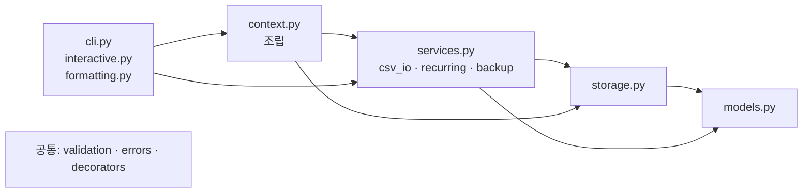
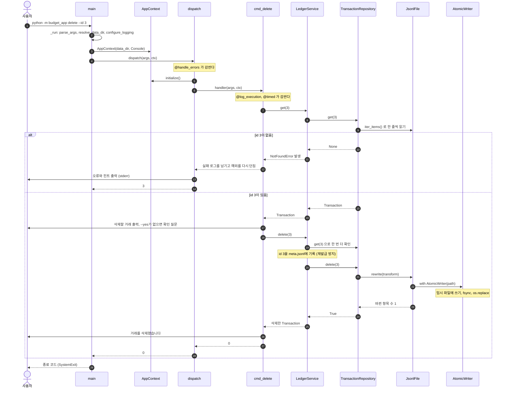

# 01. 계층 구조와 책임 (모델 / 저장소 / 서비스 / CLI)

> 학습 가이드의 첫 문서입니다. 전체 지도를 먼저 보고, 명령 하나가 어떤 파일을 거쳐 실행되는지 끝까지 따라갑니다.
> 문서 목록은 [학습 가이드](README.md)에 있습니다.

## 이 문서에서 배우는 것

- 모델·저장소·서비스·CLI 네 계층이 각각 **무엇을 하고, 무엇을 하지 않는지** 설명할 수 있습니다.
- 의존 방향이 `cli → services → storage → models` 한 방향이라는 것을 직접 확인할 수 있습니다.
- `python -m budget_app delete --id 3` 하나가 `main()`에서 `os.replace`까지 어떻게 흘러가는지 따라갈 수 있습니다.
- 객체 조립(Composition Root)과 의존성 주입(dependency injection)이 왜 필요한지 설명할 수 있습니다.
- 서비스가 `print()` 대신 예외를 던지는 이유를 설명할 수 있습니다.

## 핵심 개념

### 계층은 "바뀌는 이유"로 나눕니다

프로그램을 계층(layer)으로 나눈다는 것은 **바뀌는 이유가 같은 코드끼리** 묶는다는 뜻입니다.

| 계층 | 이 계층이 답하는 질문 | 이 계층을 고치게 되는 때 |
| --- | --- | --- |
| 모델(model) | 거래란 무엇인가? 어떤 값이 올바른가? | 필드를 추가할 때 |
| 저장소(repository) | 데이터를 어디에, 어떤 형식으로 보관하나? | JSONL을 SQLite로 바꿀 때 |
| 서비스(service) | 어떤 규칙으로 처리하나? | "사용 중인 카테고리는 삭제 금지" 같은 규칙이 바뀔 때 |
| CLI(사용자 인터페이스) | 사용자와 어떻게 주고받나? | 옵션 이름, 출력 모양, 질문 순서가 바뀔 때 |

모든 것이 한 파일에 섞여 있으면 출력 문구 하나를 고치다가 저장 코드를 건드리게 됩니다. 나눠 두면 고칠 곳이 한 곳으로 좁혀집니다.

### 작은 예제: 메모장을 네 계층으로 나누기

아래 코드를 `layers_demo.py`로 저장하고 `python3 layers_demo.py`로 실행해 보세요.

```python
from dataclasses import dataclass
from typing import Dict, List, Optional


@dataclass(frozen=True)
class Memo:  # 모델: 데이터와 불변 조건(invariant)만 안다
    id: int
    text: str

    def __post_init__(self) -> None:
        if not self.text:
            raise ValueError("메모 내용이 비어 있습니다")


class MemoRepository:  # 저장소: '어떻게 보관하나'만 안다 (여기서는 dict)
    def __init__(self) -> None:
        self._rows: Dict[int, Memo] = {}

    def add(self, memo: Memo) -> None:
        self._rows[memo.id] = memo

    def get(self, memo_id: int) -> Optional[Memo]:
        return self._rows.get(memo_id)  # 없으면 None. 그게 오류인지는 서비스가 정한다


class MemoNotFound(Exception):
    exit_code = 3


class MemoService:  # 서비스: 규칙만 안다. 출력하지 않고 예외로 알린다
    def __init__(self, repo: MemoRepository) -> None:  # 의존성 주입: 저장소를 밖에서 받는다
        self._repo = repo

    def read(self, memo_id: int) -> Memo:
        memo = self._repo.get(memo_id)
        if memo is None:
            raise MemoNotFound(f"{memo_id}번 메모가 없습니다")
        return memo


def main(argv: List[str]) -> int:  # CLI: 인자 해석, 출력, 종료 코드만 맡는다
    repo = MemoRepository()  # 객체 조립은 한 곳에서 (Composition Root)
    repo.add(Memo(1, "우유 사기"))
    service = MemoService(repo)
    try:
        print(service.read(int(argv[0])).text)
        return 0
    except MemoNotFound as exc:
        print(f"오류: {exc}")
        return exc.exit_code


print("종료 코드", main(["1"]))
print("종료 코드", main(["2"]))
```

```text
우유 사기
종료 코드 0
오류: 2번 메모가 없습니다
종료 코드 3
```

- `MemoRepository.get`은 없으면 `None`만 돌려줍니다. "없는 것이 오류인가"는 **서비스**가 정합니다.
- `MemoService.read`는 아무것도 출력하지 않습니다. 어떻게 보여 줄지와 종료 코드는 `main`이 정합니다.
- `MemoService`는 저장소를 직접 만들지 않고 생성자로 **받습니다**(의존성 주입). 객체를 만들어 끼우는 단 한 곳(`main`의 앞부분)이 **Composition Root**입니다.

### 의존 방향: 위는 아래를 알고, 아래는 위를 모릅니다

`main`은 `MemoService`를, 서비스는 저장소를, 저장소는 `Memo`를 압니다. 반대 방향은 없습니다. 그래서 다음이 가능합니다.

1. **아래 계층을 혼자 테스트하고 재사용**할 수 있습니다. 서비스는 CLI 없이도 돌아갑니다.
2. **위 계층을 바꿔도 아래 계층은 그대로**입니다. CLI를 GUI로 바꿔도 서비스는 고치지 않습니다.
3. **순환 import(circular import)가 생기지 않습니다.** 화살표가 한 방향이면 고리가 생길 수 없습니다.

### 서비스는 왜 `print()` 대신 예외를 던질까요?

위 예제의 `MemoService.read`가 `print("메모가 없습니다")`를 하고 `None`을 돌려준다고 생각해 보세요.

- 호출한 `main`은 실패를 모른 채 `None.text`를 읽다가 엉뚱한 `AttributeError`로 죽습니다. 반환값을 쓰지 않는 호출이었다면 실패를 모른 채 종료 코드 0으로 끝났을 것입니다.
- GUI에서 같은 서비스를 쓰면 그 문구는 대화상자가 아니라 보이지 않는 터미널로 사라집니다.
- 테스트는 stdout을 가로채 문자열을 비교해야만 실패를 알 수 있습니다.

예외는 흐름을 멈추고, 호출자가 반드시 처리하게 만들고, 원인·힌트·종료 코드 같은 정보를 함께 실어 나릅니다.
**무엇이 실패인지는 서비스가 판단하고, 그것을 어떻게 보여 줄지는 호출한 쪽(CLI, GUI, 테스트)이 정합니다.**

## 이 프로젝트에서는

### 모듈 지도

| 모듈 | 계층 | 하는 일 | 하지 않는 일 |
| --- | --- | --- | --- |
| `models.py` | 모델 | `frozen` dataclass, 불변 조건 검사, `to_record()`/`from_record()` | 파일 I/O, JSON 문자열 만들기, 출력 |
| `storage.py` | 저장소 | 파일 하나당 클래스 하나, JSONL 스트리밍 읽기·추가·원자적 재작성 | "없는 id는 오류" 같은 규칙 판단 |
| `services.py` | 서비스 | 거래·카테고리·예산·요약 규칙, 결과 객체 반환, 실패는 예외 | `print`, `input`, argparse, JSON 형식 |
| `csv_io.py`, `recurring.py`, `backup.py` | 서비스(부가 기능) | CSV 가져오기/내보내기, 반복 거래, 백업/복원 | 화면 출력 |
| `validation.py`, `errors.py` | 공통 | 문자열 → 값 검증(`ValidationError`), 예외 계층과 `ExitCode` | 저장, 출력 |
| `decorators.py`, `logconfig.py` | 공통 관심사 | `@handle_errors`, `@log_execution`, `@timed`, 로거 설정 | 비즈니스 규칙 |
| `interactive.py`, `formatting.py` | 사용자 대화 | 묻고 다시 묻기(`Prompter`), 표·요약 **문자열** 만들기 | 저장 형식, 규칙 판단 |
| `cli.py` | CLI | argparse, 명령 핸들러, 출력, 종료 코드 | 규칙 판단, 파일 I/O |
| `context.py` | 조립 | `AppContext`: 저장소 → 서비스 생성·주입, 첫 실행 초기화, `Console` | 규칙 판단 |

화살표(의존 방향)는 한쪽으로만 향합니다. `context.py`는 저장소와 서비스를 직접 만들기 때문에 둘 다 import합니다.
`validation`·`errors`·`decorators`는 여러 계층이 함께 쓰는 공통 모듈이라 그림에서는 화살표 없이 따로 두었습니다.



### 모델: 값과 불변 조건만 압니다

[models.py의 Transaction](../budget_app/models.py)은 거래 한 건을 나타내는 불변(frozen) dataclass입니다.

```python
@dataclass(frozen=True)
class Transaction:
    """거래 내역 한 건."""

    id: int
    type: TransactionType
    date: dt.date
    amount: int
    category: str
    memo: str = ""
    tags: Tuple[str, ...] = ()
    recurring_id: Optional[int] = None  # 반복 규칙으로 자동 생성된 경우 그 규칙의 id
    created_at: str = ""  # 저장 시각 (ISO 8601)

    def __post_init__(self) -> None:
        if self.id <= 0:
            raise ValueError(f"id는 1 이상이어야 합니다: {self.id}")
        if self.amount <= 0:
            raise ValueError(f"금액은 양수여야 합니다: {self.amount}")
        if not self.category:
            raise ValueError("카테고리가 비어 있습니다")
```

- `__post_init__`은 "금액이 0 이하인 거래" 같은 **있을 수 없는 객체가 생기는 것 자체를 막는** 마지막 방어선입니다.
  사람에게 보여 줄 친절한 메시지(원인 + 힌트)는 [validation.py](../budget_app/validation.py)가 따로 맡습니다.
- `to_record()`는 dict까지만 만듭니다. JSON으로 바꾸는 일은 저장소의 `encode_record`가 합니다. 저장 형식을 바꿔도 모델은 그대로입니다.
- `from_record()`는 파일에서 읽은 **믿을 수 없는** dict를 검사하고, 틀리면 `ValueError`/`KeyError`/`TypeError`를 던집니다.
  저장소가 이 예외를 받아 "손상된 줄"로 처리합니다 ([02. 파일 저장소](02-file-storage.md)).
- `models.py`는 패키지 안의 다른 모듈을 하나도 import하지 않습니다. 가장 아래 계층입니다.

### 저장소: 파일 하나에 클래스 하나

`TransactionRepository`(`transactions.jsonl`), `CategoryStore`, `BudgetStore`, `RecurringRuleStore`, `SequenceStore`(`meta.jsonl`, id 발급 기록)
다섯 클래스가 각자 파일 하나를 맡고, 실제 읽기·쓰기는 저수준 클래스 `JsonlFile`에 맡깁니다.
[storage.py의 TransactionRepository.get](../budget_app/storage.py)을 보겠습니다.

```python
    def get(self, tx_id: int) -> Optional[Transaction]:
        for tx in self.iter_all():
            if tx.id == tx_id:
                return tx  # 찾으면 바로 멈춘다. 나머지 줄은 읽지 않는다.
        return None
```

삭제는 `return self.rewrite(first_match(lambda tx: tx.id == tx_id, lambda tx: None)) > 0` 한 줄입니다.
`first_match`는 "조건을 처음 만족하는 항목 하나에만 변경을 적용하는" 변환 함수를 만들어 줍니다. 파일을 직접 고쳐서 같은 id가 두 줄 있어도 `get()`이 보여 준 첫 줄만 지워집니다.

- `get`은 없으면 `None`, `delete`는 지운 것이 없으면 `False`를 돌려줍니다. **"없다"를 오류로 볼지는 저장소가 정하지 않습니다.**
- 저장소가 사용자에게 알리려고 직접 만들어 던지는 예외는 `StorageError`(파일 자리에 폴더가 있음, 쓰기 금지된 파일 등)뿐입니다.
  디스크 오류 같은 `OSError`는 저장소가 잡지 않고 그대로 위로 올려 보냅니다. 비즈니스 규칙은 없습니다.
- 모든 읽기는 제너레이터(`iter_all`)로 한 줄씩 흐릅니다 ([03. 제너레이터와 스트리밍](03-generators-streaming.md)).

### 서비스: 규칙을 지키고, 실패는 예외로 알립니다

[services.py의 LedgerService.get](../budget_app/services.py)은 저장소의 `None`을 "사용자에게 알려야 할 실패"로 바꿉니다.

```python
    def get(self, tx_id: int) -> Transaction:
        tx = self._transactions.get(tx_id)
        if tx is None:
            raise NotFoundError(
                f"id {tx_id}에 해당하는 거래가 없습니다.",
                hint="'list'나 'search' 명령으로 올바른 id를 확인하세요.",
            )
        return tx
```

`LedgerService.delete`도 먼저 `self.get(tx_id)`로 대상을 확인하고, 지운 id가 다시 발급되지 않도록 `SequenceStore`(`meta.jsonl`)에 기록한 뒤
`self._transactions.delete(tx_id)`에 삭제를 맡기고, 지운 거래를 돌려줍니다. "id는 재사용하지 않는다"는 규칙도 서비스가 지킵니다.

종료 코드는 서비스가 고르지 않습니다. [errors.py](../budget_app/errors.py)의 **예외 클래스가** 자기 종료 코드를 가집니다.

```python
class NotFoundError(BudgetAppError):
    """요청한 대상(거래 id, 카테고리, 파일 등)이 없다."""

    exit_code = ExitCode.NOT_FOUND
```

다른 서비스도 같습니다. `CategoryService.remove`는 "사용 중인 카테고리는 대체 카테고리 없이 삭제 금지"를 어기면 `ConflictError`를 던지고,
`CsvService.import_csv`, `RecurringService.apply`, `BackupService.create`는 화면에 쓰는 대신 `ImportReport`, `ApplyReport`, `BackupInfo` 객체를 돌려줍니다.

> 참고: 서비스 모듈들은 `@timed`를 쓰려고 `decorators.py`를 import합니다. 그런데 `decorators.py`에는 CLI 경계용 `@handle_errors`도 있어서
> 타입 힌트용으로 `argparse`를 import합니다. 서비스 **코드**는 argparse를 쓰지 않지만 import 사슬로는 이어져 있습니다.
> 더 엄격하게 나누고 싶다면 `handle_errors`를 `cli.py` 쪽으로 옮기면 됩니다.

### 사용자 계층: 값을 꺼내고, 서비스를 부르고, 보여 줍니다

[cli.py의 cmd_delete](../budget_app/cli.py)는 명령 핸들러의 전형적인 모양입니다.

```python
@log_execution
@timed
def cmd_delete(args: argparse.Namespace, ctx: AppContext) -> int:
    tx = ctx.ledger.get(args.tx_id)
    ctx.console.print("삭제할 거래")
    ctx.console.print(format_transaction(tx))
    if not args.yes and not ctx.prompter().confirm("이 거래를 삭제할까요?", default=False):
        ctx.console.print("삭제를 취소했습니다. 아무것도 바뀌지 않았습니다.")
        return OK
    ctx.ledger.delete(args.tx_id)
    ctx.console.print(f"거래를 삭제했습니다. (id: {tx.id})")
    return OK
```

이미 검증된 값(`args.tx_id`, argparse `type=`에 연결한 `parse_id`가 변환)을 꺼내고, 서비스를 부르고,
`formatting.py`의 `format_transaction`으로 만든 문자열을 `ctx.console`로 출력하고, 종료 코드를 돌려줍니다.
`print()`를 직접 부르지 않으므로 출력 대상을 바꿔 끼울 수 있고, `try/except`가 없으므로 예외는 `dispatch`가 한 곳에서 받습니다.
`interactive.py`의 `Prompter`는 `input` 함수를 생성자로 받아 묻고, `ValidationError`가 나면 원인과 힌트를 보여 준 뒤 다시 묻습니다.

### 조립: `context.py`가 Composition Root입니다

[context.py의 AppContext](../budget_app/context.py)는 명령 한 번 실행에 필요한 객체를 모두 만들어 끼웁니다.

```python
        # 저장소 계층: 파일 하나 = 저장소 하나
        self.transactions = TransactionRepository(data_dir)
        self.categories = CategoryStore(data_dir)
        self.budgets = BudgetStore(data_dir)
        self.recurring_rules = RecurringRuleStore(data_dir)
        self.sequences = SequenceStore(data_dir)

        # 서비스 계층: 저장소를 주입받는다
        self.category_service = CategoryService(self.categories, self.transactions, self.recurring_rules, now=now)
        self.ledger = LedgerService(self.transactions, self.categories, self.sequences, now=now)
        self.budget_service = BudgetService(self.budgets, self.transactions)
        self.reports = ReportService(self.transactions, self.budgets)
        self.csv = CsvService(self.transactions, self.categories, self.sequences, now=now)
        self.recurring = RecurringService(
            self.recurring_rules, self.transactions, self.categories, self.sequences, now=now
        )
        self.backups = BackupService(
            data_dir,
            [path.name for path in self.data_files],
            sequences=self.sequences,
            sequence_keys=[TRANSACTION_SEQUENCE, RULE_SEQUENCE],
            now=now,
        )
```

- 저장소 5개, 서비스 7개가 **여기서만** 만들어집니다. 같은 `TransactionRepository` 객체를 여러 서비스가 함께 씁니다.
- `data_dir`, 시계(`now`, `today`), 입출력(`Console(out, err, input_func)`)이 모두 밖에서 들어옵니다.
  그래서 테스트는 임시 폴더, `io.StringIO`, 가짜 `input`을 넣기만 하면 됩니다 ([09. 테스트 전략](09-testing.md)).
- `BackupService`는 파일 이름 목록과 함께 `SequenceStore`와 id 종류(`sequence_keys`: 거래 id, 반복 규칙 id)도 주입받습니다.
  복원 직전에 지금까지 발급한 id 최댓값을 읽어 두었다가 복원 뒤 다시 기록하므로, 예전 `meta.jsonl`이 복원되어도 이미 쓴 id가 다시 발급되지 않습니다.
- `AppContext.initialize()`는 폴더와 빈 파일을 만들고, 카테고리가 비어 있으면 기본 카테고리를 채웁니다. `dispatch`가 저장소가 필요한 명령에서만 부릅니다.

### 의존 방향을 grep으로 확인하기

아래 계층 세 모듈이 무엇을 import하는지 봅니다 (프로젝트 루트에서 실행한 결과).

```text
$ grep "^from \." budget_app/models.py budget_app/storage.py budget_app/services.py
budget_app/storage.py:from .errors import StorageError
budget_app/storage.py:from .models import Budget, Category, RecurringRule, Transaction, YearMonth
budget_app/services.py:from .decorators import timed
budget_app/services.py:from .errors import ConflictError, NotFoundError, ValidationError
budget_app/services.py:from .models import Budget, Category, Transaction, TransactionType, YearMonth
budget_app/services.py:from .storage import BudgetStore, CategoryStore, RecurringRuleStore, SequenceStore, TransactionRepository
```

`models.py`는 한 줄도 나오지 않습니다. `storage.py`는 `models`와 `errors`만 알고,
`services.py`는 아래 계층(`storage`, `models`)과 공통 모듈(`errors`, `decorators`)만 압니다.
반대로 사용자 계층 모듈을 import하는 파일을 찾으면 맨 위 세 파일만 나옵니다.

```text
$ grep -lE "from \.(cli|context|interactive|formatting) import" budget_app/*.py
budget_app/__main__.py
budget_app/cli.py
budget_app/context.py
```

### 요청 하나 따라가기: `python -m budget_app delete --id 3`



**1. 진입점.** `__main__.py`는 `main()`을 부르고 그 반환값으로 `raise SystemExit(...)` 할 뿐입니다.
[cli.py의 main](../budget_app/cli.py)은 표준 스트림 준비와 끊긴 파이프(`list | head`) 처리만 맡고, 실제 준비는 `_run`이 합니다.
`_run`은 `build_parser().parse_args()`로 인자를 해석한 뒤 다음 순서로 객체를 준비합니다.

```python
    console = Console(out, err, input_func or input)
    try:
        data_dir = resolve_data_dir(getattr(args, "data_dir", None))
    except BudgetAppError as exc:  # dispatch() 전이라 @handle_errors 밖이므로 여기서 직접 알린다.
        console.error(exc.message, exc.hint)
        return int(exc.exit_code)
    configure_logging(
        data_dir / LOG_FILE_NAME,
        err,
        verbose=getattr(args, "verbose", False),
        timing=getattr(args, "timing", False),
    )
    ctx = AppContext(data_dir, console, debug=getattr(args, "debug", False), today=today)
    return dispatch(args, ctx)
```

`input_func or input`에 주목하세요. `input`을 **호출하지 않고 함수 자체를** 넘깁니다. 테스트에서는 여기에 가짜 함수가 들어갑니다.
`today`(기본값 `dt.date.today`)도 `main()`이 받은 함수를 그대로 `AppContext`에 넘깁니다. `add`의 기본 날짜와 `summary`·`budget set`·`recurring apply`의 기본 월이 이 함수에서 나오므로, 테스트는 날짜를 고정할 수 있습니다.
`resolve_data_dir`의 오류(빈 `--data-dir` 등)는 아직 `dispatch` 밖이라 `_run`이 직접 출력합니다. 그 뒤의 모든 오류는 `dispatch`가 맡습니다.

**2. 관문.** [cli.py의 dispatch](../budget_app/cli.py)는 모든 명령이 지나가는 한 곳입니다.

```python
@handle_errors
def dispatch(args: argparse.Namespace, ctx: AppContext) -> int:
    """모든 명령이 지나가는 관문: 저장소를 준비하고 명령 핸들러를 부른다."""
    if args.needs_storage:
        ctx.initialize()
    handler: Handler = args.handler
    return handler(args, ctx)
```

`args.handler`는 `build_parser()`가 `_add_command`로 하위 명령을 만들 때 `set_defaults(handler=...)`로 연결해 둔 함수입니다.
`@handle_errors`는 `BudgetAppError`를 받으면 `ctx.report_error(exc.message, exc.hint, exc)`로 출력하고 `int(exc.exit_code)`를 돌려줍니다 ([04. 데코레이터](04-decorators.md)).

**3. 핸들러와 서비스.** `cmd_delete` → `LedgerService.get` → `LedgerService.delete` 순서입니다. `--yes`가 없으면 `이 거래를 삭제할까요? [y/N]: `를 묻습니다.
거래 파일은 최대 세 번 읽힙니다. `cmd_delete`의 `get`과 `LedgerService.delete` 안의 `get`(둘 다 찾으면 멈춤), 그리고 재작성을 위한 전체 읽기 한 번입니다.

**4. 저장소와 원자적 쓰기.** [storage.py의 JsonlFile.rewrite](../budget_app/storage.py)의 핵심 부분입니다.

```python
        with AtomicWriter(self.path) as writer:
            for raw in self.iter_raw():
                item = self.decode(raw, decoder)
                if item is None:
                    writer.write_line(raw.data)
                    continue
                result = transform(item)
                if result is None:
                    changed += 1
                elif result == item:
                    writer.write_line(raw.data)  # 바뀌지 않은 줄은 원문 그대로 (모르는 필드도 보존)
                else:
                    writer.write_line(encode_record(encoder(result)))
                    changed += 1
```

`TransactionRepository.delete`가 `first_match`로 만들어 넘긴 `transform`은 "처음 만난 id 3이면 `None`(삭제), 나머지는 그대로"입니다.
`rewrite`는 이것이 거래 삭제인지 카테고리 이동인지 **모릅니다.** 어떤 줄을 어떻게 바꿀지는 위 계층이 함수로 넘겨줍니다.
`AtomicWriter`는 같은 폴더의 임시 파일에 쓰고 `fsync` 후 `os.replace`로 교체합니다 ([02. 파일 저장소](02-file-storage.md)).

**5. 실패하면.** id가 없으면 `LedgerService.get`이 `NotFoundError`를 던집니다. `@log_execution`이 "실패" 로그를 남기고 다시 던지고,
`@handle_errors`가 받아 `오류:`/`힌트:` 두 줄을 stderr에 쓰고 3을 돌려줍니다. 핸들러 안에는 이를 위한 코드가 한 줄도 없습니다.

## 왜 이렇게 설계했나

**대안 1: 한 파일짜리 스크립트.** `input()`, 검증, JSON 읽기, `print()`를 한 함수에 쓰는 방법이 가장 빠릅니다.
하지만 사람이 키보드를 쳐야만 실행되므로 자동 테스트가 사실상 불가능하고, "금액은 양수" 검사를 `add`·`update`·`import`에 복사하게 됩니다.
이 프로젝트는 같은 `parse_amount`를 대화형 입력, argparse 옵션, CSV 가져오기가 함께 씁니다.

**대안 2: 서비스가 직접 출력.** `LedgerService.delete`가 `print("없는 id입니다")` 하고 `None`을 돌려주면, 핵심 개념에서 본 문제(호출자가 실패를 모름, GUI에서 문구가 사라짐,
테스트가 stdout을 비교해야 함)가 그대로 생깁니다. 예외를 쓰면 **판단(무엇이 실패인가)은 서비스가, 표현(어떤 문구를 어디에)은 사용자 계층이** 맡습니다.

**대안 3: 저장소가 규칙까지 판단.** `TransactionRepository.add`에서 카테고리 등록 여부를 확인하면 저장소가 `CategoryStore`를 알아야 하고,
SQLite로 바꿀 때 규칙도 옮겨 적어야 합니다. 이 프로젝트에서는 `LedgerService.add`가 `require_category`로 확인합니다.
대화형 흐름(`ask_category`)도 확인하지만 서비스가 **한 번 더** 확인하므로, 다른 입구(예: 나중에 붙일 GUI)로 들어와도 규칙이 지켜집니다.
`ask_category`는 없는 이름을 직접 등록하지 않고 `(이름, 새로 등록할지)` 튜플만 돌려줍니다. 등록은 `cmd_add`가 마지막 저장 확인을 받은 뒤 `CategoryService.add`로 하므로, 저장을 취소하면 카테고리도 생기지 않습니다.

**대안 4: 각자 필요한 객체를 직접 생성.** `LedgerService.__init__`에서 `TransactionRepository(Path("data"))`를 만들면 `--data-dir`를 전달할 길이 없고,
테스트에서 임시 폴더를 쓸 수 없으며, 같은 파일을 여러 객체가 따로 다루게 됩니다. 생성은 `AppContext` 한 곳에 모읍니다.

| 바꾸고 싶은 것 | 손대는 곳 | 그대로 두는 곳 |
| --- | --- | --- |
| 저장 형식 JSONL → SQLite | `storage.py`(같은 메서드로 새 구현), `context.py`(생성 부분), `backup.py`(파일을 zip으로 묶는 방식) | 모델, 서비스의 규칙 코드, CLI, 대화형 입력, 포맷터 |
| GUI 추가 | 새 GUI 모듈 (서비스 호출, `BudgetAppError`를 대화상자로 표시) | 서비스, 저장소, 모델, 검증 |
| 표 모양, 출력 배치 | `formatting.py`, `cli.py` | 서비스 이하 전부 |
| `오류:`/`힌트:` 출력 형식 | `context.py`의 `Console.error` (argparse 사용법 오류는 `cli.py`의 `KoreanArgumentParser.error`, 대화형 재입력 안내는 `interactive.py`의 `Prompter.ask`) | 예외를 던지는 모든 코드 |
| 금액 상한 같은 입력 규칙 | `validation.py` 한 곳 | `add`·`update`·`import`·`budget set`에 자동 적용 |

SQLite 교체가 "storage.py 하나"로 끝나지 않는 이유도 솔직히 적어 둡니다. 서비스의 타입 힌트가 `Protocol`이 아닌 구체 클래스(`TransactionRepository`)를 가리키고,
`CategoryService.remove`는 `rewrite(transform)`을, `CsvService`와 `RecurringService`는 `staged_append()`를 직접 씁니다. 새 구현도 이 메서드들을 같은 의미로 제공해야 합니다.
`BackupService`는 데이터를 파일 이름 목록으로 다루므로 백업 방식도 바뀌어야 합니다.

**이 구조의 대가.** 파일이 많고 호출이 여러 겹입니다. `CategoryService.names()`처럼 저장소를 그대로 부르는 얇은 메서드도 있고,
계층을 지키느라 같은 파일을 여러 번 읽습니다(`delete`는 최대 세 번). 여러 프로세스의 동시 쓰기도 고려하지 않았습니다(README 10장 "알려진 한계").
작은 스크립트라면 과할 수 있지만, 이 과제의 목표는 "예외 상황에서도 데이터가 안전한 작은 서비스"이고, 나눈 덕분에 155개 테스트가 사람 없이 1~2초 안에 돕니다.

## 직접 해 보기

모든 명령은 프로젝트 루트에서 실행합니다. 실습 데이터는 `/tmp/budget-lab`에 둡니다.

**1. 실습 데이터 준비**

```bash
rm -rf /tmp/budget-lab
```

```bash
python3 -m budget_app --data-dir /tmp/budget-lab import --from examples/sample_transactions.csv
```

```text
안내: 저장 파일을 새로 만들었습니다: transactions.jsonl, categories.jsonl, budgets.jsonl, recurring.jsonl, meta.jsonl (위치: ...)
안내: 카테고리가 비어 있어 기본 카테고리를 만들었습니다: food, transport, rent, utilities, shopping, health, salary, etc
가져오기 완료: 전체 11행 중 11건을 추가했습니다 (id 1~11).
'list' 명령으로 가져온 거래를 확인하세요.
```

**2. 의존 방향 검사**: 위 "의존 방향을 grep으로 확인하기"의 grep 두 개를 직접 실행해 보고, 모든 모듈을 `ast`로 한 번에 검사합니다.

```bash
python3 - <<'EOF'
import ast, pathlib

# 숫자가 작을수록 아래 계층이다. 위 계층 → 아래 계층 방향의 import만 허용한다.
RANK = {"__init__": 0, "errors": 0, "models": 0,
        "validation": 1, "storage": 1, "decorators": 1, "logconfig": 1,
        "services": 2, "csv_io": 3, "recurring": 3, "backup": 3,
        "formatting": 4, "interactive": 4, "context": 5, "cli": 6, "__main__": 7}

violations = 0
for path in sorted(pathlib.Path("budget_app").glob("*.py")):
    me, deps, io_calls = path.stem, set(), set()
    for node in ast.walk(ast.parse(path.read_text(encoding="utf-8"))):
        if isinstance(node, ast.ImportFrom) and node.level == 1:  # from .x import ...
            deps.add(node.module or "__init__")
        if isinstance(node, ast.Call) and isinstance(node.func, ast.Name) and node.func.id in ("print", "input"):
            io_calls.add(node.func.id)
    bad = sorted(d for d in deps if RANK[d] >= RANK[me])
    violations += len(bad)
    shown = ", ".join(sorted(deps, key=lambda d: (RANK[d], d))) or "-"
    print(f"{me:11} ({RANK[me]}) -> {shown}" + (f"  [직접 호출: {', '.join(sorted(io_calls))}]" if io_calls else ""))
print("위반 개수:", violations)
EOF
```

```text
__init__    (0) -> -
__main__    (7) -> cli
...
context     (5) -> errors, logconfig, storage, services, backup, csv_io, recurring, interactive  [직접 호출: print]
...
interactive (4) -> errors, validation, services, recurring  [직접 호출: print]
...
services    (2) -> errors, models, decorators, storage
storage     (1) -> errors, models
validation  (1) -> errors, models
위반 개수: 0
```

`print()`를 직접 부르는 곳은 `context.py`(`Console`과 `AppContext.report_error`의 `--debug` 출력)와 `interactive.py`(`Prompter.say`)뿐이고,
`input()`을 직접 호출하는 곳은 없습니다. `cli.py`의 `_run`은 `input`을 부르지 않고 함수 자체를 `Console`에 넘길 뿐입니다.

**3. 요청 하나를 로그로 따라가기**

```bash
python3 -m budget_app --data-dir /tmp/budget-lab delete --id 3 --yes --verbose
```

```text
로그: 시작 cmd_delete {'command': 'delete', 'data_dir': '/tmp/budget-lab', 'tx_id': 3, 'yes': True, 'verbose': True}, <AppContext>
삭제할 거래
  id       : 3
  ...
거래를 삭제했습니다. (id: 3)
로그: cmd_delete 실행 시간: 0.44ms
로그: 완료 cmd_delete -> 0
```

`시작` → (핸들러 출력) → `실행 시간` → `완료` 순서는 `@log_execution`이 바깥, `@timed`가 안쪽에서 감싼 순서 그대로입니다. 시간 숫자는 매번 다릅니다.
`로그:` 줄은 stderr, 나머지는 stdout으로 나갑니다. 위 순서는 터미널에서 실행했을 때입니다. 출력을 `| cat`이나 파일로 보내면 stdout이 한꺼번에 버퍼링되어 `로그:` 세 줄이 먼저 보일 수 있습니다.
`ls -a /tmp/budget-lab`로 보면 임시 파일(`.transactions.jsonl.*.tmp`)은 남아 있지 않습니다.

**4. 실패 경로 확인**

```bash
python3 -m budget_app --data-dir /tmp/budget-lab delete --id 3 --yes
```

```text
오류: id 3에 해당하는 거래가 없습니다.
힌트: 'list'나 'search' 명령으로 올바른 id를 확인하세요.
```

바로 이어서 `echo $?`를 실행하면 `3`이 나옵니다. `tail -3 /tmp/budget-lab/app.log`의 마지막 줄에는 `실패 cmd_delete: NotFoundError: ...`가 남습니다.

**5. CLI 없이 서비스만 쓰기**: GUI나 웹이 서비스를 재사용하는 모습을 흉내 냅니다. argparse도 핸들러도 거치지 않습니다.

```bash
python3 -c "
import io
from pathlib import Path
from budget_app.context import AppContext, Console
from budget_app.errors import NotFoundError
from budget_app.models import YearMonth

ctx = AppContext(Path('/tmp/budget-lab'), Console(io.StringIO(), io.StringIO(), input))
summary = ctx.reports.monthly_summary(YearMonth(2026, 10), top=3)
print('수입', summary.income, '/ 지출', summary.expense, '/ 잔액', summary.balance)
for item in summary.top_expenses:
    print(' ', item.category, item.amount)
try:
    ctx.ledger.get(999)
except NotFoundError as exc:
    print(type(exc).__name__, int(exc.exit_code), exc.message)
"
```

```text
수입 3250000 / 지출 840850 / 잔액 2409150
  rent 650000
  utilities 82000
  food 46500
NotFoundError 3 id 999에 해당하는 거래가 없습니다.
```

서비스는 숫자가 담긴 객체(`MonthlySummary`)와 예외만 돌려줍니다. "3,250,000원"처럼 꾸미는 일은 `formatting.py`의 몫입니다.

**6. 새 명령 `stats` 추가하기**: 전체·수입·지출 건수를 보여 주는 명령을 만들며 **어느 계층을 고칠지** 정해 봅니다.
먼저 스스로 답해 보세요. 답: `services.py`(건수를 세는 규칙)와 `cli.py`(명령 등록, 핸들러, 출력)만 고칩니다.
`storage.py`는 `iter_all()`로 충분하고, `models.py`에는 새 데이터 구조가 없고, `context.py`에는 `LedgerService`가 이미 조립되어 있습니다.
원본을 지키기 위해 복사본에서 실습합니다.

```bash
rm -rf /tmp/budget-src && mkdir -p /tmp/budget-src && cp -R budget_app tests examples /tmp/budget-src/
```

`/tmp/budget-src/budget_app/services.py`의 `LedgerService` 안, `require_category` 메서드 바로 앞에 추가합니다.
(프로젝트 스타일대로라면 `ListResult`처럼 결과용 dataclass를 만드는 편이 더 좋습니다. 여기서는 짧게 튜플로 돌려줍니다.)

```python
    def stats(self) -> Tuple[int, int, int]:
        """(전체, 수입, 지출) 건수. 거래 파일을 한 번만 스트리밍한다."""
        total = income = 0
        for tx in self._transactions.iter_all():
            total += 1
            if tx.type is TransactionType.INCOME:
                income += 1
        return total, income, total - income
```

`/tmp/budget-src/budget_app/cli.py`의 `build_parser()`에서 `# search ---` 주석 바로 앞에 한 줄을 넣고,

```python
    _add_command(sub, "stats", common, help="거래 건수 통계", handler=cmd_stats)
```

같은 파일에서 `cmd_search` 위에 붙은 데코레이터(`@log_execution`)보다 앞에 핸들러를 추가합니다. 데코레이터와 `def` 사이에 끼워 넣으면 안 됩니다.

```python
@log_execution
@timed
def cmd_stats(args: argparse.Namespace, ctx: AppContext) -> int:
    total, income, expense = ctx.ledger.stats()
    ctx.console.print(f"전체 {total}건 (수입 {income}건 / 지출 {expense}건)")
    return OK
```

실행합니다. 3번 실습에서 3번 거래를 지웠으므로 10건입니다.

```bash
(cd /tmp/budget-src && python3 -m budget_app --data-dir /tmp/budget-lab stats --timing)
```

```text
전체 10건 (수입 3건 / 지출 7건)
cmd_stats 실행 시간: 0.10ms
```

`--help`, `--timing`, 오류 처리, 실행 로그를 따로 쓰지 않았는데 저절로 붙었습니다. `_add_command`, 데코레이터, `dispatch` 덕분입니다.
더 해 보기: `stats`에 `--month` 옵션을 붙인다면 검증은 어디서 하나요? (힌트: `summary`의 `--month`가 어떻게 정의되어 있는지 보세요.)

## 자주 하는 실수

- **서비스에서 `print()`로 실패를 알리고 `None`을 돌려주기.** 호출한 쪽은 실패를 모르고 종료 코드 0으로 끝납니다. 예외를 던지세요.
- **서비스 안에서 `input()`으로 되묻기.** 서비스를 GUI나 테스트에서 쓸 수 없습니다. 묻는 일은 `interactive.py`가, 서비스는 완성된 값(`TransactionDraft`)을 받습니다.
- **검증을 대화형 흐름에만 넣기.** CSV 같은 다른 입구로 들어온 값이 검사를 건너뜁니다. 검증 함수는 `validation.py`에 두고, 규칙은 서비스가 다시 확인합니다.
- **모델에 `json.dumps()`나 파일 경로 넣기.** 저장 형식을 바꿀 때 모델까지 고쳐야 합니다. 모델은 dict(`to_record`)까지만 만듭니다.
- **아래 계층에서 위 계층 import하기.** `storage.py`에 `from .cli import main`을 넣으면 실행하자마자 이렇게 실패합니다.

  ```text
  ImportError: cannot import name 'main' from partially initialized module 'budget_app.cli' (most likely due to a circular import) (...)
  ```

- **객체를 아무 데서나 생성하기.** 서비스 안에서 `TransactionRepository(Path("data"))`를 만들면 `--data-dir`가 무시됩니다. 생성은 `AppContext`에서만 합니다.
- **핸들러마다 `try/except` 복사하기.** 예외를 메시지와 종료 코드로 바꾸는 일은 `dispatch`의 `@handle_errors` 한 곳에서 합니다.

## 정리

- [ ] 모델·저장소·서비스·CLI가 각각 무엇을 하고 무엇을 하지 않는지 설명할 수 있다
- [ ] `cli → services → storage → models` 의존 방향을 grep이나 `ast`로 확인하는 방법을 설명할 수 있다
- [ ] `delete --id 3`이 `main → dispatch → cmd_delete → LedgerService → TransactionRepository → JsonlFile.rewrite → AtomicWriter`로 흐르는 과정을 설명할 수 있다
- [ ] 저장소는 `None`/`False`를 돌려주고 서비스가 그것을 `NotFoundError`로 바꾸는 이유를 설명할 수 있다
- [ ] `AppContext`가 Composition Root로서 무엇을 만들고 무엇을 주입하는지 설명할 수 있다
- [ ] JSONL을 SQLite로 바꾸거나 GUI를 붙일 때 어느 파일을 고치는지 설명할 수 있다

## 스스로 설명해 보기

1. `TransactionRepository.get`은 왜 예외 대신 `None`을 돌려주고, 누가 그것을 오류로 바꾸나요?
2. `LedgerService.add`가 `print()`를 쓴다면 테스트와 GUI에서 각각 어떤 문제가 생기나요?
3. `main()`이 `input_func`를 인자로 받고 `_run()`이 `input_func or input`처럼 함수 자체를 넘기는 것은 어떤 설계 원칙이고, 무엇이 쉬워지나요?
4. `delete --id 999`의 종료 코드 3은 어느 파일의 어느 값에서 오고, 어떤 경로로 `main()`까지 전달되나요?
5. 새 명령을 하나 추가할 때 손대지 않아도 되는 계층은 어디이고, 그 이유는 무엇인가요?
