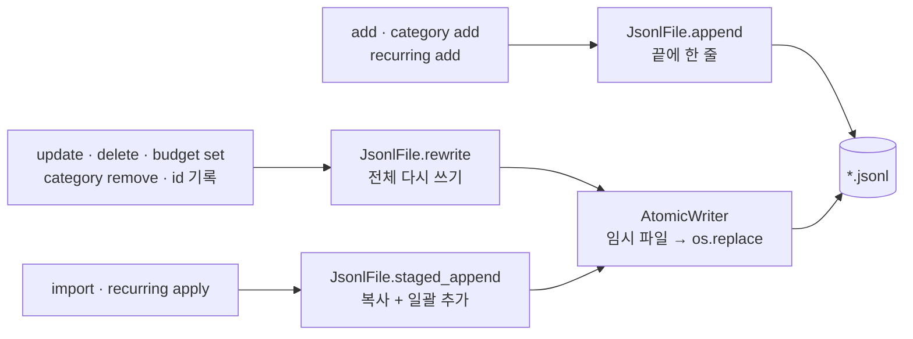
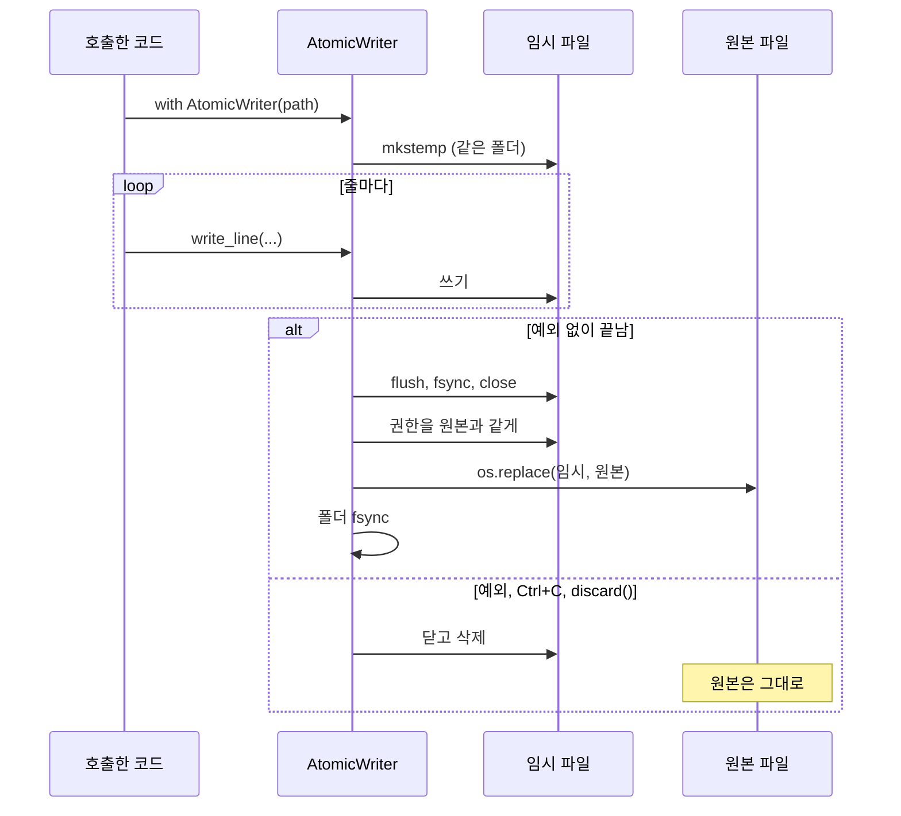

# 02. 파일 저장소: JSONL, 원자적 쓰기, 데이터 안전

과제는 '작은 서비스'를 "예외 상황에서도 데이터가 안전한 것"이라고 정의합니다.
이 문서는 가계부 데이터가 **어떤 모양으로 저장되는지**, 그리고 **프로그램이 중간에 죽어도 왜 깨지지 않는지**를
[storage.py](../budget_app/storage.py)를 중심으로 설명합니다.
제너레이터 자체는 [03. 제너레이터와 스트리밍](03-generators-streaming.md)에서 자세히 다룹니다.

## 이 문서에서 배우는 것

- 저장 형식으로 JSONL을 고른 이유를 CSV, JSON 파일 하나와 비교해서 설명할 수 있다.
- "끝에 한 줄 추가(append)"와 "전체 다시 쓰기(rewrite)" 두 쓰기 경로가 각각 무엇으로 데이터를 지키는지 설명할 수 있다.
- 임시 파일 → `fsync` → `os.replace` 순서로 하는 원자적 쓰기(atomic write)의 각 단계가 왜 필요한지 설명할 수 있다.
- 손상된 줄, 끊긴 마지막 줄, 모르는 필드를 이 프로젝트가 어떻게 다루는지 설명할 수 있다.
- `meta.jsonl`의 id 최댓값 기록과 "기록 먼저, 데이터 나중" 순서가 id 중복을 어떻게 막는지 설명할 수 있다.

## 핵심 개념

### JSONL: 한 줄에 JSON 객체 하나

JSONL(JSON Lines)은 **한 줄 = JSON 객체 하나**인 텍스트 형식입니다. 줄마다 독립된 JSON이 있으므로
줄 단위로 추가하고 줄 단위로 읽을 수 있습니다.

```python
import json

# JSONL 파일 만들기: 한 줄에 객체 하나
with open("demo.jsonl", "w", encoding="utf-8") as f:
    f.write(json.dumps({"id": 1, "amount": 12000}) + "\n")
    f.write(json.dumps({"id": 2, "amount": 8500, "memo": "카페"}, ensure_ascii=False) + "\n")

# 추가: 기존 줄은 건드리지 않고 끝에 한 줄만 붙인다
with open("demo.jsonl", "a", encoding="utf-8") as f:
    f.write(json.dumps({"id": 3, "amount": 1450}) + "\n")

# 읽기: 한 줄씩 (파일 전체를 메모리에 올리지 않는다)
with open("demo.jsonl", encoding="utf-8") as f:
    for line in f:
        obj = json.loads(line)
        print(obj["id"], obj["amount"], obj.get("memo", "(메모 없음)"))
```

```text
1 12000 (메모 없음)
2 8500 카페
3 1450 (메모 없음)
```

마지막 줄의 `obj.get("memo", 기본값)`이 **스키마 확장(schema evolution)**의 핵심입니다. 줄마다 키가 달라도 되므로,
새 버전이 `memo` 필드를 추가해도 `memo`가 없는 예전 줄을 기본값으로 읽을 수 있습니다.

`json.dumps`는 문자열 안의 줄바꿈을 `\n`이라는 두 글자로 바꿔 씁니다. 그래서 레코드 하나는 언제나 **물리적인 한 줄**에 들어갑니다.
한글은 `ensure_ascii=False`를 줘야 그대로 저장됩니다.

```python
import json

record = {"id": 1, "memo": "점심\n김치찌개", "tags": ["점심"]}
print(json.dumps(record))
print(json.dumps(record, ensure_ascii=False))
```

```text
{"id": 1, "memo": "\uc810\uc2ec\n\uae40\uce58\ucc0c\uac1c", "tags": ["\uc810\uc2ec"]}
{"id": 1, "memo": "점심\n김치찌개", "tags": ["점심"]}
```

### 저장 형식 비교

| 비교 항목 | JSONL | CSV | JSON 파일 하나 (`[{...}, {...}]`) |
| --- | --- | --- | --- |
| 한 건 추가 | 끝에 한 줄 붙이기 | 끝에 한 줄 붙이기 | 전체를 읽고 전체를 다시 써야 함 |
| 한 건씩 읽기 (스트리밍) | 쉬움 (`for line in f`) | 쉬움 (`csv.reader`) | 표준 `json` 모듈은 전체를 한 번에 파싱 |
| 한 줄이 깨지면 | 그 줄만 건너뛸 수 있음 | 따옴표가 깨지면 뒤쪽 줄까지 영향 | 파일 전체를 못 읽음 |
| 타입 | 정수, 문자열, 목록 그대로 | 모두 문자열 | 정수, 문자열, 목록 그대로 |
| 필드 추가 | 새 줄에만 넣으면 됨 | 헤더와 모든 줄의 열 수를 맞춰야 함 | 새 객체에만 넣으면 됨 |
| 엑셀로 열기 | 불편 | 편함 | 불편 |

이 프로젝트는 **저장은 JSONL**, 사람이 엑셀과 주고받는 **교환은 CSV**로 나눴습니다([07. CSV 가져오기와 내보내기](07-csv-import-export.md)).

### 파일을 바로 덮어쓰면 위험한 이유

`open(path, "w")`는 파일을 여는 **그 순간 내용을 0바이트로 자릅니다**. 그 뒤에 쓰다가 실패하면 앞부분만 남습니다.

```python
import json

with open("ledger.jsonl", "w", encoding="utf-8") as f:
    f.write('{"id": 1}\n{"id": 2}\n{"id": 3}\n')

def unsafe_save(path, records):
    with open(path, "w", encoding="utf-8") as f:  # 이 순간 기존 내용이 0바이트로 잘린다
        for r in records:
            f.write(json.dumps(r) + "\n")

try:
    unsafe_save("ledger.jsonl", [{"id": 1}, {"id": 2, "bad": {1, 2}}, {"id": 3}])  # set은 JSON으로 못 바꾼다
except TypeError as exc:
    print("실패:", exc)

with open("ledger.jsonl", encoding="utf-8") as f:
    print(repr(f.read()))
```

```text
실패: Object of type set is not JSON serializable
'{"id": 1}\n'
```

세 줄이던 파일이 한 줄이 됐습니다. 예외 대신 Ctrl+C나 전원 차단이었어도 결과는 같습니다.

### 원자적 쓰기: 임시 파일에 쓰고 한 번에 바꾸기

해결책은 **원본은 그대로 두고 새 파일을 따로 완성한 뒤, 이름만 한 번에 바꾸는 것**입니다.

```python
import json
import os
import tempfile

with open("ledger.jsonl", "w", encoding="utf-8") as f:
    f.write('{"id": 1}\n{"id": 2}\n{"id": 3}\n')

def safe_save(path, records):
    folder = os.path.dirname(os.path.abspath(path))
    fd, tmp = tempfile.mkstemp(dir=folder, suffix=".tmp")  # 같은 폴더에 임시 파일
    try:
        with os.fdopen(fd, "w", encoding="utf-8") as f:
            for r in records:
                f.write(json.dumps(r) + "\n")
            f.flush()
            os.fsync(f.fileno())  # 디스크에 실제로 기록
        os.replace(tmp, path)  # 한 번에 교체 (원자적)
    except BaseException:
        os.unlink(tmp)  # 실패하면 임시 파일만 버린다
        raise

try:
    safe_save("ledger.jsonl", [{"id": 1}, {"id": 2, "bad": {1, 2}}, {"id": 3}])
except TypeError as exc:
    print("실패:", exc)

with open("ledger.jsonl", encoding="utf-8") as f:
    print(repr(f.read()))
print([name for name in os.listdir(".") if name.endswith(".tmp")])
```

```text
실패: Object of type set is not JSON serializable
'{"id": 1}\n{"id": 2}\n{"id": 3}\n'
[]
```

| 단계 | 이유 |
| --- | --- |
| 임시 파일을 **같은 폴더**에 만든다 | `os.replace`는 같은 파일 시스템 안에서만 원자적입니다. 다른 파일 시스템(예: 다른 디스크의 `/tmp`)이면 `EXDEV` 오류로 실패합니다. |
| `flush()` 다음 `os.fsync()` | `flush()`는 파이썬 버퍼를 운영체제로 넘길 뿐입니다. `fsync()`를 해야 디스크에 기록됩니다. 기록 전에 이름을 바꾸면, 전원이 나갔을 때 "이름은 새 파일인데 내용은 빈" 상태가 될 수 있습니다. |
| `os.replace(tmp, path)` | 대상이 있어도 덮어쓰는 이름 바꾸기입니다. 다른 프로그램은 "예전 파일" 아니면 "완성된 새 파일"만 봅니다. (`os.rename`은 윈도우에서 대상이 있으면 실패합니다.) |
| 폴더 `fsync` (POSIX) | 이름 바꾸기는 **폴더 내용**을 바꾸는 일입니다. 폴더도 `fsync`해야 그 변경이 디스크에 확정됩니다. |

### 바이트로 읽고 줄마다 따로 해석하기

텍스트 모드는 UTF-8이 아닌 바이트를 만나면 반복 전체가 실패합니다. 바이트 모드로 읽고 줄마다 해석하면 문제 있는 줄만 건너뛸 수 있습니다.

```python
import json

with open("mixed.jsonl", "wb") as f:
    f.write(b'{"id": 1}\n\xff\xfe broken\n{"id": 3}\n')

try:
    with open("mixed.jsonl", encoding="utf-8") as f:  # 텍스트 모드
        for line in f:
            print(json.loads(line))
except UnicodeDecodeError as exc:
    print("텍스트 모드: 한 줄도 못 읽고 실패 ->", type(exc).__name__)

with open("mixed.jsonl", "rb") as f:  # 바이트 모드: 줄마다 따로 해석
    for lineno, raw in enumerate(f, start=1):
        try:
            print(lineno, json.loads(raw.decode("utf-8")))
        except ValueError:  # UnicodeDecodeError, JSONDecodeError 모두 ValueError의 하위 클래스
            print(lineno, "건너뜀:", raw)
```

```text
텍스트 모드: 한 줄도 못 읽고 실패 -> UnicodeDecodeError
1 {'id': 1}
2 건너뜀: b'\xff\xfe broken\n'
3 {'id': 3}
```

## 이 프로젝트에서는

### 다섯 개의 데이터 파일

아래 실습의 준비 단계를 실행한 뒤 실제 파일에서 본 한 줄씩입니다(`recurring.jsonl`만은 `recurring add`로 "매월 25일 월급" 규칙을 추가한 뒤의 모습).
모두 UTF-8 JSONL이고, 저장소 클래스 하나가 파일 하나를 맡습니다.

| 파일 | 저장소 클래스 | 한 줄 모양 (실제 파일) |
| --- | --- | --- |
| `transactions.jsonl` | `TransactionRepository` | `{"id": 1, "type": "income", "date": "2026-09-25", "amount": 3200000, "category": "salary", "memo": "9월 급여", "tags": ["월급"], "created_at": "2026-10-19T00:46:29"}` |
| `categories.jsonl` | `CategoryStore` | `{"name": "food", "created_at": "2026-10-19T00:46:29"}` |
| `budgets.jsonl` | `BudgetStore` | `{"month": "2026-10", "amount": 900000}` |
| `recurring.jsonl` | `RecurringRuleStore` | `{"id": 1, "day": 25, "type": "income", "amount": 3200000, "category": "salary", "memo": "월급", "tags": [], "created_at": "..."}` |
| `meta.jsonl` | `SequenceStore` | `{"key": "transaction", "value": 11}` |

`recurring.jsonl`은 `recurring add` 전에는 빈 파일입니다. 반복 거래로 만든 거래에는 `"recurring_id"`가 더 붙습니다.
`meta.jsonl`에는 거래 id(`transaction`)와 반복 규칙 id(`recurring_rule`)의 최댓값이 키마다 한 줄씩 들어갑니다.

다섯 저장소는 모두 안쪽에서 [storage.py의 JsonlFile](../budget_app/storage.py) 하나를 씁니다.
읽기, 추가, 다시 쓰기, 손상된 줄 처리 규칙은 `JsonlFile` 한곳에만 있습니다. 쓰기 경로는 세 가지입니다.



### 읽기: iter_raw와 decode

[storage.py의 JsonlFile.iter_raw](../budget_app/storage.py)는 파일을 **바이트 모드**로 열고 한 줄씩 `yield`합니다.

```python
        try:
            handle = open(self.path, "rb")
        except FileNotFoundError:
            return
        with handle:  # 제너레이터가 끝나거나 닫히면(close) 파일도 닫힌다.
            for lineno, line in enumerate(handle, start=1):
                data = line.rstrip(b"\r\n")
                if lineno == 1 and data.startswith(_UTF8_BOM):
                    data = data[len(_UTF8_BOM) :]
                if data.strip():
                    yield RawLine(lineno, data)
```

- `rstrip(b"\r\n")`: 윈도우 편집기로 저장해 줄 끝이 `\r\n`이어도 읽힙니다. 첫 줄의 BOM(`EF BB BF`)도 떼어 내고, 빈 줄은 건너뜁니다.
- 줄 번호(`lineno`)와 **원문 바이트(`data`)**를 함께 넘깁니다. 줄 번호는 경고 메시지에, 원문은 손상된 줄을 보존하는 데 씁니다.

[storage.py의 JsonlFile.decode](../budget_app/storage.py)는 한 줄을 객체로 바꾸고, 실패하면 경고를 남긴 뒤 `None`을 돌려줍니다.

```python
    def decode(self, raw: RawLine, decoder: Decoder[T]) -> Optional[T]:
        """한 줄을 객체로 바꾼다. 읽을 수 없으면 경고를 남기고 None."""
        try:
            obj = json.loads(raw.data.decode(ENCODING))
            if not isinstance(obj, dict):
                raise ValueError("JSON 객체({...}) 형태가 아닙니다")
            return decoder(obj)
        # JSON/UTF-8 오류는 ValueError의 하위 클래스다. RecursionError는 지나치게 깊이 중첩된 JSON에서 난다.
        except (ValueError, KeyError, TypeError, RecursionError) as exc:
            self._warn_corrupt(raw, exc)
            return None
```

`decoder`는 `Transaction.from_record` 같은 모델 메서드입니다. 모델은 파일 내용을 믿지 않고 필드 타입을 하나씩 검사해서,
틀리면 `ValueError`/`KeyError`/`TypeError`를 던집니다. 그래서 JSON 문법은 맞아도 `"date": "2026-02-30"`처럼 값이 틀린 줄도 손상된 줄로 처리됩니다.
`[[[[...`처럼 수만 겹으로 중첩된 줄은 `json.loads`가 `RecursionError`를 내는데, 이것도 같은 방식으로 "손상된 줄"이 됩니다.
같은 줄의 경고는 `_warn_corrupt`가 한 번 실행하는 동안 한 번만 출력합니다.

[models.py의 Transaction.from_record](../budget_app/models.py)는 선택 필드가 없으면 기본값으로 읽습니다(스키마 확장).

```python
        recurring_id = record.get("recurring_id")
        return cls(
            id=_get_int(record, "id"),
            type=_get_type(record),
            date=parse_iso_date(_get_str(record, "date")),
            amount=_get_int(record, "amount"),
            category=_get_str(record, "category"),
            memo=_get_str(record, "memo", default=""),
            tags=_get_tags(record),
            recurring_id=None if recurring_id is None else _get_int(record, "recurring_id"),
            created_at=_get_str(record, "created_at", default=""),
        )
```

반대로 `to_record`는 `recurring_id`가 없으면 그 키를 쓰지 않습니다. 반복 거래 기능 전후의 줄이 한 파일에 섞여 있어도 됩니다.

### 쓰기 경로 1: 끝에 한 줄 추가 (JsonlFile.append)

`add`, `category add`, `recurring add`는 기존 줄을 건드리지 않고 끝에 한 줄만 붙입니다.

```python
    def append(self, record: Mapping[str, Any]) -> None:
        """레코드 한 줄을 파일 끝에 추가한다. 기존 줄은 건드리지 않는다."""
        payload = encode_record(record) + b"\n"  # 직렬화를 먼저 끝내서 실패하면 아무것도 쓰지 않는다.
        self.ensure()
        if self._needs_leading_newline():
            # 이전 실행이 마지막 줄을 쓰다가 끊겼다면 그 줄과 붙지 않게 줄을 바꾼다.
            payload = b"\n" + payload
        # 버퍼 없이(buffering=0) 열어서, 쓰다가 실패하면 늘어난 부분을 잘라 내고 원래 길이로 되돌린다.
        with open(self.path, "ab", buffering=0) as handle:
            start = handle.seek(0, os.SEEK_END)
            try:
                remaining = memoryview(payload)
                while remaining:
                    written = handle.write(remaining)
                    remaining = remaining[written:]
                os.fsync(handle.fileno())
            except BaseException:
                try:
                    os.ftruncate(handle.fileno(), start)
                except OSError:
                    pass
                raise
```

1. **직렬화 먼저**: `encode_record`(`json.dumps(..., ensure_ascii=False)`를 UTF-8 바이트로 바꾼 값)가 실패하면 파일을 열기도 전에 끝납니다.
2. **끊긴 마지막 줄 보정**: 파일이 줄바꿈 없이 끝나 있으면 새 줄 앞에 `\n`을 붙입니다. 그렇지 않으면 새 레코드가 깨진 조각에 붙어 함께 망가집니다. (실습 3)
3. **버퍼 없이 끝까지 쓰고 fsync**: `buffering=0`으로 열면 `write`가 운영체제에 바로 넘깁니다. 이때 `write`는 일부만 쓰고 쓴 바이트 수를 돌려줄 수 있으므로,
   `memoryview`로 남은 부분을 잘라 가며 다 쓸 때까지 반복합니다. 그다음 `fsync`로 디스크에 기록한 뒤에야 "저장했습니다"를 출력합니다.
4. **실패하면 원래 길이로 되돌리기**: 쓰기 전 파일 길이(`start`)를 기억해 두었다가, 쓰는 도중 예외(디스크 가득 참 같은 `OSError`, Ctrl+C의 `KeyboardInterrupt`)가 나면
   `os.ftruncate`로 그 길이까지 잘라 내고 예외를 다시 던집니다. 버퍼 없이 여는 이유도 여기에 있습니다. 버퍼가 있으면 잘라 낸 뒤 파일을 닫을 때
   버퍼에 남은 조각이 다시 써질 수 있습니다.

추가는 파일 크기와 상관없이 빠릅니다. 하지만 4번은 `except`가 실행될 때만 동작합니다. 강제 종료(`kill -9`)나 전원 차단으로
`write` 도중 프로세스가 사라지면 반쯤 쓴 줄이 남을 수 있고, 그래서 다음 실행의 2번 보정이 필요합니다.

### 쓰기 경로 2: 전체 다시 쓰기 (JsonlFile.rewrite + AtomicWriter)

JSONL의 한 줄은 길이가 제각각이라, 가운데 한 줄만 그 자리에서 고칠 수 없습니다. 수정·삭제는 파일 전체를 새로 씁니다.
[storage.py의 JsonlFile.rewrite](../budget_app/storage.py) 본문입니다.

```python
        self.ensure()
        changed = 0
        with AtomicWriter(self.path) as writer:
            for raw in self.iter_raw():
                item = self.decode(raw, decoder)
                if item is None:
                    writer.write_line(raw.data)
                    continue
                result = transform(item)
                if result is None:
                    changed += 1
                elif result == item:
                    writer.write_line(raw.data)  # 바뀌지 않은 줄은 원문 그대로 (모르는 필드도 보존)
                else:
                    writer.write_line(encode_record(encoder(result)))
                    changed += 1
            for item in extra:
                writer.write_line(encode_record(encoder(item)))
                changed += 1
            if changed == 0:
                writer.discard()
        return changed
```

- `transform`이 `None`을 돌려주면 삭제, 같은 값이면 **원문 바이트 그대로**, 다른 값이면 새로 직렬화합니다.
  `TransactionRepository.delete`는 `first_match(lambda tx: tx.id == tx_id, lambda tx: None)`을 넘길 뿐입니다.
  [storage.py의 first_match](../budget_app/storage.py)는 조건을 **처음** 만족하는 항목에만 변경을 적용하는 `transform`을 만들어 줍니다.
  그래서 손으로 편집하다 같은 id가 두 줄이 되어도, `get()`이 보여 준 첫 줄만 지워지거나 바뀝니다.
- **손상된 줄(`item is None`)도 원문 그대로 옮겨 적습니다.** 읽을 수 없다고 지우면 사용자가 고칠 기회도 없이 데이터가 사라집니다.
- 바뀌지 않은 줄을 원문으로 쓰므로, 이 버전이 모르는 필드(미래 버전이 추가한 필드 등)도 그 줄에서는 보존됩니다.
- `extra`는 끝에 덧붙일 항목입니다. `BudgetStore.upsert`, `SequenceStore.commit`이 "기존 줄 삭제 + 새 줄 추가"를 한 번에 할 때 씁니다.
- 바뀐 것이 없으면 `discard()`로 임시 파일을 버립니다. 원본은 수정 시각조차 바뀌지 않습니다.
- 읽기와 쓰기가 모두 한 줄씩이라 메모리 사용량은 파일 크기와 상관없습니다.

실제 교체는 [storage.py의 AtomicWriter](../budget_app/storage.py)가 맡습니다. `__enter__`에서 `tempfile.mkstemp(dir=대상 폴더, prefix=".transactions.jsonl.", suffix=".tmp")`처럼
**같은 폴더**에 점으로 시작하는(그래서 `ls`에 안 보이는) 임시 파일을 만듭니다. 블록을 나갈 때 `__exit__`이 교체하거나 버립니다.
그 밖에 두 가지를 먼저 확인합니다. `__init__`은 대상이 심볼릭 링크면 `os.path.realpath`로 **링크가 가리키는 실제 파일**을 교체 대상으로 삼고,
`__enter__`는 대상 파일에 쓰기 권한이 없으면(`chmod a-w`로 잠근 파일) `StorageError`를 냅니다. `os.replace`는 읽기 전용 파일도 바꿔 버리기 때문입니다.

```python
        committed = False
        try:
            if exc_type is None and not self._discarded:
                stream.flush()
                os.fsync(stream.fileno())  # 디스크에 실제로 기록된 뒤에 교체한다.
                stream.close()
                _apply_permissions(tmp_path, self.target)
                os.replace(tmp_path, self.target)
                committed = True
                _fsync_directory(self.target.parent)
        finally:
            if not stream.closed:
                try:
                    stream.close()
                except OSError:
                    pass  # 이미 실패한 쓰기(디스크 가득 참 등)를 닫다가 난 오류: 원래 예외를 가리지 않는다.
            if not committed:
                try:
                    tmp_path.unlink()
                except OSError:
                    pass
```



- `finally` 덕분에 예외뿐 아니라 `KeyboardInterrupt`(Ctrl+C)에서도 임시 파일이 지워집니다.
- `finally` 안에서 닫기·지우기가 다시 `OSError`를 내면 무시합니다. 그래야 사용자에게 원래 원인(예: 디스크 가득 참)이 그대로 전달됩니다.
- `mkstemp`는 파일을 `0600`(나만 읽기/쓰기) 권한으로 만듭니다. 그대로 교체하면 원본 권한이 바뀌므로 `_apply_permissions`가 원본 권한을 복사합니다
  (원본이 없으면 umask 기본값). 이 단계는 실패해도 데이터에 영향이 없어 오류를 무시합니다. `_fsync_directory`는 POSIX(맥, 리눅스)에서만 동작합니다.

### 쓰기 경로 3: 전부 아니면 전무 추가 (staged_append)

여러 건을 추가할 때 `append`를 반복하면, 중간에 멈췄을 때 일부만 들어갑니다.
[storage.py의 JsonlFile.staged_append](../budget_app/storage.py)는 **기존 내용을 임시 파일에 복사하고, 새 항목을 그 뒤에 쓴 다음, 블록이 정상적으로 끝날 때만 교체**합니다.

```python
        self.ensure()
        with AtomicWriter(self.path) as writer:
            self._copy_into(writer)
            staged = StagedAppend(writer, encoder)
            yield staged
            if staged.count == 0:
                writer.discard()
```

- `_copy_into`는 `shutil.copyfileobj`로 고정 크기 버퍼씩 바이트 그대로 복사합니다. 손상된 줄과 모르는 필드가 모두 보존되고, 마지막 줄에 줄바꿈이 없으면 여기서도 보정합니다.
- 블록 안에서 예외가 나면 `yield` 자리에서 예외가 다시 일어나고, 바깥의 `AtomicWriter`가 임시 파일을 버립니다.
- 쓰는 곳은 `CsvService.import_csv`(`--dry-run`이 아닐 때)와 `RecurringService.apply` 두 군데입니다.
- 대가: 몇 건만 추가해도 기존 파일 전체를 한 번 복사합니다. 메모리는 일정하지만 디스크 I/O는 파일 크기에 비례합니다.

### id 발급: SequenceStore와 "기록 먼저, 데이터 나중"

거래 id를 "현재 최대 id + 1"로만 정하면, **가장 큰 id를 지운 뒤 같은 번호가 다시 나옵니다.**
내보낸 CSV나 메모에 "id 12는 삭제함"이라고 적어 둔 기록과 새 거래가 헷갈립니다.
그래서 [storage.py의 SequenceStore](../budget_app/storage.py)가 `meta.jsonl`에 **지금까지 발급한 최댓값(high-water mark)**을 남깁니다.

```python
    def next_value(self, key: str, *, floor: int = 0) -> int:
        """다음에 발급할 번호. ``floor``는 실제 데이터에 이미 있는 최대 번호다.

        meta 파일이 사라졌거나 실제 데이터보다 뒤처져 있어도, 데이터의 최댓값보다
        큰 번호를 내주므로 id가 겹치지 않는다.
        """
        return max(self.current(key), floor) + 1

    def commit(self, key: str, last_value: int) -> None:
        """``last_value``까지 발급했음을 기록한다. 기록된 값은 줄어들지 않는다."""
        value = max(self.current(key), last_value)
        self._file.rewrite(
            SequenceEntry.from_record,
            lambda e: None if e.key == key else e,
            SequenceEntry.to_record,
            extra=[SequenceEntry(key, value)],
        )
```

`commit`은 해당 키의 줄을 지우고 끝에 새 줄을 추가하므로, 기록할 때마다 그 키가 파일의 마지막 줄로 옮겨 갑니다.
백업 복원도 이 "줄어들지 않는다" 규칙을 지킵니다. [backup.py의 BackupService.restore](../budget_app/backup.py)는 복원 전의 발급 최댓값을 기억해 두었다가
복원이 끝나면 다시 `commit`하므로, 예전 `meta.jsonl`이 되돌아와도 이미 발급한 id가 다시 나가지 않습니다([08. 보너스 기능](08-bonus-features.md)).
[services.py의 LedgerService.add](../budget_app/services.py)는 `next_value(..., floor=self._transactions.max_id())`로 번호를 정한 뒤, **id를 먼저 기록하고 거래는 그다음에 추가**합니다.

```python
        # id 발급을 먼저 기록한다. 그 사이에 멈추면 번호 하나가 비지만, 같은 id가 두 번 나오지는 않는다.
        self._sequences.commit(TRANSACTION_SEQUENCE, new_id)
        self._transactions.add(tx)
```

[services.py의 LedgerService.delete](../budget_app/services.py)도 같은 원칙으로, 거래 줄을 지우기 **전에** 지울 id를 `commit`합니다.
meta가 사라졌거나 뒤처져 있어도, 앱으로 지운 번호는 이렇게 기록에 남으므로 다시 발급되지 않습니다.

순서를 거꾸로 하면, 거래를 쓴 뒤 기록하기 전에 멈췄을 때 meta가 실제 데이터보다 **뒤처집니다**. `floor` 덕분에 바로 중복이 나지는 않고,
앱의 `delete`도 지울 id를 먼저 기록하므로 대부분은 메워집니다. 하지만 그 거래 줄을 손으로 지우거나 줄이 손상되어 읽히지 않으면 같은 번호가 다시 나갈 수 있습니다.
"기록 먼저"면 meta는 언제나 실제로 쓴 id 이상이므로, 최악의 경우가 **번호 하나가 비는 것(gap)**뿐입니다.

### 여러 파일에 걸친 명령: 순서로 지키는 일관성

`AtomicWriter`는 **파일 하나**를 원자적으로 바꿉니다. 여러 파일을 한꺼번에 원자적으로 바꾸는 방법은 없으므로,
여러 파일을 고치는 명령은 **어느 지점에서 멈춰도 모순이 없는 순서**로 씁니다. [services.py의 CategoryService.remove](../budget_app/services.py)의 대체 카테고리 처리입니다.

```python
        target = replace_with
        # 순서가 중요하다: 내역을 먼저 옮기고 카테고리를 마지막에 지운다. 중간에 멈춰도
        # '카테고리가 하나 더 남아 있는' 안전한 상태가 되고, 어떤 거래도 없는 카테고리를 가리키지 않는다.
        moved_tx = self._transactions.rewrite(
            lambda tx: replace(tx, category=target) if tx.category == name else tx
        )
        moved_rules = self._rules.rewrite(
            lambda rule: replace(rule, category=target) if rule.category == name else rule
        )
        self._categories.remove(name)
```

카테고리를 먼저 지우면, 멈췄을 때 "등록되지 않은 카테고리를 가리키는 거래"가 남고, `category remove`로도 정리할 수 없게 됩니다.

### 어느 순간에 프로그램이 죽으면 파일 상태는?

"죽는다"에는 두 종류가 있습니다.

- **예외나 Ctrl+C**: `finally`가 실행됩니다. 임시 파일은 지워지고 원본은 그대로입니다.
- **강제 종료(`kill -9`)나 전원 차단**: `finally`가 실행되지 않습니다. `os.replace`는 "했거나 안 했거나" 둘 중 하나라 원본은 안전하지만,
  `.파일이름.<임의>.tmp`가 남을 수 있습니다. 프로그램은 이 파일을 읽지도, 자동으로 지우지도 않으므로 직접 지우면 됩니다. (실습 7)

| 명령 (쓰는 순서) | 멈춘 시점 | 남는 상태 | 다시 실행하면 |
| --- | --- | --- | --- |
| `add` (① meta 기록 → ② 거래 append) | ① 전 또는 도중 | 아무것도 안 바뀜 (meta 재작성은 원자적) | 그대로 다시 하면 됨 |
| | ① 후, ② 전 | meta만 1 늘어남 | 번호 하나가 빔. 중복 없음 (실습 8) |
| | ② 도중 (예외, Ctrl+C) | `ftruncate`로 원래 길이로 되돌림. meta만 1 늘어남 | 번호 하나가 빔. 중복 없음 |
| | ② 도중 (전원 차단) | 마지막 줄이 반쯤 남을 수 있음 | 그 줄은 경고 후 건너뜀. 다음 추가는 줄을 바꿔 씀 (실습 3) |
| `update` (거래 파일 재작성) | `os.replace` 전 | 원본 그대로 (강제 종료면 임시 파일이 남을 수 있음) | 그대로 다시 하면 됨 (실습 6, 7) |
| | `os.replace` 후 | 새 파일 완성 | 끝 |
| `delete` (① meta 기록 → ② 거래 파일 재작성) | ① 후, ② 전 | 거래는 그대로, 지울 id만 meta에 기록됨 | 그대로 다시 하면 됨 |
| | ② `os.replace` 후 | 새 파일 완성 | 끝 |
| `import` (① 임시 파일에 복사·추가 → ② 새 카테고리 append → ③ meta 기록 → ④ 거래 파일 교체) | ① 도중 | 원본 그대로 | 그대로 다시 하면 됨 |
| | ② 후, ③ 전 | 쓰이지 않는 카테고리만 늘어남 (`--create-categories`일 때) | 다시 가져오면 됨 |
| | ③ 후, ④ 전 | id 범위만 비어 있음 | 다시 가져오면 그다음 번호부터 |
| `category remove X --replace-with Y` (① 거래 → ② 반복 규칙 → ③ 카테고리) | ① 후, ② 전 | 거래는 Y, 규칙은 아직 X, 카테고리 X는 남음 | 같은 명령을 다시 실행하면 나머지를 마저 처리 |
| | ② 후, ③ 전 | X는 남아 있지만 아무도 안 씀 | 같은 명령 또는 `category remove X` |

어느 행에서든 "모든 거래가 등록된 카테고리를 가리킨다", "id가 겹치지 않는다"는 규칙이 지켜집니다.
`import`의 순서는 [csv_io.py의 CsvService.import_csv](../budget_app/csv_io.py)에 주석으로 적혀 있습니다([07. CSV](07-csv-import-export.md) 참고).

## 왜 이렇게 설계했나

**JSONL을 고른 이유.** CSV는 모든 값이 문자열이라 태그 목록 같은 값에 별도 규칙이 필요하고, 손으로 고치다 따옴표 하나가 빠지면 뒤쪽 줄의 해석까지 달라집니다.
JSON 파일 하나는 한 건만 추가해도 전체를 다시 써야 하고, 한 글자만 깨져도 전체를 못 읽습니다.
JSONL은 줄 단위 추가, 스트리밍, 부분 손상 격리, 필드 추가가 모두 쉽습니다. 표준 라이브러리 `sqlite3`도 있지만,
과제가 JSONL/CSV 파일 저장과 스트리밍 원리를 직접 다루는 것을 요구하므로 쓰지 않았습니다.

**추가와 재작성을 나눈 이유.** 모든 쓰기를 재작성으로 하면 단순하지만 거래 하나를 추가할 때마다 파일 전체를 복사합니다.
가장 자주 쓰는 `add`는 `append`로 빠르게 하고, 그 대신 생길 수 있는 "끊긴 마지막 줄"을 보정 코드로 처리합니다.

**fsync의 비용.** `fsync`는 디스크 기록을 기다리므로 느립니다. 한 사람이 쓰는 콘솔 도구는 쓰기 횟수가 적어서,
"저장했습니다"라는 메시지가 거짓이 되지 않는 쪽을 택했습니다.

**손상된 줄 정책.**

| 정책 | 결과 |
| --- | --- |
| 손상된 줄이 있으면 오류로 멈춤 | 줄 하나 때문에 프로그램 전체를 못 씀 |
| 읽을 때 버리고, 다시 쓸 때도 빠뜨림 | 사용자 모르게 데이터가 사라짐 |
| **경고하고 건너뛰되, 다시 쓸 때 원문 보존** (이 프로젝트) | 프로그램은 계속 쓸 수 있고, 사용자가 나중에 직접 고칠 수 있음 |

**staged_append가 파일을 통째로 복사하는 이유.** "일단 append하고 실패하면 잘라 내기(truncate)"는 `append`가 한 줄을 쓸 때 실제로 쓰는 방법입니다.
하지만 잘라 내기는 `except`가 실행될 때만 동작하므로, 여러 건을 쓰는 도중 강제 종료나 전원 차단이 오면 일부 행만 들어간 상태가 그대로 남습니다.
복사 후 교체는 느리지만 `AtomicWriter` 하나로 "전부 아니면 전무"가 보장됩니다.

**알려진 한계.**

- 파일 잠금이 없습니다. 두 프로세스가 동시에 쓰면 한쪽의 재작성이 다른 쪽의 추가를 덮어쓸 수 있습니다 (README 10장).
- 강제 종료로 남은 `.tmp` 파일은 자동으로 지우지 않습니다.
- 재작성할 때 **바뀐 줄**은 모델 기준으로 새로 직렬화하므로, 그 줄의 모르는 필드는 사라집니다.
- 끊긴 마지막 줄 보정은 새 줄이 붙지 않게 할 뿐, 깨진 조각을 지우지 않습니다. 조각은 지울 때까지 계속 경고가 나옵니다.
- `meta.jsonl`을 지우면 `floor` 덕분에 지금 있는 id와 겹치지는 않지만, 이미 삭제한 최대 id가 다시 쓰일 수 있습니다.

## 직접 해 보기

프로젝트 루트에서 실행합니다. 시각, inode 숫자, 임시 파일 이름은 실행할 때마다 다릅니다.

**준비**: 실습용 폴더를 새로 만들고 샘플 거래와 예산을 넣습니다.

```bash
rm -rf /tmp/budget-lab
```

```bash
python3 -m budget_app --data-dir /tmp/budget-lab import --from examples/sample_transactions.csv
```

```bash
python3 -m budget_app --data-dir /tmp/budget-lab budget set --month 2026-10 --amount 900000
```

**1. 다섯 파일 열어 보기**: `ls -a /tmp/budget-lab`를 하면 `app.log`와 `*.jsonl` 다섯 개가 보입니다.

```bash
cat /tmp/budget-lab/categories.jsonl /tmp/budget-lab/budgets.jsonl /tmp/budget-lab/meta.jsonl
```

```text
{"name": "food", "created_at": "2026-10-19T00:46:29"}
...
{"name": "etc", "created_at": "2026-10-19T00:46:29"}
{"month": "2026-10", "amount": 900000}
{"key": "transaction", "value": 11}
```

**2. 손상된 줄 만들기**: 3번째 줄(id 3)의 마지막 `}`를 지워서, 손으로 편집하다 실수한 상황을 만듭니다.

```bash
python3 -c "p = '/tmp/budget-lab/transactions.jsonl'; lines = open(p, encoding='utf-8').read().splitlines(); lines[2] = lines[2][:-1]; open(p, 'w', encoding='utf-8').write('\n'.join(lines) + '\n')"
```

```bash
python3 -m budget_app --data-dir /tmp/budget-lab list --limit 3
```

```text
경고: transactions.jsonl 3번째 줄을 읽을 수 없어 건너뜁니다 (JSON 형식 오류). 이 줄은 파일을 다시 쓸 때도 원문 그대로 보존됩니다.
ID | 날짜       | 구분 | 카테고리 |        금액 | 메모      | 태그
...
전체 10건 중 최신 3건을 표시했습니다. (--limit으로 개수를 바꿀 수 있습니다)
```

11건이 아니라 10건입니다. 이제 다른 거래를 지워서 파일을 **다시 쓰게** 만들고, 3번째 줄을 확인합니다.

```bash
python3 -m budget_app --data-dir /tmp/budget-lab delete --id 10 --yes
```

```bash
sed -n 3p /tmp/budget-lab/transactions.jsonl
```

```text
{"id": 3, "type": "expense", "date": "2026-10-02", "amount": 12000, "category": "food", "memo": "점심 김치찌개", "tags": ["점심", "회사"], "created_at": "2026-10-19T00:46:29"
```

다시 썼는데도 깨진 줄이 같은 자리에 그대로 있습니다. `}`를 되돌려 고친 뒤 검색하면 id 3이 다시 보입니다.

```bash
python3 -c "p = '/tmp/budget-lab/transactions.jsonl'; lines = open(p, encoding='utf-8').read().splitlines(); lines[2] = lines[2] + '}'; open(p, 'w', encoding='utf-8').write('\n'.join(lines) + '\n')"
```

```bash
python3 -m budget_app --data-dir /tmp/budget-lab search --q 김치찌개
```

```text
검색 조건: 메모에 '김치찌개' 포함
...
 3 | 2026-10-02 | 지출 | food     | 12,000원 | 점심 김치찌개 | #점심 #회사

조건에 맞는 거래 1건
```

**3. 끊긴 마지막 줄**: 쓰다가 전원이 나간 것처럼 줄바꿈 없는 조각을 끝에 붙인 뒤, 거래를 추가합니다(입력은 파이프로 넣습니다).

```bash
printf '{"type": "expense", "da' >> /tmp/budget-lab/transactions.jsonl
```

```bash
printf '2026-10-20\nexpense\nfood\n3000\n편의점\n\n\n' | python3 -m budget_app --data-dir /tmp/budget-lab add
```

```text
...
이 내용으로 저장할까요? [Y/n]: 경고: transactions.jsonl 11번째 줄을 읽을 수 없어 건너뜁니다 (JSON 형식 오류). ...
거래를 저장했습니다. (id: 12)
[주의] 2026-10 예산의 94.1%를 사용했습니다. (남은 예산 52,650원)
```

```bash
tail -n 2 /tmp/budget-lab/transactions.jsonl
```

```text
{"type": "expense", "da
{"id": 12, "type": "expense", "date": "2026-10-20", "amount": 3000, "category": "food", "memo": "편의점", "tags": [], "created_at": "2026-10-19T00:46:29"}
```

새 거래가 조각과 다른 줄에 들어갔습니다. 조각은 자동으로 지워지지 않으니 직접 지웁니다(`}`로 끝나는 줄만 남깁니다).

```bash
python3 -c "p = '/tmp/budget-lab/transactions.jsonl'; lines = open(p, encoding='utf-8').read().splitlines(); open(p, 'w', encoding='utf-8').write('\n'.join(l for l in lines if l.endswith('}')) + '\n')"
```

**4. 지운 id는 다시 쓰지 않는다**: 가장 큰 id 12를 지우고 새로 추가합니다.

```bash
python3 -m budget_app --data-dir /tmp/budget-lab delete --id 12 --yes
```

```bash
printf '2026-10-21\nexpense\nfood\n4000\n\n\n\n' | python3 -m budget_app --data-dir /tmp/budget-lab add
```

출력에 `거래를 저장했습니다. (id: 13)`이 나오고(그 뒤에 예산 사용률 안내가 이어집니다), `cat /tmp/budget-lab/meta.jsonl`은 `{"key": "transaction", "value": 13}`입니다.

**5. 임시 파일, inode, 권한**: `ls -a /tmp/budget-lab | grep tmp`가 아무것도 출력하지 않으면 남은 임시 파일이 없는 것입니다.
이제 inode 번호(파일의 실제 정체)와 권한을 봅니다.

```bash
python3 -c "import os; s = os.stat('/tmp/budget-lab/transactions.jsonl'); print(s.st_ino, oct(s.st_mode & 0o777))"
```

```text
4159757 0o644
```

거래를 하나 추가(추가 경로)한 뒤 위 명령을 다시 실행하면 inode가 **같습니다**.

```bash
printf '2026-10-22\nexpense\nfood\n5000\n\n\n\n' | python3 -m budget_app --data-dir /tmp/budget-lab add > /dev/null
```

이번에는 권한을 바꾼 뒤 삭제(재작성 경로)하고 다시 확인합니다.

```bash
chmod 640 /tmp/budget-lab/transactions.jsonl
```

```bash
python3 -m budget_app --data-dir /tmp/budget-lab delete --id 14 --yes > /dev/null
```

`os.stat` 명령을 다시 실행하면 inode는 **바뀌고**(새 파일로 교체됨) 권한은 `0o640`으로 유지됩니다.

```text
4159763 0o640
```

**6. 교체 실패 흉내 내기**: `unittest.mock`으로 `os.replace`가 "디스크 공간 부족" 오류를 내게 만든 뒤, id 3의 금액을 바꿔 봅니다.
여기서는 `delete` 대신 `update`를 씁니다. `update`는 거래 파일 하나만 다시 쓰지만, `delete`는 meta부터 기록하므로 첫 `os.replace`가 `meta.jsonl` 교체가 되기 때문입니다.

```bash
python3 -c "
from unittest import mock
from budget_app.cli import main
with mock.patch('budget_app.storage.os.replace', side_effect=OSError(28, 'No space left on device')):
    code = main(['--data-dir', '/tmp/budget-lab', 'update', '--id', '3', '--amount', '13000'])
print('종료 코드:', code)
"
```

```text
오류: 파일을 처리하다가 문제가 생겼습니다: No space left on device
힌트: 경로가 맞는지, 쓰기 권한과 디스크 여유 공간이 있는지 확인하세요.
종료 코드: 5
```

`search --q 김치찌개`로 id 3이 여전히 12,000원인지, `ls -a /tmp/budget-lab | grep tmp`로 임시 파일이 없는지 확인합니다.

**7. 강제 종료 흉내 내기**: 교체 직전에 `os._exit`로 프로세스를 즉시 끝냅니다. `finally`가 실행되지 않습니다.

```bash
python3 -c "
import os
from unittest import mock
from budget_app.cli import main
with mock.patch('budget_app.storage.os.replace', side_effect=lambda *args: os._exit(9)):
    main(['--data-dir', '/tmp/budget-lab', 'update', '--id', '3', '--amount', '13000'])
"
```

```bash
ls -a /tmp/budget-lab | grep tmp
```

```text
.transactions.jsonl.nynkoq1f.tmp
```

임시 파일이 남았지만 `search --q 김치찌개`를 하면 id 3은 여전히 12,000원입니다. 남은 임시 파일은 지웁니다.

```bash
rm /tmp/budget-lab/.transactions.jsonl.*.tmp
```

**8. "기록 먼저"의 효과**: id를 기록한 직후, 거래를 쓰기 직전에 Ctrl+C가 눌린 상황을 만듭니다.

```bash
python3 -c "
from unittest import mock
from budget_app.cli import main
answers = iter(['2026-10-23', 'expense', 'food', '6000', '', '', 'y'])
with mock.patch('budget_app.storage.TransactionRepository.add', side_effect=KeyboardInterrupt):
    code = main(['--data-dir', '/tmp/budget-lab', 'add'], input_func=lambda prompt: next(answers))
print('종료 코드:', code)
"
```

```text
...
오류: 사용자가 작업을 중단했습니다.
힌트: 저장 파일은 파일마다 '임시 파일 → 교체' 방식으로 써서 반쯤 쓴 파일은 남지 않습니다. 여러 파일을 바꾸는 명령은 먼저 끝난 파일까지만 반영될 수 있지만, 순서를 정해 두어 데이터가 서로 어긋나지 않습니다.
종료 코드: 130
```

```bash
cat /tmp/budget-lab/meta.jsonl
```

```text
{"key": "transaction", "value": 15}
```

meta는 15인데 거래 파일에는 15가 없습니다. 실습 4의 `add` 명령을 다시 실행하면 `id: 16`이 나옵니다. 15번이 비었을 뿐 겹치지 않습니다.

**더 해 보기**: `python3 -m unittest tests.test_storage -v`를 실행해 보고, `AtomicWriterTest`와 `JsonlFileTest`의 각 테스트가 위의 어떤 실습과 같은지 짝지어 보세요.

## 자주 하는 실수

- **`open(path, "w")`로 바로 덮어쓰기**: 여는 순간 파일이 0바이트가 됩니다. 수정·삭제는 임시 파일 → 교체로 합니다.
- **임시 파일을 다른 폴더(`/tmp` 등)에 만들기**: 파일 시스템이 다르면 `os.replace`가 실패합니다. 대상과 같은 폴더에 만듭니다.
- **`flush()`만 하고 `fsync()`를 빼먹기**: 프로그램은 저장했다고 생각해도, 전원이 나가면 운영체제 캐시의 내용은 사라집니다.
- **버퍼가 있는 파일에서 `ftruncate`로 되돌리기**: 잘라 낸 뒤 파일을 닫을 때 버퍼에 남은 바이트가 다시 써집니다. 그래서 `append`는 `buffering=0`으로 엽니다.
- **`ensure_ascii`를 기본값으로 두기**: 한글이 `\uc810\uc2ec`처럼 저장됩니다. 동작은 하지만 사람이 읽고 고치기 어렵습니다.
- **텍스트 모드로 통째로 읽기**: UTF-8이 아닌 바이트가 한 줄만 있어도 반복 전체가 실패합니다.
- **읽을 수 없는 줄을 버리고 다시 쓰기**: 사용자 모르게 데이터가 사라집니다.
- **"모르는 필드는 항상 보존된다"고 생각하기**: 보존되는 것은 바뀌지 않은 줄뿐입니다.
- **`meta.jsonl`을 쓸모없는 파일로 보고 지우기**: 이미 지운 최대 id가 다시 쓰일 수 있습니다.
- **여러 파일을 고치는 명령의 순서를 아무렇게나 정하기**: 파일 하나는 원자적이어도 명령 전체는 아닙니다. "중간에 멈춰도 모순이 없는" 순서를 고릅니다.

## 정리

- [ ] JSONL, CSV, JSON 파일 하나의 장단점을 추가·스트리밍·손상·필드 추가 관점에서 비교해 설명할 수 있다.
- [ ] 다섯 데이터 파일의 이름과 한 줄 모양, 각각을 맡는 저장소 클래스를 설명할 수 있다.
- [ ] `JsonlFile.append`의 네 가지 안전장치(직렬화 먼저, 줄바꿈 보정, 끝까지 쓰고 fsync, 실패하면 원래 길이로 되돌리기)를 설명할 수 있다.
- [ ] `AtomicWriter`가 같은 폴더에 임시 파일을 만들고, fsync 후 `os.replace`하고, 폴더를 fsync하는 이유를 설명할 수 있다.
- [ ] `JsonlFile.rewrite`가 손상된 줄과 바뀌지 않은 줄을 원문 그대로 쓰는 이유를 설명할 수 있다.
- [ ] `staged_append`가 "전부 아니면 전무"를 보장하는 방법과 그 비용을 설명할 수 있다.
- [ ] `meta.jsonl`의 high-water mark와 `floor`, "기록 먼저, 데이터 나중" 순서가 무엇을 막는지 설명할 수 있다.
- [ ] 예외/Ctrl+C와 강제 종료/전원 차단에서 남는 파일 상태의 차이를 설명할 수 있다.

## 스스로 설명해 보기

1. 거래 수정 도중 Ctrl+C를 눌렀습니다. `transactions.jsonl`은 어떤 상태이고, 코드의 어느 부분 덕분인가요?
2. 누군가 `transactions.jsonl`을 편집하다 한 줄을 깨뜨렸습니다. `list`와 `delete`를 실행하면 각각 무슨 일이 일어나고, 그 줄은 결국 어떻게 되나요?
3. `add`가 거래를 쓰기 전에 `meta.jsonl`부터 기록하는 이유를, 순서를 바꿨을 때 생기는 문제로 설명해 보세요.
4. CSV 100건을 가져올 때 `append`를 100번 부르지 않고 `staged_append`를 쓰는 이유와 그 대가는 무엇인가요?
5. `category remove food --replace-with etc`가 세 파일을 고치는 순서와, 그 순서가 아니면 생기는 문제를 설명해 보세요.
