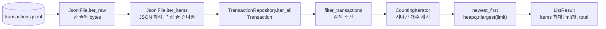
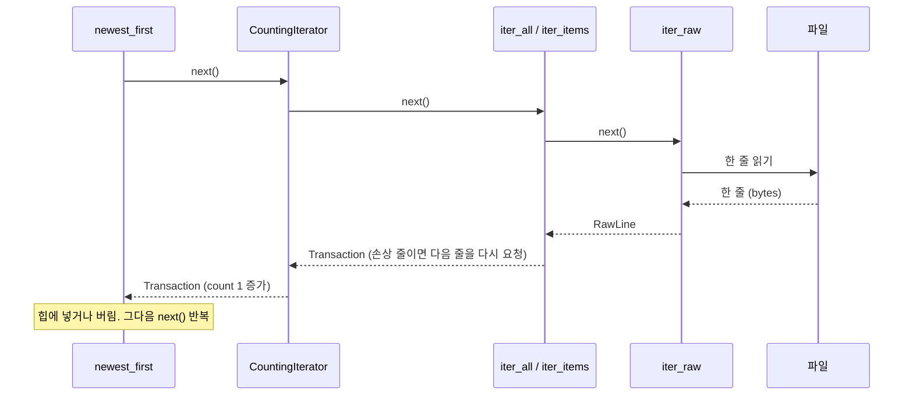

# 03. 제너레이터와 스트리밍 처리

거래가 20만 건 쌓여도 `list --limit 5`는 거래가 없을 때와 거의 같은 메모리로 끝납니다. 그 비결이 **제너레이터(generator)** 입니다.
이 문서에서는 작은 예제로 개념을 익히고, 이 프로젝트의 읽기 파이프라인을 따라간 뒤, 큰 파일을 만들어 메모리를 직접 재 봅니다.

## 이 문서에서 배우는 것

- 이터러블(iterable), 이터레이터(iterator), 제너레이터의 차이와 `next()`, `StopIteration`의 역할
- `yield`가 함수를 멈췄다가 다시 이어 가는 방식, 제너레이터 표현식, `yield from`, 한 번만 쓸 수 있다는 성질
- `iter_raw → iter_items → iter_all → filter_transactions → CountingIterator → newest_first` 파이프라인이 메모리를 일정하게 쓰는 이유
- 제너레이터를 중간에 버리면 파일이 언제, 어떻게 닫히는지와 이 프로젝트가 일부러 리스트를 만드는 곳
- 20만 줄 파일로 "스트리밍 vs 전부 읽기"를 직접 재 보고 숫자로 설명하기

## 핵심 개념

### 이터러블, 이터레이터, 제너레이터

| 용어 | 뜻 | 예 |
| --- | --- | --- |
| 이터러블(iterable) | `iter()`에 넣으면 이터레이터를 돌려주는 객체입니다. `for` 문에 쓸 수 있습니다. | `list`, `dict`, `str`, `range`, 파일 객체 |
| 이터레이터(iterator) | `next()`를 부를 때마다 값을 하나씩 내주고, 다 내주면 `StopIteration`을 던집니다. | `iter([1, 2])`, 파일 객체, 제너레이터 |
| 제너레이터(generator) | `yield`가 들어 있는 함수를 호출하면 만들어지는 이터레이터입니다. | `count_up(3)`, `(x * 2 for x in data)` |

`for x in obj:`는 내부적으로 `it = iter(obj)`로 이터레이터를 꺼낸 뒤, `StopIteration`이 날 때까지 `next(it)`를 부릅니다.

```python
it = iter([10, 20])          # 리스트(이터러블)에서 이터레이터를 꺼낸다
print(next(it), next(it))
try:
    next(it)
except StopIteration:
    print("StopIteration: 더 꺼낼 값이 없습니다")
```

```text
10 20
StopIteration: 더 꺼낼 값이 없습니다
```

### `yield`: 멈췄다가 이어 가는 함수

`yield`가 있는 함수는 호출해도 본문이 실행되지 않고 **제너레이터 객체만** 만들어집니다.
`next()`를 부를 때마다 다음 `yield`까지만 실행하고 멈춥니다. 지역 변수와 "어디까지 실행했는지"는 그대로 보존됩니다.

```python
def count_up(limit):
    print("  [gen] 시작")
    n = 1
    while n <= limit:
        print(f"  [gen] yield {n} 직전")
        yield n
        print(f"  [gen] yield {n} 다음 줄에서 재개")
        n += 1
    print("  [gen] 끝 (함수가 반환되면 StopIteration)")

gen = count_up(2)
print("만들기만 했습니다:", type(gen).__name__)
print("next ->", next(gen))
print("next ->", next(gen))
try:
    next(gen)
except StopIteration:
    print("StopIteration")
```

```text
만들기만 했습니다: generator
  [gen] 시작
  [gen] yield 1 직전
next -> 1
  [gen] yield 1 다음 줄에서 재개
  [gen] yield 2 직전
next -> 2
  [gen] yield 2 다음 줄에서 재개
  [gen] 끝 (함수가 반환되면 StopIteration)
StopIteration
```

`"[gen] 시작"`은 `count_up(2)`를 부를 때가 아니라 첫 `next()` 때 찍힙니다. 필요할 때까지 계산을 미루는 이 성질을 **지연 평가(lazy evaluation)** 라고 합니다.
값을 하나씩 요청받아 만들기 때문에, 원하는 값을 찾은 뒤 `break`하면 나머지는 아예 만들지(읽지) 않습니다.

### 제너레이터 표현식, 한 번만 쓸 수 있다는 성질, `yield from`

리스트 컴프리헨션의 `[...]`를 `(...)`로 바꾸면 제너레이터 표현식이 됩니다. 백만 개짜리 리스트를 만들지 않고, 하나씩 만들어 쓰고 버립니다.
제너레이터에는 "되감기"가 없습니다. 한 번 끝까지 돌면 그다음부터는 비어 있고, 오류도 나지 않습니다.
`yield from 다른_이터러블`은 `for v in 다른_이터러블: yield v`를 한 줄로 쓴 것입니다. 값뿐 아니라 `close()` 같은 신호도 안쪽 제너레이터에 전달합니다.

```python
squares = (n * n for n in range(1_000_000))   # 아직 아무것도 계산하지 않았다
print(sum(squares))                            # 하나씩 만들어 더하고 버린다
print(sum(squares))                            # 두 번째는 비어 있다: 한 번만 쓸 수 있다


def inner():
    yield 1
    yield 2


def outer():
    yield from inner()                         # for v in inner(): yield v 와 같다


print(list(outer()))
```

```text
333332833333500000
0
[1, 2]
```

여러 번 돌아야 하거나 `len()`이 필요하면 리스트로 만들어야 합니다. 이 프로젝트도 그런 곳에서는 일부러 리스트를 씁니다.

### 중간에 버린 제너레이터와 `close()`

제너레이터를 끝까지 돌지 않고 버리면 `close()`가 불립니다. 그러면 멈춰 있던 `yield` 자리에서 `GeneratorExit` 예외가 발생하고, `finally`와 `with`의 정리 코드가 실행됩니다.
CPython은 참조 카운트(reference count)로 메모리를 관리합니다. 그래서 제너레이터를 가리키는 마지막 참조가 사라지는 **바로 그 순간** 정리됩니다.

```python
def lines():
    print("  열기")
    try:
        yield from range(1, 1000)
    except GeneratorExit:
        print("  GeneratorExit")
        raise
    finally:
        print("  닫기")


def find_first_even():
    for n in lines():
        if n % 2 == 0:
            return n          # 루프를 빠져나가면 제너레이터는 버려진다


print("결과:", find_first_even())
```

```text
  열기
  GeneratorExit
  닫기
결과: 2
```

`return n`으로 빠져나오자 `"결과: 2"`보다 `"닫기"`가 먼저 찍혔습니다. 파일을 여는 제너레이터를 중간에 버려도 파일이 곧바로 닫히는 것은 이 성질 덕분입니다.
직접 닫고 싶으면 `gen.close()`를 부르면 됩니다.

## 이 프로젝트에서는

### 전체 그림: 작은 제너레이터를 이어 붙인 파이프라인

`search --limit 5`는 아래 단계를 거칩니다. 각 단계는 앞 단계에서 **하나씩** 받아 다음 단계로 **하나씩** 넘깁니다. 중간에 리스트가 없습니다.
`list`(`LedgerService.recent`)는 조건이 없어서 `filter_transactions`만 빠집니다.



이 파이프라인은 **끌어당기는(pull) 방식**입니다. 맨 끝의 `newest_first`가 "하나 더"를 요청해야 그 요청이 거슬러 올라가 파일에서 한 줄을 읽습니다.
아래 그림은 `filter_transactions`가 없는 `list`의 경우입니다. `search`라면 `CountingIterator`와 `iter_all` 사이에 `filter_transactions`가 한 단계 더 끼어, 조건에 맞는 거래가 나올 때까지 다음 줄을 계속 요청합니다.



### 1단계: `JsonlFile.iter_raw`: 파일을 한 줄씩

[storage.py의 JsonlFile.iter_raw](../budget_app/storage.py)

```python
    def iter_raw(self) -> Iterator[RawLine]:
        """파일을 한 줄씩 읽어 yield한다 (빈 줄은 건너뜀).

        제너레이터이므로 ``for``가 다음 값을 요청할 때만 다음 줄을 읽는다.
        파일이 1GB여도 한 번에 메모리에 있는 것은 '현재 줄' 하나뿐이다.
        """
        try:
            handle = open(self.path, "rb")
        except FileNotFoundError:
            return
        with handle:  # 제너레이터가 끝나거나 닫히면(close) 파일도 닫힌다.
            for lineno, line in enumerate(handle, start=1):
                data = line.rstrip(b"\r\n")
                if lineno == 1 and data.startswith(_UTF8_BOM):
                    data = data[len(_UTF8_BOM) :]
                if data.strip():
                    yield RawLine(lineno, data)
```

- **파일 객체도 이터레이터입니다.** `for line in handle`은 몇 KB 단위 버퍼로 읽어 와서 한 줄씩 잘라 줍니다. 메모리에는 "버퍼 + 현재 줄" 정도만 있습니다.
- `open()`도 제너레이터 본문 안에 있으므로 **첫 `next()` 때** 실행됩니다. 부르기만 하고 돌지 않으면 파일을 열지도 않습니다(실습 2).
- 파일이 없으면 `return`합니다. 제너레이터의 `return`은 곧 `StopIteration`이라, 호출한 쪽은 "빈 목록"을 받습니다. `try`는 `open()` 한 줄만 감싸서 "파일 없음"만 조용히 넘기고, 권한 오류 같은 나머지 오류는 그대로 올려 보냅니다.
- 바이너리(`"rb"`)로 읽고 UTF-8 해석은 다음 단계로 미룹니다. 그래서 깨진 바이트가 있는 줄도 원문 그대로 보존할 수 있습니다([02. 파일 저장소](02-file-storage.md)).

### 2단계와 3단계: 해석하기, 저장소의 스트림으로 내보내기

[storage.py의 JsonlFile.iter_items](../budget_app/storage.py)

```python
    def iter_items(self, decoder: Decoder[T]) -> Iterator[T]:
        """올바른 줄만 객체로 바꿔 하나씩 yield한다 (제너레이터 파이프라인의 출발점)."""
        for raw in self.iter_raw():
            item = self.decode(raw, decoder)
            if item is not None:
                yield item
```

`decode`는 한 줄을 객체로 바꾸고, 실패하면 경고를 남긴 뒤 `None`을 돌려줍니다. `iter_items`가 `None`을 걸러 내므로 뒤 단계는 "손상된 줄"을 몰라도 됩니다.
`decoder`에는 `Transaction.from_record` 같은 함수가 들어갑니다. 이 함수의 타입은 [05. 타입 힌트](05-type-hints.md)에서 다룹니다.

[storage.py의 TransactionRepository.iter_all](../budget_app/storage.py)

```python
    def iter_all(self) -> Iterator[Transaction]:
        """저장된 순서대로 거래를 하나씩 yield한다 (스트리밍)."""
        yield from self._file.iter_items(Transaction.from_record)
```

서비스 계층은 거래 목록을 읽을 때 이 메서드만 부릅니다. 파일 경로, JSONL 형식, 디코더는 저장소 안에 숨어 있어서 서비스는 알 필요가 없습니다.

### 4단계와 5단계: 거르기, 세기

[services.py의 filter_transactions / CountingIterator](../budget_app/services.py)

```python
def filter_transactions(items: Iterable[Transaction], criteria: SearchCriteria) -> Iterator[Transaction]:
    """조건에 맞는 거래만 통과시키는 제너레이터."""
    for tx in items:
        if criteria.matches(tx):
            yield tx


class CountingIterator(Generic[T]):
    """항목을 그대로 흘려보내면서 몇 개가 지나갔는지 센다."""

    def __init__(self, items: Iterable[T]) -> None:
        self._items = items
        self.count = 0

    def __iter__(self) -> Iterator[T]:
        self.count = 0  # 다시 순회하면 처음부터 센다.
        for item in self._items:
            self.count += 1
            yield item
```

`filter_transactions`는 `(tx for tx in items if criteria.matches(tx))`와 같은 일을 합니다. 이름 있는 함수라서 `search`와 `export`가 함께 씁니다.
입력 타입이 `Iterable`이라 리스트를 넣어도, 다른 제너레이터를 넣어도 됩니다.

화면에 "전체 200000건 중 최신 5건"을 보여 주려면 전체 건수가 필요합니다. 하지만 스트림에는 `len()`이 없고, 세려고 리스트를 만들면 스트리밍한 의미가 사라집니다.
`CountingIterator`는 거래를 그대로 통과시키면서 개수만 셉니다. 단, `count`는 **끝까지 다 돈 뒤에야** 정확합니다. 그래서 `LedgerService.recent`는 `newest_first`가 스트림을 다 소비한 다음에 `count`를 읽습니다.
`__iter__`는 첫 줄에서 `count`를 0으로 되돌립니다. 그래서 리스트처럼 여러 번 돌 수 있는 대상을 두 번 돌아도 개수가 두 배로 불지 않고, **마지막 순회에서 지나간 개수**만 남습니다.

[services.py의 LedgerService.recent](../budget_app/services.py)

```python
    def recent(self, limit: int) -> ListResult:
        counter = CountingIterator(self._transactions.iter_all())
        items = newest_first(counter, limit)
        return ListResult(items, counter.count)
```

서비스가 CLI에 돌려주는 것은 제너레이터가 아니라 `ListResult`(리스트 + 건수)입니다. 파일이 열려 있는 시간은 서비스 메서드 안으로 한정되고, CLI는 파일을 전혀 모릅니다.

### 6단계: `newest_first`: `heapq.nlargest`로 최신 `limit`개만 들고 있기

[services.py의 _recency_key / newest_first](../budget_app/services.py)

```python
def _recency_key(pair: Tuple[int, Transaction]) -> Tuple[dt.date, int]:
    index, tx = pair
    return (tx.date, index)  # 날짜가 같으면 파일에 나중에 저장된 것(index가 큰 것)이 더 최신


def newest_first(items: Iterable[Transaction], limit: Optional[int] = None) -> List[Transaction]:
    """최신순(날짜 내림차순, 같은 날짜는 나중에 저장한 것 먼저)으로 정렬한다.

    ``limit``이 있으면 ``heapq.nlargest``로 '지금까지 본 것 중 최신 limit개'만 들고 있으므로,
    거래가 백만 건이어도 메모리에는 limit개만 남는다.
    """
    indexed = enumerate(items)
    if limit is None:
        ordered = sorted(indexed, key=_recency_key, reverse=True)
    else:
        ordered = heapq.nlargest(limit, indexed, key=_recency_key)
    return [tx for _, tx in ordered]
```

**"가장 큰 k개"를 고르는 데 전체를 정렬할 필요는 없습니다.** 크기가 k인 최소 힙(min-heap)에 "지금까지 본 것 중 큰 k개"만 유지하면 됩니다.
힙의 맨 앞(`heap[0]`)은 k개 중 가장 작은 값, 즉 **커트라인**입니다. 새 값이 커트라인보다 크면 커트라인을 밀어내고 들어가고, 아니면 버려집니다.
`heapq.nlargest`가 하는 일을 단순하게 흉내 내면 이렇습니다.

```python
import heapq


def top_k(items, k):
    heap = []                                # 지금까지 본 것 중 큰 k개 (가장 작은 것이 heap[0])
    for x in items:
        if len(heap) < k:
            heapq.heappush(heap, x)
        elif x > heap[0]:                    # 커트라인보다 크면 커트라인을 밀어낸다
            heapq.heapreplace(heap, x)
        print(f"  {x:>2} 본 뒤 heap={sorted(heap)}")
    return sorted(heap, reverse=True)


print(top_k([5, 1, 9, 3, 7, 2, 8], 3))
```

```text
   5 본 뒤 heap=[5]
   1 본 뒤 heap=[1, 5]
   9 본 뒤 heap=[1, 5, 9]
   3 본 뒤 heap=[3, 5, 9]
   7 본 뒤 heap=[5, 7, 9]
   2 본 뒤 heap=[5, 7, 9]
   8 본 뒤 heap=[7, 8, 9]
[9, 8, 7]
```

| 방법 | 메모리 | 시간 (n = 전체 건수, k = limit) |
| --- | --- | --- |
| `sorted(...)[:k]` | O(n): 전부 모은 뒤 정렬 | O(n log n) |
| `heapq.nlargest(k, ...)` | **O(k)**: 힙에 k개만 | O(n log k): 원소마다 커트라인과 비교하고, 들어갈 때만 힙 정리(log k) |

`list --limit 5`라면 k = 5입니다. 거래가 20만 건이든 200만 건이든 힙에는 5개만 있고, 시간은 대부분 파일을 한 번 읽는 O(n)에 듭니다.
`limit`이 없으면(`search`에서 `--limit`을 생략한 경우) 어차피 전부 보여 줘야 하므로 `sorted`를 씁니다. 이때는 결과 건수만큼 메모리를 씁니다(실습 4).

**왜 `enumerate`로 순번을 붙였을까요?** 최신순 정책은 "날짜 내림차순, 같은 날짜는 나중에 저장한 것 먼저"입니다.
날짜만 키로 쓰면 같은 날짜끼리는 **먼저** 저장한 것이 먼저 나옵니다. `sorted`는 안정(stable) 정렬이라 `reverse=True`여도 같은 키끼리는 원래 순서를 지키고, `nlargest`도 `sorted(..., reverse=True)[:n]`과 같은 결과를 내도록 만들어져 있기 때문입니다.
그래서 키를 `(날짜, 파일 안 순번)`으로 만들어, 같은 날짜면 순번이 큰 것(나중에 저장한 것)이 더 크게 했습니다. 실습 4의 ②와 ③에서 두 방식의 차이가 실제로 드러납니다.
순번 대신 `id`를 써도 보통은 결과가 같습니다. 하지만 정책이 "나중에 **저장한** 것"이므로 파일 안 위치를 그대로 쓰는 쪽이 정책을 더 직접 표현합니다. 파일을 직접 편집해 id 순서와 줄 순서가 어긋나도 정책대로 동작합니다.

### 집계: `Counter`로 카테고리별 합계

[services.py의 ReportService.monthly_summary](../budget_app/services.py) (앞부분)

```python
    @timed
    def monthly_summary(self, month: YearMonth, top: int) -> MonthlySummary:
        """한 달 요약. 파일을 한 번만 스트리밍하며 합계와 카테고리별 지출을 동시에 계산한다."""
        income = expense = income_count = expense_count = 0
        by_category: Counter[str] = Counter()
        for tx in self._transactions.iter_all():
            if not month.contains(tx.date):
                continue
            if tx.type is TransactionType.INCOME:
                income += tx.amount
                income_count += 1
            else:
                expense += tx.amount
                expense_count += 1
                by_category[tx.category] += tx.amount

        ranked = sorted(by_category.items(), key=lambda item: (-item[1], item[0]))[:top]
```

요약에 필요한 것은 거래 목록이 아니라 **합계**입니다. 거래를 하나 읽을 때마다 숫자 네 개와 `Counter`만 갱신하고 거래 객체는 버립니다.
메모리는 거래 수가 아니라 **카테고리 수**에 비례하고, 마지막 `sorted`도 카테고리만 정렬합니다.
같은 패턴이 `CategoryService.list_usage`(카테고리별 거래 수)와 `BudgetService.list_statuses`(예산이 있는 달의 지출 합계)에도 있습니다.

### 일찍 멈추기: `get`과 파일이 닫히는 순서

[storage.py의 TransactionRepository.get](../budget_app/storage.py)

```python
    def get(self, tx_id: int) -> Optional[Transaction]:
        for tx in self.iter_all():
            if tx.id == tx_id:
                return tx  # 찾으면 바로 멈춘다. 나머지 줄은 읽지 않는다.
        return None
```

`get(5)`는 id가 5인 줄을 만나는 순간 멈추고, 그 뒤의 줄은 읽지 않습니다. [tests/test_streaming.py](../tests/test_streaming.py)의 `test_get_stops_reading_early`는 id 1~20000이 차례로 적힌 2만 줄 파일에서 `get(5)`가 정확히 5줄만 읽는지 검사합니다.
`return`으로 빠져나오면 열려 있던 파일은 앞에서 본 `close()` 규칙에 따라 사슬처럼 닫힙니다.

1. `get`이 반환되면 `iter_all()` 제너레이터를 가리키던 마지막 참조가 사라지고, CPython이 즉시 `close()`를 부릅니다.
2. `iter_all`은 `yield from`으로 위임 중이었으므로 안쪽 `iter_items`도 닫힙니다.
3. `iter_items`가 `GeneratorExit`로 끝나면서, 그 `for` 루프가 쥐고 있던 `iter_raw` 제너레이터도 버려져 닫힙니다.
4. `iter_raw`의 `with handle:` 블록이 끝나면서 **파일이 닫힙니다.**

같은 원리로 `CategoryStore.exists`는 `any(...)`로 처음 일치하는 카테고리에서 멈추고, `CategoryStore.is_empty`는 `next(self.iter_all(), None)`으로 첫 항목 하나만 읽습니다.

> "마지막 참조가 사라지면 즉시 닫힌다"는 CPython의 참조 카운트 동작입니다. PyPy처럼 다른 방식으로 메모리를 관리하는 구현에서는 가비지 컬렉션 때까지 늦어질 수 있습니다.
> 확실히 닫아야 한다면 `gen.close()`를 직접 부르거나 `contextlib.closing(gen)`으로 감싸면 됩니다.

### 쓰기도 스트리밍: `JsonlFile.rewrite`

수정·삭제처럼 파일을 다시 써야 할 때도 전체를 메모리에 올리지 않습니다. `JsonlFile.rewrite`는 `iter_raw()`로 한 줄씩 읽어, 결과를 곧바로 임시 파일(`AtomicWriter`)에 한 줄씩 씁니다.
임시 파일과 `os.replace`로 원자적으로 교체하는 과정은 [02. 파일 저장소](02-file-storage.md)에서 다룹니다.

### 일부러 리스트로 만드는 곳

모든 곳을 제너레이터로 만들지는 않았습니다. 다음 경우에는 **의도적으로** 결과를 리스트(또는 dict)로 만듭니다.

| 위치 | 메모리에 올리는 것 | 크기 | 이유 |
| --- | --- | --- | --- |
| `CategoryStore.names` | 카테고리 이름 `List[str]` | 카테고리 수 (작음) | 여러 번 돌고 `in`, `len()`을 씁니다. 예: `CategoryService.remove` |
| `RecurringService.list_rules` | 정렬한 규칙 목록 | 규칙 수 (작음) | 정렬하려면 전부 있어야 합니다. |
| `BudgetService.list_statuses` | `Dict[YearMonth, Budget]` | 예산을 설정한 달 수 | 같은 달이 여러 줄이면 마지막 값을 쓰고, 월 순서로 정렬합니다. |
| `CsvService.export_csv` | 조건에 맞는 거래 목록 | **결과 건수** | CSV를 날짜 오름차순으로 써야 합니다. |
| `LedgerService.search` (`limit` 없음) | 조건에 맞는 거래 목록 | **결과 건수** | 전부 화면에 보여 줄 것이므로 어차피 그만큼 출력합니다. |

[storage.py의 CategoryStore.names](../budget_app/storage.py)

```python
    def names(self) -> List[str]:
        """등록 순서를 지킨 카테고리 이름 목록 (중복 제거). 카테고리는 수가 적어 리스트로 돌려준다."""
        names: Dict[str, None] = {}
        for category in self.iter_all():
            names.setdefault(category.name, None)
        return list(names)
```

[csv_io.py의 CsvService.export_csv](../budget_app/csv_io.py) (일부)

```python
        # 조건에 맞는 거래만 모아 날짜순으로 정렬한다 (메모리에는 '결과'만 올라간다).
        rows = oldest_first(filter_transactions(self._transactions.iter_all(), criteria))
```

`export`도 파일 전체가 아니라 **필터를 통과한 결과만** 모읍니다. 그래도 결과가 아주 많으면 그만큼 메모리를 씁니다. `--limit` 없는 `search`도 마찬가지입니다. 두 가지 모두 README의 "알려진 한계"에 적혀 있습니다.
결과가 커도 메모리를 일정하게 쓰려면 외부 정렬(external sort: 덩어리별로 정렬해 임시 파일에 쓴 뒤 병합)이 필요합니다. 한 사람이 쓰는 가계부에서는 복잡도에 비해 얻는 것이 적어 택하지 않았습니다.

### 함정: 제너레이터 함수에 `@timed`를 붙이면

[decorators.py의 timed](../budget_app/decorators.py)의 docstring에는 이런 주의가 있습니다.

> 주의: 제너레이터 함수에 붙이면 '제너레이터 객체를 만드는 시간'만 재게 된다.
> 실제 반복은 호출한 쪽이 나중에 하기 때문이다.

`@timed`는 `func(*args, **kwargs)`가 반환될 때까지만 잽니다. 제너레이터 함수는 호출하자마자 제너레이터 객체를 돌려주고 끝나므로 측정값이 거의 0ms입니다(실습 3).
그래서 이 프로젝트는 `@timed`를 **작업을 다 끝내고 반환하는 일반 함수**에만 붙였습니다. `ReportService.monthly_summary`(안에서 스트림을 끝까지 소비합니다), `CsvService.import_csv` / `export_csv`, `BackupService.create` / `restore`, `cmd_*` 명령 핸들러입니다.
`iter_all`, `filter_transactions` 같은 제너레이터에는 붙이지 않았습니다. 데코레이터 자체는 [04. 데코레이터](04-decorators.md)에서 다룹니다.

## 왜 이렇게 설계했나

**대안 1: 명령을 실행할 때 파일 전체를 리스트로 읽기.**
`[Transaction.from_record(json.loads(line)) for line in f]` 한 줄이면 되고, 여러 번 돌거나 인덱스로 접근하기도 쉽습니다.
하지만 메모리가 파일 크기에 비례합니다. 실습 4에서 재 보면 20만 건(약 33MB 파일)에서 스트리밍은 약 23MB(빈 데이터일 때와 같은 수준), 전부 읽기는 약 163MB를 씁니다.
과제의 요구도 저장 파일을 한 번에 모두 읽지 않고 제너레이터로 스트리밍하라는 것입니다.

**대안 2: 거래 전체를 JSON 배열 파일 하나(`[{...}, {...}]`)로 저장하기.**
표준 `json` 모듈은 배열을 끝까지 읽어야 해석할 수 있어 스트리밍이 어렵고, 거래 하나를 추가할 때도 파일 전체를 다시 써야 합니다.
JSONL은 한 줄이 독립된 JSON이라 한 줄씩 읽고, 끝에 한 줄만 덧붙일 수 있습니다.

**대안 3: 데이터베이스(SQLite)나 색인 파일 쓰기.**
`get(id)`나 날짜 범위 검색이 훨씬 빨라집니다. 하지만 과제는 JSONL/CSV 파일 저장이 전제입니다.
여기서 정직하게 알아 둘 점이 있습니다. 스트리밍은 **메모리**를 아끼는 기법이지 **시간**을 아끼는 기법이 아닙니다. 이 프로그램은 명령마다 파일을 처음부터 읽고, 20만 건에서 `list`가 약 0.8초 걸렸습니다. 일찍 멈출 수 있는 `get`, `exists`, `is_empty`만 예외입니다.

**큰 반복문 하나 대신 작은 제너레이터 여러 개.**
읽기(`iter_raw`), 해석(`iter_items`), 거르기(`filter_transactions`), 세기(`CountingIterator`), 고르기(`newest_first`)를 나누었기 때문에 단계마다 따로 테스트하고 다시 쓸 수 있습니다.
`filter_transactions`는 `search`와 `export`가, `newest_first`는 `list`와 `search`가 함께 씁니다.

**이렇게 하지 않았다면 깨지는 것들**

- `iter_raw`가 `f.read().splitlines()`로 읽었다면 파일 크기만큼 메모리를 썼을 것입니다.
- `newest_first`가 늘 `sorted(...)[:limit]`였다면 `list --limit 5`도 전체 거래를 메모리에 올렸을 것입니다.
- 정렬 키에 순번이 없었다면 같은 날짜 거래가 "먼저 저장한 것 먼저"로 나와 README에 적은 정책과 어긋났을 것입니다.
- `CategoryStore.names`가 제너레이터였다면 `CategoryService.remove`가 망가졌을 것입니다. 이 메서드는 `names`로 `in` 검사를 하고 `len(names)`도 부릅니다. `in` 검사가 값을 소비해 버리고, 제너레이터에는 `len()`이 없어 `TypeError`가 납니다.
- 서비스가 CLI에 제너레이터를 넘겼다면 화면에 출력하는 동안에도 파일이 열려 있었고, 계층 사이의 경계도 흐려졌을 것입니다.

## 직접 해 보기

모든 명령은 프로젝트 루트에서 실행합니다. 시간·메모리 값은 환경마다 다르고, 같은 컴퓨터에서도 실행할 때마다 조금씩 달라집니다. 아래 숫자는 macOS, Python 3.9.6에서 잰 값입니다. 절대값보다 명령 사이의 **차이**를 보세요.

### 실습 1. 실습 폴더 준비

```bash
rm -rf /tmp/budget-lab
```

```bash
python3 -m budget_app --data-dir /tmp/budget-lab import --from examples/sample_transactions.csv
```

```text
안내: 저장 파일을 새로 만들었습니다: transactions.jsonl, categories.jsonl, budgets.jsonl, recurring.jsonl, meta.jsonl (위치: /private/tmp/budget-lab)
...
가져오기 완료: 전체 11행 중 11건을 추가했습니다 (id 1~11).
```

### 실습 2. 파일은 첫 `next()`에서 열리고, 일찍 멈추면 닫힌다

열려 있는 파일 디스크립터(file descriptor) 수를 셉니다. macOS와 Linux에서는 `/dev/fd`로 셀 수 있습니다.

```bash
python3 -c "
import os
from pathlib import Path
from budget_app.storage import TransactionRepository

def open_fds():
    return len(os.listdir('/dev/fd'))

repo = TransactionRepository(Path('/tmp/budget-lab'))
print('시작           :', open_fds())
tx = repo.get(1)
print('get(1) 뒤      :', open_fds())
gen = repo.iter_all()
print('만들기만 한 뒤 :', open_fds())
next(gen)
print('next 한 번 뒤  :', open_fds())
gen.close()
print('close 뒤       :', open_fds())
"
```

```text
시작           : 5
get(1) 뒤      : 5
만들기만 한 뒤 : 5
next 한 번 뒤  : 6
close 뒤       : 5
```

- `get(1)`은 첫 줄에서 멈췄고, 반환과 동시에 파일이 닫혀 개수가 그대로입니다.
- `iter_all()`을 부르기만 했을 때는 파일이 열리지 않습니다. 첫 `next()`에서 열리고, 반쯤 돈 제너레이터를 `gen`에 쥐고 있는 동안에는 계속 열려 있습니다.
- 시작 값(5)은 환경마다 다를 수 있습니다. 차이만 보세요.

더 해 보기: `echo '{broken' >> /tmp/budget-lab/transactions.jsonl`로 파일 끝에 깨진 줄을 붙여 보세요. 그러면 끝까지 읽는 `list`는 "12번째 줄을 읽을 수 없어 건너뜁니다" 경고를 내지만, `get(1)`은 그 줄까지 가지 않아 경고 없이 끝납니다. 확인한 뒤에는 실습 1을 다시 실행해 폴더를 되돌립니다.

### 실습 3. `@timed`를 제너레이터 함수에 붙이면

```bash
python3 -c "
import logging, sys, time
from budget_app.decorators import timed

logging.basicConfig(level=logging.INFO, format='  [로그] %(message)s', stream=sys.stdout)

@timed
def slow_numbers():
    for n in range(3):
        time.sleep(0.1)
        yield n

@timed
def consume():
    return list(slow_numbers())

gen = slow_numbers()
print('제너레이터를 만들었습니다')
print(list(gen))
print('---')
print(consume())
"
```

```text
  [로그] slow_numbers 실행 시간: 0.00ms
제너레이터를 만들었습니다
[0, 1, 2]
---
  [로그] slow_numbers 실행 시간: 0.00ms
  [로그] consume 실행 시간: 327.78ms
[0, 1, 2]
```

실제로는 0.3초가 걸리는데 `slow_numbers`는 0.00ms로 기록됩니다. 스트림을 **소비하는** `consume`에 붙여야 제대로 잽니다.

### 실습 4. 20만 줄 파일로 메모리 재 보기

**① 큰 파일 만들기.** `writelines`에 제너레이터 표현식을 넘기므로, 만드는 쪽도 20만 줄을 메모리에 모으지 않습니다. 약 33MB 파일이 생깁니다.

```bash
mkdir -p /tmp/budget-lab-big
```

```bash
python3 -c "
import json, datetime as dt
start = dt.date(2020, 1, 1)
with open('/tmp/budget-lab-big/transactions.jsonl', 'w', encoding='utf-8') as f:
    f.writelines(
        json.dumps({'id': i, 'type': 'expense', 'date': (start + dt.timedelta(days=i % 2000)).isoformat(),
                    'amount': 1000 + i % 9000, 'category': 'food', 'memo': '점심 김치찌개 회사 근처',
                    'tags': ['점심', '회사']}, ensure_ascii=False) + '\n'
        for i in range(1, 200_001)
    )
"
```

**② 프로그램의 `list --limit 5`.** macOS의 `/usr/bin/time -l`은 프로세스의 최대 메모리(maximum resident set size, 바이트)를 알려 줍니다. Linux에서는 `/usr/bin/time -v`를 쓰고, 값은 KB 단위입니다.

```bash
/usr/bin/time -l python3 -m budget_app --data-dir /tmp/budget-lab-big list --limit 5
```

```text
안내: 저장 파일을 새로 만들었습니다: categories.jsonl, budgets.jsonl, recurring.jsonl, meta.jsonl (위치: /private/tmp/budget-lab-big)
...
    ID | 날짜       | 구분 | 카테고리 |    금액 | 메모                    | 태그
-------+------------+------+----------+---------+-------------------------+------------
199999 | 2025-06-22 | 지출 | food     | 2,999원 | 점심 김치찌개 회사 근처 | #점심 #회사
197999 | 2025-06-22 | 지출 | food     | 9,999원 | 점심 김치찌개 회사 근처 | #점심 #회사
...
전체 200000건 중 최신 5건을 표시했습니다. (--limit으로 개수를 바꿀 수 있습니다)
        0.80 real         0.78 user         0.01 sys
            23412736  maximum resident set size
...
```

가장 최근 날짜(2025-06-22)인 거래가 100건 있는데, 그중 나중에 저장된 것(id가 큰 것)부터 나옵니다. 정렬 키의 순번이 동작한 결과입니다.

**③ 비교 대상: 전부 리스트로 읽고 날짜로 정렬하기.**

```bash
/usr/bin/time -l python3 -c "
import json
from budget_app.models import Transaction
with open('/tmp/budget-lab-big/transactions.jsonl', encoding='utf-8') as f:
    everything = [Transaction.from_record(json.loads(line)) for line in f]   # 전부 리스트로
everything.sort(key=lambda tx: tx.date, reverse=True)
print(len(everything), [tx.id for tx in everything[:5]])
"
```

```text
200000 [1999, 3999, 5999, 7999, 9999]
        0.83 real         0.80 user         0.02 sys
           163053568  maximum resident set size
...
```

메모리가 7배쯤 늘었습니다. 게다가 날짜만 키로 쓴 탓에 같은 날짜 중 **먼저** 저장된 것(id 1999)이 맨 앞에 왔습니다. 6단계에서 설명한 동점 문제가 실제로 나타난 것입니다.

**④ 파이썬 객체만 따로 재기(`tracemalloc`).** 프로세스 메모리에는 인터프리터와 모듈 자체(거래가 없을 때도 약 23MB)가 들어 있습니다. `tracemalloc`은 파이썬이 할당한 메모리의 최고치만 잽니다.

```bash
python3 -c "
import json, tracemalloc
from pathlib import Path
from budget_app.models import Transaction
from budget_app.services import CountingIterator, newest_first
from budget_app.storage import TransactionRepository

path = Path('/tmp/budget-lab-big')

tracemalloc.start()
counter = CountingIterator(TransactionRepository(path).iter_all())
top = newest_first(counter, 5)
print(f'스트리밍: {counter.count:,}건, 최고 {tracemalloc.get_traced_memory()[1] / 1e6:.2f} MB')
tracemalloc.stop()

tracemalloc.start()
with open(path / 'transactions.jsonl', encoding='utf-8') as f:
    everything = [Transaction.from_record(json.loads(line)) for line in f]
everything.sort(key=lambda tx: tx.date, reverse=True)
print(f'전부 로드: {len(everything):,}건, 최고 {tracemalloc.get_traced_memory()[1] / 1e6:.2f} MB')
tracemalloc.stop()
"
```

```text
스트리밍: 200,000건, 최고 0.03 MB
전부 로드: 200,000건, 최고 133.39 MB
```

**⑤ 다른 명령도 재 보기.** 아래 표의 명령 앞에 `/usr/bin/time -l python3 -m budget_app --data-dir /tmp/budget-lab-big`을, 끝에 `> /dev/null`을 붙여 실행합니다. 예를 들면 이렇습니다.

```bash
/usr/bin/time -l python3 -m budget_app --data-dir /tmp/budget-lab-big search --type expense > /dev/null
```

```text
        4.82 real         4.77 user         0.04 sys
           393003008  maximum resident set size
...
```

| 명령 | 시간 | 최대 메모리 |
| --- | --- | --- |
| 기준선: 빈 폴더에서 `list --limit 5` (`--data-dir /tmp/budget-lab-empty`로 바꿔 실행) | 0.08초 | 23.3MB |
| `list --limit 5` | 0.80초 | 23.4MB |
| `search --type expense --limit 5` | 0.84초 | 23.4MB |
| `summary --month 2025-06` | 0.79초 | 23.4MB |
| `export --month 2025-06 --out /tmp/budget-lab-big/june.csv` (결과 2,200건) | 0.80초 | 25.2MB |
| `search --type expense` (`--limit` 없음, 결과 20만 건) | 4.82초 | 393.0MB |
| 참고: ③ 전부 리스트로 읽고 정렬 | 0.83초 | 163.1MB |

`list`·`search --limit`·`summary`는 20만 건이어도 메모리가 기준선과 거의 같습니다(시간은 파일을 한 번 읽는 만큼 늘어납니다). `--limit` 없는 `search`는 결과 20만 건을 정렬하고 표 문자열로 만들기 때문에 메모리가 커집니다.
"스트리밍은 결과가 작을 때 빛난다"는 점을 숫자로 확인할 수 있습니다. `summary --month 2025-06 --timing`을 실행하면 `ReportService.monthly_summary 실행 시간: 724.89ms`처럼, 스트림을 소비한 시간이 제대로 찍히는 것도 볼 수 있습니다.
다 했으면 큰 폴더를 지웁니다.

```bash
rm -rf /tmp/budget-lab-big /tmp/budget-lab-empty
```

## 자주 하는 실수

**1. 제너레이터를 두 번 돌리거나, 다 돌기 전에 개수를 읽는다.** 두 번째에는 아무것도 나오지 않고 오류도 나지 않습니다. `CountingIterator`의 `count`도 소비하기 전에 읽으면 0입니다.

```bash
python3 -c "
from budget_app.services import CountingIterator

counter = CountingIterator(n for n in range(100))
print('소비 전 count:', counter.count)
top3 = sorted(counter, reverse=True)[:3]
print('소비 후 count:', counter.count, top3)
print('다시 돌면:', list(counter), counter.count)
"
```

```text
소비 전 count: 0
소비 후 count: 100 [99, 98, 97]
다시 돌면: [] 0
```

다시 돌았을 때 `count`가 0인 것은 `CountingIterator`가 돌 때마다 처음부터 세기 때문입니다. 안쪽 제너레이터는 이미 다 소비되어 이번에는 아무것도 지나가지 않았습니다. 앞에서 센 100이 필요하면 다시 돌기 전에 읽어 두어야 합니다.

이 예제에는 실수가 하나 더 있습니다. 상위 3개를 고르려고 `sorted`를 써서 100개를 모두 메모리에 올렸습니다. `heapq.nlargest(3, counter)`라면 3개만 남습니다.

**2. 파일을 `with` 안에서 열고 제너레이터 표현식을 `return`한다.**

```python
def bad_lines(path):
    with open(path, "rb") as handle:
        return (line for line in handle)    # return하는 순간 with가 끝나 파일이 닫힌다


def good_lines(path):
    with open(path, "rb") as handle:
        yield from handle                   # 제너레이터 함수: 다 읽거나 close될 때까지 열려 있다


path = "/tmp/budget-lab/transactions.jsonl"         # 실습 1에서 만든 파일 (11줄)
print(sum(1 for _ in good_lines(path)))
print(sum(1 for _ in bad_lines(path)))
```

```text
11
Traceback (most recent call last):
  ...
ValueError: readline of closed file
```

`bad_lines`는 일반 함수라서 `return`하는 순간 `with`가 끝나 파일이 닫힙니다. `iter_raw`처럼 `with` 블록 **안에서 `yield`** 해야 합니다.

**3. 제너레이터 함수에 `@timed`를 붙인다.** 실습 3처럼 0ms가 기록됩니다. 시간은 스트림을 소비하는 함수에서 재세요.

**4. 반쯤 돈 제너레이터를 오래 들고 있는다.** 실습 2처럼 그동안 파일이 계속 열려 있습니다. 필요한 만큼 썼으면 버리거나 `close()`하세요.

**5. `list(...)`로 감싸 스트리밍을 스스로 무너뜨린다.** `len(list(repo.iter_all()))`로 개수를 세거나 `sorted(...)[:5]`로 상위 몇 개를 고르면 전부 메모리에 올라갑니다. 개수는 `sum(1 for _ in ...)`이나 `CountingIterator`로, 상위 k개는 `heapq.nlargest`로 구하세요.

**6. 제너레이터 안에서 `next()`가 `StopIteration`을 흘린다.** Python 3.7부터 제너레이터 안에서 새어 나온 `StopIteration`은 `RuntimeError: generator raised StopIteration`으로 바뀝니다(PEP 479). 제너레이터 안에서는 `next(it, 기본값)`이나 `for` 문을 쓰세요.

## 정리

- [ ] 이터러블·이터레이터·제너레이터의 차이를 `iter()`, `next()`, `StopIteration`으로 설명할 수 있다
- [ ] `yield`가 함수를 멈추고 다시 이어 가는 과정과, 제너레이터를 만들기만 하면 본문이 실행되지 않는 이유를 설명할 수 있다
- [ ] `iter_raw → iter_items → iter_all → filter_transactions → CountingIterator → newest_first`에서 각 단계가 하는 일을 설명할 수 있다
- [ ] `heapq.nlargest`가 O(limit) 메모리와 O(n log limit) 시간으로 최신 N건을 고르는 원리와, 정렬 키에 순번을 넣은 이유를 설명할 수 있다
- [ ] `get`이 일찍 반환될 때 `close()` → `GeneratorExit` → `with` 종료로 파일이 닫히는 과정을 설명할 수 있다
- [ ] 이 프로젝트가 일부러 리스트로 만드는 곳(`CategoryStore.names`, `export` 정렬 등)과 그 이유를 설명할 수 있다
- [ ] 제너레이터 함수에 `@timed`를 붙이면 안 되는 이유를 설명할 수 있다
- [ ] 20만 건 실험 결과로 스트리밍의 이점과 한계(시간은 줄지 않음, 결과가 크면 메모리도 큼)를 설명할 수 있다

## 스스로 설명해 보기

1. `list --limit 5`가 거래 20만 건 파일에서도 메모리를 거의 쓰지 않는 이유를, 파일을 읽는 단계부터 화면에 출력하는 단계까지 순서대로 말해 보세요.
2. `CountingIterator`가 없다면 "전체 N건 중 최신 5건"의 N을 어떻게 구해야 할까요? 그 방법은 무엇을 희생하나요?
3. `TransactionRepository.get`이 `return tx`로 반환된 직후, 열려 있던 `transactions.jsonl`은 누가, 어떤 순서로 닫나요?
4. `CategoryStore.names`는 왜 제너레이터가 아니라 리스트를 돌려줄까요? 반대로 `TransactionRepository.iter_all`이 리스트를 돌려주면 무엇이 달라질까요?
5. 스트리밍으로 메모리는 아꼈지만 아끼지 못한 것은 무엇인가요? 그것까지 줄이려면 설계를 어떻게 바꿔야 할까요?
