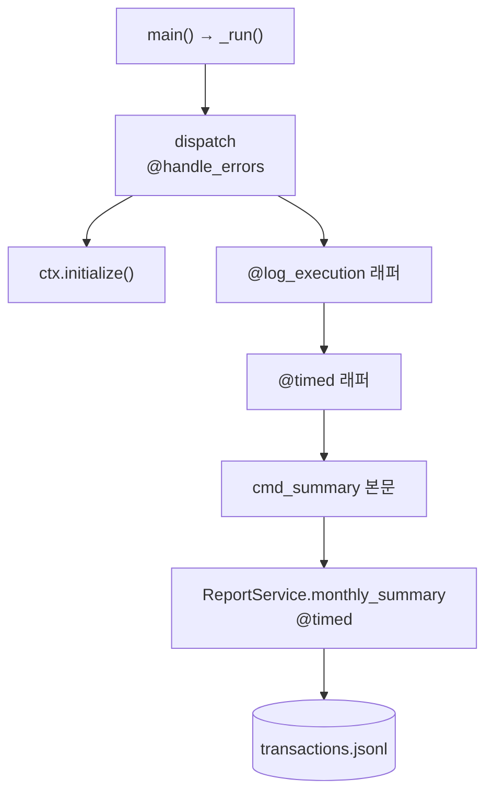
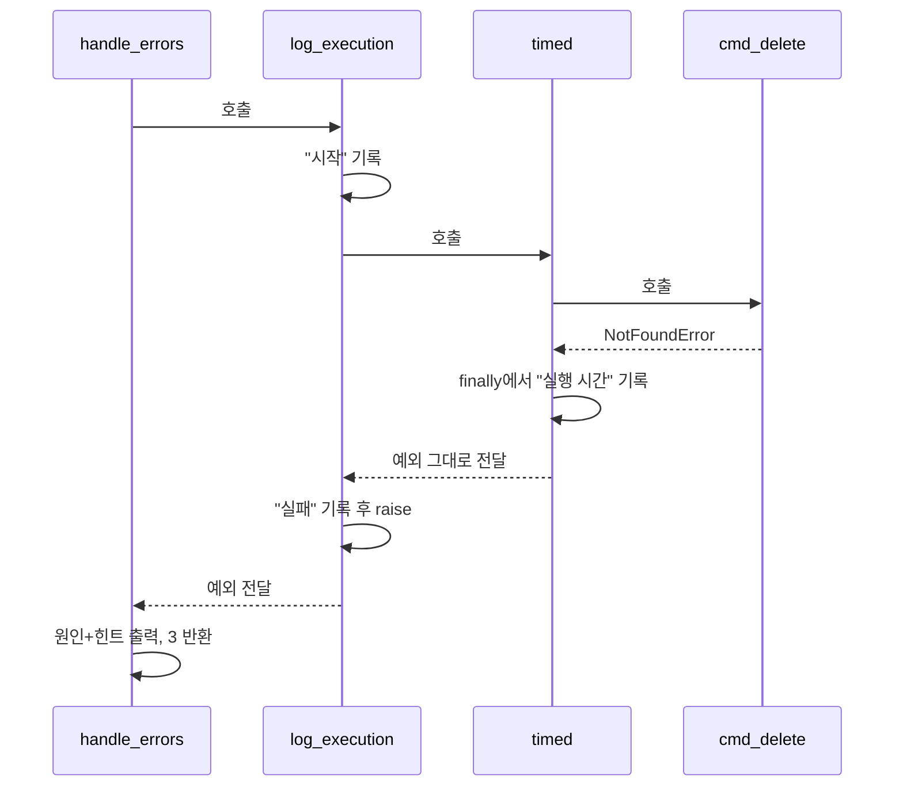

# 04. 데코레이터로 공통 관심사 분리하기

> 관련 과제 목표: "데코레이터로 공통 관심사(로그/예외/시간 측정)를 분리한 구조와 이유를 설명할 수 있다."
> 핵심 코드: [decorators.py](../budget_app/decorators.py), [cli.py의 dispatch와 cmd_* 핸들러](../budget_app/cli.py)

## 이 문서에서 배우는 것

- 함수가 값(객체)이라는 것과 클로저(closure)가 무엇인지 설명할 수 있습니다.
- 데코레이터(decorator)가 "함수를 받아 새 함수를 돌려주는 함수"이고, `@deco`가 `f = deco(f)`와 같다는 것을 설명할 수 있습니다.
- `functools.wraps`가 없으면 무엇이 깨지는지, 이 프로젝트의 로그로 직접 보여 줄 수 있습니다.
- 이 프로젝트의 세 데코레이터(`@timed`, `@log_execution`, `@handle_errors`)가 어디에 왜 붙었는지, 쌓는 순서가 왜 중요한지 설명할 수 있습니다.
- 데코레이터를 붙이면 안 되는 곳(제너레이터 함수 등)과 그 이유를 말할 수 있습니다.

## 핵심 개념

### 1. 함수는 값이고, 바깥 변수를 기억할 수 있다

파이썬에서 함수는 숫자나 문자열처럼 **변수에 담고, 인자로 넘기고, 반환할 수 있는 객체**입니다.
또 함수 안에서 만든 함수는 **바깥 함수의 변수를 기억**합니다. 바깥 함수가 이미 끝났어도 그렇습니다. 이것을 클로저라고 합니다.

```python
def greet(name):
    return f"안녕하세요, {name}님"

say = greet                       # 함수를 변수에 담는다 (호출이 아니라 참조)
print(say("민수"), say is greet)

def make_counter():
    count = 0
    def increase():               # 안쪽 함수가 바깥 변수 count를 기억한다 → 클로저
        nonlocal count
        count += 1
        return count
    return increase               # 함수를 반환한다

counter = make_counter()          # make_counter는 이미 끝났지만
print(counter(), counter(), counter())
```

```text
안녕하세요, 민수님 True
1 2 3
```

데코레이터는 이 두 가지(함수를 값으로 다루기 + 클로저)로 만들어집니다.

### 2. 데코레이터 = 함수를 받아 새 함수를 돌려주는 함수

```python
def shout(func):                      # 1) 함수를 받아서
    def wrapper(*args, **kwargs):     # 2) 새 함수를 만들고
        print(f"[호출] {func.__name__}{args}")
        result = func(*args, **kwargs)
        return result.upper()
    return wrapper                    # 3) 새 함수를 돌려준다

@shout
def hello(name):
    return f"hello, {name}"

def bye(name):
    return f"bye, {name}"
bye = shout(bye)                      # @shout 와 완전히 같은 일

print(hello("kim"))
print(bye("lee"))
```

```text
[호출] hello('kim',)
HELLO, KIM
[호출] bye('lee',)
BYE, LEE
```

`@shout`는 문법 설탕(syntax sugar)입니다. 함수를 정의한 **직후에 한 번** `hello = shout(hello)`를 실행하는 것과 같습니다.
그 뒤로 `hello`라는 이름은 `wrapper`를 가리키고, `wrapper`는 클로저로 원래 함수(`func`)를 기억했다가 부릅니다.
`*args, **kwargs`로 받는 이유는 데코레이터가 감쌀 함수의 인자 모양을 모르기 때문입니다.

### 3. `functools.wraps`: 원래 함수의 이름표를 옮겨 붙인다

`wrapper`도 함수이므로 자기 이름(`__name__`)과 설명(`__doc__`)이 있습니다. 그대로 두면 원래 함수의 정보가 가려집니다.

```python
import functools

def plain(func):
    def wrapper(*args, **kwargs):
        return func(*args, **kwargs)
    return wrapper

def kept(func):
    @functools.wraps(func)
    def wrapper(*args, **kwargs):
        return func(*args, **kwargs)
    return wrapper

class Report:
    @plain
    def summary(self):
        """한 달 요약을 만든다."""

    @kept
    def detail(self):
        """상세 내역을 만든다."""

for method in (Report.summary, Report.detail):
    print(method.__name__, "|", method.__qualname__, "|", method.__doc__)
```

```text
wrapper | plain.<locals>.wrapper | None
detail | Report.detail | 상세 내역을 만든다.
```

`functools.wraps(func)`는 `__name__`, `__qualname__`, `__doc__`, `__module__` 등을 복사하고, 원래 함수를 `__wrapped__`에 남깁니다.
`__qualname__`은 `Report.detail`처럼 **클래스 이름까지 붙은 이름**입니다. 이 프로젝트의 로그가 `ReportService.monthly_summary 실행 시간`처럼 찍히는 것이 이 값 덕분입니다.

### 4. 인자를 받는 데코레이터 (데코레이터 공장)

`@repeat(3)`처럼 설정값을 받으려면 한 겹을 더 둡니다. **설정값을 받아 데코레이터를 돌려주는 함수**입니다.

```python
import functools

def repeat(times):                    # 1겹: 설정값을 받는 '공장'
    def decorator(func):              # 2겹: 진짜 데코레이터
        @functools.wraps(func)
        def wrapper(*args, **kwargs): # 3겹: 실제로 실행되는 함수
            return [func(*args, **kwargs) for _ in range(times)]
        return wrapper
    return decorator

@repeat(3)                            # repeat(3)이 먼저 호출되어 decorator를 돌려준다
def roll():
    return "주사위"

print(roll())
print(roll.__name__)
# 위 코드는 roll = repeat(3)(roll) 과 같다
```

```text
['주사위', '주사위', '주사위']
roll
```

이 프로젝트의 세 데코레이터는 설정값이 필요 없어서 모두 괄호 없는 한 겹짜리입니다. 공장 형태는 "직접 해 보기"의 `@retry` 과제에서 만들어 봅니다.

### 5. 여러 개 쌓기: 아래에서부터 감싸고, 위에서부터 들어간다

`@A` 아래 `@B`를 쓰고 함수를 정의하면 `f = A(B(f))`입니다. **아래쪽(B)이 먼저 감싸고**, 호출할 때는 **바깥쪽(A)부터 들어갑니다**.

```python
import functools

def tag(label):
    def decorator(func):
        @functools.wraps(func)
        def wrapper(*args, **kwargs):
            print(f"{label} 들어감")
            try:
                return func(*args, **kwargs)
            finally:
                print(f"{label} 나옴")
        return wrapper
    return decorator

@tag("바깥(log_execution 자리)")
@tag("안쪽(timed 자리)")
def work():
    print("    본문 실행")
    return 0

work()
```

```text
바깥(log_execution 자리) 들어감
안쪽(timed 자리) 들어감
    본문 실행
안쪽(timed 자리) 나옴
바깥(log_execution 자리) 나옴
```

양파 껍질처럼 바깥부터 벗기며 들어가고, 안쪽부터 다시 덮으며 나옵니다.

## 이 프로젝트에서는

### 공통 관심사(cross-cutting concern) 세 가지

"시간 재기", "실행 기록 남기기", "예외를 사용자 메시지로 바꾸기"는 **거의 모든 명령에 똑같이 필요하지만, 어느 명령의 본래 일도 아닌 것**입니다.
이 프로젝트는 이 셋을 [decorators.py](../budget_app/decorators.py)에 모았습니다.

| 데코레이터 | 하는 일 | 로거 | 붙은 곳 |
| --- | --- | --- | --- |
| `@timed` | 실행 시간을 ms로 기록 (실패해도 기록) | `budget_app.perf` | 모든 `cmd_*` 핸들러 + 일부 서비스 메서드 |
| `@log_execution` | 시작/완료/실패를 기록하고 예외는 다시 던짐 | `budget_app.exec` | 모든 `cmd_*` 핸들러 |
| `@handle_errors` | 예외 → "원인 + 힌트" 메시지와 종료 코드 | `budget_app.error` (`OSError`와 예상 못 한 오류만) | `cli.dispatch` 한 곳 |

### `@timed`: 실패한 실행도 시간을 잰다

[decorators.py의 timed](../budget_app/decorators.py)

```python
def timed(func: F) -> F:
    """함수 실행 시간을 밀리초 단위로 기록한다. 예외가 나도 ``finally``에서 기록한다.

    주의: 제너레이터 함수에 붙이면 '제너레이터 객체를 만드는 시간'만 재게 된다.
    실제 반복은 호출한 쪽이 나중에 하기 때문이다.
    """

    @functools.wraps(func)  # 원래 함수의 이름·docstring을 래퍼에 복사한다.
    def wrapper(*args: Any, **kwargs: Any) -> Any:
        started = time.perf_counter()
        try:
            return func(*args, **kwargs)
        finally:
            elapsed_ms = (time.perf_counter() - started) * 1000
            perf_logger.info("%s 실행 시간: %.2fms", func.__qualname__, elapsed_ms)

    return cast(F, wrapper)
```

- `time.perf_counter()`는 **경과 시간 측정용 시계**입니다. `time.time()`은 벽시계라서 시스템 시간이 바뀌면 값이 튈 수 있지만, `perf_counter()`는 앞으로만 가고 해상도도 높습니다.
- `return`은 `try` 안에, 기록은 `finally`에 있습니다. 그래서 **정상 종료든 예외든** 시간이 남습니다. 실패한 CSV 가져오기도 `CsvService.import_csv 실행 시간`이 기록됩니다.
- 반환 타입이 `F`(입력과 같은 타입)라서 `mypy`는 데코레이터를 붙인 뒤에도 원래 시그니처를 압니다. `cast(F, wrapper)`는 타입 검사기에게 주는 표시일 뿐 실행 중에는 아무 일도 하지 않습니다 ([05. 타입 힌트](05-type-hints.md)).

### `@log_execution`: 기록하되 예외는 삼키지 않는다

[decorators.py의 log_execution](../budget_app/decorators.py)

```python
def log_execution(func: F) -> F:
    """함수의 시작, 결과, 예외를 실행 로그로 남긴다. 예외는 삼키지 않고 다시 던진다."""

    @functools.wraps(func)
    def wrapper(*args: Any, **kwargs: Any) -> Any:
        name = func.__qualname__
        exec_logger.info("시작 %s %s", name, _describe_call(args, kwargs))
        try:
            result = func(*args, **kwargs)
        except BaseException as exc:
            exec_logger.info("실패 %s: %s: %s", name, type(exc).__name__, exc)
            raise
        exec_logger.info("완료 %s -> %r", name, result)
        return result

    return cast(F, wrapper)
```

- `except BaseException`이라서 `KeyboardInterrupt`(Ctrl+C)도 "실패"로 기록됩니다. 하지만 **바로 `raise`로 다시 던지므로** 예외를 처리할 책임은 바깥의 `@handle_errors`에 그대로 남습니다.
- 인자는 `_describe_call`로 요약합니다. `argparse.Namespace`는 dict로 보여 주되 핸들러 함수처럼 호출 가능한 값과 내부용 `needs_storage`는 빼고, 그 밖의 객체는 `<AppContext>`처럼 **타입 이름만** 남깁니다. 큰 객체를 통째로 로그에 쏟지 않기 위해서입니다.

### `@handle_errors`: 예외를 "원인 + 힌트 + 종료 코드"로 바꾼다

[decorators.py의 handle_errors](../budget_app/decorators.py)의 앞부분입니다.

```python
    @functools.wraps(func)
    def wrapper(args: argparse.Namespace, ctx: R) -> int:
        try:
            return func(args, ctx)
        except BudgetAppError as exc:
            ctx.report_error(exc.message, exc.hint, exc)
            return int(exc.exit_code)
        except KeyboardInterrupt as exc:
            ctx.report_error(
                "사용자가 작업을 중단했습니다.",
                "저장 파일은 파일마다 '임시 파일 → 교체' 방식으로 써서 반쯤 쓴 파일은 남지 않습니다. "
                "여러 파일을 바꾸는 명령은 먼저 끝난 파일까지만 반영될 수 있지만, 순서를 정해 두어 데이터가 서로 어긋나지 않습니다.",
                exc,
            )
            return int(ExitCode.INTERRUPTED)
        except BrokenPipeError:
            # 'list | head'처럼 출력을 받던 쪽이 먼저 끝난 경우다. 오류가 아니므로 main()이 조용히 끝낸다.
            raise
```

이어서 `OSError` 분기가 나옵니다.

```python
        except OSError as exc:
            error_logger.exception("파일 처리 오류")
            ctx.report_error(
                f"파일을 처리하다가 문제가 생겼습니다: {_describe_os_error(exc)}",
                "경로가 맞는지, 쓰기 권한과 디스크 여유 공간이 있는지 확인하세요.",
                exc,
            )
            return int(ExitCode.STORAGE)
```

그 아래에 `except Exception` 마지막 안전망이 이어집니다. 정리하면 다음과 같습니다.

| 잡는 예외 | 사용자에게 보이는 것 | 종료 코드 | 상세 기록 |
| --- | --- | --- | --- |
| `BudgetAppError`와 하위 클래스 | 예외에 담긴 `message`, `hint` | 예외의 `exit_code` | 실행 로그의 "실패" 한 줄 |
| `KeyboardInterrupt` | "사용자가 작업을 중단했습니다." | 130 | 실행 로그의 "실패" 한 줄 |
| `BrokenPipeError` | 잡지 않고 다시 던짐 → `main()`이 조용히 끝냄 | 0 | 핸들러가 출력하던 중이었다면 실행 로그의 "실패" 한 줄 (아래 설명) |
| `OSError` | 원인(`strerror`, 파일 이름) + 권한/공간 힌트 | 5 | `app.log`에 스택트레이스 |
| 그 밖의 `Exception` | "예기치 못한 오류" + `--debug` 안내 | 1 | `app.log`에 스택트레이스 |

`except`는 위에서부터 검사하므로 **구체적인 예외를 먼저** 둡니다. `Exception`을 맨 위에 두면 `BudgetAppError`도 모두 "예기치 못한 오류"가 됩니다. `BrokenPipeError`가 `OSError`보다 위에 있는 것도 같은 이유입니다. `BrokenPipeError`는 `OSError`의 하위 클래스라서, 순서를 바꾸면 `list | head` 같은 정상적인 사용이 "파일 처리 오류"(5)로 보고됩니다.
`KeyboardInterrupt`와 `SystemExit`은 `Exception`의 자식이 아니라 `BaseException`의 자식입니다. 그래서 `KeyboardInterrupt`는 따로 잡고, `SystemExit`은 잡히지 않고 그대로 지나갑니다.

`BrokenPipeError`의 "실패" 기록은 **파이프가 끊긴 순간이 핸들러 안이었을 때만** 남습니다. 거래가 수천 건인 데이터에서 `list --limit 5000 | head -1`을 실행하면 핸들러가 표를 출력하는 도중 끊기므로 `app.log`에 `실패 cmd_list: BrokenPipeError: [Errno 32] Broken pipe`가 남고, 종료 코드는 0입니다.
출력이 짧으면 내용이 버퍼에만 쌓였다가 핸들러가 끝난 뒤 `main()`의 `out.flush()`에서 끊기거나 아예 끊기지 않으므로, 로그에는 `완료 cmd_list -> 0`이 남습니다.

`ctx`의 타입은 구체 클래스가 아니라 **프로토콜 `ErrorReporter`** 입니다 (정확히는 `ErrorReporter`를 상한(bound)으로 둔 타입 변수 `R`).

```python
class ErrorReporter(Protocol):
    """``handle_errors``가 요구하는 최소 기능. 이 메서드만 있으면 어떤 객체든 된다 (구조적 타이핑)."""

    def report_error(
        self, message: str, hint: Optional[str] = None, exc: Optional[BaseException] = None
    ) -> None: ...
```

데코레이터는 "`report_error` 메서드가 있는 객체"만 요구합니다. 그래서 `decorators.py`는 `context.py`를 import하지 않아도 됩니다.
실제 구현은 [context.py의 AppContext.report_error](../budget_app/context.py)이며, `--debug`일 때만 스택트레이스를 덧붙입니다.

### 어디에 붙였나: 경계에 한 번, 핸들러마다 두 개

모든 명령은 [cli.py의 dispatch](../budget_app/cli.py)를 지나갑니다. `@handle_errors`는 **여기 한 곳에만** 있습니다.

```python
@handle_errors
def dispatch(args: argparse.Namespace, ctx: AppContext) -> int:
    """모든 명령이 지나가는 관문: 저장소를 준비하고 명령 핸들러를 부른다."""
    if args.needs_storage:
        ctx.initialize()
    handler: Handler = args.handler
    return handler(args, ctx)
```

명령 핸들러 21개(`cmd_add` … `cmd_backup_restore`)에는 모두 `@log_execution`과 `@timed`가 같은 순서로 붙어 있습니다. [cli.py의 cmd_summary](../budget_app/cli.py):

```python
@log_execution
@timed
def cmd_summary(args: argparse.Namespace, ctx: AppContext) -> int:
    month: YearMonth = args.month or _current_month(ctx)
    summary = ctx.reports.monthly_summary(month, args.top)
    ctx.console.print(format_summary(summary))
    return OK
```

본문에는 `try`도, `time.perf_counter()`도, `logging`도 없습니다. **"무엇을 할지"만 남았습니다.** 다른 핸들러(`cmd_list`, `cmd_delete` 등)도 모두 같은 모양입니다.

서비스 계층에는 오래 걸릴 수 있는 메서드에만 `@timed`를 붙였습니다.

| 서비스 메서드 | 파일 | 붙인 이유 |
| --- | --- | --- |
| `ReportService.monthly_summary` | [services.py](../budget_app/services.py) | 거래 파일 전체를 한 번 스트리밍 |
| `CsvService.import_csv`, `CsvService.export_csv` | [csv_io.py](../budget_app/csv_io.py) | CSV 전체 처리 + 원자적 쓰기 |
| `BackupService.create`, `BackupService.restore` | [backup.py](../budget_app/backup.py) | zip 압축/해제 |

전체를 겹쳐 그리면 이렇습니다.



`cmd_delete = log_execution(timed(cmd_delete))`이므로, 없는 id를 지우려 할 때의 실행 순서는 다음과 같습니다.



### 실제 출력으로 확인하기

`--timing`을 붙이면 `budget_app.perf` 로그가 화면(stderr)에도 나옵니다. 서비스 메서드와 핸들러가 **각각** 기록됩니다 (시간 값은 실행할 때마다 다릅니다).

```text
$ python3 -m budget_app --data-dir /tmp/budget-lab summary --month 2026-10 --top 2 --timing
ReportService.monthly_summary 실행 시간: 0.09ms
[2026-10 월별 요약]
  총 수입 : 3,250,000원  (2건)
  ...
     2 | utilities |  82,000원 |  9.6% | [#---------]
cmd_summary 실행 시간: 0.18ms
```

`--verbose`를 붙이면 실행 로그도 화면에 나옵니다. 위 시퀀스 다이어그램과 같은 순서인지 확인해 보세요.

```text
$ python3 -m budget_app --data-dir /tmp/budget-lab delete --id 99 --yes --verbose
로그: 시작 cmd_delete {'command': 'delete', 'data_dir': '/tmp/budget-lab', 'tx_id': 99, 'yes': True, 'verbose': True}, <AppContext>
로그: cmd_delete 실행 시간: 0.08ms
로그: 실패 cmd_delete: NotFoundError: id 99에 해당하는 거래가 없습니다.
오류: id 99에 해당하는 거래가 없습니다.
힌트: 'list'나 'search' 명령으로 올바른 id를 확인하세요.
```

옵션이 없어도 모든 기록은 데이터 폴더의 `app.log`에 쌓입니다. [logconfig.py](../budget_app/logconfig.py)가 파일 핸들러를 INFO 수준으로 붙이기 때문입니다.

```text
$ tail -3 /tmp/budget-lab/app.log
... [INFO] budget_app.exec: 시작 cmd_delete {'command': 'delete', 'data_dir': '/tmp/budget-lab', 'tx_id': 99, 'yes': True, 'verbose': True}, <AppContext>
... [INFO] budget_app.perf: cmd_delete 실행 시간: 0.08ms
... [INFO] budget_app.exec: 실패 cmd_delete: NotFoundError: id 99에 해당하는 거래가 없습니다.
```

### 데코레이터가 없다면: 전과 후

아래는 데코레이터 없이 `cmd_delete`를 썼다면 어떤 모양일지 보여 주는 **설명용 스케치**입니다 (실제 코드가 아닙니다).

```python
# 설명용 스케치: 데코레이터가 없을 때의 cmd_delete
def cmd_delete(args, ctx):
    started = time.perf_counter()
    exec_logger.info("시작 cmd_delete %s", args)
    try:
        ...                                   # 진짜 일(조회, 확인, 삭제)은 이 안의 몇 줄뿐
        exec_logger.info("완료 cmd_delete -> 0")
        return 0
    except BudgetAppError as exc:
        exec_logger.info("실패 cmd_delete: %s", exc)
        ctx.report_error(exc.message, exc.hint, exc)
        return int(exc.exit_code)
    # except KeyboardInterrupt / OSError / Exception 도 여기에 똑같이 반복...
    finally:
        perf_logger.info("cmd_delete 실행 시간: %.2fms", (time.perf_counter() - started) * 1000)
```

이 코드가 핸들러 21개에 **복사**되어 있다고 생각해 보세요. 힌트 문구 하나를 바꾸려면 21곳을 고쳐야 하고, 한 곳만 빠뜨려도 그 명령에서는 스택트레이스가 사용자에게 보입니다.
지금 구조에서는 [decorators.py](../budget_app/decorators.py) 한 파일만 고치면 모든 명령에 반영됩니다.

## 왜 이렇게 설계했나

### `@handle_errors`를 왜 CLI 경계(`dispatch`) 한 곳에만 붙였나

- **서비스는 예외를 던지기만 합니다.** `LedgerService.get`은 없는 id를 만나면 `NotFoundError`를 던질 뿐, 화면에 무엇을 찍을지도 종료 코드가 몇인지도 모릅니다. 그래서 서비스 테스트는 `assertRaises(NotFoundError)`로 간단히 끝나고, 다른 UI를 붙여도 서비스를 그대로 쓸 수 있습니다.
- 서비스 메서드에 `@handle_errors`를 붙이면 예외가 **중간에서 정수로 바뀌어** 버립니다. 부른 쪽은 성공 결과와 오류 코드를 구분하기 어렵고, 서비스가 다른 서비스를 부르면 메시지가 두 번 찍힐 수도 있습니다.
- 핸들러가 아니라 `dispatch`에 붙인 이유도 있습니다. `dispatch`는 핸들러보다 **먼저** `ctx.initialize()`를 실행합니다. 데이터 경로가 파일일 때 나는 `StorageError`(종료 코드 5)는 이 단계에서 나므로, 가장 바깥에 있어야 한 그물로 받을 수 있습니다.
- `argparse` 사용법 오류는 `dispatch`에 오기 전, `main()`이 부르는 `_run()`의 `parse_args`에서 끝납니다 (`KoreanArgumentParser.error` → 종료 코드 2). [06. 입력 검증과 오류 처리](06-validation-and-errors.md)에서 다룹니다.

### `@log_execution`을 바깥, `@timed`를 안쪽에 둔 이유

- 안쪽의 `@timed`는 **핸들러 본문만** 잽니다. 로그를 쓰는 시간이 측정에 섞이지 않습니다.
- 바깥의 `@log_execution`이 시간 기록 뒤에 "완료/실패"를 남기므로, 한 명령의 로그는 항상 `시작 → 실행 시간 → 완료/실패`로 묶입니다. 로그를 읽을 때 한 명령의 처음과 끝이 분명합니다.
- 순서를 뒤집어도 기능은 망가지지 않습니다. 다만 측정에 로그 쓰기 시간이 들어가고 "실행 시간"이 "완료" 뒤에 찍힙니다 (직접 해 보기 2번).

### 서비스에는 왜 `@timed`만 붙였나

- 실행 로그(`exec`)는 "사용자가 어떤 명령을 실행했는가"라는 **명령 이력**입니다. 명령당 한 쌍이면 충분하고, 서비스 호출까지 다 남기면 금방 시끄러워집니다.
- 성능 로그(`perf`)는 "어디가 느린가"를 찾는 용도라서 **느려질 수 있는 지점**에만 붙였습니다. `backup restore --timing`을 해 보면 `restore` 안에서 부른 안전 백업 `BackupService.create`도 따로 찍힙니다.

```text
BackupService.create 실행 시간: 0.77ms
BackupService.restore 실행 시간: 1.88ms
복원 완료: ...
복원 직전 상태는 ...에 백업했습니다.
cmd_backup_restore 실행 시간: 1.92ms
```

### 다른 방법과 비교

| 방법 | 장점 | 단점 |
| --- | --- | --- |
| 핸들러마다 `try/except` 직접 작성 | 흐름이 눈에 다 보임 | 21곳 중복, 하나만 빠져도 스택트레이스 노출 |
| `with timer():` 같은 컨텍스트 매니저 | 함수 일부 구간만 잴 수 있음 | 여전히 모든 함수 본문에 한 줄씩 필요 |
| 데코레이터 (이 프로젝트) | 본문은 그대로, 한 곳에서 정책 변경 | 동작이 함수 정의 밖에 숨음, 스택트레이스에 `wrapper` 프레임이 끼어듦 |

데코레이터의 단점도 분명합니다. `--debug`로 스택트레이스를 보면 `decorators.py ... in wrapper` 줄이 중간에 끼어 있습니다.
그래서 이 프로젝트는 데코레이터를 **세 개로 제한**하고, 모든 핸들러 위에 같은 순서로 붙여 "모든 명령이 같은 껍질을 쓴다"는 규칙을 눈에 보이게 했습니다.

### 왜 `handle_errors`만 시그니처가 고정되어 있나

`timed`와 `log_execution`은 어떤 함수든 감싸므로 `F = TypeVar("F", bound=Callable[..., Any])`로 "받은 그대로의 타입"을 돌려줍니다.
`handle_errors`는 감싼 함수에 `ctx`가 있어야 하고 반환값도 종료 코드여야 하므로, `Callable[[argparse.Namespace, R], int]`로 **"이런 모양의 함수에만 붙일 수 있다"는 계약**을 적었습니다. 엉뚱한 함수에 붙이면 `mypy`가 알려 줍니다.

## 직접 해 보기

실습 데이터를 먼저 준비합니다. 모든 명령은 프로젝트 루트에서 실행합니다.

```bash
python3 -m budget_app --data-dir /tmp/budget-lab import --from examples/sample_transactions.csv
```

### 1. 실행 시간, 실행 로그, 로그 파일 보기

```bash
python3 -m budget_app --data-dir /tmp/budget-lab summary --month 2026-10 --top 2 --timing
```

`ReportService.monthly_summary 실행 시간`과 `cmd_summary 실행 시간` 두 줄이 보이면 성공입니다. `cmd_summary` 쪽이 항상 조금 더 큰 이유를 설명해 보세요.
이어서 `delete --id 99 --yes --verbose`를 실행하면 "실제 출력으로 확인하기"처럼 `시작 → 실행 시간 → 실패` 순서로 찍히고, `echo $?`는 `3`입니다. 실패했는데도 "실행 시간"이 찍히는 것은 `timed`의 어느 줄 덕분인지 찾아보세요.
마지막으로 로그 파일을 봅니다.

```bash
tail -5 /tmp/budget-lab/app.log
```

`--verbose` 없이 실행한 `summary`도 `[INFO] budget_app.exec`, `[INFO] budget_app.perf` 줄로 남아 있는지 확인합니다.

### 2. 쌓는 순서 바꿔 보기

프로젝트의 진짜 데코레이터로 실험합니다. `python3 -`는 표준 입력으로 받은 코드를 실행하고, 현재 폴더(프로젝트 루트)를 import 경로에 넣어 줍니다.

```bash
python3 - <<'EOF'
import logging, sys
logging.basicConfig(level=logging.INFO, format="%(name)s: %(message)s", stream=sys.stdout)
from budget_app.decorators import log_execution, timed

@log_execution
@timed
def divide(a, b):
    """a를 b로 나눈다."""
    return a // b

print(divide(10, 3))
try:
    divide(1, 0)
except ZeroDivisionError:
    print("예외가 호출한 쪽까지 그대로 올라왔다")
print(divide.__name__, "/", divide.__doc__)
EOF
```

```text
budget_app.exec: 시작 divide 10, 3
budget_app.perf: divide 실행 시간: 0.00ms
budget_app.exec: 완료 divide -> 3
3
budget_app.exec: 시작 divide 1, 0
budget_app.perf: divide 실행 시간: 0.00ms
budget_app.exec: 실패 divide: ZeroDivisionError: integer division or modulo by zero
예외가 호출한 쪽까지 그대로 올라왔다
divide / a를 b로 나눈다.
```

예외가 기록된 뒤에도 호출한 쪽까지 그대로 올라오고, 이름과 docstring도 유지됩니다.

이제 `@log_execution`과 `@timed` 두 줄의 순서를 바꿔 다시 실행합니다. "실행 시간"이 "완료"/"실패" 뒤로 가는 것을 확인하세요.

```text
budget_app.exec: 시작 divide 10, 3
budget_app.exec: 완료 divide -> 3
budget_app.perf: divide 실행 시간: 0.06ms
...
```

### 3. `functools.wraps`를 빼면 로그가 어떻게 되나

```bash
python3 - <<'EOF'
import logging, sys
logging.basicConfig(level=logging.INFO, format="%(name)s: %(message)s", stream=sys.stdout)
from budget_app.decorators import log_execution

def timed_without_wraps(func):        # functools.wraps를 뺀 가짜 timed
    def wrapper(*args, **kwargs):
        return func(*args, **kwargs)
    return wrapper

@log_execution
@timed_without_wraps
def cmd_list():
    return 0

cmd_list()
print(cmd_list.__name__)
EOF
```

```text
budget_app.exec: 시작 timed_without_wraps.<locals>.wrapper 
budget_app.exec: 완료 timed_without_wraps.<locals>.wrapper -> 0
wrapper
```

바깥의 `log_execution`이 받은 `func`은 원래 `cmd_list`가 아니라 안쪽의 `wrapper`입니다. 안쪽에서 이름표를 옮겨 붙이지 않으면 바깥 로그에 엉뚱한 이름이 찍힙니다.
**쌓인 데코레이터 중 하나라도 `wraps`를 빠뜨리면 그 위의 데코레이터가 모두 영향을 받습니다.** 진짜 `cmd_list`도 확인해 봅니다.

```bash
python3 -c "from budget_app.cli import cmd_list; print(cmd_list.__name__, cmd_list.__code__.co_name, cmd_list.__wrapped__.__wrapped__.__code__.co_name)"
```

```text
cmd_list wrapper cmd_list
```

이름표(`__name__`)는 `cmd_list`지만 실제로 실행되는 코드(`__code__`)는 `wrapper`입니다. `wraps`는 정보를 **복사**할 뿐 함수를 바꾸지 않습니다. `__wrapped__`를 두 번 따라가면 원래 함수가 나옵니다.

### 4. 과제: `@count_calls` 만들기

함수가 몇 번 호출되었는지 `함수.calls`에 세는 데코레이터를 만드세요. 이름과 docstring은 유지되어야 합니다.

```python
@count_calls
def add(a, b):
    """두 수를 더한다."""
    return a + b

add(1, 2)
add(3, 4)
print(add.__name__, add.calls)   # 기대 출력: add 2
```

<details>
<summary>참고 답안</summary>

```python
import functools

def count_calls(func):
    @functools.wraps(func)
    def wrapper(*args, **kwargs):
        wrapper.calls += 1
        return func(*args, **kwargs)
    wrapper.calls = 0
    return wrapper
```

함수도 객체라서 속성(`wrapper.calls`)을 붙일 수 있습니다. 클로저 변수와 `nonlocal`로 세어도 되지만, 그러면 바깥에서 값을 읽을 방법을 따로 만들어야 합니다.

</details>

### 5. 과제: `@retry(times, exceptions)` 만들기

지정한 예외가 나면 최대 `times`번까지 다시 시도하고, 마지막에도 실패하면 예외를 그대로 올리는 **인자를 받는** 데코레이터를 만드세요. 아래 시험 코드의 기대 출력은 다음과 같습니다.

```text
  flaky_read 1번째 시도 실패: 디스크가 잠시 바쁩니다
  flaky_read 2번째 시도 실패: 디스크가 잠시 바쁩니다
읽기 성공
```

<details>
<summary>참고 답안과 시험 코드</summary>

```python
import functools

def retry(times, exceptions=(Exception,)):
    def decorator(func):
        @functools.wraps(func)
        def wrapper(*args, **kwargs):
            for attempt in range(1, times + 1):
                try:
                    return func(*args, **kwargs)
                except exceptions as exc:
                    print(f"  {func.__name__} {attempt}번째 시도 실패: {exc}")
                    if attempt == times:
                        raise          # 마지막 시도도 실패하면 예외를 그대로 올린다
        return wrapper
    return decorator

state = {"left": 2}

@retry(3, exceptions=(OSError,))
def flaky_read():
    if state["left"] > 0:
        state["left"] -= 1
        raise OSError("디스크가 잠시 바쁩니다")
    return "읽기 성공"

print(flaky_read())
```

생각해 볼 점: 이 프로젝트의 `JsonlFile.append`에 `@retry`를 붙이면 좋을까요? 디스크가 가득 찬 경우라면 다시 시도해도 소용없습니다. 또 `append`는 실패하면 늘어난 부분을 `os.ftruncate`로 잘라 내므로 다시 시도해도 비교적 안전하지만, 이런 되돌리기가 없는 쓰기 함수에 `@retry`를 붙이면 일부만 쓰인 줄 뒤에 같은 줄이 또 들어갈 수 있습니다. "다시 해도 안전한(멱등) 작업인가?"를 먼저 따져야 합니다.

</details>

### 6. 함정 체험: 제너레이터 함수에 `@timed` 붙이기

```bash
python3 - <<'EOF'
import logging, sys, time
logging.basicConfig(level=logging.INFO, format="%(name)s: %(message)s", stream=sys.stdout)
from budget_app.decorators import timed

@timed
def slow_lines():
    for i in range(3):
        time.sleep(0.1)          # 한 줄 읽는 데 0.1초 걸린다고 치자
        yield i

gen = slow_lines()               # 여기서 바로 '실행 시간'이 찍힌다
started = time.perf_counter()
print(list(gen))                 # 진짜 일은 여기서 일어난다
print(f"실제 반복 시간: {(time.perf_counter() - started) * 1000:.0f}ms")
EOF
```

```text
budget_app.perf: slow_lines 실행 시간: 0.00ms
[0, 1, 2]
실제 반복 시간: 318ms
```

시간 값은 조금씩 다르지만, 0.3초 걸리는 일의 측정값이 0ms라는 점은 같습니다. 이유는 바로 아래에서 정리합니다.

## 자주 하는 실수

1. **제너레이터 함수에 데코레이터를 붙인다.** 제너레이터 함수는 호출하면 본문을 실행하지 않고 제너레이터 객체만 바로 돌려줍니다 ([03. 제너레이터와 스트리밍](03-generators-streaming.md)). 그래서 `@timed`는 "객체를 만드는 시간"만 재고, `@log_execution`은 `완료 ... -> <generator object ...>`를 찍은 뒤 나중에 반복하다 나는 예외는 기록하지 못합니다. 이 프로젝트가 `iter_all`, `iter_raw`, `filter_transactions` 같은 제너레이터에는 데코레이터를 붙이지 않고, 제너레이터를 **끝까지 소비하는** `monthly_summary` 같은 메서드에 붙인 이유입니다.
2. **`functools.wraps`를 빠뜨린다.** 로그에 `wrapper`나 `xxx.<locals>.wrapper`가 찍히고 `help()`의 설명이 사라집니다. 쌓여 있으면 위쪽 데코레이터까지 잘못된 이름을 씁니다 (직접 해 보기 3번).
3. **wrapper에서 `return`을 빼먹는다.** `func(*args, **kwargs)`를 부르기만 하고 반환하지 않으면 감싼 함수는 항상 `None`을 돌려줍니다. 이 프로젝트라면 핸들러가 돌려준 종료 코드가 `None`으로 바뀌고, `raise SystemExit(None)`은 0으로 끝나므로 오류 행이 있는 `import --dry-run`(원래 2)도 0으로 끝나 버립니다.
4. **기록용 데코레이터에서 예외를 삼킨다.** `except`에서 기록만 하고 `raise`를 빼면 바깥의 `@handle_errors`는 오류가 난 줄도 모릅니다.
5. **괄호를 잘못 붙인다.** 인자 없는 데코레이터에 `@timed()`를 쓰면 `TypeError: timed() missing 1 required positional argument: 'func'`가 납니다. 반대로 공장 형태인 `@retry`를 괄호 없이 쓰면 `times` 자리에 함수가 들어가 버립니다.
6. **마지막 안전망에서 `BaseException`을 잡는다.** 그러면 `SystemExit`까지 종료 코드 1로 바뀝니다. `handle_errors`는 `Exception`만 잡고 `KeyboardInterrupt`는 따로 처리합니다. (`log_execution`이 `BaseException`을 잡는 것은 괜찮습니다. 기록만 하고 바로 다시 던지기 때문입니다.)
7. **예외를 서비스 안에서 메시지로 바꾼다.** 서비스가 `print`하고 숫자를 반환하기 시작하면 테스트와 재사용이 어려워집니다. 변환은 경계에서 한 번만 합니다.

## 정리

- [ ] 함수를 변수에 담고, 인자로 넘기고, 반환할 수 있다는 것과 클로저의 원리를 예로 설명할 수 있다.
- [ ] `@deco`가 `f = deco(f)`와 같고, 두 개를 쌓으면 `A(B(f))`라는 것을 설명할 수 있다.
- [ ] `functools.wraps`가 복사하는 정보와, 빠뜨렸을 때 이 프로젝트 로그에 생기는 문제를 설명할 수 있다.
- [ ] 인자를 받는 데코레이터가 왜 함수 세 겹인지 설명할 수 있다.
- [ ] `@timed`가 `try/finally`를 쓰는 이유와 `@log_execution`이 예외를 다시 던지는 이유를 설명할 수 있다.
- [ ] `@handle_errors`가 어떤 예외를 어떤 종료 코드로 바꾸는지, 왜 `dispatch` 한 곳에만 붙었는지 설명할 수 있다.
- [ ] 제너레이터 함수에 데코레이터를 붙이면 무엇이 잘못되는지 설명할 수 있다.

## 스스로 설명해 보기

1. `cmd_list`에서 `@log_execution`과 `@timed`의 순서를 바꾸면 로그가 어떻게 달라지나요? 기능이 망가지나요?
2. `@handle_errors`를 `LedgerService.delete`에 직접 붙이면 어떤 문제가 생길까요? 테스트 코드 입장에서도 설명해 보세요.
3. `timed`의 `finally`를 `except`로 바꾸면 어떤 경우에 시간이 기록되지 않나요?
4. `handle_errors`의 `ctx` 타입을 `AppContext`가 아니라 `ErrorReporter` 프로토콜로 둔 이점은 무엇인가요?
5. `TransactionRepository.iter_all`에 `@timed`를 붙이지 않은 이유를 제너레이터의 동작으로 설명해 보세요.
