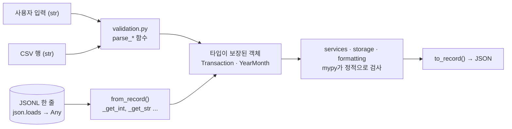

# 05. 타입 힌트로 입출력 계약 정하기

`def parse_month(text: str) -> YearMonth:` 한 줄만 읽어도 "문자열을 주면 `YearMonth`를 돌려준다"는 약속을 알 수 있습니다.
이 문서에서는 이런 약속을 **계약(contract)** 이라고 부릅니다. 타입 힌트로 함수와 데이터의 계약을 적는 방법을 익히고, `mypy --strict`가 그 계약을 어떻게 검사하는지 봅니다.
그리고 검사가 **닿지 않는 곳**(실행 중에 들어오는 파일·사용자 입력)은 어떻게 지키는지도 살펴봅니다.

## 이 문서에서 배우는 것

- 타입 힌트가 "계약"이라는 뜻과, 파이썬이 실행 중에는 타입 힌트를 검사하지 않는다는 사실
- `Optional`, `Enum`, 값 객체(`YearMonth`), `Tuple[str, ...]`, `Literal`로 잘못된 값이 들어갈 자리를 줄이는 방법
- `Callable` 별칭, `TypeVar`와 `Generic`, `Callable`에 묶인 `TypeVar`와 `cast`, `Protocol`이 이 프로젝트에서 하는 일
- `mypy --strict`로 실제 버그를 잡는 과정과, 정적 검사와 실행 중 검증(`from_record`, `validation.py`)의 경계
- `from __future__ import annotations`를 쓰는 이유와, Python 3.9에서 `typing.List`·`Optional`을 쓰는 이유

## 핵심 개념

### 타입 힌트는 약속일 뿐, 실행 중에는 검사되지 않는다

```python
def total(a: int, b: int) -> int:
    return a + b


print(total(1, 2))
print(total("1", "2"))   # 실행은 된다. 결과는 '12'
```

```text
3
12
```

파이썬은 힌트를 무시하고 그대로 실행합니다. 약속을 어긴 곳을 찾는 것은 **정적 타입 검사기**(static type checker)인 mypy의 몫입니다.
이 코드를 `basic.py`로 저장하고 `mypy --strict basic.py`로 검사하면, 실행하기 전에 문제를 알려 줍니다.

```text
basic.py:6: error: Argument 1 to "total" has incompatible type "str"; expected "int"  [arg-type]
basic.py:6: error: Argument 2 to "total" has incompatible type "str"; expected "int"  [arg-type]
Found 2 errors in 1 file (checked 1 source file)
```

### `Optional`: "없을 수도 있음"을 타입에 적기

`Optional[int]`는 "`int` 또는 `None`"입니다. mypy는 `None`인 경우를 처리하기 전에는 그 값을 `int`처럼 쓰지 못하게 막습니다.
`if price is None:`으로 걸러 내면 그 아래에서 `price`는 `int`로 **좁혀집니다**(narrowing).

```python
from __future__ import annotations

from typing import Dict, Optional

PRICES: Dict[str, int] = {"coffee": 4500}


def find_price(name: str) -> Optional[int]:
    return PRICES.get(name)       # 없으면 None


def double_price(name: str) -> int:
    price = find_price(name)
    if price is None:             # None을 먼저 걸러 내면
        raise KeyError(name)
    return price * 2              # 여기서 price는 int로 '좁혀진다'(narrowing)


print(double_price("coffee"))
```

```text
9000
```

이 파일을 `optional_demo.py`로 저장하고 `if price is None:` 두 줄을 지운 뒤 검사하면 mypy가 이렇게 알려 줍니다.

```text
optional_demo.py:14: error: Unsupported operand types for * ("None" and "int")  [operator]
optional_demo.py:14: note: Left operand is of type "Optional[int]"
Found 1 error in 1 file (checked 1 source file)
```

### `TypeVar`와 `Protocol`: 타입을 묶고, 모양으로 맞추기

`TypeVar`는 "어떤 타입이든 되지만, 입력과 출력은 **같은** 타입"이라는 약속입니다. `Generic[T]`를 상속한 클래스도 같은 방식으로 타입을 매개변수로 받습니다.
`Protocol`은 "이 메서드를 가진 객체면 된다"는 약속입니다. 상속 관계가 아니라 모양으로 판단하므로 **구조적 타이핑(structural typing)** 이라고 합니다.

```python
from __future__ import annotations

from typing import Protocol, Sequence, TypeVar

T = TypeVar("T")


def first(items: Sequence[T]) -> T:      # 들어온 원소 타입을 그대로 돌려준다
    return items[0]


class Greeter(Protocol):                 # greet(str) -> str 메서드만 있으면 된다
    def greet(self, name: str) -> str: ...


class Korean:                            # Greeter를 상속하지 않았다
    def greet(self, name: str) -> str:
        return f"안녕하세요, {name}님"


def welcome(greeter: Greeter) -> None:
    print(greeter.greet(first(["민지", "준호"])))   # first(...)는 str


welcome(Korean())
print(first([1000, 2000]) + 1)                     # first(...)는 int
```

```text
안녕하세요, 민지님
1001
```

`first`의 반환 타입을 `Any`로 적었다면, 결과에 오타 난 메서드를 불러도 mypy가 잡지 못합니다. `TypeVar`가 입력과 출력을 **묶어 주기** 때문에 잡을 수 있습니다.

### 그 밖의 도구: `Enum`, `Literal`, `Callable` 별칭

```python
from __future__ import annotations

import json
from enum import Enum
from typing import Callable, Literal

Unit = Literal["원", "달러"]               # 이 두 문자열만 허용
Formatter = Callable[[int], str]           # 'int를 받아 str을 돌려주는 함수' 타입 별칭


class Kind(str, Enum):                     # 정해진 값만 갖는 문자열
    INCOME = "income"
    EXPENSE = "expense"


def show(kind: Kind, amount: int, unit: Unit, fmt: Formatter) -> str:
    return f"{kind.value} {fmt(amount)}{unit}"


kind = Kind("expense")                     # 파일에서 읽은 문자열 → Enum
print(show(kind, 12000, "원", lambda n: f"{n:,}"))
print(kind is Kind.EXPENSE, kind == "expense", json.dumps(kind))
```

```text
expense 12,000원
True True "expense"
```

`str`을 함께 상속한 Enum은 문자열과 비교할 수 있고 JSON으로도 바로 바뀝니다. `frozen` dataclass와 `__post_init__`은 이 프로젝트의 `Transaction`으로 바로 살펴봅니다. 지금까지 본 문법과 이 프로젝트에서 쓰는 곳을 표로 정리하면 다음과 같습니다.

| 문법 | 뜻 | 이 프로젝트의 예 |
| --- | --- | --- |
| `Optional[X]` | `X` 또는 `None` | `TransactionRepository.get -> Optional[Transaction]`, `TransactionChanges` |
| `class K(str, Enum)` | 정해진 값만 갖는 문자열 | `TransactionType` |
| `@dataclass(frozen=True)` | 만든 뒤 바꿀 수 없는 객체 | 모든 모델, `YearMonth`, `SearchCriteria` |
| `Tuple[str, ...]` | 길이가 정해지지 않은 `str` 튜플 | `Transaction.tags` |
| `Literal["a", "b"]` | 이 값들 중 하나 | `formatting.Align` |
| `Callable[[A], R]` | `A`를 받아 `R`을 돌려주는 함수 (`Callable[[], R]`은 인자 없는 함수) | `Decoder`, `Encoder`, `Handler`, `InputFunc`, `Clock` |
| `TypeVar`, `Generic[T]` | 타입을 매개변수로 받기 | `StagedAppend[T]`, `CountingIterator[T]`, `JsonlFile.rewrite` |
| `TypeVar("F", bound=Callable[..., Any])` | "함수면 무엇이든", 받은 타입 그대로 돌려주기 | `decorators.F` |
| `Protocol` | 메서드 모양만 맞으면 되는 계약 | `ErrorReporter`, `FileBackedStore`, `TransactionSink` |

### `from __future__ import annotations`와 Python 3.9

이 프로젝트에서 타입 힌트를 쓰는 모듈은 모두 맨 위에 `from __future__ import annotations`가 있습니다(`__init__.py`, `__main__.py`처럼 힌트가 없는 파일은 빼고).
이 문장이 있으면 어노테이션을 **실행하지 않고 문자열로만 저장**합니다. 그래서 두 가지가 가능해집니다.

1. **아직 정의가 끝나지 않은 클래스를 가리킬 수 있습니다.** `YearMonth` 안의 `def parse(cls, text: str) -> YearMonth:`가 그 예입니다. 이 문장이 없으면 클래스 본문을 실행하는 도중이라 `NameError`가 납니다.
2. **어노테이션 자리에서는 새 문법을 써도 3.9에서 실행됩니다.** 하지만 타입 별칭(`Decoder = Callable[...]`)이나 `Generic[T]` 같은 상속 목록은 어노테이션이 아니라 **실제로 실행되는 코드**입니다.

```python
from __future__ import annotations

from typing import Optional


def find(name: str) -> int | None:      # 어노테이션은 문자열로만 저장되어 평가되지 않는다
    return None


print(find.__annotations__)
print(list[int])                         # 3.9부터 내장 제네릭 가능 (PEP 585)
MaybeInt = Optional[int]                 # 별칭은 '실행되는 코드'라서 typing 쪽이 안전하다
print(MaybeInt)
MaybeInt2 = int | None                   # 3.9에서는 여기서 TypeError
```

```text
{'name': 'str', 'return': 'int | None'}
list[int]
typing.Optional[int]
Traceback (most recent call last):
  ...
TypeError: unsupported operand type(s) for |: 'type' and 'NoneType'
```

Python 3.9에서 `X | None`은 실행되는 자리에 쓸 수 없습니다(3.10부터 가능). 그래서 이 프로젝트는 `Optional[X]`를 씁니다.
`list[int]`나 `collections.Counter[str]`는 3.9에서도 동작하고, `services.py`도 실제로 `Counter[str]`를 씁니다. 그런데도 `typing.List`, `Dict`, `Tuple`로 통일한 것은 **표기 일관성** 때문입니다. `Optional`은 typing에서 가져오면서 `list`는 내장으로 쓰는 식으로 섞이지 않게 한 선택입니다.
3.10 이상만 지원한다면 `list[int]`, `int | None`으로 쓰는 것이 요즘 관례입니다.

## 이 프로젝트에서는

### 1. `validation.py`: `(str) -> 값`, 실패하면 `ValidationError`

[validation.py의 parse_month](../budget_app/validation.py)

```python
def parse_month(text: str) -> YearMonth:
    value = text.strip()
    if not value:
        raise ValidationError("월을 입력하세요.", hint=MONTH_HINT)
    if not _MONTH_SHAPE_RE.fullmatch(value):
        raise ValidationError(f"월 형식이 올바르지 않습니다: '{value}'", hint=MONTH_HINT)
    try:
        return YearMonth.parse(value)
    except ValueError:
        raise ValidationError(f"존재하지 않는 월입니다: '{value}'", hint="월은 01~12 사이여야 합니다.") from None
```

`validation.py`의 공개 함수는 `parse_date(text: str) -> dt.date`, `parse_amount(text: str) -> int`, `parse_tags(text: str) -> Tuple[str, ...]`처럼 **문자열 하나를 받아 검증된 값 하나를 돌려주는** 모양입니다.
옵션을 더 받는 `parse_positive_int(text, *, name, maximum)`도 `parse_id`, `parse_day_of_month` 같은 작은 함수(또는 `cli.py`의 `lambda`)로 감싸서 같은 `(str) -> 값` 모양으로 맞춰 씁니다.
타입 힌트로는 "어떤 예외를 던지는지"를 적을 수 없습니다. 그래서 "실패하면 `ValidationError`"라는 나머지 계약은 모듈 docstring에 적었습니다.

모양이 같으므로 "검증 함수를 받는 함수"는 하나만 만들면 됩니다.

[interactive.py의 Prompter.ask](../budget_app/interactive.py) (시그니처)와 [prompt_transaction](../budget_app/interactive.py) (일부)

```python
    def ask(self, label: str, parser: Callable[[str], T], *, default: Optional[str] = None) -> T:
```

```python
    tx_date = prompter.ask("날짜 (YYYY-MM-DD)", parse_date, default=today.isoformat())
    tx_type = prompter.ask("타입 (income=수입 / expense=지출)", parse_type)
```

`parser`가 `Callable[[str], T]`이고 반환이 `T`입니다. 그래서 `parse_date`를 넘기면 mypy는 `tx_date`를 `datetime.date`로, `parse_type`을 넘기면 `tx_type`을 `TransactionType`으로 추론합니다.
CLI의 `_arg_type(parser: Callable[[str], T]) -> Callable[[str], T]`도 같은 원리로 같은 검증 함수를 argparse `type=`에 연결합니다. 대화형 입력, 명령줄 옵션, CSV 가져오기가 모두 같은 검증 함수를 쓰게 됩니다.

### 2. 모델: `frozen` dataclass와 `__post_init__` 불변 조건

[models.py의 Transaction](../budget_app/models.py) (앞부분)

```python
@dataclass(frozen=True)
class Transaction:
    """거래 내역 한 건."""

    id: int
    type: TransactionType
    date: dt.date
    amount: int
    category: str
    memo: str = ""
    tags: Tuple[str, ...] = ()
    recurring_id: Optional[int] = None  # 반복 규칙으로 자동 생성된 경우 그 규칙의 id
    created_at: str = ""  # 저장 시각 (ISO 8601)

    def __post_init__(self) -> None:
        if self.id <= 0:
            raise ValueError(f"id는 1 이상이어야 합니다: {self.id}")
        if self.amount <= 0:
            raise ValueError(f"금액은 양수여야 합니다: {self.amount}")
        if not self.category:
            raise ValueError("카테고리가 비어 있습니다")
```

- 필드 선언 자체가 "거래에는 무엇이 있고, 각각 어떤 타입인가"를 알려 주는 문서입니다. `dict`였다면 `tx["ammount"]` 같은 오타를 실행해 보기 전에는 모릅니다.
- `frozen=True`면 만든 뒤에 바꿀 수 없습니다. 실행 중에는 `FrozenInstanceError`가 나고, mypy는 실행 전에 `Property "amount" defined in "Transaction" is read-only`로 알려 줍니다(실습 2). 값을 바꿀 때는 `dataclasses.replace()`로 새 객체를 만듭니다(`TransactionChanges.apply_to`).
- 타입은 "정수"까지만 말할 수 있고 "양수"는 말할 수 없습니다. 값의 규칙(불변 조건, invariant)은 `__post_init__`이 실행 중에 검사합니다. 그래서 한번 만들어진 `Transaction`은 금액이 항상 양수라고 믿고 써도 됩니다.
- 태그는 `List[str]`가 아니라 `Tuple[str, ...]`입니다. "길이는 정해지지 않았고 원소는 모두 `str`인 튜플"이라는 뜻입니다(`Tuple[str, int]`는 "정확히 두 칸"이라 다릅니다). 리스트였다면 `frozen=True`여도 `tx.tags.append(...)`로 안쪽이 바뀌고, 객체를 해시할 수도 없습니다. 파일에 쓸 때만 `to_record`에서 `list(self.tags)`로 바꾸고, 읽을 때는 `_get_tags`가 다시 튜플로 바꿉니다(JSON에는 튜플이 없습니다).

### 3. `Optional`: 저장소는 "없을 수 있음", 서비스는 "없으면 오류"

`TransactionRepository.get(tx_id) -> Optional[Transaction]`은 "못 찾을 수도 있다"는 것을 타입으로 알립니다. 저장소 입장에서 없는 id는 정상적인 결과입니다. 서비스는 이것을 사용자에게 보여 줄 오류로 바꿉니다.

[services.py의 LedgerService.get](../budget_app/services.py)

```python
    def get(self, tx_id: int) -> Transaction:
        tx = self._transactions.get(tx_id)
        if tx is None:
            raise NotFoundError(
                f"id {tx_id}에 해당하는 거래가 없습니다.",
                hint="'list'나 'search' 명령으로 올바른 id를 확인하세요.",
            )
        return tx
```

반환 타입이 `Optional`이 아닌 `Transaction`이라서, 이 메서드를 쓰는 `update`·`delete`는 `None` 검사를 할 필요가 없습니다. 반대로 `None` 처리를 빠뜨린 채 반환하려 하면 mypy가 막습니다.

`Optional`은 "바꾸지 않음"을 표현하는 데도 쓰입니다.

[services.py의 TransactionChanges](../budget_app/services.py) (앞부분)

```python
@dataclass(frozen=True)
class TransactionChanges:
    """``update``에서 바꿀 필드. None인 필드는 '바꾸지 않음'이다."""

    date: Optional[dt.date] = None
    type: Optional[TransactionType] = None
    category: Optional[str] = None
    amount: Optional[int] = None
    memo: Optional[str] = None
    tags: Optional[Tuple[str, ...]] = None

    def as_dict(self) -> Dict[str, Any]:
        return {f.name: getattr(self, f.name) for f in fields(self) if getattr(self, f.name) is not None}
```

`update --memo ""`는 "메모를 비워라"이고, `--memo`를 아예 안 주면 "메모는 그대로 둬라"입니다. 이 두 경우를 `""`와 `None`으로 구별합니다.
그래서 `as_dict`는 `if getattr(...)`가 아니라 **`is not None`** 으로 거릅니다. 참/거짓으로 거르면 `""`(빈 메모)와 `()`(빈 태그)도 `None`처럼 버려져서 "비우기"가 동작하지 않습니다(실습 5).

### 4. `TransactionType(str, Enum)`과 값 객체 `YearMonth`

[models.py의 TransactionType](../budget_app/models.py) (앞부분)

```python
class TransactionType(str, Enum):
    """거래 종류. ``str``도 상속하므로 ``"income"`` 같은 문자열처럼 다룰 수 있다."""

    INCOME = "income"
    EXPENSE = "expense"
```

`type: str`이었다면 `"Income"`, `"incme"` 무엇이든 들어갈 수 있습니다. `TransactionType`이면 두 값 말고는 만들 수 없습니다.
`str`도 상속했기 때문에 `.value`가 문자열이고 `json.dumps`도 바로 됩니다. 코드 안에서는 `tx.type is TransactionType.EXPENSE`처럼 `is`로 비교합니다.
문자열은 **경계에서 한 번만** Enum으로 바꿉니다. 파일 값은 `_get_type`의 `TransactionType(value)`가, 사용자 입력은 `parse_type`이 바꿉니다.

[models.py의 YearMonth](../budget_app/models.py) (앞부분)

```python
@dataclass(frozen=True, order=True)
class YearMonth:
    """'연-월' 값 객체. 문자열 ``"2026-10"`` 대신 이 타입을 쓰면 잘못된 월이 들어올 수 없다."""

    year: int
    month: int

    def __post_init__(self) -> None:
        if not 1 <= self.year <= 9999:
            raise ValueError(f"연도는 1~9999 사이여야 합니다: {self.year}")
        if not 1 <= self.month <= 12:
            raise ValueError(f"월은 1~12 사이여야 합니다: {self.month}")
```

값 객체(value object)는 "값 자체가 정체성인 작은 불변 객체"입니다. `YearMonth`는 세 가지를 보장합니다.

- **존재하지 않는 월은 만들 수 없습니다.** `YearMonth(2026, 13)`은 `__post_init__`에서 막힙니다. 그래서 `YearMonth`를 받는 함수는 형식 검사를 다시 할 필요가 없습니다.
- `frozen=True` 덕분에 해시할 수 있어 **dict 키**로 씁니다(`BudgetService.list_statuses`의 `Dict[YearMonth, Budget]`, `Counter[YearMonth]`).
- `order=True` 덕분에 `(year, month)` 순서로 **정렬**됩니다(`sorted(budgets)`).

`BudgetService.status(self, month: YearMonth) -> Optional[BudgetStatus]`에 실수로 `"2026-10"`을 넘기면 어떻게 될까요?
실행 중에는 오류 없이 `None`("예산 없음")이 나옵니다. 문자열과 `YearMonth`를 비교하면 그냥 `False`이기 때문입니다. **조용히 틀린 답**이 나오는 셈입니다. mypy는 이것을 실행 전에 잡습니다(실습 2, 3).

### 5. `Callable` 타입 별칭: 함수를 주고받는 자리에 이름 붙이기

[storage.py](../budget_app/storage.py)

```python
T = TypeVar("T")
Decoder = Callable[[Mapping[str, Any]], T]
Encoder = Callable[[T], Mapping[str, Any]]
```

| 별칭 | 정의 위치 | 뜻 | 쓰는 곳 |
| --- | --- | --- | --- |
| `Decoder[T]` | `storage.py` | 레코드(dict) → 객체 | `Transaction.from_record`를 `JsonlFile.iter_items`에 넘길 때 |
| `Encoder[T]` | `storage.py` | 객체 → 레코드(dict) | `Transaction.to_record`를 `rewrite`, `staged_append`에 넘길 때 |
| `Handler` | `cli.py` | `Callable[[argparse.Namespace, AppContext], int]` | 모든 `cmd_*` 명령 핸들러 |
| `InputFunc` | `interactive.py` | `Callable[[str], str]` (`input`과 같은 모양) | `Prompter`, `Console`, `cli.main(input_func=...)` |
| `Clock` | `services.py` | `Callable[[], dt.datetime]` (`datetime.now`와 같은 모양) | 서비스 생성자의 `now=` |

별칭은 긴 타입에 이름을 붙여 읽기 쉽게 만듭니다. 그리고 **바꿔 끼울 수 있는 자리**가 어디인지 드러냅니다.
테스트는 `InputFunc` 자리에 미리 준비한 답을 돌려주는 `FakeInput`([tests/helpers.py](../tests/helpers.py))을 넣고, `Clock` 자리에 고정된 시각을 돌려주는 `lambda`를 넣습니다([tests/test_bonus.py](../tests/test_bonus.py)). 모양만 맞으면 진짜 `input`이든 가짜든 mypy가 받아 줍니다.
별칭 없이 적은 자리도 같습니다. `cli.main`의 `today: Callable[[], dt.date] = dt.date.today`에는 CLI 테스트(`CliTestCase.run_cli`)가 `lambda: TODAY`(2026-10-19)를 넣습니다. 그래서 실제 날짜가 바뀌어도(자정 무렵에도) 테스트 결과가 같습니다.

### 6. `TypeVar`와 `Generic`: 한 번 짠 코드를 여러 모델에 쓰기

`JsonlFile`은 거래, 카테고리, 예산, 반복 규칙, id 발급 기록(`meta.jsonl`) 파일을 모두 다룹니다. 모델마다 코드를 복사하지 않고 `T` 하나로 일반화했습니다.

[storage.py의 JsonlFile.rewrite](../budget_app/storage.py) (시그니처)

```python
    def rewrite(
        self,
        decoder: Decoder[T],
        transform: Callable[[T], Optional[T]],
        encoder: Encoder[T],
        *,
        extra: Iterable[T] = (),
    ) -> int:
```


네 인자의 `T`는 **같은 타입이어야** 합니다. `rewrite(Transaction.from_record, lambda tx: tx, Category.to_record)`처럼 거래 디코더와 카테고리 인코더를 섞으면 mypy가 `Cannot infer type argument 1 of "rewrite"`로 거부합니다(실습 4).
같은 원리로 `StagedAppend[T]`는 `add(item: T)`로 한 가지 모델만 받고, `services.py`의 `CountingIterator[T]`는 받은 타입을 그대로 흘려보냅니다.

`@contextmanager`로 만든 제너레이터 함수(`JsonlFile.staged_append`)는 `-> Iterator[StagedAppend[T]]`로 적습니다. mypy는 데코레이터를 거친 결과를 컨텍스트 매니저로 이해합니다. 바깥에 공개하는 메서드는 `ContextManager`로 적었습니다.

[storage.py의 TransactionRepository.staged_append](../budget_app/storage.py)

```python
    def staged_append(self) -> ContextManager[StagedAppend[Transaction]]:
        """``with repo.staged_append() as staged: staged.add(tx)`` 형태로 일괄 추가."""
        return self._file.staged_append(Transaction.to_record)
```

`with repo.staged_append() as staged:`에서 `staged`는 `StagedAppend[Transaction]`입니다. 그래서 `staged.add(category)`처럼 다른 모델을 넣으면 mypy가 `Argument 1 to "add" of "StagedAppend" has incompatible type "Category"; expected "Transaction"`으로 잡습니다.

### 7. 데코레이터의 타입: `TypeVar(bound=Callable)`과 `cast`

[decorators.py의 F / timed](../budget_app/decorators.py)

```python
F = TypeVar("F", bound=Callable[..., Any])
```

```python
def timed(func: F) -> F:
    """함수 실행 시간을 밀리초 단위로 기록한다. 예외가 나도 ``finally``에서 기록한다.

    주의: 제너레이터 함수에 붙이면 '제너레이터 객체를 만드는 시간'만 재게 된다.
    실제 반복은 호출한 쪽이 나중에 하기 때문이다.
    """

    @functools.wraps(func)  # 원래 함수의 이름·docstring을 래퍼에 복사한다.
    def wrapper(*args: Any, **kwargs: Any) -> Any:
        started = time.perf_counter()
        try:
            return func(*args, **kwargs)
        finally:
            elapsed_ms = (time.perf_counter() - started) * 1000
            perf_logger.info("%s 실행 시간: %.2fms", func.__qualname__, elapsed_ms)

    return cast(F, wrapper)
```

`timed(func: F) -> F`는 "어떤 함수를 받든 **그 함수의 타입 그대로** 돌려준다"는 계약입니다. `bound=Callable[..., Any]`는 "`F`는 호출할 수 있는 것이어야 한다"는 제한입니다.
그래서 `@timed`를 붙인 `ReportService.monthly_summary`도 여전히 `(month: YearMonth, top: int) -> MonthlySummary`로 검사됩니다.

그런데 실제로 돌려주는 `wrapper`의 타입은 `(*Any, **Any) -> Any`라서 `F`와 다릅니다. `cast(F, wrapper)`는 mypy에게 "이것을 `F`로 취급하라"고 **주장**하는 것입니다. 실행 중에는 아무 일도 하지 않고, 아무것도 검사하지 않습니다.
이 주장이 참이 되도록 `wrapper`는 받은 인자를 그대로 `func`에 넘기고 결과도 그대로 돌려줍니다. 반환 타입을 `Callable[..., Any]`로 적었다면 장식된 함수는 타입 정보를 모두 잃습니다(실습 4에서 비교합니다).
Python 3.10의 `ParamSpec`을 쓰면 `cast` 없이 표현할 수 있습니다. 하지만 3.9 표준 라이브러리에는 없고, `typing_extensions`는 외부 패키지라서 이 프로젝트의 "표준 라이브러리만 사용" 원칙(README)에 맞지 않습니다.

### 8. `Protocol`: import하지 않고도 계약 맺기

[decorators.py의 ErrorReporter / handle_errors](../budget_app/decorators.py) (시그니처)

```python
class ErrorReporter(Protocol):
    """``handle_errors``가 요구하는 최소 기능. 이 메서드만 있으면 어떤 객체든 된다 (구조적 타이핑)."""

    def report_error(
        self, message: str, hint: Optional[str] = None, exc: Optional[BaseException] = None
    ) -> None: ...


R = TypeVar("R", bound=ErrorReporter)


def handle_errors(
    func: Callable[[argparse.Namespace, R], int],
) -> Callable[[argparse.Namespace, R], int]:
```

`handle_errors`는 오류가 나면 `ctx.report_error(...)`를 부르고, 실제 `ctx`는 `context.py`의 `AppContext`입니다. 그렇다면 왜 `ctx: AppContext`라고 적지 않았을까요?
`decorators.py`가 `context.py`를 import하면 **순환 import**가 생기기 때문입니다. `context`는 `services`를 import하고, `services`는 `@timed`를 쓰려고 `decorators`를 import합니다.
`ErrorReporter`는 "`report_error`만 있으면 된다"고만 말합니다. `AppContext`는 이 프로토콜을 상속하지 않고 같은 모양의 메서드(`AppContext.report_error`)를 가졌을 뿐인데, mypy는 계약을 만족한다고 인정합니다.
`TypeVar("R", bound=ErrorReporter)`로 묶었으므로, `@handle_errors`를 붙인 `dispatch`의 두 번째 인자 타입도 `AppContext` 그대로 유지됩니다.

[storage.py의 FileBackedStore](../budget_app/storage.py)와 [context.py의 AppContext.stores](../budget_app/context.py)

```python
class FileBackedStore(Protocol):
    """파일 하나를 맡는 저장소가 공통으로 가진 기능 (초기화·백업에서 사용)."""

    @property
    def path(self) -> Path: ...

    def ensure_file(self) -> bool: ...
```

```python
    def stores(self) -> List[FileBackedStore]:
        return [self.transactions, self.categories, self.budgets, self.recurring_rules, self.sequences]
```

다섯 저장소 클래스에는 공통 부모가 없습니다. 그래도 모두 `path`와 `ensure_file()`을 가졌으므로 `List[FileBackedStore]`에 담깁니다. `AppContext.initialize`는 이 목록을 돌며 파일을 준비하고, `AppContext.data_files`는 백업할 파일 목록을 만듭니다(`export`가 덮어쓰면 안 되는 파일 목록 `protected_files`도 이 목록에서 출발합니다).
새 저장소를 추가하면서 `ensure_file`을 빠뜨리면 mypy가 알려 줍니다(실습 4).

[csv_io.py의 TransactionSink / CsvService.import_csv](../budget_app/csv_io.py) (일부)

```python
class TransactionSink(Protocol):
    """가져온 거래를 받는 곳. 실제 저장(StagedAppend)과 검증 전용(_DryRunSink)이 같은 모양을 가진다."""

    def add(self, item: Transaction) -> None: ...

    def discard(self) -> None: ...
```

```python
        staging: ContextManager[TransactionSink] = (
            nullcontext(_DryRunSink()) if dry_run else self._transactions.staged_append()
        )
```

`import --dry-run`은 아무것도 쓰지 않는 `_DryRunSink`를, 실제 가져오기는 `StagedAppend[Transaction]`을 씁니다. 두 클래스는 공통 부모가 없고 `add(item: Transaction)`과 `discard()`의 모양만 같습니다.
그래서 `nullcontext(...)`와 `staged_append()`를 `ContextManager[TransactionSink]` 변수 하나에 담고, 그 뒤의 가져오기 코드는 둘을 구별하지 않습니다.

### 9. `Literal`: 허용되는 문자열을 못 박기

[formatting.py의 Align](../budget_app/formatting.py)

```python
Align = Literal["left", "right", "center"]
```

`pad(text: str, width: int, align: Align = "left")`는 `"right"`, `"center"`를 차례로 확인하고, 나머지는 모두 왼쪽 정렬로 처리합니다.
그래서 `align: str`이었다면 `pad("식비", 10, "middle")`은 오류 없이 **왼쪽 정렬**됩니다. `Literal`이면 mypy가 실행 전에 거부합니다(실습 2).
값이 몇 개 안 되는 코드 안의 옵션이면 `Literal`로 충분합니다. 파일에 저장하거나 밖에서 들어오는 값이면 `TransactionType`처럼 실행 중에 변환하고 검사해야 하므로 `Enum`이 낫습니다.

### 10. `mypy --strict` 설정

[pyproject.toml](../pyproject.toml) (일부)

```text
[tool.mypy]
python_version = "3.9"
strict = true
files = ["budget_app"]
```

`strict = true`는 여러 검사를 한꺼번에 켭니다. 타입 힌트가 없는 함수 정의 금지, `List`처럼 타입 인자를 빠뜨린 제네릭 금지, `Any`를 반환해 타입이 새는 것 경고, 겹칠 수 없는 값끼리 `==` 비교 금지(strict equality), 쓸모없는 `cast`나 `# type: ignore` 경고 등입니다.
그래서 "힌트가 있는 곳만 검사"하는 것이 아니라, **패키지 전체에 계약이 빠짐없이 적혀 있다**는 것까지 보장합니다. `python_version = "3.9"`는 3.9에 없는 기능을 쓰면 알려 달라는 설정입니다.

### 11. 정적 검사가 닿지 않는 곳: 실행 중 검증

mypy는 **코드**를 검사합니다. 실행 중에 들어오는 **데이터**, 즉 사용자가 친 문자열, JSONL 파일의 한 줄, CSV의 한 칸은 검사할 수 없습니다.
`json.loads`가 돌려주는 값의 타입은 `Any`입니다. 파일에 `"amount": "1000"`이나 `"id": true`가 적혀 있어도 mypy는 알 수 없습니다.
그래서 이 프로젝트는 **경계에서 한 번** 실행 중에 검증하고, 경계 안쪽에서는 타입을 믿습니다.



[models.py의 _get_int](../budget_app/models.py)

```python
def _get_int(record: Mapping[str, Any], key: str) -> int:
    value = record[key]
    # bool은 int의 하위 클래스이므로(True == 1) 명시적으로 걸러낸다.
    if isinstance(value, int) and not isinstance(value, bool):
        return value
    raise TypeError(f"'{key}' 값은 정수여야 합니다: {value!r}")
```

`from_record`는 `_get_int`, `_get_str`, `_get_tags`, `_get_type`, `parse_iso_date`로 필드를 하나씩 확인하고, 그다음 생성자의 `__post_init__`이 값의 규칙을 확인합니다.
여기서 나는 오류는 저장소가 "손상된 줄"로 처리합니다([02. 파일 저장소](02-file-storage.md)). 사용자 입력 쪽 검증과 오류 메시지는 [06. 입력 검증과 오류 처리](06-validation-and-errors.md)에서 다룹니다.

## 왜 이렇게 설계했나

**타입 힌트 없이 docstring에만 적었다면?** 사람은 읽을 수 있지만 도구는 검사할 수 없습니다. 코드가 바뀌어도 docstring은 그대로 남아 거짓말이 되기 쉽습니다. 타입 힌트는 mypy가 매번 검사하는 "실행되지 않는 테스트"입니다.

**dict 대신 dataclass, `str` 대신 `Enum`·`YearMonth`인 이유.** 검증을 **경계에서 한 번** 하고, 그 결과를 타입에 담아 안쪽으로 넘기기 위해서입니다.
`"2026-10"` 문자열을 넘기면 받는 함수마다 형식을 다시 검사하거나, 검사를 빠뜨려 버그가 생깁니다. `YearMonth`를 받는 함수는 "이미 올바른 월"이라고 믿어도 됩니다. 대가는 변환 코드(`parse`, `from_record`, `to_record`)가 늘어난다는 점입니다.

**`None`을 돌려줄까, 예외를 던질까?** 저장소는 "없음"이 정상 결과이므로 `Optional`로 돌려줍니다. 서비스는 사용자에게 "없음"이 오류이므로 `NotFoundError`를 던지고 반환 타입에서 `Optional`을 없앱니다. 반환 타입만 봐도 호출한 쪽이 `None`을 처리해야 하는지 알 수 있습니다.

**ABC(추상 기본 클래스) 대신 `Protocol`인 이유.** ABC는 구현 클래스가 상속해야 하므로 구현 쪽이 ABC를 import해야 합니다. `Protocol`은 상속이 필요 없어 모듈 사이에 의존을 만들지 않습니다(8번의 순환 import 문제).
대신 `@runtime_checkable`을 붙이지 않은 `Protocol`은 `isinstance` 검사에 쓸 수 없습니다. 이 프로젝트는 정적 검사만 필요해서 붙이지 않았습니다.

**`cast`를 쓴 대가.** `cast`는 검사가 아니라 주장이라, 잘못 쓰면 mypy를 속일 수 있습니다. 그래서 `cast`는 `decorators.py`의 두 군데(`timed`, `log_execution`)에만 있고, 래퍼가 인자와 결과를 그대로 전달한다는 조건에서만 씁니다.

**한계도 분명합니다.** 타입 힌트는 실행 중에 아무것도 막지 않습니다. mypy를 **돌려야** 효과가 있습니다. 또 테스트 코드는 mypy 검사 대상(`files = ["budget_app"]`)이 아니라서 테스트 쪽 타입 실수는 잡히지 않습니다.

## 직접 해 보기

모든 명령은 프로젝트 루트에서 실행합니다. mypy는 `pip install mypy`로 설치하거나, `uv`가 있다면 설치 없이 `uvx`로 실행할 수 있습니다. 아래 결과는 mypy 1.13.0, Python 3.9.6으로 확인했습니다.

### 실습 1. 프로젝트 전체를 검사하기

```bash
uvx --quiet --from 'mypy==1.13.0' mypy
```

```text
Success: no issues found in 16 source files
```

인자 없이 실행하면 `pyproject.toml`의 `[tool.mypy]` 설정(`strict`, `python_version`, `files`)을 읽습니다. `pip`으로 설치했다면 `python3 -m mypy`도 같습니다.

### 실습 2. 일부러 계약을 어기고 mypy에게 잡혀 보기

```bash
mkdir -p /tmp/budget-lab-types
```

```bash
cat > /tmp/budget-lab-types/mistakes.py <<'EOF'
from __future__ import annotations

import datetime as dt

from budget_app.formatting import pad
from budget_app.models import Transaction, TransactionType
from budget_app.services import BudgetService, TransactionDraft
from budget_app.storage import TransactionRepository


def show_budget(service: BudgetService) -> None:
    status = service.status("2026-10")              # 실수 1: YearMonth 대신 문자열
    print(status.usage_rate)                        # 실수 2: None일 수 있는 값을 바로 사용


def show_memo(repo: TransactionRepository) -> str:
    return repo.get(3).memo                         # 실수 3: 없는 id면 None


def raise_amount(tx: Transaction) -> None:
    tx.amount = 15000                               # 실수 4: frozen dataclass 수정


def make_draft() -> TransactionDraft:
    return TransactionDraft(
        type=TransactionType.EXPENSE,
        date=dt.date(2026, 10, 2),
        amount=12000,
        category="food",
        tags=["점심"],                               # 실수 5: Tuple[str, ...] 자리에 list
    )


print(pad("식비", 10, "middle"))                     # 실수 6: Literal에 없는 값
EOF
```

`MYPYPATH`는 `budget_app` 패키지를 찾을 위치입니다. 프로젝트 루트(`$PWD`)를 알려 줍니다.

```bash
MYPYPATH="$PWD" uvx --quiet --from 'mypy==1.13.0' mypy --strict --python-version 3.9 /tmp/budget-lab-types/mistakes.py
```

```text
/tmp/budget-lab-types/mistakes.py:12: error: Argument 1 to "status" of "BudgetService" has incompatible type "str"; expected "YearMonth"  [arg-type]
/tmp/budget-lab-types/mistakes.py:13: error: Item "None" of "Optional[BudgetStatus]" has no attribute "usage_rate"  [union-attr]
/tmp/budget-lab-types/mistakes.py:17: error: Item "None" of "Optional[Transaction]" has no attribute "memo"  [union-attr]
/tmp/budget-lab-types/mistakes.py:21: error: Property "amount" defined in "Transaction" is read-only  [misc]
/tmp/budget-lab-types/mistakes.py:30: error: Argument "tags" to "TransactionDraft" has incompatible type "list[str]"; expected "tuple[str, ...]"  [arg-type]
/tmp/budget-lab-types/mistakes.py:34: error: Argument 3 to "pad" has incompatible type "Literal['middle']"; expected "Literal['left', 'right', 'center']"  [arg-type]
Found 6 errors in 1 file (checked 1 source file)
```

여섯 개 모두 **실행하지 않고** 찾았습니다. 메시지마다 어느 계약(시그니처)을 어겼는지가 들어 있습니다.

### 실습 3. 같은 실수를 실행하면: 조용히 틀린다

실습용 데이터를 준비하고 10월 예산을 정합니다.

```bash
rm -rf /tmp/budget-lab && python3 -m budget_app --data-dir /tmp/budget-lab import --from examples/sample_transactions.csv
```

```bash
python3 -m budget_app --data-dir /tmp/budget-lab budget set --month 2026-10 --amount 900000
```

```text
2026-10 예산을 900,000원으로 저장했습니다.
...
```

```bash
python3 -c "
from pathlib import Path
from budget_app.models import YearMonth
from budget_app.services import BudgetService
from budget_app.storage import BudgetStore, TransactionRepository

data = Path('/tmp/budget-lab')
service = BudgetService(BudgetStore(data), TransactionRepository(data))
print(service.status(YearMonth(2026, 10)))
print(service.status('2026-10'))
"
```

```text
BudgetStatus(month=YearMonth(year=2026, month=10), budget=900000, spent=852850)
None
```

예산이 분명히 있는데 문자열로 물으면 "예산 없음(`None`)"이 나옵니다. 예외도 나지 않습니다. 실습 2의 실수 1을 실행 중에 만났다면, 화면에는 "예산이 없다"는 잘못된 안내만 나왔을 것입니다.

### 실습 4. 제네릭, 데코레이터, `Protocol`이 지키는 타입 확인하기

`reveal_type(x)`는 mypy에게 "x의 타입을 알려 달라"고 요청하는 특별한 이름입니다. 검사할 때만 의미가 있고, Python 3.9에서 실제로 실행하면 `NameError`가 납니다. 그래서 이 파일은 실행하지 않고 검사만 합니다.

```bash
cat > /tmp/budget-lab-types/contracts.py <<'EOF'
from __future__ import annotations

from pathlib import Path
from typing import Any, Callable, List

from budget_app.decorators import timed
from budget_app.models import Category, Transaction
from budget_app.services import CountingIterator, ReportService
from budget_app.storage import FileBackedStore, JsonlFile, TransactionRepository

file = JsonlFile(Path("/tmp/budget-lab/transactions.jsonl"))
file.rewrite(Transaction.from_record, lambda tx: tx, Category.to_record)   # 1) 디코더와 인코더의 T가 다름

for item in CountingIterator(["a", "b"]):
    reveal_type(item)                                                       # 2) T = str


def loose(func: Callable[..., Any]) -> Callable[..., Any]:
    return func


@loose
def total(a: int, b: int) -> int:
    return a + b


@timed
def total_timed(a: int, b: int) -> int:
    return a + b


reveal_type(total)                                                          # 3) 타입 정보를 잃음
reveal_type(ReportService.monthly_summary)                                  # 4) @timed를 거쳐도 그대로
total("1", "2")                                                             # 5) 잡지 못함
total_timed("1", "2")                                                       # 6) 잡음


class LogFile:
    def __init__(self, path: Path) -> None:
        self.path = path                                                    # ensure_file()이 없다


stores: List[FileBackedStore] = [TransactionRepository(Path("/tmp/x")), LogFile(Path("/tmp/x/app.log"))]
EOF
```

```bash
MYPYPATH="$PWD" uvx --quiet --from 'mypy==1.13.0' mypy --strict --python-version 3.9 /tmp/budget-lab-types/contracts.py
```

```text
/tmp/budget-lab-types/contracts.py:12: error: Cannot infer type argument 1 of "rewrite" of "JsonlFile"  [misc]
/tmp/budget-lab-types/contracts.py:15: note: Revealed type is "builtins.str"
/tmp/budget-lab-types/contracts.py:32: note: Revealed type is "def (*Any, **Any) -> Any"
/tmp/budget-lab-types/contracts.py:33: note: Revealed type is "def (self: budget_app.services.ReportService, month: budget_app.models.YearMonth, top: builtins.int) -> budget_app.services.MonthlySummary"
/tmp/budget-lab-types/contracts.py:35: error: Argument 1 to "total_timed" has incompatible type "str"; expected "int"  [arg-type]
/tmp/budget-lab-types/contracts.py:35: error: Argument 2 to "total_timed" has incompatible type "str"; expected "int"  [arg-type]
/tmp/budget-lab-types/contracts.py:43: error: List item 1 has incompatible type "LogFile"; expected "FileBackedStore"  [list-item]
/tmp/budget-lab-types/contracts.py:43: note: "LogFile" is missing following "FileBackedStore" protocol member:
/tmp/budget-lab-types/contracts.py:43: note:     ensure_file
Found 4 errors in 1 file (checked 1 source file)
```

- 주석 1: `rewrite`의 `T`가 `Transaction`과 `Category`로 엇갈려 거부됐습니다.
- 주석 2: `CountingIterator(["a", "b"])`의 `T`가 `str`로 추론됐습니다.
- 주석 3, 5: `Callable[..., Any]`를 돌려주는 `loose`를 거친 `total`은 타입 정보를 모두 잃었습니다. 그래서 `total("1", "2")`는 잡히지 않았습니다.
- 주석 4, 6: `@timed`를 거쳐도 원래 시그니처가 남아 있어 `total_timed("1", "2")`를 잡았습니다.
- 마지막 줄: `TransactionRepository`는 상속 없이 `FileBackedStore`로 인정됐고, `ensure_file`이 없는 `LogFile`은 거부됐습니다.

### 실습 5. 실행 중 검증과 `None` / `""` 구별

파일에서 읽은 값처럼 `dict`를 직접 넣어 봅니다. 타입 힌트가 못 하는 일을 `from_record`가 합니다.

```bash
python3 -c "
from budget_app.models import Transaction

good = {'id': 1, 'type': 'income', 'date': '2026-10-02', 'amount': 1000, 'category': 'food'}
print(Transaction.from_record(good).type)
for broken in [
    {**good, 'id': True},
    {**good, 'amount': '1000'},
    {**good, 'type': 'transfer'},
    {**good, 'date': '2026-02-30'},
    {**good, 'amount': -5},
]:
    try:
        Transaction.from_record(broken)
    except (ValueError, KeyError, TypeError) as exc:
        print(type(exc).__name__, exc)
"
```

```text
TransactionType.INCOME
TypeError 'id' 값은 정수여야 합니다: True
TypeError 'amount' 값은 정수여야 합니다: '1000'
ValueError 'type'은 income 또는 expense여야 합니다: 'transfer'
ValueError 존재하지 않는 날짜입니다: '2026-02-30'
ValueError 금액은 양수여야 합니다: -5
```

반대로 생성자를 직접 부르면 타입 검사가 없습니다. `__post_init__`은 값의 규칙만 봅니다.

```bash
python3 -c "
from budget_app.models import Transaction

tx = Transaction(id=1, type='income', date='2026-10-02', amount=1000, category='food')
print('만들어짐:', tx)
print(tx.month)
"
```

```text
만들어짐: Transaction(id=1, type='income', date='2026-10-02', amount=1000, category='food', memo='', tags=(), recurring_id=None, created_at='')
Traceback (most recent call last):
  ...
AttributeError: 'str' object has no attribute 'year'
```

잘못된 객체가 **만들어진 뒤**, 한참 떨어진 곳(`tx.month`)에서야 터졌습니다. 그래서 바깥 데이터는 반드시 `from_record`나 `validation.py`를 거쳐 들어오게 하고, 안쪽 코드는 mypy로 지킵니다.

마지막으로 `None`(바꾸지 않음)과 `""`(비우기)의 차이를 봅니다.

```bash
python3 -c "
from budget_app.services import TransactionChanges
print(TransactionChanges().as_dict(), TransactionChanges().is_empty())
print(TransactionChanges(memo='').as_dict())
print(TransactionChanges(amount=15000, tags=()).as_dict())
"
```

```text
{} True
{'memo': ''}
{'amount': 15000, 'tags': ()}
```

CLI에서 `python3 -m budget_app --data-dir /tmp/budget-lab update --id 3 --memo ""`를 실행하면 메모만 비워지고(`점심 김치찌개` → `-`) 나머지는 그대로입니다.
아무 옵션 없이 `update --id 3`만 실행하면 `TransactionChanges`가 비어 있어 "수정할 항목을 지정하지 않았습니다" 오류(종료 코드 2)가 납니다.

## 자주 하는 실수

**1. `Optional` 결과를 확인 없이 쓴다.** `repo.get(3).memo`는 id 3이 없으면 `AttributeError`입니다. mypy가 `union-attr`로 알려 주면 `if tx is None:` 처리를 넣거나, `LedgerService.get`처럼 `None`을 예외로 바꾸는 함수를 쓰세요.

**2. `None` 검사를 참/거짓으로 한다.** `if changes.memo:`는 `""`도 거짓으로 봅니다. "값이 없음"과 "빈 값"을 구별해야 하면 `is None` / `is not None`을 쓰세요(`TransactionChanges.as_dict`).

**3. 타입 힌트가 있으니 파일 데이터도 맞을 거라고 믿는다.** 힌트는 실행 중에 아무것도 막지 않습니다(실습 5). 파일·입력·CSV처럼 바깥에서 오는 값은 경계에서 검증하세요.

**4. `cast`로 오류를 덮는다.** `cast(YearMonth, "2026-10")`은 mypy를 조용하게 만들 뿐, 값은 여전히 문자열입니다. `cast`는 "검사기가 증명하지 못하지만 내가 보장한다"는 경우에만 쓰세요.

**5. `frozen` dataclass에 리스트를 넣는다.** 안쪽이 바뀌고 해시도 안 됩니다. `Tuple[str, ...]`를 쓰세요.

**6. str-Enum을 문자열 리터럴과 섞어 비교한다.** 실행 중에는 `TransactionType.INCOME == "income"`이 `True`입니다. 이 코드처럼 양쪽이 모두 리터럴이면 `mypy --strict`가 `Non-overlapping equality check (left operand type: "Literal[TransactionType.INCOME]", right operand type: "Literal['income']")` 오류로 거부합니다.
하지만 `tx.type == "incme"`처럼 한쪽이 변수이면 mypy는 오류를 내지 않습니다. `TransactionType`이 `str`의 하위 클래스라서 "겹칠 수 있는 비교"로 보기 때문입니다. 오타가 나도 실행 중에 늘 `False`가 될 뿐 아무도 알려 주지 않습니다. 문자열은 경계에서 Enum으로 바꾸고, 안쪽에서는 `tx.type is TransactionType.INCOME`처럼 Enum끼리 `is`로 비교하세요. 그러면 `TransactionType.INCMOE` 같은 오타는 mypy가 잡습니다.

**7. Python 3.9에서 `int | None`을 별칭이나 `isinstance`에 쓴다.** 어노테이션 밖에서는 `TypeError`입니다. 3.9를 지원하는 동안은 `Optional[int]`를 쓰세요.

## 정리

- [ ] 타입 힌트가 "계약"인 이유와, 실행 중에는 검사되지 않는다는 사실을 예로 설명할 수 있다
- [ ] `validation.py`의 `(str) -> 값` 모양 덕분에 `Prompter.ask`와 `_arg_type`이 하나로 끝나는 이유를 `TypeVar`로 설명할 수 있다
- [ ] `frozen` dataclass와 `__post_init__`이 각각 무엇을 보장하는지 설명할 수 있다
- [ ] `TransactionChanges`에서 `None`과 `""`를 구별하는 이유와 `is not None`을 쓴 이유를 설명할 수 있다
- [ ] `TransactionType`, `YearMonth`, `Tuple[str, ...]`, `Literal`이 막아 주는 실수를 각각 하나씩 말할 수 있다
- [ ] `JsonlFile.rewrite`, `StagedAppend[T]`, `CountingIterator[T]`에서 `T`가 하는 일을 설명할 수 있다
- [ ] `timed(func: F) -> F`와 `cast`가 데코레이터를 붙인 뒤에도 시그니처를 지키는 방식을 설명할 수 있다
- [ ] `ErrorReporter`, `FileBackedStore`가 `Protocol`인 이유(순환 import, 상속 불필요)를 설명할 수 있다
- [ ] mypy가 지키는 곳과 `from_record`·`validation.py`가 지키는 곳의 경계를 그림으로 설명할 수 있다

## 스스로 설명해 보기

1. `BudgetService.status("2026-10")`은 실행 중에 오류가 나지 않습니다. 그런데 왜 위험한가요? 타입 힌트와 mypy는 이 문제를 어떻게 막나요?
2. `TransactionRepository.get`은 `Optional[Transaction]`을, `LedgerService.get`은 `Transaction`을 돌려줍니다. 두 계층이 "없음"을 다르게 다루는 이유는 무엇인가요?
3. `handle_errors`가 `AppContext` 대신 `ErrorReporter` 프로토콜을 요구하는 이유를 import 관계로 설명해 보세요.
4. `cast(F, wrapper)`를 지우고 `timed`의 반환 타입을 `Callable[..., Any]`로 바꾸면 무엇을 잃나요?
5. mypy를 통과한 코드인데도 `from_record`에서 타입을 다시 검사하는 이유는 무엇인가요?
