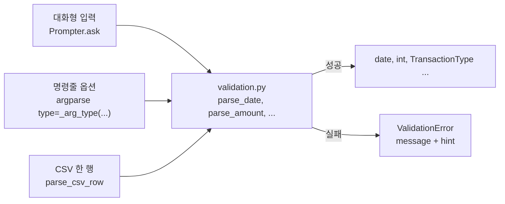
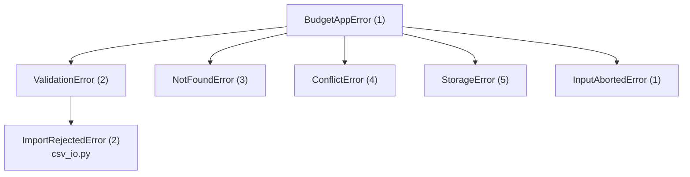
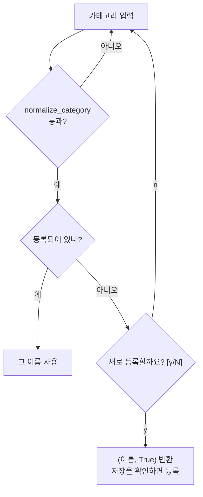
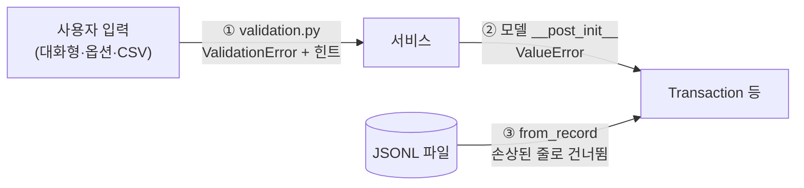

# 06. 입력 검증과 오류 처리: 원인 + 해결 힌트

> 관련 요구사항: 4.3 입력 검증, 4.14 예외 처리 및 종료 코드 ("스택트레이스 대신 원인 + 해결 힌트", "정상 0, 오류는 0이 아닌 값")
> 핵심 코드: [validation.py](../budget_app/validation.py), [errors.py](../budget_app/errors.py), [interactive.py](../budget_app/interactive.py), [cli.py](../budget_app/cli.py)

## 이 문서에서 배우는 것

- 검증 함수를 `(str) -> 값` 모양의 순수 함수로 만들고, 대화형 입력·명령줄 옵션·CSV 세 입구에서 **같은 규칙을 재사용**하는 구조를 설명할 수 있습니다.
- 예외 클래스에 "원인(message) + 힌트(hint) + 종료 코드(exit_code)"를 담는 설계와 `ExitCode` 표를 설명하고, 각 코드를 직접 만들어 볼 수 있습니다.
- `Prompter`의 재입력 루프(남은 기회, 기본값, EOF, 최대 횟수)와 카테고리 등록 유도 흐름을 설명할 수 있습니다.
- `argparse` 오류, 예상한 오류, 예상하지 못한 오류가 각각 어디서 어떻게 처리되는지 구분할 수 있습니다.
- 입력 검증 / 모델 불변식 / 파일 데이터 검증이라는 **세 겹의 방어선**을 설명할 수 있습니다.

## 핵심 개념

### 1. 검증은 "문자열을 믿을 수 있는 값으로 바꾸는 일"이다

사용자 입력은 언제나 **문자열**입니다. 검증 함수가 "맞다/틀리다"만 돌려주면, 부르는 쪽이 다시 `int()`나 날짜 변환을 해야 하고 규칙이 여러 곳에 흩어집니다.
그래서 검증 함수는 **변환까지 끝낸 값을 돌려주거나, 이유를 담은 예외를 던지게** 만드는 것이 좋습니다.
아래 예제는 이 프로젝트와 같은 구조를 작게 줄인 것입니다.

```python
class AppError(Exception):
    exit_code = 1                          # 하위 클래스가 덮어쓴다

    def __init__(self, message, hint=None):
        super().__init__(message)
        self.message = message             # 원인
        self.hint = hint                   # 해결 힌트

class InvalidInput(AppError):
    exit_code = 2

def parse_age(text: str) -> int:
    """문자열 → 나이(int). 잘못되면 원인과 힌트를 담아 던진다."""
    value = text.strip()
    if not value.isascii() or not value.isdigit():
        raise InvalidInput(f"나이는 숫자여야 합니다: '{value}'", hint="예: 27")
    age = int(value)
    if not 1 <= age <= 149:
        raise InvalidInput(f"나이가 범위를 벗어났습니다: {age}", hint="1~149 사이로 입력하세요.")
    return age

def ask(parser, answers, max_attempts=3):
    """재입력 루프: 통과할 때까지 다시 묻는다. answers는 사용자가 차례로 친 값이라고 치자."""
    for attempt, raw in enumerate(answers[:max_attempts], start=1):
        try:
            return parser(raw)
        except InvalidInput as exc:
            print(f"  ! {exc.message} / 힌트: {exc.hint} (남은 기회 {max_attempts - attempt}번)")
    raise AppError("올바른 값을 받지 못했습니다.")

print(ask(parse_age, ["스물", "200", "27"]))
try:
    parse_age("-1")
except AppError as exc:                    # 부모 클래스로 한꺼번에 잡을 수 있다
    print(type(exc).__name__, exc.exit_code, exc.message)
```

```text
  ! 나이는 숫자여야 합니다: '스물' / 힌트: 예: 27 (남은 기회 2번)
  ! 나이가 범위를 벗어났습니다: 200 / 힌트: 1~149 사이로 입력하세요. (남은 기회 1번)
27
InvalidInput 2 나이는 숫자여야 합니다: '-1'
```

세 가지를 기억하세요.

1. **검증 함수는 입출력을 하지 않습니다.** `print`도 `input`도 없습니다. 그래서 재입력 루프에서도, 명령줄 옵션에서도, 파일을 읽을 때도 쓸 수 있습니다.
2. **예외가 "무엇이 잘못됐는지"와 "어떻게 고치는지"를 함께 운반합니다.** 메시지를 만드는 곳(검증 함수)과 보여 주는 곳(UI)이 분리됩니다.
3. **예외 종류마다 종료 코드를 정해 두면**, 바깥에서는 부모 클래스 하나만 잡고 `exc.exit_code`를 쓰면 됩니다.

### 2. 종료 코드(exit code)

프로그램은 끝날 때 운영체제에 정수 하나를 돌려줍니다. 셸에서는 `echo $?`로 바로 앞 명령의 종료 코드를 볼 수 있습니다.

```bash
python3 -c "raise SystemExit(3)"; echo $?
```

```text
3
```

관례상 `0`은 성공, 그 밖의 값은 실패입니다. `argparse`는 사용법 오류에 `2`를 쓰고, Ctrl+C로 끝난 프로그램은 `128 + 2(SIGINT 번호) = 130`을 쓰는 것이 관례입니다.
스크립트나 CI는 화면 문구가 아니라 이 숫자로 성공/실패를 판단하므로, 오류 종류별로 **일관된 코드**를 주는 것이 중요합니다.

## 이 프로젝트에서는

### 한 규칙, 한 곳: validation.py와 세 입구

[validation.py](../budget_app/validation.py)의 모든 함수는 `(str) -> 값` 모양이고, 잘못된 입력에는 `ValidationError(message, hint)`를 던집니다. 이 함수들을 세 입구가 똑같이 씁니다.



**① 대화형 입력** — [interactive.py의 Prompter.ask](../budget_app/interactive.py)는 검증 함수를 인자(`parser`)로 받아, 통과할 때까지 다시 묻습니다.

```python
    def ask(self, label: str, parser: Callable[[str], T], *, default: Optional[str] = None) -> T:
        """``label``을 묻고 ``parser``로 변환한 값을 돌려준다.

        - Enter만 누르면 ``default``를 쓴다 (default가 ""이면 '선택 항목 건너뛰기').
        - parser가 ValidationError를 던지면 원인과 힌트를 보여 주고 다시 묻는다.
        """
        suffix = f" [{default}]" if default else ""
        for attempt in range(1, self._max_attempts + 1):
            raw = self.read(f"{label}{suffix}: ").strip()
            if not raw and default is not None:
                raw = default
            try:
                return parser(raw)
            except ValidationError as exc:
                self.say(f"  ! {exc.message}")
                if exc.hint:
                    self.say(f"    힌트: {exc.hint}")
                if attempt < self._max_attempts:
                    self.say(f"    다시 입력해 주세요. (남은 기회 {self._max_attempts - attempt}번)")
        raise InputAbortedError(
            f"'{label}' 값이 {self._max_attempts}번 연속 올바르지 않아 작업을 취소했습니다.",
            hint="입력 형식을 확인한 뒤 다시 실행하세요.",
        )
```

**② 명령줄 옵션** — `argparse`의 `type=`에는 "문자열을 받아 값을 돌려주는 함수"를 넣을 수 있습니다. 검증 함수가 바로 그런 모양입니다. 다만 `argparse`는 `ArgumentTypeError`(또는 `TypeError`, `ValueError`)만 사용법 오류로 처리하므로, [cli.py의 _arg_type](../budget_app/cli.py)이 예외를 바꿔 줍니다.

```python
def _arg_type(parser: Callable[[str], T]) -> Callable[[str], T]:
    """validation 함수를 argparse ``type=``으로 쓸 수 있게 감싼다 (ValidationError → ArgumentTypeError)."""

    def convert(text: str) -> T:
        try:
            return parser(text)
        except ValidationError as exc:
            detail = f" ({exc.hint})" if exc.hint else ""
            raise argparse.ArgumentTypeError(f"{exc.message}{detail}") from None

    convert.__name__ = getattr(parser, "__name__", "value")
    return convert
```

사용하는 곳은 `p.add_argument("--amount", metavar="AMOUNT", type=_arg_type(parse_amount), ...)`처럼 한 줄입니다.

**③ CSV 가져오기** — [csv_io.py의 parse_csv_row](../budget_app/csv_io.py)도 같은 함수로 한 행을 `TransactionDraft`로 바꿉니다.

```python
    return TransactionDraft(
        date=parse_date(cell("date")),
        type=parse_type(cell("type")),
        category=normalize_category(cell("category")),
        amount=parse_amount(cell("amount")),
        memo=parse_memo(cell("memo")),
        tags=parse_tags(cell("tags")),
    )
```

그래서 `add`에서 거부되는 `-500`은 `update --amount -500`에서도, CSV의 `amount` 열에서도 **같은 문구로** 거부됩니다.

### 규칙 하나하나 살펴보기

**날짜: "모양"과 "실제로 있는 날짜"를 따로 검사합니다.** [validation.py의 parse_date](../budget_app/validation.py)

```python
def parse_date(text: str) -> dt.date:
    value = text.strip()
    if not value:
        raise ValidationError("날짜를 입력하세요.", hint=DATE_HINT)
    if not _DATE_SHAPE_RE.fullmatch(value):
        raise ValidationError(f"날짜 형식이 올바르지 않습니다: '{value}'", hint=DATE_HINT)
    try:
        return parse_iso_date(value)
    except ValueError:
        raise ValidationError(
            f"존재하지 않는 날짜입니다: '{value}'",
            hint="월(01~12)과 그 달의 일 수를 확인하세요.",
        ) from None
```

`2026-1-5`는 모양이 틀렸고(힌트: 형식), `2026-02-30`은 모양은 맞지만 없는 날짜입니다(힌트: 그 달의 일 수). 원인이 다르니 **힌트도 다르게** 줍니다.
`from None`은 내부의 `ValueError`를 예외 체인에서 숨겨, `--debug` 출력이 불필요하게 길어지지 않게 합니다.

**금액: 정규식으로 허용할 모양을 먼저 정합니다.** [validation.py의 parse_amount](../budget_app/validation.py)

```python
# "12000" 또는 세 자리마다 쉼표를 찍은 "12,000"만 허용한다. "1,2,3" 같은 값은 거부.
_AMOUNT_RE = re.compile(r"[0-9]+|[0-9]{1,3}(?:,[0-9]{3})+")
```

`parse_amount`는 앞뒤 공백을 지우고 끝의 `원`(과 그 바로 앞의 공백)을 뗀 뒤, 빈 값 → 음수 → 모양 → 0 → 최대값(1조) 순서로 검사합니다. 숫자 **사이의** 공백은 지우지 않습니다. 실제 결과는 다음과 같습니다.

| 입력 | 결과 |
| --- | --- |
| `12000`, `12,000`, `12,000원`, `12,000 원` | `12000` |
| `1,2,3`, `12.5`, `1e3` | 금액은 양의 정수여야 합니다 |
| `0` | 금액은 0보다 커야 합니다 |
| `-500` | 금액은 음수일 수 없습니다 (힌트: 수입/지출 구분은 부호가 아니라 타입으로) |
| `1000000000001` | 금액이 너무 큽니다 (힌트: 1,000,000,000,000원 이하) |
| `１２` (전각 숫자) | 금액은 양의 정수여야 합니다 |
| `1 2 3` (숫자 사이 공백) | 금액은 양의 정수여야 합니다 (숫자 사이 공백은 지우지 않으므로 거부) |

`１２` 줄이 중요합니다. 정규식에서 `\d`는 전각 숫자 같은 **유니코드 숫자도** 맞다고 보고, `int("１２")`도 `12`를 돌려줍니다. 이 프로젝트는 `[0-9]`로 범위를 좁혀 의도하지 않은 입력을 막습니다.
또 `float`을 쓰지 않으므로 `12.5`나 `1e3` 같은 값이 슬쩍 정수로 바뀌는 일이 없습니다.
공백은 필요한 곳에서만 너그럽게 받습니다. 앞뒤 공백과 `12,000 원`처럼 `원` 앞에 띄어 쓴 공백은 지우지만, 숫자 사이의 공백은 그대로 두어 정규식에서 거부됩니다. 공백을 모두 지우면 `1 2 3` 같은 오타가 조용히 `123`으로 받아들여지기 때문입니다.

**그 밖의 규칙**

| 함수 | 규칙 | 예 |
| --- | --- | --- |
| `parse_type` | `TYPE_ALIASES` 사전으로 별칭 허용, 대소문자 무시 | `E`, `ex`, `지출` → `EXPENSE` / `transfer` 거부 |
| `parse_month` | `YYYY-MM` 모양 + 01~12 | `202610` 형식 오류, `2026-00` 없는 월 |
| `normalize_category` | 공백 정리 + 소문자, 20자 이하, 정규식 `[^\W_][\w&\- ]*` | `Food` → `food`, `eating  out` → `eating out` / `-x`, `a/b`, `_tmp` 거부 |
| `parse_memo` | `_clean_text`로 줄바꿈·탭·연속 공백을 공백 하나로 바꾸고 제어 문자(ESC 등)를 지움, 200자 이하 | `"점심\n  김치찌개"` → `"점심 김치찌개"` |
| `parse_tags` | 쉼표로 나누고 `#` 제거·`_clean_text`·소문자, 순서 유지하며 중복 제거, 최대 10개 | `"#점심, 회사,점심"` → `("점심", "회사")` |
| `_ensure_encodable` | UTF-8로 저장할 수 없는 문자(서로게이트) 거부 | `"깨진\udcff입력"` → 저장할 수 없는 문자 |

`parse_tags`는 `Dict[str, None]`과 `setdefault`로 중복을 없앱니다. `set`은 순서를 지키지 않지만 dict는 넣은 순서를 지키기 때문입니다.
`_ensure_encodable`은 깨진 입력을 막습니다. 예를 들어 명령줄 인자에 UTF-8이 아닌 바이트가 섞이면 파이썬은 그것을 서로게이트 문자(`\udcff` 등)로 바꿔 둡니다. 이 값이 파일에 쓰이다가 `UnicodeEncodeError`로 터지기 **전에** 입력 단계에서 거부합니다 (`update --memo $'\xff'` → "메모에 저장할 수 없는 문자가 들어 있습니다").
`_clean_text`(메모·태그·검색어가 함께 씁니다)가 제어 문자(`unicodedata.category(ch) == "Cc"`)를 지우는 이유도 비슷합니다. 메모에 `ESC[31m` 같은 터미널 제어 코드가 남아 있으면 `list` 출력이 색을 바꾸거나 표가 깨질 수 있습니다. `parse_memo("점심\x1b[31m빨간 글씨\x07")`은 `'점심[31m빨간 글씨'`가 됩니다.

### 예외 계층과 종료 코드: errors.py

[errors.py](../budget_app/errors.py)는 종료 코드를 `IntEnum`으로 정의합니다. `IntEnum`은 정수처럼 비교·반환할 수 있으면서 `ExitCode.NOT_FOUND`처럼 이름으로 읽을 수 있습니다.

```python
class ExitCode(IntEnum):
    """프로세스 종료 코드. 0은 정상이고 나머지는 모두 오류다."""

    OK = 0
    ERROR = 1  # 분류되지 않은 오류, 대화형 입력 중단
    INVALID_INPUT = 2  # 입력 형식/값 오류 (argparse 사용법 오류와 같은 값)
    NOT_FOUND = 3  # 없는 id, 없는 파일 등
    CONFLICT = 4  # 중복 등록, 사용 중인 카테고리 삭제 시도 등
    STORAGE = 5  # 파일 읽기/쓰기 실패, 저장 경로 문제
    INTERRUPTED = 130  # Ctrl+C (관례: 128 + SIGINT(2))
```

예외 클래스는 **클래스 속성으로 종료 코드를 가집니다.**

```python
class BudgetAppError(Exception):
    """가계부 애플리케이션의 모든 '예상된' 오류의 부모 클래스."""

    exit_code: ExitCode = ExitCode.ERROR

    def __init__(self, message: str, hint: Optional[str] = None) -> None:
        super().__init__(message)
        self.message = message
        self.hint = hint


class ValidationError(BudgetAppError):
    """사용자 입력이 형식이나 규칙에 맞지 않는다."""

    exit_code = ExitCode.INVALID_INPUT
```



[04. 데코레이터](04-decorators.md)에서 본 `@handle_errors`는 하위 클래스를 하나하나 잡지 않고 부모인 `BudgetAppError` 하나만 잡아 `exc.exit_code`를 돌려줍니다. 새 오류 종류가 생겨도 **예외 클래스 하나만 추가하면** 되고, 핸들러 쪽 코드는 바뀌지 않습니다.

아래 표의 명령은 모두 직접 실행해 종료 코드를 확인한 것입니다 (실습 데이터는 "직접 해 보기"에서 준비합니다).

| 코드 | 상황 | 명령 예 | 처리하는 곳 |
| --- | --- | --- | --- |
| 0 | 정상, 취소를 고른 경우 포함 | `list`, `--help`, `--version` | — |
| 1 | 대화형 입력 중 EOF, 5번 연속 오류 (예기치 못한 오류도 1: 아래 "마지막 안전망") | `add < /dev/null` | `InputAbortedError` |
| 2 | 잘못된 옵션 값 / 사용법 | `summary --month 2026-13`, `list --limit 0`, `list -h` | `KoreanArgumentParser.error` |
| 2 | 검증 규칙 위반 (옵션 해석 뒤) | `export --out x.csv`(기간 없음), `update --id 3`(필드 없음), `search --from 2026-10-31 --to 2026-10-01`, `update --id 3 --category nothing`(등록되지 않은 카테고리), `--data-dir ""` | `ValidationError` |
| 2 | CSV 오류 행 | `import --from examples/invalid_transactions.csv` | `ImportRejectedError` |
| 3 | 대상 없음 | `delete --id 999 --yes`, `import --from nope.csv`, `category remove nothing`, `category remove food --replace-with nothing` | `NotFoundError` |
| 4 | 충돌 | `category add food`, `category remove food`(사용 중), 같은 `--out`으로 두 번 `export` | `ConflictError` |
| 5 | 저장 경로 문제 | `--data-dir`에 일반 파일 지정, `--data-dir '~없는사용자/data'`, 쓰기 권한 없는 폴더, 읽기 전용 데이터 파일 | `StorageError`, `OSError` |
| 130 | Ctrl+C | `add` 입력 중 Ctrl+C | `KeyboardInterrupt` |

### 대화형 입력: 다시 묻기, 기본값, EOF, 확인 질문

`Prompter`의 동작을 정리하면 다음과 같습니다.

- **다시 묻기**: 검증에 실패하면 원인·힌트와 함께 "남은 기회 N번"을 보여 줍니다. 기본 최대 횟수는 `MAX_ATTEMPTS = 5`입니다.
- **기본값**: `default`가 있으면 `[2026-10-19]`처럼 보여 주고, Enter만 치면 그 값을 검증 함수에 넣습니다. 메모·태그는 `default=""`라서 Enter가 "건너뛰기"가 됩니다.
- **EOF**: `Prompter.read`가 `EOFError`를 `InputAbortedError`로 바꿉니다. 파이프 입력이 끝났는데 계속 묻는 무한 루프를 막습니다.
- **확인 질문**: `confirm`은 `[Y/n]`(기본 예) 또는 `[y/N]`(기본 아니오)을 보여 주고 `y/yes/예/네/ㅇ`, `n/no/아니오/아니요/ㄴ`을 받습니다. 삭제·복원처럼 되돌리기 어려운 일은 기본값을 "아니오"로 둡니다.

**카테고리는 "검증"만으로 끝나지 않습니다.** 형식이 맞아도 등록되지 않은 이름일 수 있기 때문입니다. [interactive.py의 ask_category](../budget_app/interactive.py)는 요구사항 4.5("없으면 안내 후 재입력/등록 유도")를 이렇게 구현합니다.



실제 화면입니다 (`[ ]` 안의 날짜는 실행한 날의 날짜로 바뀝니다).

```text
날짜 (YYYY-MM-DD) [2026-10-19]: 2026/10/02
  ! 날짜 형식이 올바르지 않습니다: '2026/10/02'
    힌트: YYYY-MM-DD 형식으로 입력하세요 (예: 2026-10-18).
    다시 입력해 주세요. (남은 기회 4번)
날짜 (YYYY-MM-DD) [2026-10-19]: 2026-02-30
  ! 존재하지 않는 날짜입니다: '2026-02-30'
    힌트: 월(01~12)과 그 달의 일 수를 확인하세요.
    다시 입력해 주세요. (남은 기회 3번)
날짜 (YYYY-MM-DD) [2026-10-19]: 2026-10-02
타입 (income=수입 / expense=지출): 지출
  등록된 카테고리: food, transport, rent, utilities, shopping, health, salary, etc
카테고리: coffee
  ! 'coffee'은(는) 등록되지 않은 카테고리입니다.
  'coffee' 카테고리를 새로 등록할까요? [y/N]: n
  등록된 카테고리 중에서 골라 주세요: food, transport, rent, utilities, shopping, health, salary, etc
카테고리: Food
금액 (원, 양의 정수): -500
  ! 금액은 음수일 수 없습니다: '-500'
    힌트: 금액은 양의 정수로 입력하세요. 수입/지출 구분은 부호가 아니라 타입(income/expense)으로 합니다.
    다시 입력해 주세요. (남은 기회 4번)
금액 (원, 양의 정수): 12,000
메모 (선택, Enter로 건너뛰기):   점심   김치찌개
태그 (선택, 쉼표로 구분): #점심, 회사, 점심

입력한 내용
  ...
  카테고리 : food
  금액     : 12,000원
  메모     : 점심 김치찌개
  태그     : #점심 #회사
이 내용으로 저장할까요? [Y/n]:
거래를 저장했습니다. (id: 1)
```

`Food`는 `food`로, 메모의 연속 공백은 하나로, 중복 태그는 하나로 정리되었습니다. 사용자는 고칠 것만 다시 입력하면 됩니다.

새 카테고리 등록에 `y`로 답하면 `ask_category`는 **바로 등록하지 않고** `(이름, True)`를 돌려줍니다. `cmd_add`는 요약에 `(카테고리 'coffee'은(는) 저장할 때 새로 등록됩니다)`를 덧붙이고,
마지막 `이 내용으로 저장할까요?`에 예라고 답했을 때만 `카테고리 'coffee'을(를) 등록했습니다.`를 출력하며 카테고리와 거래를 저장합니다. 저장을 취소하면 카테고리도 생기지 않습니다. "취소했는데 흔적이 남는" 일을 막기 위한 순서입니다.

### 명령줄 오류: KoreanArgumentParser와 `--help`

`argparse`는 사용법 오류가 나면 `error()` 메서드를 부르고 종료 코드 2로 끝냅니다. [cli.py의 KoreanArgumentParser](../budget_app/cli.py)는 이 메서드만 바꿔서 같은 "오류 + 힌트" 형식을 씁니다.

```python
class KoreanArgumentParser(argparse.ArgumentParser):
    def error(self, message: str) -> NoReturn:
        self.print_usage(sys.stderr)
        self.exit(
            int(ExitCode.INVALID_INPUT),
            f"오류: {_translate_argparse_message(message)}\n힌트: '{self.prog} --help'로 사용법을 확인하세요.\n",
        )
```

`_translate_argparse_message`는 `_ARGPARSE_MESSAGES`의 정규식으로 `argparse`의 영어 메시지(`the following arguments are required: ...` 등)를 한국어로 바꿉니다. 맞는 패턴이 없으면 원문을 그대로 씁니다.

```text
$ python3 -m budget_app --data-dir /tmp/budget-lab search --type transfer
사용법: python -m budget_app search [--data-dir DIR] [--verbose] [--timing] [--debug] [--help]
...
오류: --type: 허용되지 않은 타입입니다: 'transfer' (income(수입) 또는 expense(지출) 중 하나를 입력하세요.)
힌트: 'python -m budget_app search --help'로 사용법을 확인하세요.
```

요구사항 4.1("옵션 표기는 `--`로 통일")에 맞춰 모든 파서를 `add_help=False`로 만들고 `--help`만 직접 추가했습니다(`_add_help`). 그래서 `-h`는 모르는 인자로 처리됩니다.

```text
$ python3 -m budget_app list -h
...
오류: 알 수 없는 인자입니다: -h
힌트: 'python -m budget_app --help'로 사용법을 확인하세요.
```

이 오류들은 `main()`이 부르는 `_run()`의 `parser.parse_args()`에서 끝납니다. 로그 설정과 `AppContext` 생성보다 **먼저**이므로, 잘못된 옵션으로는 데이터 폴더가 만들어지지도 않고 `app.log`에도 남지 않습니다.
`--data-dir ""`처럼 데이터 경로 자체가 비어 있는 경우도 `dispatch`(즉 `@handle_errors`) 전에 걸러집니다. `_run()`이 `resolve_data_dir`의 `ValidationError`를 직접 받아 `오류: --data-dir 값이 비어 있습니다.`와 힌트를 보여 주고 2로 끝냅니다. `--data-dir '~없는사용자/data'`처럼 `~`를 해석할 수 없는 경로도 같은 자리에서 `StorageError`(5)로 알립니다.

### 마지막 안전망: 예상하지 못한 오류, `--debug`, app.log

`BudgetAppError`도 `KeyboardInterrupt`(130)도 아닌 예외는 `@handle_errors`의 `OSError` 분기(종료 코드 5)나 `Exception` 분기(종료 코드 1)로 갑니다 (`list | head`에서 나는 `BrokenPipeError`만은 오류가 아니므로 다시 던져 `main()`이 0으로 끝냅니다). 두 경우 모두 `error_logger.exception(...)`으로 **스택트레이스를 app.log에 남기고**, 화면에는 원인 + 힌트만 보여 줍니다.
`--debug`를 붙이면 [context.py의 AppContext.report_error](../budget_app/context.py)가 스택트레이스도 화면에 출력합니다.

```python
    def report_error(self, message: str, hint: Optional[str] = None, exc: Optional[BaseException] = None) -> None:
        """``@handle_errors``가 부르는 오류 출력 함수 (ErrorReporter 프로토콜 구현)."""
        self.console.error(message, hint)
        if self.debug and exc is not None:
            print("\n[debug] 상세 정보:", file=self.console.err)
            traceback.print_exception(type(exc), exc, exc.__traceback__, file=self.console.err)
```

쓰기 권한이 없는 데이터 폴더(`chmod 555`)에 예산을 저장하려 하면 이렇게 보입니다 (경로 앞부분은 줄였습니다).

```text
$ python3 -m budget_app --data-dir /tmp/budget-lab-ro budget set --month 2026-10 --amount 1000
오류: 파일을 처리하다가 문제가 생겼습니다: Permission denied (.../budget-lab-ro/.budgets.jsonl.s57tv5sh.tmp)
힌트: 경로가 맞는지, 쓰기 권한과 디스크 여유 공간이 있는지 확인하세요.
```

임시 파일 이름(`.budgets.jsonl.xxxx.tmp`)이 보이는 것은 원자적 쓰기가 같은 폴더에 임시 파일부터 만들기 때문입니다 ([02. 파일 저장소](02-file-storage.md)).
화면에는 이 두 줄뿐이고, `error_logger`가 남긴 스택트레이스는 `app.log`에만 들어갑니다. [logconfig.py](../budget_app/logconfig.py)가 화면 핸들러에 `_FileOnly` 필터를 붙여 `budget_app.error` 기록을 걸러 내기 때문입니다.
반대로 **파일 자체**가 읽기 전용(`chmod 444`)이면 `AtomicWriter`가 미리 확인하고 `StorageError`를 던집니다. `os.replace`는 읽기 전용 파일도 바꿔 버리므로, 사용자가 일부러 잠가 둔 파일을 존중하기 위해서입니다.

```text
오류: 쓰기가 금지된 파일이라 바꿀 수 없습니다: .../budget-lab-ro/budgets.jsonl
힌트: 파일 권한을 확인하세요 (예: chmod u+w <파일>).
```

### 세 겹의 방어선

"검증"은 한 번으로 끝나지 않습니다. 이 프로젝트는 데이터가 들어오는 길마다 다른 성격의 검사를 둡니다.



| 방어선 | 어디 | 막는 것 | 실패하면 |
| --- | --- | --- | --- |
| ① 입력 검증 | `validation.py` | 사용자의 실수 | 원인 + 힌트, 다시 묻기 / 종료 코드 2 |
| ② 모델 불변식 | `models.py`의 `__post_init__` | **프로그래머의 실수** (검증을 빠뜨린 코드) | `ValueError` → 예기치 못한 오류(1) |
| ③ 파일 데이터 검증 | `models.py`의 `from_record` + `JsonlFile.decode` | 직접 편집하다 깨진 파일 | 경고 후 그 줄 건너뜀, 원문 보존 |

②는 `Transaction(amount=0, ...)`처럼 **절대 있어서는 안 되는 객체**가 만들어지는 것을 막습니다. `dataclasses.replace()`로 새 객체를 만들 때도 `__post_init__`이 다시 실행되므로, `update`에서 실수로 음수 금액이 들어가는 일도 막힙니다. ③의 `from_record`도 함께 시험해 봅니다.

```bash
python3 - <<'EOF'
import datetime as dt
from dataclasses import replace
from budget_app.models import Transaction, TransactionType

tx = Transaction(id=1, type=TransactionType.EXPENSE, date=dt.date(2026, 10, 2), amount=12000, category="food")
for make in (
    lambda: Transaction(id=2, type=TransactionType.EXPENSE, date=dt.date(2026, 10, 2), amount=0, category="food"),
    lambda: replace(tx, amount=-5),          # replace()도 __post_init__을 다시 거친다
    lambda: Transaction.from_record({"id": 3, "type": "transfer", "date": "2026-10-02", "amount": 1, "category": "food"}),
    lambda: Transaction.from_record({"id": True, "type": "income", "date": "2026-10-02", "amount": 1, "category": "food"}),
):
    try:
        make()
    except (ValueError, TypeError, KeyError) as exc:
        print(type(exc).__name__, "-", exc)
EOF
```

```text
ValueError - 금액은 양수여야 합니다: 0
ValueError - 금액은 양수여야 합니다: -5
ValueError - 'type'은 income 또는 expense여야 합니다: 'transfer'
TypeError - 'id' 값은 정수여야 합니다: True
```

마지막 줄은 `bool`이 `int`의 하위 클래스(`True == 1`)라서 생길 수 있는 실수를 `_get_int`가 따로 막는 모습입니다.

③은 저장 파일을 **믿지 않는** 단계입니다. 샘플 11건을 가져온 파일 끝에 `amount`가 `-5`인 줄, 없는 날짜인 줄, JSON이 깨진 줄을 직접 덧붙이고 `list`를 실행하면 프로그램은 멈추지 않고 경고만 남깁니다.

```text
경고: transactions.jsonl 12번째 줄을 읽을 수 없어 건너뜁니다 (금액은 양수여야 합니다: -5). 이 줄은 파일을 다시 쓸 때도 원문 그대로 보존됩니다.
경고: transactions.jsonl 13번째 줄을 읽을 수 없어 건너뜁니다 (존재하지 않는 날짜입니다: '2026-02-30'). ...
경고: transactions.jsonl 14번째 줄을 읽을 수 없어 건너뜁니다 (JSON 형식 오류). ...
```

`from_record`는 **구조**(타입, 필수 항목, 날짜 형식), 문자열을 UTF-8로 다시 쓸 수 있는지(`_require_encodable`: JSON의 `"\udcff"` 같은 짝 없는 서로게이트 거부), 그리고 모델 불변식을 검사합니다.
하지만 `validation.py`의 입력 규칙(소문자 카테고리, 1조 상한 등)을 다시 적용하지는 않습니다. 파일을 직접 고쳐 대문자 카테고리를 넣으면 그대로 읽힙니다.

## 왜 이렇게 설계했나

- **규칙을 한 곳에 두지 않으면 입구마다 규칙이 갈라집니다.** 예를 들어 `add`에서는 `12,000`을 받는데 CSV에서는 거부하거나, 대화형에서는 막는 음수를 `update --amount`에서는 통과시키는 식입니다. 한 함수를 세 입구가 공유하면 이런 차이가 생길 수 없고, 규칙을 바꿀 때도 한 곳만 고칩니다 (직접 해 보기 5번).
- **순수 함수라서 테스트가 쉽습니다.** [tests/test_validation.py](../tests/test_validation.py)는 파일도, 입력도 없이 문자열만 넣어 결과를 확인합니다.
- **반환값(`None`, `False`) 대신 예외를 쓴 이유**: 실패 이유(message)와 해결 방법(hint)을 함께 운반할 수 있고, 검증 함수를 여러 번 부르는 코드(`parse_csv_row`)에서 `if` 검사를 줄줄이 쓰지 않아도 됩니다.
- **종료 코드를 예외 클래스에 둔 이유**: "어떤 예외가 몇 번인가"라는 표를 CLI가 따로 들고 있으면, 예외를 추가할 때마다 두 곳을 고쳐야 합니다. 예외가 자기 코드를 알고 있으면 `@handle_errors`는 `int(exc.exit_code)` 한 줄로 끝납니다.
- **다시 묻되, 무한히 묻지는 않습니다.** 사람에게는 다시 물어보는 것이 친절하지만, 파이프로 잘못된 값이 계속 들어오는 상황에서 무한 루프가 되면 안 됩니다. 그래서 최대 5번과 EOF 처리가 있습니다.
- **옵션 값도 `argparse` 단계에서 검증하는 이유**: 잘못된 `--month`는 파일을 하나도 건드리기 전에 거부되고, `argparse`가 어떤 옵션이 틀렸는지(`--month:`)와 사용법을 함께 보여 줍니다. 대신 "`--month`와 `--from`을 함께 쓰면 안 된다"처럼 **옵션 여러 개를 함께 봐야 하는 규칙**은 `_criteria_from_args`나 `SearchCriteria.__post_init__`에서 `ValidationError`로 검사합니다.
- **메시지 번역의 대가**: `_ARGPARSE_MESSAGES`는 `argparse`의 영어 문구에 기대므로, 파이썬 버전이 바뀌어 문구가 달라지면 번역이 안 될 수 있습니다. 그때도 원문을 그대로 보여 주도록(`return message`) 만들어 기능은 깨지지 않게 했습니다.
- **오류는 stderr로 보냅니다.** `Console.error`와 `notice`는 `err`(stderr)에 씁니다. `list > out.txt`처럼 결과를 파일로 받을 때 오류 문구가 결과에 섞이지 않습니다.

## 직접 해 보기

실습 데이터를 준비합니다.

```bash
python3 -m budget_app --data-dir /tmp/budget-lab import --from examples/sample_transactions.csv
```

### 1. 종료 코드 모두 만들어 보기

명령 뒤에 `; echo $?`를 붙여 종료 코드를 함께 봅니다. 먼저 하나를 자세히 봅니다.

```bash
python3 -m budget_app --data-dir /tmp/budget-lab add < /dev/null; echo $?
```

```text
...
오류: 입력이 끝나서(EOF) 작업을 취소했습니다.
힌트: 대화형 명령은 터미널에서 직접 실행하고, 묻는 값을 모두 입력하세요.
1
```

나머지도 같은 방법으로 실행해, 오른쪽 열과 같은 첫 오류 줄과 종료 코드가 나오는지 확인하세요.

| 명령 (`python3 -m budget_app --data-dir /tmp/budget-lab` 뒤에) | 첫 `오류:` 줄 | `echo $?` |
| --- | --- | --- |
| `summary --month 2026-13` | `--month: 존재하지 않는 월입니다: '2026-13' (...)` | 2 |
| `delete --id 999 --yes` | `id 999에 해당하는 거래가 없습니다.` | 3 |
| `category remove food` | `'food' 카테고리를 쓰는 거래 3건, 반복 규칙 0건이 있어 삭제할 수 없습니다.` | 4 |

종료 코드 5는 데이터 경로에 일반 파일을 주면 볼 수 있습니다.

```bash
touch /tmp/budget-lab-file && python3 -m budget_app --data-dir /tmp/budget-lab-file list; echo $?
```

```text
오류: 데이터 경로가 폴더가 아닙니다: /tmp/budget-lab-file
힌트: --data-dir 옵션으로 폴더 경로를 지정하세요.
5
```

마지막으로 `python3 -m budget_app --data-dir /tmp/budget-lab add`를 실행하고 첫 질문에서 Ctrl+C를 누른 뒤 `echo $?`를 해 보세요. `오류: 사용자가 작업을 중단했습니다.`와 `130`이 나옵니다.

### 2. 재입력 루프와 최대 횟수

금액을 다섯 번 연속 틀리게 넣어 봅니다.

```bash
printf '2026-10-02\nexpense\nfood\n-1\n0\nabc\n1.5\n1,2,3\n' | python3 -m budget_app --data-dir /tmp/budget-lab add; echo $?
```

```text
...
카테고리: 금액 (원, 양의 정수):   ! 금액은 음수일 수 없습니다: '-1'
    힌트: 금액은 양의 정수로 입력하세요. 수입/지출 구분은 부호가 아니라 타입(income/expense)으로 합니다.
    다시 입력해 주세요. (남은 기회 4번)
...
오류: '금액 (원, 양의 정수)' 값이 5번 연속 올바르지 않아 작업을 취소했습니다.
힌트: 입력 형식을 확인한 뒤 다시 실행하세요.
1
```

파이프 입력은 화면에 입력값이 보이지 않아 질문이 한 줄에 붙어 보입니다. 터미널에서 직접 `add`를 실행해 같은 값을 넣어 보고, 마지막 시도 뒤에는 "다시 입력해 주세요"가 나오지 않는 것도 확인하세요.

### 3. 검증 함수를 직접 불러 보기

```bash
python3 -c "from budget_app.validation import parse_amount as p; print(p('12,000원'), p(' 12000 '))"
```

```text
12000 12000
```

```bash
python3 -c "from budget_app.validation import parse_amount; parse_amount('1,2,3')"
```

```text
Traceback (most recent call last):
  ...
budget_app.errors.ValidationError: 금액은 양의 정수여야 합니다: '1,2,3'
```

검증 함수만 직접 부르면 `@handle_errors`가 없으므로 스택트레이스가 그대로 보입니다. "원인 + 힌트" 출력은 CLI 경계에서만 만들어진다는 증거입니다.

### 4. 파일 데이터 방어선 확인하기

```bash
echo '{"id": 50, "type": "expense", "date": "2026-10-21", "amount": -5, "category": "food"}' >> /tmp/budget-lab/transactions.jsonl
```

```bash
python3 -m budget_app --data-dir /tmp/budget-lab list --limit 1
```

```text
경고: transactions.jsonl 12번째 줄을 읽을 수 없어 건너뜁니다 (금액은 양수여야 합니다: -5). 이 줄은 파일을 다시 쓸 때도 원문 그대로 보존됩니다.
ID | 날짜       | ...
11 | 2026-10-25 | ...
```

(줄 번호는 그 전에 추가한 거래 수에 따라 다를 수 있습니다.) 실습이 끝나면 `rm -rf /tmp/budget-lab`로 지우고 다시 준비하세요.

### 5. 새 검증 규칙 추가하기: "10년 넘는 미래 날짜 거부"

원본을 건드리지 않도록 복사본에서 실험합니다.

```bash
mkdir -p /tmp/budget-copy && cp -R budget_app examples /tmp/budget-copy/
```

`/tmp/budget-copy/budget_app/validation.py`를 열어 위쪽 상수들(`MAX_CATEGORY_LENGTH = 20` 아래)에 상수 하나를 추가하고, `parse_date`의 `try` 부분부터 끝까지를 아래처럼 바꿉니다.

```python
MAX_FUTURE_YEARS = 10
```

```python
    try:
        parsed = parse_iso_date(value)
    except ValueError:
        raise ValidationError(
            f"존재하지 않는 날짜입니다: '{value}'",
            hint="월(01~12)과 그 달의 일 수를 확인하세요.",
        ) from None
    if parsed.year > dt.date.today().year + MAX_FUTURE_YEARS:
        raise ValidationError(
            f"너무 먼 미래의 날짜입니다: '{value}'",
            hint=f"올해부터 {MAX_FUTURE_YEARS}년 뒤까지만 입력할 수 있습니다.",
        )
    return parsed
```

이제 복사본 폴더(`cd /tmp/budget-copy`)에서 세 입구를 모두 시험합니다.

```bash
python3 -m budget_app --data-dir /tmp/budget-lab-copy import --from examples/sample_transactions.csv
```

```bash
python3 -m budget_app --data-dir /tmp/budget-lab-copy update --id 3 --date 2099-01-01; echo $?
```

```text
...
오류: --date: 너무 먼 미래의 날짜입니다: '2099-01-01' (올해부터 10년 뒤까지만 입력할 수 있습니다.)
...
2
```

```bash
printf 'date,type,category,amount\n2099-01-01,expense,food,1000\n' > /tmp/future.csv && python3 -m budget_app --data-dir /tmp/budget-lab-copy import --from /tmp/future.csv
```

```text
오류: CSV 1행 중 1행에 오류가 있어 아무것도 가져오지 않았습니다.
  - 2번째 줄: 너무 먼 미래의 날짜입니다: '2099-01-01'
...
```

`python3 -m budget_app --data-dir /tmp/budget-lab-copy add`에서 날짜에 `2099-01-01`을 넣으면 같은 문구와 "남은 기회 4번"이 나옵니다. **한 함수만 고쳤는데 세 입구가 모두 바뀌었습니다.**

생각해 볼 점: 이 규칙은 `search --to 2099-12-31` 같은 **검색 조건**도 거부합니다. 같은 `parse_date`를 쓰기 때문입니다. "저장할 날짜 규칙"과 "검색할 날짜 규칙"을 나눠야 할까요? 나눈다면 함수를 어떻게 구성하겠습니까?

## 자주 하는 실수

1. **`\d`나 `int()`만 믿는다.** `\d`와 `int()`는 `１２` 같은 유니코드 숫자도 받아들입니다. 허용 범위를 `[0-9]`처럼 명시하세요.
2. **금액에 `float`을 쓴다.** `float("1e3")`은 `1000.0`이 되고, `0.1 + 0.2`는 정확히 `0.3`이 아닙니다. 원 단위 금액은 정수로 다룹니다.
3. **검증을 UI 한 곳에만 넣는다.** 대화형 입력에서만 검사하면 CSV 가져오기나 옵션으로 잘못된 값이 들어옵니다. 규칙은 입구가 아니라 **검증 함수**에 둡니다.
4. **`argparse`의 `type=`에 검증 함수를 그대로 넣는다.** `ValidationError`는 `argparse`가 아는 예외가 아니라서 사용법 오류로 바뀌지 않고, `main()`을 뚫고 나가 스택트레이스가 됩니다. 그래서 `_arg_type`으로 감쌉니다.
5. **EOF를 처리하지 않는다.** `input()`은 입력이 끝나면 `EOFError`를 던집니다. 잡지 않으면 스택트레이스가 나오고, 잘못 잡으면 같은 질문을 무한히 반복합니다.
6. **오류를 stdout에 쓰거나, 오류인데 0으로 끝낸다.** 둘 다 스크립트가 실패를 알아차리지 못하게 만듭니다.
7. **`except Exception: pass`로 덮는다.** 원인을 잃어버립니다. 이 프로젝트는 예상하지 못한 오류도 `app.log`에 스택트레이스를 남기고, 사용자에게는 `--debug`를 안내합니다.
8. **힌트 없이 "잘못된 입력입니다"만 보여 준다.** 사용자는 무엇을 고쳐야 할지 모릅니다. 원인에는 **받은 값**(`'2026-02-30'`)을, 힌트에는 **올바른 예**(`2026-10-18`)를 넣으세요.

## 정리

- [ ] 검증 함수를 `(str) -> 값` 순수 함수로 만든 이유와 세 입구(대화형·옵션·CSV)에서 재사용되는 방식을 설명할 수 있다.
- [ ] 날짜의 "형식 오류"와 "없는 날짜"를 나눠 다른 힌트를 주는 이유를 설명할 수 있다.
- [ ] 금액 정규식이 `12,000`은 받고 `1,2,3`과 `１２`는 거부하는 이유를 설명할 수 있다.
- [ ] `BudgetAppError` 계층과 `ExitCode`의 관계, 종료 코드 0·1·2·3·4·5·130이 각각 언제 나오는지 설명할 수 있다.
- [ ] `Prompter.ask`의 기본값, 남은 기회, 최대 횟수, EOF 처리를 설명할 수 있다.
- [ ] `argparse` 오류가 `@handle_errors`보다 먼저 처리되는 이유와 그 결과(파일·로그를 건드리지 않음)를 설명할 수 있다.
- [ ] 입력 검증, 모델 불변식, 파일 데이터 검증이 각각 누구의 실수를 막는지 설명할 수 있다.

## 스스로 설명해 보기

1. `parse_amount`를 대화형 입력, `--amount` 옵션, CSV 가져오기가 함께 쓰면 어떤 버그를 막을 수 있나요? 반대로 어떤 불편이 생길 수 있나요?
2. `ValidationError`를 `ValueError`의 하위 클래스로 만들었다면 `_arg_type` 없이도 `argparse`가 처리했을 것입니다. 그래도 지금처럼 감싸는 방식의 장점은 무엇일까요?
3. `Transaction.__post_init__`의 금액 검사와 `parse_amount`의 금액 검사는 중복일까요? 하나를 지운다면 무엇이 위험해지나요?
4. 대화형 입력에서 최대 횟수를 없애면 어떤 상황에서 문제가 되나요?
5. 같은 "잘못된 월"이라도 `summary --month 2026-13`과 대화형 `budget set`에서 보이는 화면이 다른 이유를 처리 경로로 설명해 보세요.
