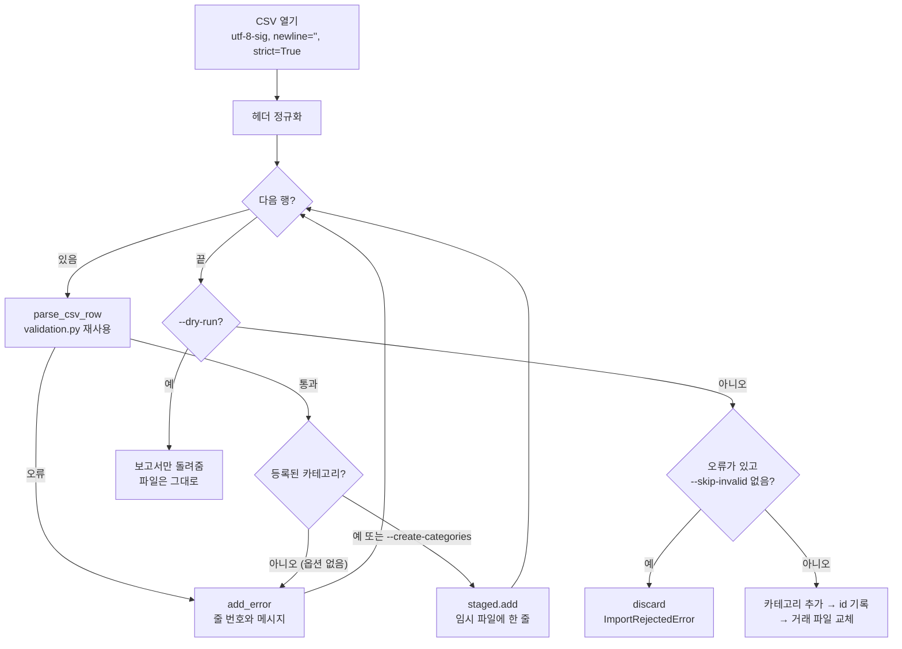

# 07. CSV 가져오기와 내보내기

가계부 데이터는 JSONL로 저장하지만([02. 파일 저장소](02-file-storage.md)), 사람이 엑셀이나 은행 앱과 주고받는 형식은 CSV입니다.
이 문서는 파이썬 `csv` 모듈의 기본 규칙을 익힌 뒤, [csv_io.py](../budget_app/csv_io.py)의 `CsvService`가
**한 행씩 읽으면서 검증하고, 오류가 하나라도 있으면 아무것도 저장하지 않는** 가져오기와, **반쯤 쓴 파일을 남기지 않는** 내보내기를 어떻게 구현했는지 봅니다.

## 이 문서에서 배우는 것

- 이 프로젝트의 고정 CSV 스키마(`date,type,category,amount,memo,tags`)와 그렇게 고정한 이유를 설명할 수 있다.
- `csv` 모듈의 따옴표 규칙, `newline=''`, `utf-8-sig`, `DictReader`의 `line_num`과 `None` 키, `strict=True`를 예제로 설명할 수 있다.
- `CsvService.import_csv`가 헤더 정규화 → 행별 검증 → 오류 모으기 → 저장 여부 결정을 어떻게 하는지 설명할 수 있다.
- 가져오기가 "전부 아니면 전무(all-or-nothing)"인 방법과, 카테고리 → id → 거래 파일 순서로 반영하는 이유를 설명할 수 있다.
- `CsvService.export_csv`의 안전장치(기간 필수, 데이터 파일 보호, 덮어쓰기 확인, 원자적 쓰기)를 설명할 수 있다.

## 핵심 개념

### CSV의 규칙: 쉼표, 큰따옴표, 줄바꿈

CSV는 "쉼표로 값을 나눈 줄"이지만, 값 안에 쉼표·큰따옴표·줄바꿈이 있으면 **값 전체를 큰따옴표로 감싸고, 안쪽 큰따옴표는 두 번(`""`) 씁니다.**
그래서 `split(",")`으로 직접 쪼개면 안 되고, `csv` 모듈을 써야 합니다.

```python
import csv
import io

buf = io.StringIO()
writer = csv.writer(buf)
writer.writerow(["2026-10-02", "점심,회사", 'He said "hi"', "두 줄\n메모", "평범한 값"])
text = buf.getvalue()
print(repr(text))

print(text.strip().split(","))           # 직접 쪼개면 망가진다
print(next(csv.reader(io.StringIO(text))))  # csv.reader는 원래 값을 되찾는다
```

```text
'2026-10-02,"점심,회사","He said ""hi""","두 줄\n메모",평범한 값\r\n'
['2026-10-02', '"점심', '회사"', '"He said ""hi"""', '"두 줄\n메모"', '평범한 값']
['2026-10-02', '점심,회사', 'He said "hi"', '두 줄\n메모', '평범한 값']
```

`csv.writer`는 필요한 값만 따옴표로 감싸고(기본값 `QUOTE_MINIMAL`), 줄 끝에 `\r\n`을 씁니다(엑셀 방식).

### 파일을 열 때 `newline=''`가 필요한 이유

파이썬 텍스트 모드는 기본으로 줄바꿈을 바꿉니다. 읽을 때는 `\r\n`을 `\n`으로, 쓸 때는 (윈도우에서) `\n`을 `\r\n`으로 바꿉니다.
`csv` 모듈은 줄바꿈을 스스로 처리하므로, 파일은 `newline=''`로 열어 이 변환을 꺼야 합니다.

```python
import csv

with open("crlf.csv", "wb") as f:
    f.write(b'memo,amount\r\n"first\r\nsecond",1000\r\n')

with open("crlf.csv", encoding="utf-8") as f:              # newline 생략
    print(list(csv.reader(f)))
with open("crlf.csv", encoding="utf-8", newline="") as f:  # newline=''
    print(list(csv.reader(f)))

# 쓰기: 윈도우처럼 '\n'을 '\r\n'으로 바꾸는 환경을 흉내 낸다
with open("out.csv", "w", encoding="utf-8", newline="\r\n") as f:
    csv.writer(f).writerow(["a", "b"])
with open("out.csv", "rb") as f:
    print(f.read())
```

```text
[['memo', 'amount'], ['first\nsecond', '1000']]
[['memo', 'amount'], ['first\r\nsecond', '1000']]
b'a,b\r\r\n'
```

`newline`을 생략하면 따옴표 안의 값이 바뀌고(`\r\n` → `\n`), 윈도우에서 쓰면 줄 끝이 `\r\r\n`이 되어 빈 줄이 끼어듭니다.

### 엑셀의 BOM과 `utf-8-sig`

엑셀은 "CSV UTF-8"로 저장할 때 파일 맨 앞에 BOM(Byte Order Mark, `EF BB BF`)을 붙입니다.
`utf-8`로 읽으면 첫 열 이름이 `'\ufeffdate'`가 되어 `date` 열을 못 찾습니다. `utf-8-sig`는 BOM이 있으면 떼어 내고, 없으면 그냥 UTF-8로 읽습니다.

```python
import csv

with open("bom.csv", "w", encoding="utf-8-sig") as f:  # 엑셀처럼 BOM을 붙여 저장
    f.write("date,type\n2026-10-01,expense\n")

with open("bom.csv", "rb") as f:
    print(f.read()[:8])
with open("bom.csv", encoding="utf-8", newline="") as f:
    print(next(csv.reader(f)))
with open("bom.csv", encoding="utf-8-sig", newline="") as f:
    print(next(csv.reader(f)))
```

```text
b'\xef\xbb\xbfdate,'
['\ufeffdate', 'type']
['date', 'type']
```

### DictReader는 이터레이터다

`csv.DictReader`는 첫 줄을 헤더로 쓰고, 나머지 행을 `{열 이름: 값}` dict로 돌려줍니다.
리스트를 만드는 것이 아니라 **요청할 때마다 한 행씩 읽는 이터레이터**입니다.

```python
import csv


def noisy(lines):
    for line in lines:
        print("  (한 줄 읽음)", line.strip())
        yield line


source = ["date,amount\n", "2026-10-01,1000\n", "2026-10-02,500\n", "2026-10-03,700\n"]
reader = csv.DictReader(noisy(source))
print("DictReader 생성 완료")
first = next(reader)
print("첫 행:", first)
```

```text
DictReader 생성 완료
  (한 줄 읽음) date,amount
  (한 줄 읽음) 2026-10-01,1000
첫 행: {'date': '2026-10-01', 'amount': '1000'}
```

만들 때는 아무것도 읽지 않고, 첫 행을 요청하자 헤더와 첫 행 두 줄만 읽었습니다. 나머지 두 줄은 아직 읽지 않았습니다.

### line_num, 헤더보다 많거나 적은 값

```python
import csv
import io

text = (
    "date,amount,memo\n"
    '2026-10-01,1000,"여러\n줄 메모"\n'
    "2026-10-02,500,점심,회사\n"
    "\n"
    "2026-10-03\n"
)
reader = csv.DictReader(io.StringIO(text))
print(reader.fieldnames)
for row in reader:
    print(reader.line_num, row)
```

```text
['date', 'amount', 'memo']
3 {'date': '2026-10-01', 'amount': '1000', 'memo': '여러\n줄 메모'}
4 {'date': '2026-10-02', 'amount': '500', 'memo': '점심', None: ['회사']}
6 {'date': '2026-10-03', 'amount': None, 'memo': None}
```

- `reader.line_num`은 "지금까지 읽은 **물리적인 줄** 수"입니다. 여러 줄짜리 값이 있으면 행 번호와 달라지므로, 사용자에게 알려 줄 때는 이 값이 정확합니다.
  여러 줄에 걸친 행은 그 행이 **끝나는 줄** 번호가 됩니다.
- 헤더보다 값이 많으면 남는 값은 **`None` 키**에 리스트로 들어갑니다. (따옴표 없이 `점심,회사`를 쓴 흔한 실수)
- 값이 모자라면 없는 열은 `None`입니다. 완전히 빈 줄은 건너뜁니다(4번째 줄 다음이 6번째 줄).

### 닫히지 않은 따옴표와 `strict=True`

큰따옴표로 연 값이 닫히지 않으면, `csv` 모듈은 기본 설정(`strict=False`)에서 오류 없이 **파일 끝까지를 한 값으로** 읽습니다.

```python
import csv
import io

text = 'date,memo\n2026-10-01,"점심\n2026-10-02,저녁\n2026-10-03,간식\n'
print(list(csv.DictReader(io.StringIO(text))))  # 기본값 strict=False
try:
    list(csv.DictReader(io.StringIO(text), strict=True))
except csv.Error as exc:
    print("strict=True:", exc)
```

```text
[{'date': '2026-10-01', 'memo': '점심\n2026-10-02,저녁\n2026-10-03,간식\n'}]
strict=True: unexpected end of data
```

세 행이 메모 하나로 합쳐진 **정상 행 하나**가 되었습니다. 가져오기에서 이런 일이 생기면 뒤쪽 거래들이 조용히 사라지고, 한 거래의 메모만 이상해집니다.
`strict=True`를 주면 같은 입력이 `csv.Error`가 되어 사용자에게 알릴 수 있습니다.

## 이 프로젝트에서는

### 고정 스키마

[csv_io.py](../budget_app/csv_io.py)의 맨 위에 열 이름이 상수로 있습니다.

```python
CSV_COLUMNS: Tuple[str, ...] = ("date", "type", "category", "amount", "memo", "tags")
REQUIRED_COLUMNS: Tuple[str, ...] = ("date", "type", "category", "amount")
```

| 열 | 필수 | 규칙 (가져올 때) |
| --- | --- | --- |
| `date` | Y | `YYYY-MM-DD`, 실제로 있는 날짜 |
| `type` | Y | `income` / `expense` (별칭 `i`, `e`, `수입`, `지출`도 허용) |
| `category` | Y | 등록된 카테고리 (소문자로 정규화). `--create-categories`면 자동 등록 |
| `amount` | Y | 양의 정수. `12000`, `"12,000"`, `12000원` 허용 |
| `memo` | N | 200자 이하. 줄바꿈·연속 공백은 공백 하나로, 제어 문자(ESC 등)는 지움 |
| `tags` | N | 쉼표로 구분 (그래서 큰따옴표로 감쌈: `"점심,회사"`) |

인코딩은 UTF-8, 첫 줄은 헤더입니다. 같은 스키마를 가져오기와 내보내기가 함께 쓰므로, 내보낸 파일을 그대로 다시 가져올 수 있습니다.

### 가져오기 전체 흐름



### 파일 열기와 헤더 정규화

[csv_io.py의 CsvService.import_csv](../budget_app/csv_io.py)는 CSV를 열기 전에, 검증을 통과한 거래를 **받을 곳(staging)**부터 고릅니다.

```python
        # --dry-run이면 데이터 파일을 복사하지 않는 빈 저장소를 쓴다. 둘 다 add()/discard()를 가진다.
        staging: ContextManager[TransactionSink] = (
            nullcontext(_DryRunSink()) if dry_run else self._transactions.staged_append()
        )
```

- 실제 가져오기면 거래 파일의 `staged_append()`([02. 파일 저장소](02-file-storage.md)의 "전부 아니면 전무" 추가)입니다.
- `--dry-run`이면 `add()`와 `discard()`가 아무 일도 하지 않는 `_DryRunSink`입니다. 데이터 파일을 임시 파일로 복사하지도 않으므로,
  쓰기 권한이 없는 데이터 폴더에서도 검증만은 할 수 있습니다.
- 두 객체는 `add()`/`discard()` 모양이 같아서 `TransactionSink` 프로토콜(Protocol) 하나로 타입을 적습니다.
  `contextlib.nullcontext`는 "`with`에 넣으면 그 값을 그대로 돌려주기만 하는" 컨텍스트 매니저라, 두 경우를 같은 `with` 문으로 다룰 수 있습니다.

그다음 CSV 파일과 이 staging을 **한 `with` 문에서 함께** 엽니다.

```python
            # utf-8-sig: 엑셀이 파일 맨 앞에 붙이는 BOM 문자(U+FEFF)를 자동으로 떼어 낸다.
            with open(source, encoding="utf-8-sig", newline="") as handle, staging as staged:
                # strict=True: 닫히지 않은 따옴표 등을 조용히 넘기지 않고 csv.Error로 알린다.
                # (기본값 False면 따옴표가 안 닫힌 뒤의 모든 줄이 한 칸으로 합쳐져 '정상'으로 읽힌다.)
                reader = csv.DictReader(handle, strict=True)
                header = _normalize_header(reader.fieldnames)
                reader.fieldnames = header
                report.ignored_columns = [name or UNNAMED_COLUMN for name in header if name not in CSV_COLUMNS]

                for row in reader:  # DictReader도 이터레이터다: 한 번에 한 행만 읽는다.
                    line = reader.line_num  # 따옴표 안 줄바꿈까지 센 '물리적' 줄 번호
                    report.total_rows += 1
                    try:
                        draft = parse_csv_row(row)
                    except ValidationError as exc:
                        report.add_error(line, exc.message)
                        continue
                    if draft.category not in known:
                        if not create_categories:
                            report.add_error(line, f"등록되지 않은 카테고리입니다: '{draft.category}'")
                            continue
                        known.add(draft.category)
                        new_categories[draft.category] = None
```

- `utf-8-sig`, `newline=""`: 핵심 개념에서 본 두 가지 함정을 모두 피합니다.
- `strict=True`: 핵심 개념에서 본 "닫히지 않은 따옴표" 문제를 조용히 넘기지 않고 `csv.Error`로 바꿉니다. 이 오류는 아래 "읽는 도중의 오류"에서 사용자 메시지가 됩니다.
- `reader.fieldnames = header`: 정규화한 헤더로 바꿔 끼워서, 이후의 모든 행 dict가 `" Date "`가 아닌 `"date"` 키를 갖게 합니다.
- 모르는 열(예: `id`)은 오류가 아니라 `ignored_columns`로 알려 줍니다. 헤더 끝에 쉼표가 더 붙어 생긴 이름 없는 열은 `(이름 없는 열)`로 표시합니다.
- 오류가 나도 **멈추지 않고** `report.add_error(줄 번호, 메시지)`로 모은 뒤 다음 행으로 갑니다. 그래서 사용자가 한 번 실행으로 모든 오류를 볼 수 있습니다.
  `add_error`는 오류 수(`error_count`)는 전부 세지만, `RowError`는 앞쪽 100건(`MAX_STORED_ERRORS`)만 `errors`에 보관합니다. 오류 행이 수십만 개인 파일에서도 메모리가 늘지 않게 하기 위해서입니다.
- `known`은 처음에 `self._categories.names()`로 만든 집합입니다. `--create-categories`면 처음 본 카테고리를 `known`과 `new_categories`에 넣고,
  아직 **파일에는 쓰지 않습니다**(쓰는 시점은 아래에서 봅니다).
- 통과한 행은 `Transaction(id=next_id, ...)`로 만들어 `staged.add(...)`로 **임시 파일에 바로** 씁니다(`--dry-run`이면 버립니다). CSV 전체도, 거래 목록도 메모리에 모으지 않습니다.
  `next_id`는 루프 전에 `next_value(TRANSACTION_SEQUENCE, floor=max_id())`로 한 번 구하고 한 건마다 1씩 늘립니다.

헤더 검사는 [csv_io.py의 _normalize_header](../budget_app/csv_io.py)가 합니다.

```python
def _normalize_header(fieldnames: Optional[Sequence[str]]) -> List[str]:
    if not fieldnames:
        raise ValidationError("CSV 파일이 비어 있거나 헤더가 없습니다.", hint=SCHEMA_HINT)
    header = [name.strip().lower() for name in fieldnames]
    # 'date,type,...,tags,'처럼 끝에 쉼표가 붙으면 이름 없는 열이 생긴다. 무시할 열이므로 중복 검사에서 뺀다.
    duplicates = sorted({name for name in header if name and header.count(name) > 1})
    if duplicates:
        raise ValidationError(f"헤더에 같은 열이 여러 번 있습니다: {', '.join(duplicates)}", hint=SCHEMA_HINT)
    missing = [name for name in REQUIRED_COLUMNS if name not in header]
    if missing:
        raise ValidationError(f"CSV에 필수 열이 없습니다: {', '.join(missing)}", hint=SCHEMA_HINT)
    return header
```

대소문자와 앞뒤 공백은 너그럽게, 필수 열 누락과 중복은 엄격하게 다룹니다. `date,type,...,tags,`처럼 헤더 끝에 쉼표가 붙어 생기는 이름 없는 열(`""`)은 여러 개여도 중복으로 보지 않고 무시할 열로 둡니다.
헤더 문제는 행 단위 오류가 아니라 파일 전체의 문제라서 즉시 예외를 던집니다.

### 한 행 검증: parse_csv_row와 validation.py 재사용

[csv_io.py의 parse_csv_row](../budget_app/csv_io.py)는 dict 한 행을 `TransactionDraft`로 바꿉니다.

```python
def parse_csv_row(row: Mapping[Optional[str], object]) -> TransactionDraft:
    """CSV 한 행(dict)을 검증해 TransactionDraft로 바꾼다. 문제가 있으면 ValidationError."""
    if row.get(None):  # DictReader는 헤더보다 많은 값을 None 키에 담는다.
        raise ValidationError("값이 헤더보다 많습니다. 쉼표가 들어간 값은 큰따옴표로 감싸세요.")

    def cell(name: str) -> str:
        value = row.get(name)
        return value if isinstance(value, str) else ""

    for name in REQUIRED_COLUMNS:
        if not cell(name).strip():
            raise ValidationError(f"필수 값 '{name}'이(가) 비어 있습니다.")
    return TransactionDraft(
        date=parse_date(cell("date")),
        type=parse_type(cell("type")),
        category=normalize_category(cell("category")),
        amount=parse_amount(cell("amount")),
        memo=parse_memo(cell("memo")),
        tags=parse_tags(cell("tags")),
    )
```

- `row.get(None)`: 핵심 개념에서 본 "남는 값" 검사입니다. 타입 힌트도 `Mapping[Optional[str], object]`로 `None` 키가 있을 수 있음을 드러냅니다.
- `cell()`: 값이 모자라 `None`이 된 칸을 빈 문자열로 바꿔, 아래 검증 함수들이 항상 `str`을 받게 합니다.
- `parse_date`, `parse_type`, `parse_amount` 등은 [validation.py](../budget_app/validation.py)의 함수로, **대화형 `add`와 argparse 옵션도 같은 함수를 씁니다.**
  그래서 "`add`에서 거부되는 값은 CSV에서도 거부된다"가 코드 구조로 보장되고, 오류 메시지도 같습니다([06. 입력 검증과 오류 처리](06-validation-and-errors.md)).

### 저장할지 결정하기: dry-run, 거부, 반영 순서

모든 행을 읽은 뒤, 같은 `with` 블록 안에서 결정합니다.

```python
                report.created_categories = list(new_categories)
                if dry_run:
                    staged.discard()
                    return report
                if report.errors and not skip_invalid:
                    staged.discard()
                    raise ImportRejectedError(report)
                if report.imported:
                    # 순서: 새 카테고리 → id 기록 → (with 블록을 나가며) 거래 파일 교체.
                    # 중간에 멈춰도 '쓰이지 않은 카테고리'나 '비어 있는 id 번호'만 남는다.
                    for name in report.created_categories:
                        self._categories.add(Category(name, created_at))
                    if report.last_id is not None:
                        self._sequences.commit(TRANSACTION_SEQUENCE, report.last_id)
```

| 상황 | 동작 | 종료 코드 (`cmd_import`) |
| --- | --- | --- |
| `--dry-run` | 보고서만 돌려줌. `_DryRunSink`라 임시 파일도 만들지 않고, 새 카테고리도 등록하지 않음 | 오류가 있고 `--skip-invalid`가 없으면 2, 아니면 0 |
| 오류 행이 있고 `--skip-invalid` 없음 | 임시 파일을 버리고 `ImportRejectedError` (전부 아니면 전무) | 2 |
| 오류 행이 없거나 `--skip-invalid` | 새 카테고리 추가 → id 기록 → `with`를 나가며 거래 파일 교체 | 0 |
| 올바른 행이 0건 (헤더만 있는 CSV, 또는 `--skip-invalid`로 모두 건너뜀) | `report.imported`가 0이라 카테고리·id를 기록하지 않고, `staged.count == 0`이라 `staged_append`가 임시 파일을 스스로 버림 | 0 |

반영 순서가 중요한 이유는 다음과 같습니다. 거래 파일 교체(`os.replace`)가 **마지막**이어야, 그 전에 멈췄을 때 거래가 하나도 들어가지 않습니다.

- **카테고리가 거래보다 먼저**: 거래가 먼저 들어가고 카테고리를 쓰기 전에 멈추면, "등록되지 않은 카테고리를 가리키는 거래"가 생깁니다. 반대 순서면 최악의 경우 "아직 아무도 안 쓰는 카테고리"만 남습니다.
- **id 기록이 거래보다 먼저**: 거래가 먼저 들어가고 기록 전에 멈추면 `meta.jsonl`이 실제 데이터보다 뒤처집니다. 그 뒤 그 거래 줄이 손상되거나 손으로 지워지면 같은 id가 다시 발급될 수 있습니다.
  반대 순서면 meta가 언제나 실제로 쓴 id 이상이므로, 최악의 경우에도 "비어 있는 id 범위"만 남습니다.

`ImportRejectedError`는 `ValidationError`를 상속하고, 오류 목록을 메시지에 담습니다(`format_row_errors(report.errors, report.error_count)`는 처음 10건만 보여 주고,
나머지는 보관한 100건이 아니라 **전체 오류 수** 기준으로 "... 외 N건"이라고 줄입니다).

### 읽는 도중의 오류를 사용자 메시지로

```python
        except UnicodeDecodeError:
            bad_line = _first_undecodable_line(source)
            where = f" ({bad_line}번째 줄)" if bad_line is not None else ""
            raise ValidationError(
                f"CSV 파일을 UTF-8로 읽을 수 없습니다{where}.",
                hint="엑셀이라면 'CSV UTF-8(쉼표로 분리)' 형식으로 다시 저장하세요.",
            ) from None
        except csv.Error as exc:
            # 오류가 난 행은 마지막으로 읽은 정상 행(line) 바로 다음 줄에서 시작한다.
            where = f" ({line + 1}번째 줄부터)" if reader is not None else ""
            raise ValidationError(f"CSV 형식 오류{where}: {exc}", hint=_csv_error_hint(exc)) from None
```

- 이 예외들은 `with` 블록 안에서 일어나므로, `except`에 도착했을 때는 `staged_append`의 임시 파일이 이미 버려진 뒤입니다(`--dry-run`이면 처음부터 임시 파일이 없습니다).
- **UTF-8 오류의 줄 번호**: 텍스트 파일은 덩어리(chunk) 단위로 디코딩되므로, 디코딩 오류는 문제의 줄을 행으로 읽기 **전에** 날 수 있습니다.
  그래서 그 순간의 `reader.line_num`은 믿을 수 없습니다. 대신 [csv_io.py의 _first_undecodable_line](../budget_app/csv_io.py)이 파일을 바이트 모드로 다시 열어
  한 줄씩 `decode("utf-8")`해 보고, 처음 실패한 줄 번호를 돌려줍니다. UTF-8의 여러 바이트 문자 안에는 줄바꿈 바이트(`0x0A`)가 나올 수 없으므로 줄 단위로 검사해도 정확합니다(실습 9).
- **CSV 형식 오류**: [csv_io.py의 _csv_error_hint](../budget_app/csv_io.py)가 오류 문구를 보고 힌트를 고릅니다. NUL 문자 때문에 오류가 나면(`line contains NUL`) "텍스트 CSV가 맞는지",
  따옴표가 파일 끝까지 닫히지 않으면(`unexpected end of data`, `strict=True`일 때만 나는 오류) "따옴표 짝을 확인하라"고,
  한 칸이 `csv` 모듈의 한도(기본 131,072자)를 넘으면 "따옴표가 닫히지 않아 여러 줄이 한 칸으로 합쳐졌을 수 있다"고 알려 줍니다(닫히지 않은 따옴표 뒤의 내용이 이 한도보다 길면, 파일 끝보다 한도에 먼저 닿아 이 오류가 납니다).
- **CSV 형식 오류의 줄 번호**: `DictReader.line_num`은 한 행을 끝까지 읽어야 갱신되므로, 오류가 난 순간에는 문제 행이 아니라 그 앞의 정상 행을 가리킵니다.
  그래서 루프가 기억해 둔 `line`(**마지막으로 제대로 읽은 행**이 끝난 줄, 처음에는 헤더인 1)에 1을 더해 "N번째 줄부터"라고 알려 줍니다. 문제 행은 바로 그 줄에서 시작합니다(실습 11).
- `from None`은 원래 예외의 스택트레이스 연결을 끊어, 사용자에게는 원인과 힌트만 보이게 합니다.

### 내보내기: export_csv

[csv_io.py의 CsvService.export_csv](../budget_app/csv_io.py)는 먼저 위험한 요청을 거릅니다.

```python
        if not criteria.has_period:
            raise ValidationError(
                "내보내기에는 기간 조건이 필요합니다.",
                hint="--month YYYY-MM 또는 --from YYYY-MM-DD / --to YYYY-MM-DD 중 하나 이상을 지정하세요.",
            )
        # samefile은 (장치, inode)를 비교하므로 대소문자만 다른 경로, 하드 링크, 심볼릭 링크도 알아본다.
        if destination.exists() and any(path.exists() and os.path.samefile(destination, path) for path in protected):
            raise ValidationError(
                f"데이터 파일에는 내보낼 수 없습니다: {destination}",
                hint="--out에 다른 파일 이름을 지정하세요.",
            )
        if destination.is_dir():
            raise ValidationError(f"폴더가 아니라 파일 경로를 지정하세요: {destination}", hint="예: --out report.csv")
        if not destination.parent.exists():
            raise NotFoundError(
                f"저장할 폴더가 없습니다: {destination.parent}",
                hint="폴더를 먼저 만들거나 경로를 확인하세요.",
            )
        if destination.exists() and not overwrite:
            raise ConflictError(f"이미 같은 이름의 파일이 있습니다: {destination}", hint="덮어쓰려면 --force를 붙이세요.")
```

- **기간 필수**: 요구사항입니다. CLI의 `_criteria_from_args(args, require_period=True)`가 먼저 막고, 서비스도 한 번 더 검사합니다. 서비스를 CLI 없이 써도 규칙이 지켜집니다.
- **데이터 파일 보호**: `cmd_export`가 `protected=ctx.protected_files()`를 넘깁니다. [context.py의 AppContext.protected_files](../budget_app/context.py)는
  다섯 개의 `*.jsonl`에 실행 로그 `app.log`와 `backups/` 폴더 안의 백업 파일까지 더한 목록입니다. 경로 문자열이 아니라 `os.path.samefile`로 **같은 파일인지**(장치 번호와 inode)를 비교하므로,
  `./data/../data/transactions.jsonl` 같은 경로, 데이터 파일을 가리키는 심볼릭 링크나 하드 링크, (맥 기본 설정처럼 대소문자를 구분하지 않는 파일 시스템에서) `Transactions.JSONL`로도 우회할 수 없습니다.
  `destination.exists()`를 먼저 보는 이유는, 아직 없는 파일은 데이터 파일일 수 없고 `samefile`은 없는 파일에 오류를 내기 때문입니다.
  이 검사는 `--force`보다 먼저라서 `--force`로도 덮어쓸 수 없습니다.
- **덮어쓰기 확인**: 이미 있는 파일은 `--force`가 있어야 덮어씁니다(`ConflictError`, 종료 코드 4).

검사를 통과하면 정렬해서 원자적으로 씁니다.

```python
        rows = oldest_first(filter_transactions(self._transactions.iter_all(), criteria))
        with AtomicWriter(destination, text=True, newline="") as writer:
            csv_writer = csv.writer(writer.stream)
            csv_writer.writerow(CSV_COLUMNS)
            for tx in rows:
                csv_writer.writerow(transaction_to_row(tx))
        return ExportReport(destination, len(rows))
```

- `filter_transactions`는 `search`와 같은 조건(`--category`, `--type`, `--q`, `--tag`)을 스트리밍으로 거릅니다.
- `oldest_first`는 날짜 오름차순으로 정렬합니다(같은 날짜는 저장 순서). 정렬하려면 결과를 모아야 하므로, **조건에 맞는 거래만큼 메모리를 씁니다**(README 10장의 알려진 한계).
- `AtomicWriter(..., text=True, newline="")`: [02. 파일 저장소](02-file-storage.md)의 원자적 쓰기를 텍스트 모드로 씁니다. 쓰다가 실패해도 반쯤 쓴 CSV가 남지 않고, 기존 파일도 그대로입니다.

한 거래를 한 행으로 바꾸는 [csv_io.py의 transaction_to_row](../budget_app/csv_io.py)는 가져오기의 역방향입니다.

```python
def transaction_to_row(tx: Transaction) -> List[str]:
    return [tx.date.isoformat(), tx.type.value, tx.category, str(tx.amount), tx.memo, ",".join(tx.tags)]
```

태그에는 쉼표를 쓸 수 없고(`parse_tag`가 거부), 메모는 저장할 때 이미 줄바꿈이 공백으로 정리되어 있습니다. 그래서 내보낸 값을 다시 가져오면 같은 값이 됩니다.
다만 `id`, `created_at`, `recurring_id`는 스키마에 없으므로, **다시 가져오면 새 id가 붙습니다.**

## 왜 이렇게 설계했나

**스키마를 고정한 이유.** 열 이름을 매핑하는 설정(예: "은행 CSV의 '거래일자' = date")을 두면 유연하지만, 설정과 문서와 테스트가 늘어납니다.
과제는 최소 스키마 고정을 요구합니다. 대신 헤더의 대소문자·공백·열 순서·모르는 열은 너그럽게 받아들여, 고정 스키마의 불편을 줄였습니다.

**`csv.reader` 대신 `DictReader`를 쓴 이유.** 열 이름으로 값을 꺼내므로 열 순서가 달라도 되고, 모르는 열이 섞여도 됩니다.
헤더보다 많은 값을 `None` 키로 알려 주는 것도 `DictReader`라서 가능한 검사입니다.

**기본값이 "전부 아니면 전무"인 이유.** 일부만 들어가면 사용자는 "어디까지 들어갔는지" 직접 찾아서, 고친 CSV에서 그 행들을 빼고 다시 가져와야 합니다.
전부 거부하면 "오류를 고치고 같은 명령을 다시 실행"이면 끝입니다. 일부만 원하는 사용자는 `--skip-invalid`로 명시적으로 고릅니다.
먼저 확인만 하고 싶으면 `--dry-run`을 씁니다.

**목록에 모았다가 한 번에 쓰지 않는 이유.** 검증을 통과한 거래를 리스트에 모은 뒤 마지막에 쓰는 방법도 있지만, CSV가 크면 그만큼 메모리를 씁니다.
`staged_append`는 통과한 행을 바로 임시 파일에 쓰고, 마지막에 교체할지 버릴지만 정합니다. 메모리에는 현재 행 하나와 오류 목록(앞쪽 100건까지)만 있습니다.

**내보내기가 정렬을 위해 메모리를 쓰는 이유.** 사람이 엑셀로 보는 파일은 날짜순이어야 읽기 쉽습니다. 파일은 저장 순서(대체로 입력 순서)라서,
정렬하려면 결과를 모아야 합니다. 대신 조건으로 먼저 걸러서 **결과만** 모읍니다.

**구현하지 않은 것 (솔직하게).**

- **CSV 수식 주입(formula injection) 방어가 없습니다.** 메모가 `=`, `+`, `-`, `@`로 시작하면 엑셀이 수식으로 실행할 수 있습니다.
  이 프로젝트는 메모를 그대로 내보냅니다(실습 10). 앞에 `'`를 붙이는 등의 방어는 [10. 스스로 점검하기](10-self-check.md)의 확장 과제입니다.
- 내보낸 파일에는 BOM이 없습니다. 가져오기는 BOM이 있든 없든 읽지만, 일부 엑셀 버전은 BOM 없는 UTF-8 CSV의 한글을 깨뜨려 보여 줄 수 있습니다.
- 내보낸 파일의 줄 끝은 `csv.writer` 기본값인 `\r\n`입니다(엑셀 방식). 맥/리눅스 도구로 볼 때 참고하세요.

## 직접 해 보기

프로젝트 루트에서 실행합니다. 출력의 시각과 경로는 환경마다 다를 수 있습니다.

**준비**

```bash
rm -rf /tmp/budget-lab
```

**1. 샘플 가져오기**: 샘플 CSV의 앞부분을 보고 가져옵니다.

```bash
head -n 4 examples/sample_transactions.csv
```

```csv
date,type,category,amount,memo,tags
2026-09-25,income,salary,3200000,9월 급여,월급
2026-10-01,expense,rent,650000,10월 월세,고정비
2026-10-02,expense,food,12000,점심 김치찌개,"점심,회사"
```

```bash
python3 -m budget_app --data-dir /tmp/budget-lab import --from examples/sample_transactions.csv
```

```text
안내: 저장 파일을 새로 만들었습니다: transactions.jsonl, categories.jsonl, budgets.jsonl, recurring.jsonl, meta.jsonl (위치: /private/tmp/budget-lab)
안내: 카테고리가 비어 있어 기본 카테고리를 만들었습니다: food, transport, rent, utilities, shopping, health, salary, etc
가져오기 완료: 전체 11행 중 11건을 추가했습니다 (id 1~11).
'list' 명령으로 가져온 거래를 확인하세요.
```

`sed -n 3p /tmp/budget-lab/transactions.jsonl`로 보면 `"점심,회사"`가 `"tags": ["점심", "회사"]` 목록으로 저장된 것을 확인할 수 있습니다.

**2. 오류가 섞인 CSV를 검증만 하기**: `examples/invalid_transactions.csv`는 정상 행 1개와 오류 행 7개로 되어 있습니다.

```bash
python3 -m budget_app --data-dir /tmp/budget-lab import --from examples/invalid_transactions.csv --dry-run
```

```text
[검증만 실행] examples/invalid_transactions.csv: 전체 8행 중 1행을 가져올 수 있습니다.
오류가 있어 건너뛴 행 7개:
  - 3번째 줄: 존재하지 않는 날짜입니다: '2026-02-30'
  - 4번째 줄: 허용되지 않은 타입입니다: 'transfer'
  - 5번째 줄: 금액은 음수일 수 없습니다: '-3000'
  - 6번째 줄: 금액은 0보다 커야 합니다.
  - 7번째 줄: 등록되지 않은 카테고리입니다: 'coffee'
  - 8번째 줄: 금액은 양의 정수여야 합니다: '12.5'
  - 9번째 줄: 값이 헤더보다 많습니다. 쉼표가 들어간 값은 큰따옴표로 감싸세요.
실제로는 아무것도 저장하지 않았습니다.
```

```bash
echo $?
```

```text
2
```

줄 번호는 헤더가 1번 줄인 **파일의 줄 번호**입니다. 9번째 줄은 따옴표 없이 `점심,회사`를 써서 값이 7개가 된 행입니다.

**3. 전부 아니면 전무**: 같은 파일을 옵션 없이 가져옵니다.

```bash
python3 -m budget_app --data-dir /tmp/budget-lab import --from examples/invalid_transactions.csv
```

```text
오류: CSV 8행 중 7행에 오류가 있어 아무것도 가져오지 않았습니다.
  - 3번째 줄: 존재하지 않는 날짜입니다: '2026-02-30'
...
힌트: 오류를 고친 뒤 다시 실행하거나, 올바른 행만 가져오려면 --skip-invalid를 붙이세요. 등록되지 않은 카테고리는 --create-categories로 함께 등록할 수 있습니다.
```

정상 행(9,000원)도 들어가지 않았습니다. `list --limit 1`을 해 보면 여전히 `전체 11건`입니다.

**4. 올바른 행만, 새 카테고리와 함께**

```bash
python3 -m budget_app --data-dir /tmp/budget-lab import --from examples/invalid_transactions.csv --skip-invalid --create-categories
```

```text
가져오기 완료: 전체 8행 중 2건을 추가했습니다 (id 12~13).
오류가 있어 건너뛴 행 6개:
  - 3번째 줄: 존재하지 않는 날짜입니다: '2026-02-30'
...
새로 등록한 카테고리: coffee
'list' 명령으로 가져온 거래를 확인하세요.
```

`--create-categories` 덕분에 7번째 줄(`coffee`)도 들어가서 2건입니다. `category list`를 하면 `coffee` 행의 거래 수가 `1건`으로 보입니다.

**5. 내보내기: 기간 필수, 덮어쓰기 확인**

```bash
python3 -m budget_app --data-dir /tmp/budget-lab export --out /tmp/budget-lab/all.csv
```

```text
오류: 기간 조건이 필요합니다.
힌트: --month YYYY-MM 또는 --from YYYY-MM-DD / --to YYYY-MM-DD 중 하나 이상을 지정하세요.
```

```bash
python3 -m budget_app --data-dir /tmp/budget-lab export --month 2026-10 --out /tmp/budget-lab/october.csv
```

```text
내보내기 완료: 12건 → /tmp/budget-lab/october.csv
조건: 기간 2026-10-01 ~ 2026-10-31
```

```bash
head -n 4 /tmp/budget-lab/october.csv
```

```csv
date,type,category,amount,memo,tags
2026-10-01,expense,rent,650000,10월 월세,고정비
2026-10-01,expense,food,9000,정상 행,점심
2026-10-02,expense,food,12000,점심 김치찌개,"점심,회사"
```

날짜 오름차순이고, 같은 날짜(10-01)는 저장 순서(id 2 → id 12)입니다. 같은 명령을 한 번 더 실행하면 덮어쓰지 않습니다.

```bash
python3 -m budget_app --data-dir /tmp/budget-lab export --month 2026-10 --out /tmp/budget-lab/october.csv
```

```text
오류: 이미 같은 이름의 파일이 있습니다: /tmp/budget-lab/october.csv
힌트: 덮어쓰려면 --force를 붙이세요.
```

`echo $?`는 `4`입니다. 조건을 더 붙이고 `--force`로 덮어씁니다.

```bash
python3 -m budget_app --data-dir /tmp/budget-lab export --month 2026-10 --type expense --category food --out /tmp/budget-lab/october.csv --force
```

```text
내보내기 완료: 4건 → /tmp/budget-lab/october.csv
조건: 기간 2026-10-01 ~ 2026-10-31 / 카테고리 food / 타입 expense
```

줄 끝이 `\r\n`인지 바이트로 확인해 봅니다.

```bash
python3 -c "print(open('/tmp/budget-lab/october.csv', 'rb').read()[:40])"
```

```text
b'date,type,category,amount,memo,tags\r\n202'
```

**6. 데이터 파일 보호**: `--force`를 붙여도 데이터 파일에는 내보낼 수 없습니다.

```bash
python3 -m budget_app --data-dir /tmp/budget-lab export --month 2026-10 --out /tmp/budget-lab/transactions.jsonl --force
```

```text
오류: 데이터 파일에는 내보낼 수 없습니다: /tmp/budget-lab/transactions.jsonl
힌트: --out에 다른 파일 이름을 지정하세요.
```

`--out /tmp/budget-lab/app.log`도 같은 오류로 막힙니다. 실행 로그와 `backups/` 안의 백업 파일도 보호 대상이기 때문입니다.

**7. 왕복(round trip)**: 10월 전체를 내보내고, 빈 폴더에 가져온 뒤, 다시 내보내 비교합니다.

```bash
python3 -m budget_app --data-dir /tmp/budget-lab export --month 2026-10 --out /tmp/budget-lab/october.csv --force
```

```bash
rm -rf /tmp/budget-lab-copy
```

```bash
python3 -m budget_app --data-dir /tmp/budget-lab-copy import --from /tmp/budget-lab/october.csv
```

```text
...
오류: CSV 12행 중 1행에 오류가 있어 아무것도 가져오지 않았습니다.
  - 7번째 줄: 등록되지 않은 카테고리입니다: 'coffee'
...
```

새 폴더에는 기본 카테고리만 있어서 `coffee`가 없습니다. 이번에도 한 건도 들어가지 않았습니다. `--create-categories`를 붙여 다시 실행합니다.

```bash
python3 -m budget_app --data-dir /tmp/budget-lab-copy import --from /tmp/budget-lab/october.csv --create-categories
```

```text
가져오기 완료: 전체 12행 중 12건을 추가했습니다 (id 1~12).
새로 등록한 카테고리: coffee
...
```

```bash
python3 -m budget_app --data-dir /tmp/budget-lab-copy export --month 2026-10 --out /tmp/budget-lab-copy/october.csv
```

```bash
diff /tmp/budget-lab/october.csv /tmp/budget-lab-copy/october.csv && echo "두 파일이 같습니다"
```

```text
두 파일이 같습니다
```

CSV 내용은 같지만 id는 새로 붙었습니다(원래 폴더의 id 12는 복사본에서 다른 번호입니다).

**8. 엑셀이 만든 것 같은 파일**: BOM, 대소문자와 공백이 섞인 헤더, 모르는 `id` 열, `\r\n` 줄 끝, `"12,000"` 금액.

```bash
python3 -c "open('/tmp/budget-lab/excel.csv', 'w', encoding='utf-8-sig', newline='').write(' Date ,TYPE,Category,Amount,id\r\n2026-11-01,expense,food,\"12,000\",77\r\n')"
```

```bash
python3 -m budget_app --data-dir /tmp/budget-lab import --from /tmp/budget-lab/excel.csv --dry-run
```

```text
[검증만 실행] /tmp/budget-lab/excel.csv: 전체 1행 중 1행을 가져올 수 있습니다.
알 수 없어 무시한 열: id
실제로는 아무것도 저장하지 않았습니다.
```

**9. UTF-8이 아닌 파일**: 예전 엑셀의 기본 형식(CP949)으로 저장된 파일을 흉내 냅니다.

```bash
python3 -c "open('/tmp/budget-lab/cp949.csv', 'w', encoding='cp949').write('date,type,category,amount,memo,tags\n2026-11-02,expense,food,5000,점심,\n')"
```

```bash
python3 -m budget_app --data-dir /tmp/budget-lab import --from /tmp/budget-lab/cp949.csv
```

```text
오류: CSV 파일을 UTF-8로 읽을 수 없습니다 (2번째 줄).
힌트: 엑셀이라면 'CSV UTF-8(쉼표로 분리)' 형식으로 다시 저장하세요.
```

한글이 있는 2번째 줄을 정확히 가리킵니다. 사실 오류는 헤더를 읽는 순간(`reader.fieldnames`, 이때 `line_num`은 0) 이미 났습니다.
파일이 덩어리 단위로 디코딩되어 2번째 줄의 바이트까지 한꺼번에 해석했기 때문입니다. 그래서 `import_csv`는 `line_num` 대신
`_first_undecodable_line`으로 파일을 다시 검사해 줄 번호를 찾습니다.

**10. 수식처럼 보이는 메모 (보안 고려 사항)**

```bash
printf 'date,type,category,amount,memo,tags\n2026-12-01,expense,food,1000,=1+2,\n' > /tmp/budget-lab/formula.csv
```

```bash
python3 -m budget_app --data-dir /tmp/budget-lab import --from /tmp/budget-lab/formula.csv
```

```bash
python3 -m budget_app --data-dir /tmp/budget-lab export --month 2026-12 --out /tmp/budget-lab/december.csv
```

```bash
cat /tmp/budget-lab/december.csv
```

```csv
date,type,category,amount,memo,tags
2026-12-01,expense,food,1000,=1+2,
```

메모 `=1+2`가 그대로 나갔습니다. 엑셀로 열면 `3`으로 보입니다. 앞의 "구현하지 않은 것"에서 말한 수식 주입 위험입니다.

**11. 닫히지 않은 따옴표**: 3번째 줄의 메모가 `"저녁,`으로 열리고 닫히지 않은 파일입니다.

```bash
printf 'date,type,category,amount,memo,tags\n2026-11-03,expense,food,1000,점심,\n2026-11-04,expense,food,2000,"저녁,\n2026-11-05,expense,food,3000,간식,\n' > /tmp/budget-lab/quote.csv
```

```bash
python3 -m budget_app --data-dir /tmp/budget-lab import --from /tmp/budget-lab/quote.csv
```

```text
오류: CSV 형식 오류 (3번째 줄부터): unexpected end of data
힌트: 큰따옴표로 연 값이 닫히지 않았습니다. 따옴표 짝을 확인하세요.
```

종료 코드는 2이고, 정상인 2번째 줄도 들어가지 않았습니다. `strict=True`가 없었다면 3·4번째 줄이 한 거래의 메모로 합쳐져 "2건 추가"로 끝났을 것입니다.
마지막 정상 행이 2번째 줄이라서 "3번째 줄부터"라고 문제 행의 시작을 가리킵니다.

**더 해 보기**: `python3 -m unittest tests.test_csv_io -v`를 실행하고, `test_any_bad_row_rejects_everything`과 `test_round_trip`이 위 실습 3, 7과 어떻게 대응하는지 비교해 보세요.

## 자주 하는 실수

- **`line.split(",")`으로 CSV를 직접 쪼개기**: `"점심,회사"`처럼 따옴표 안의 쉼표에서 망가집니다. 항상 `csv` 모듈을 씁니다.
- **`newline=''` 없이 열기**: 따옴표 안의 줄바꿈이 바뀌고, 윈도우에서 쓰면 빈 줄이 끼어듭니다.
- **`encoding="utf-8"`로 엑셀 파일 읽기**: BOM 때문에 첫 열 이름이 `'\ufeffdate'`가 되어 "필수 열이 없습니다" 오류가 납니다. `utf-8-sig`를 씁니다.
- **태그를 따옴표 없이 쓰기**: `...,점심,회사`는 값이 하나 더 많은 행이 됩니다. `"점심,회사"`로 감쌉니다.
- **행 순서(`enumerate`)를 줄 번호로 보고하기**: 여러 줄짜리 값이 있으면 틀립니다. `reader.line_num`을 씁니다.
- **`strict=True` 없이 `DictReader` 쓰기**: 기본 설정(`strict=False`)에서는 따옴표가 끝까지 안 닫혀도 오류가 나지 않고, 뒤쪽 행들이 한 값으로 합쳐져 **한 건으로** 들어갑니다.
  이 프로젝트는 `strict=True`로 읽어서 이 경우를 `CSV 형식 오류 (N번째 줄부터): unexpected end of data`로 거부합니다(실습 11).
  다만 뒤쪽에서 다른 큰따옴표가 우연히 짝을 이루고 바로 뒤에 쉼표나 줄바꿈이 오면 `strict=True`여도 그 사이의 줄이 한 칸으로 읽힙니다.
  `--dry-run`의 "전체 N행"이 CSV의 행 수와 같은지 확인하는 습관은 여전히 쓸모 있습니다.
- **새 데이터 폴더로 가져올 때 카테고리를 잊기**: 기본 카테고리에 없는 이름이 하나라도 있으면 전체가 거부됩니다(실습 7). `--create-categories`를 씁니다.
- **왕복하면 id도 같을 거라고 기대하기**: CSV 스키마에 `id`가 없으므로 가져올 때 새 id가 붙습니다.

## 정리

- [ ] 고정 스키마 6개 열과 필수 열 4개, 인코딩/헤더 규칙을 설명할 수 있다.
- [ ] CSV의 따옴표 규칙과, `split(",")` 대신 `csv` 모듈을 써야 하는 이유를 설명할 수 있다.
- [ ] `newline=''`와 `utf-8-sig`가 각각 어떤 문제를 막는지 설명할 수 있다.
- [ ] `DictReader`가 이터레이터라는 것, `line_num`과 `None` 키의 의미, `strict=True`가 막는 문제를 설명할 수 있다.
- [ ] `import_csv`가 헤더 정규화, 행별 검증(validation.py 재사용), 오류 모으기를 하는 흐름을 설명할 수 있다.
- [ ] `--dry-run`, `--skip-invalid`, `--create-categories`가 각각 결과를 어떻게 바꾸는지 설명할 수 있다.
- [ ] `staged_append`로 "전부 아니면 전무"를 구현한 방법과, 카테고리 → id → 거래 파일 순서의 이유를 설명할 수 있다.
- [ ] `export_csv`의 기간 필수, 데이터 파일 보호, `--force`, 원자적 쓰기, 날짜순 정렬을 설명할 수 있다.
- [ ] 이 프로젝트가 막지 않는 위험(수식 주입)과 한계(정렬 메모리, BOM 없는 내보내기)를 설명할 수 있다.

## 스스로 설명해 보기

1. CSV 1,000행 중 마지막 행 하나에 오류가 있습니다. 옵션 없이 가져오면 어떻게 되고, 그동안 통과한 999행은 어디에 있다가 어떻게 되나요?
2. `import_csv`가 새 카테고리를 거래 파일보다 먼저 등록하는 이유를, 순서를 바꿨을 때 멈추는 상황으로 설명해 보세요.
3. CSV를 읽을 때 `newline=''`와 `encoding="utf-8-sig"`를 빼면 각각 어떤 파일에서 어떤 문제가 생기나요?
4. 내보내기에서 `--force`를 붙여도 `transactions.jsonl`에 쓸 수 없게 막은 이유와, 그 검사를 덮어쓰기 검사보다 먼저 하는 이유는 무엇인가요?
5. 내보낸 CSV를 엑셀로 열 때 생길 수 있는 보안 문제는 무엇이고, 어떻게 막을 수 있을까요?
