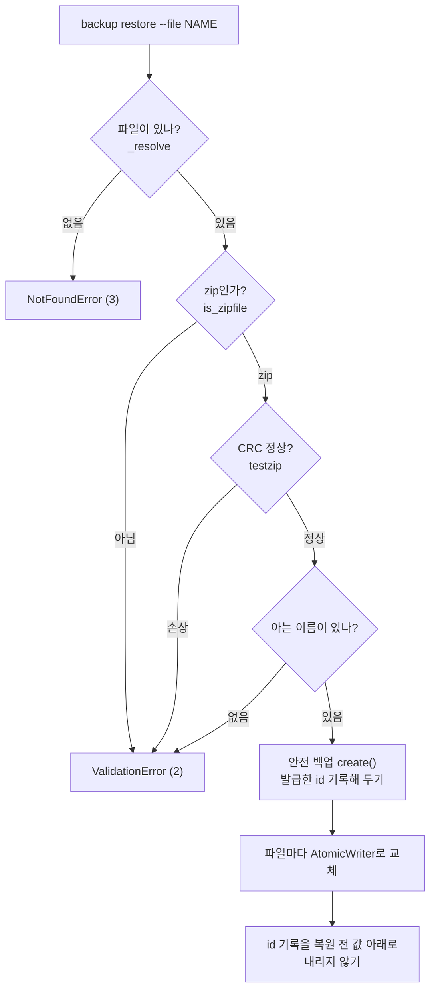
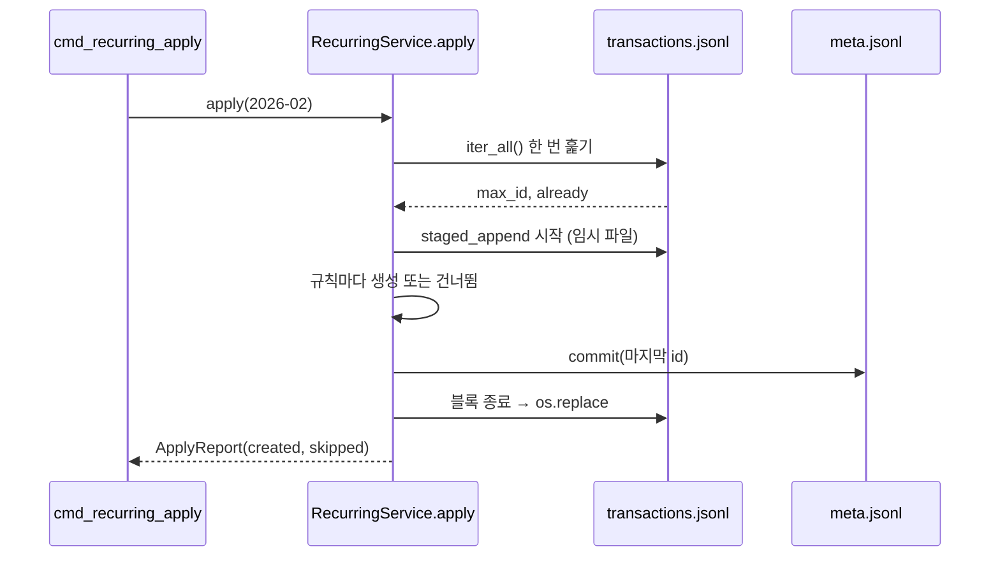

# 08. 보너스 기능 해설 (백업 · 반복 거래 · 표 정렬 · 저장 원자성)

> 관련 요구사항: 5.1 백업, 5.2 반복 내역, 5.3 출력 포맷 테이블 정렬, 5.4 저장 원자성 강화
> 핵심 코드: [backup.py](../budget_app/backup.py), [recurring.py](../budget_app/recurring.py), [formatting.py](../budget_app/formatting.py), [storage.py의 AtomicWriter](../budget_app/storage.py)

## 이 문서에서 배우는 것

- 백업 zip을 **깨지지 않게 만들고**, 복원할 때 **믿지 않고 검사하는** 방법(CRC 검사, zip slip 방지, 안전 백업)을 설명할 수 있습니다.
- 반복 거래의 `apply`가 왜 여러 번 실행해도 결과가 같은지(멱등성, idempotency), 31일 규칙이 2월에 어떻게 되는지 설명할 수 있습니다.
- 한글이 섞인 표가 `len()`과 `ljust()`로는 어긋나는 이유와 `unicodedata.east_asian_width`로 맞추는 방법을 설명할 수 있습니다.
- "임시 파일 → `os.replace`" 원자적 쓰기가 보너스 기능 어디에 쓰였는지, 그리고 **원자적이지 않은 부분**이 어디인지 정직하게 말할 수 있습니다.

## 핵심 개념

### 1. zip 파일과 "이름을 믿지 않기"

`zipfile`은 표준 라이브러리만으로 zip을 만들고 읽게 해 줍니다. 주의할 점은 **zip 안의 항목 이름은 만든 사람이 마음대로 정할 수 있다**는 것입니다.

```python
import io
import zipfile

buffer = io.BytesIO()                     # 디스크 대신 메모리에 zip을 만든다
with zipfile.ZipFile(buffer, "w", compression=zipfile.ZIP_DEFLATED) as archive:
    archive.writestr("transactions.jsonl", '{"id": 1}\n')
    archive.writestr("../../escape.txt", "zip 안의 이름은 무엇이든 될 수 있다")

with zipfile.ZipFile(buffer) as archive:
    print(archive.namelist())             # 이름 목록: 경로처럼 생긴 이름도 그대로 들어 있다
    print(archive.testzip())              # None이면 모든 항목의 CRC가 정상
    print(archive.read("transactions.jsonl"))
print(zipfile.is_zipfile(io.BytesIO(b"hello")))
```

```text
['transactions.jsonl', '../../escape.txt']
None
b'{"id": 1}\n'
False
```

이름을 그대로 `데이터폴더 / 이름`에 쓰면 `../../escape.txt`는 데이터 폴더 **밖**에 파일을 만듭니다. 이런 공격을 zip slip이라고 합니다.
가장 단순하고 확실한 방어는 **"내가 아는 이름만 꺼낸다"** 입니다.

### 2. 멱등성: 여러 번 해도 한 번 한 것과 같다

"매달 25일 월급"을 자동으로 만드는 기능을 실수로 두 번 실행해도 월급이 두 번 들어오면 안 됩니다.
이미 한 일에 **표시(marker)** 를 남기고, 실행할 때마다 표시를 확인하면 됩니다.

```python
made = []                                 # 지금까지 만든 거래: (규칙 id, 월)

def apply(month, rule_ids):
    already = {rule for rule, m in made if m == month}   # 이 달에 이미 만든 규칙
    new = [(rule, month) for rule in rule_ids if rule not in already]
    made.extend(new)
    return len(new)

print(apply("2026-02", [1, 2]), apply("2026-02", [1, 2]), apply("2026-03", [1, 2]))
print(made)
```

```text
2 0 2
[(1, '2026-02'), (2, '2026-02'), (1, '2026-03'), (2, '2026-03')]
```

같은 달에 두 번째 실행하면 0건, 다른 달이면 다시 2건입니다. 이 프로젝트는 표시를 **거래 자체**(`recurring_id` 필드)에 남깁니다.

### 3. 글자 수와 화면 폭은 다르다

```python
rows = [("food", 12000), ("식비", 8500), ("교통비", 1450)]
for name, amount in rows:
    print(f"{name.ljust(8)}|{amount:>7,}")
print([len(name) for name, _ in rows])
```

```text
food    | 12,000
식비      |  8,500
교통비     |  1,450
[4, 2, 3]
```

한글 한 글자는 터미널에서 **두 칸**을 차지하지만 `len()`은 1로 셉니다. 그래서 `ljust(8)`은 `식비` 뒤에 공백 6개를 붙이고, 화면에서는 10칸이 되어 `|`가 밀립니다.
유니코드는 글자마다 동아시아 폭(East Asian Width) 속성을 정해 두었습니다. `W`(Wide)와 `F`(Fullwidth)는 2칸, 나머지는 대개 1칸입니다.

```python
import unicodedata
for ch in ["a", "가", "食", "Ａ", "·", "\u0301"]:
    print(repr(ch), unicodedata.east_asian_width(ch), unicodedata.combining(ch))
```

```text
'a' Na 0
'가' W 0
'食' W 0
'Ａ' F 0
'·' A 0
'́' A 230
```

마지막 줄의 `\u0301`(결합용 예음 부호, 출력에서는 따옴표 위에 얹혀 보입니다)은 앞 글자 위에 얹히는 결합 문자(combining character)라서 칸을 차지하지 않습니다. `unicodedata.combining()`이 0이 아니면 폭 0으로 셉니다.

## 이 프로젝트에서는

### 5.1 백업: zip 하나로 묶고, 복원은 검사한 뒤에

**만들기** — [backup.py의 BackupService.create](../budget_app/backup.py)

```python
    @timed
    def create(self) -> BackupInfo:
        self.backup_dir.mkdir(parents=True, exist_ok=True)
        moment = self._now()
        path = self._unique_path(moment.strftime("%Y%m%d-%H%M%S"))
        included = [name for name in self._file_names if (self._data_dir / name).is_file()]
        manifest = {"app_version": __version__, "created_at": moment.isoformat(timespec="seconds"), "files": included}
        with AtomicWriter(path) as writer:
            with zipfile.ZipFile(writer.stream, "w", compression=zipfile.ZIP_DEFLATED) as archive:
                for name in included:
                    archive.write(self._data_dir / name, arcname=name)
                archive.writestr(MANIFEST_NAME, json.dumps(manifest, ensure_ascii=False, indent=2))
        return BackupInfo(path, path.stat().st_size, included)
```

- 백업 대상은 `AppContext`가 넘겨준 **알려진 데이터 파일 다섯 개**(`transactions`, `categories`, `budgets`, `recurring`, `meta`)뿐입니다. `app.log`와 `backups/` 폴더는 넣지 않습니다.
- `manifest.json`에 앱 버전, 만든 시각, 들어 있는 파일 목록을 적습니다. 나중에 형식이 바뀌어도 "어느 버전이 만든 백업인지" 알 수 있습니다. 다만 지금의 `restore`는 `manifest.json`을 읽지 않습니다. 이 이름은 데이터 파일 목록에 없으므로 복원 대상에서도 빠집니다.
- zip을 대상 경로에 바로 쓰지 않고 `AtomicWriter`의 임시 파일 스트림에 씁니다. 압축 도중 디스크가 가득 차거나 Ctrl+C가 눌려도 **반쯤 만든 zip이 백업 목록에 남지 않습니다.**
- 시계는 `self._now()`로 주입받습니다. 테스트에서 시각을 고정해 "같은 초에 여러 번 백업"을 재현할 수 있습니다.

이름은 `backup-YYYYMMDD-HHMMSS.zip`이고, 같은 초에 또 만들면 덮어쓰지 않고 번호를 붙입니다. [backup.py의 _unique_path](../budget_app/backup.py):

```python
    def _unique_path(self, stamp: str) -> Path:
        path = self.backup_dir / f"{BACKUP_PREFIX}{stamp}{BACKUP_SUFFIX}"
        counter = 2
        while path.exists():  # 같은 초에 두 번 백업하면 -2, -3을 붙인다.
            path = self.backup_dir / f"{BACKUP_PREFIX}{stamp}-{counter}{BACKUP_SUFFIX}"
            counter += 1
        return path
```

실제로 두 번 연달아 실행하면 이렇습니다 (시각은 실행할 때마다 다릅니다).

```text
$ python3 -m budget_app --data-dir /tmp/budget-lab backup && python3 -m budget_app --data-dir /tmp/budget-lab backup
백업을 만들었습니다: /tmp/budget-lab/backups/backup-20261019-011218.zip (1,431 bytes, 파일 5개)
백업을 만들었습니다: /tmp/budget-lab/backups/backup-20261019-011218-2.zip (1,431 bytes, 파일 5개)
$ python3 -m zipfile -l /tmp/budget-lab/backups/backup-20261019-011218.zip
File Name                                             Modified             Size
transactions.jsonl                             2026-10-19 01:12:18         1908
categories.jsonl                               2026-10-19 01:12:18          449
budgets.jsonl                                  2026-10-19 01:12:18            0
recurring.jsonl                                2026-10-19 01:12:18            0
meta.jsonl                                     2026-10-19 01:12:18           36
manifest.json                                  2026-10-19 01:12:18          196
```

`backup list`는 [backup.py의 _newest_first_key](../budget_app/backup.py)로 **최신순** 정렬합니다. 파일 이름을 그냥 문자열로 역정렬하면 `.zip`의 `.`이 `-2`의 `-`보다 큰 문자라서, 같은 초에 나중에 만든 `-2` 파일이 원래 파일 **아래로** 가 버립니다. 그래서 이름을 `("20261019-011218", 2)`처럼 (시각, 번호) 튜플로 바꿔 비교합니다. 규칙에 맞지 않는 이름은 `("", 0)`이 되어 맨 뒤로 갑니다.
목록은 5.3의 표 포매터(`backups_table`)로 그립니다.

```text
$ python3 -m budget_app --data-dir /tmp/budget-lab backup list
백업 파일                    |        크기 | 데이터 파일
-----------------------------+-------------+------------
backup-20261019-011218-2.zip | 1,431 bytes |         5개
backup-20261019-011218.zip   | 1,431 bytes |         5개

백업 2개 (최신순), 폴더: /tmp/budget-lab/backups
```

**복원하기** — [backup.py의 BackupService.restore](../budget_app/backup.py)

```python
    @timed
    def restore(self, name: str) -> RestoreReport:
        source = self._resolve(name)
        if not zipfile.is_zipfile(source):
            raise ValidationError(f"올바른 백업 파일(zip)이 아닙니다: {source.name}", hint=LIST_HINT)
        with zipfile.ZipFile(source) as archive:
            try:
                broken = archive.testzip()  # 각 파일의 압축을 풀어 보며 CRC를 검사한다.
            except (zipfile.BadZipFile, zlib.error, EOFError) as exc:
                raise ValidationError(f"백업 파일이 손상되었습니다 ({exc}).", hint="다른 백업 파일로 복원하세요.") from None
            if broken is not None:
                raise ValidationError(f"백업 파일이 손상되었습니다 (손상된 항목: {broken}).", hint="다른 백업 파일로 복원하세요.")
            members = [member for member in archive.namelist() if member in self._file_names]
            if not members:
                raise ValidationError(f"백업에 복원할 데이터 파일이 없습니다: {source.name}", hint=LIST_HINT)

            safety = self.create()  # 복원하기 전에 지금 상태를 백업해 둔다.
            issued = self._issued_ids()
            for member in members:
                with AtomicWriter(self._data_dir / member) as writer, archive.open(member) as data:
                    shutil.copyfileobj(data, writer.stream)
        self._keep_issued_ids(issued)
        return RestoreReport(source, safety, members)
```



- **검사를 모두 통과한 뒤에야** 데이터를 건드립니다. 검사에서 실패하면 안전 백업도 만들지 않고, 데이터 파일은 그대로입니다.
- `testzip()`은 모든 항목의 압축을 풀어 CRC(내용 체크섬)를 확인하고, 처음 발견한 손상 항목의 이름을 돌려줍니다. 압축 데이터가 깨져 풀다가 `zlib.error` 등이 나는 경우도 같은 "손상" 오류로 바꿉니다.
- `members`는 zip의 이름 목록 중 **알려진 데이터 파일 이름과 정확히 같은 것만** 고릅니다. `../../escape.jsonl`이나 `/etc/transactions.jsonl` 같은 이름은 목록에서 빠지므로 데이터 폴더 밖에 쓸 길이 없습니다 (zip slip 방지).
- 쓰기 경로는 `self._data_dir / member`이고 `member`는 이미 검증된 짧은 이름이라, `extractall()`처럼 zip이 정한 경로를 따라가지 않습니다.
- 파일 이름만 주면(`--file backup-...zip`) 백업 폴더에서 찾고, 경로를 주면 그 경로를 씁니다 (`_resolve`).
- `_issued_ids()`는 데이터를 바꾸기 직전에 `meta.jsonl`의 "지금까지 발급한 최대 id"(거래·반복 규칙)를 읽어 두고, `_keep_issued_ids()`는 복원이 끝난 뒤 그 값을 다시 `commit`합니다. `SequenceStore.commit`은 값을 줄이지 않으므로, 예전 `meta.jsonl`이 복원돼도 id 기록은 복원 전보다 낮아지지 않습니다. 이를 위해 `AppContext`가 `BackupService`에 `sequences`와 `sequence_keys`를 넘겨줍니다.

잘못된 파일로 복원을 시도한 결과입니다. `힌트:` 줄은 모두 `'backup list'로 복원할 수 있는 백업 파일을 확인하세요.`이고, 손상된 경우만 `다른 백업 파일로 복원하세요.`입니다.

| 시도한 파일 | 오류 메시지 | 종료 코드 |
| --- | --- | --- |
| 내용이 `hello`인 `backup-fake.zip` | 올바른 백업 파일(zip)이 아닙니다: backup-fake.zip | 2 |
| `../escape.jsonl`만 든 `backup-evil.zip` | 백업에 복원할 데이터 파일이 없습니다: backup-evil.zip | 2 |
| `transactions.jsonl`의 압축 데이터에서 바이트 하나를 바꾼 `backup-broken.zip` | 백업 파일이 손상되었습니다 (손상된 항목: transactions.jsonl). | 2 |
| 없는 `nope.zip` | 백업 파일을 찾을 수 없습니다: nope.zip | 3 |

손상 메시지는 바꾼 바이트에 따라 달라집니다. 압축은 풀리지만 내용이 달라지면 `testzip()`이 CRC 불일치로 항목 이름을 돌려주고, 압축 데이터 자체가 깨지면 `백업 파일이 손상되었습니다 (Error -3 while decompressing data: ...)`처럼 `zlib.error`의 문구가 들어갑니다. 어느 쪽이든 종료 코드는 2이고 데이터는 그대로입니다.

**안전 백업과 정직한 한계.** 복원은 파일마다 `AtomicWriter`로 교체하므로 **파일 하나하나는** "예전 내용 아니면 새 내용"입니다. 하지만 다섯 파일을 **한꺼번에** 바꾸는 것은 원자적이지 않습니다.
예를 들어 `transactions.jsonl`을 교체한 직후 `categories.jsonl` 교체가 실패하면, 거래는 백업 시점, 카테고리는 현재 시점인 섞인 상태가 됩니다.
파일 시스템에는 여러 파일을 한 번에 바꾸는 기본 기능이 없으므로, 이 프로젝트는 그 대신 **복원 직전 상태를 자동으로 백업**합니다. 문제가 생기면 그 안전 백업으로 다시 복원하면 됩니다.

```text
$ python3 -m budget_app --data-dir /tmp/budget-lab backup restore --file backup-20261019-011218.zip --yes
복원 완료: backup-20261019-011218.zip → 파일 5개 (transactions.jsonl, categories.jsonl, budgets.jsonl, recurring.jsonl, meta.jsonl)
복원 직전 상태는 backup-20261019-011228.zip에 백업했습니다.
```

또 `restore`는 zip의 CRC와 이름만 검사하고 **JSONL 내용 자체는 검사하지 않습니다.** 내용이 깨진 줄은 복원 뒤 읽을 때 [02. 파일 저장소](02-file-storage.md)의 "손상된 줄" 규칙대로 경고와 함께 건너뜁니다.

id는 복원해도 다시 쓰이지 않습니다. 복원은 `meta.jsonl`도 백업 시점의 파일로 바꾸지만, 바로 이어서 `_keep_issued_ids()`가 복원 전에 읽어 둔 최대 id를 다시 기록합니다. 그래서 백업 뒤에 id 12를 받은 거래가 있었다면, 복원한 다음 새로 추가한 거래는 **id 13**을 받습니다.
id 12 거래는 안전 백업 안에만 남아 있으므로, 이렇게 하지 않으면 두 시점의 데이터에 **같은 id를 가진 서로 다른 거래**가 생겨 id로 맞춰 볼 때 헷갈립니다.

```text
$ printf 'date,type,category,amount\n2026-10-26,expense,food,5000\n' > /tmp/one.csv
$ python3 -m budget_app --data-dir /tmp/budget-lab import --from /tmp/one.csv     # 백업 뒤에 한 건 추가
가져오기 완료: 전체 1행 중 1건을 추가했습니다 (id 12).
...
$ python3 -m budget_app --data-dir /tmp/budget-lab backup restore --file backup-20261019-011218.zip --yes
복원 완료: backup-20261019-011218.zip → 파일 5개 (...)
...
$ cat /tmp/budget-lab/meta.jsonl                                                  # 백업 안의 값은 11
{"key": "transaction", "value": 12}
$ python3 -m budget_app --data-dir /tmp/budget-lab import --from /tmp/one.csv     # 복원 뒤에 다시 추가
가져오기 완료: 전체 1행 중 1건을 추가했습니다 (id 13).
...
```

### 5.2 반복 거래: 규칙 → 그 달의 거래

규칙은 [models.py의 RecurringRule](../budget_app/models.py)입니다. "매월 `day`일, `type`, `category`, `amount`, `memo`, `tags`"를 담고, `__post_init__`에서 `day`가 1~31인지 확인합니다.
규칙이 특정 달의 날짜를 정할 때는 `YearMonth.clamp_day`를 씁니다.

```python
    def clamp_day(self, day: int) -> dt.date:
        """그 달에 없는 날(예: 2월 31일)이면 그 달의 마지막 날로 맞춘다."""
        return dt.date(self.year, self.month, min(day, self.last_day.day))
```

`last_day`는 `calendar.monthrange`로 그 달의 일 수를 구하므로 윤년도 맞습니다. 31일 규칙은 2026년 2월에 28일, 2028년 2월에 29일, 4월에 30일이 됩니다.

**적용하기** — [recurring.py의 RecurringService.apply](../budget_app/recurring.py)의 앞부분입니다.

```python
        # 거래 파일을 한 번만 훑어서 '최대 id'와 '이 달에 이미 만든 규칙'을 함께 구한다.
        max_id = 0
        already: Set[int] = set()
        for tx in self._transactions.iter_all():
            max_id = max(max_id, tx.id)
            if tx.recurring_id is not None and month.contains(tx.date):
                already.add(tx.recurring_id)
```

- 반복 규칙으로 만든 거래에는 `recurring_id`(만든 규칙의 id)가 저장됩니다. "이 달에 `recurring_id == 1`인 거래가 있다" = "규칙 1은 이 달에 이미 적용됐다"입니다. 별도의 "적용 기록" 파일이 필요 없습니다.
- 파일을 **한 번만** 스트리밍하면서 새 id의 기준이 될 최대 id와 이미 적용된 규칙 집합을 함께 구합니다. 거래는 메모리에 쌓이지 않고, 정수 하나(최대 id)와 규칙 id 집합만 남습니다.

뒷부분은 새 거래를 **전부 아니면 전무**로 추가합니다.

```python
        with self._transactions.staged_append() as staged:
            for rule in rules:
                if rule.id in already:
                    report.skipped.append((rule, "이 달에 이미 생성됨"))
                    continue
                if rule.category not in known:
                    report.skipped.append((rule, f"카테고리 '{rule.category}'가 등록되어 있지 않음"))
                    continue
```

(이어서 `Transaction(..., date=rule.date_for(month), recurring_id=rule.id, ...)`를 만들어 `staged.add(tx)`하고, 마지막에 `self._sequences.commit(...)`으로 id 발급을 기록합니다.)

`staged_append`는 기존 내용을 임시 파일에 복사하고 새 줄을 덧붙인 다음, 블록이 정상으로 끝날 때만 원본과 교체합니다. 규칙 10개 중 7번째를 만들다 실패하면 **아무것도 추가되지 않습니다.** 새로 만든 것이 0건이면 파일을 아예 건드리지 않습니다.



실제 실행 결과입니다 (샘플 거래 11건을 가져온 상태에서 규칙 두 개를 등록했습니다).

```text
$ python3 -m budget_app --data-dir /tmp/budget-lab recurring list
ID | 매월 | 구분 | 카테고리 |        금액 | 메모 | 태그
---+------+------+----------+-------------+------+--------
 1 | 25일 | 수입 | salary   | 3,200,000원 | 월급 |
 2 | 31일 | 지출 | rent     |   650,000원 | 월세 | #고정비
$ python3 -m budget_app --data-dir /tmp/budget-lab recurring apply --month 2026-02
2026-02 반복 거래: 2건 생성, 0건 건너뜀
ID | 날짜       | 구분 | 카테고리 |        금액 | 메모 | 태그
---+------------+------+----------+-------------+------+--------
12 | 2026-02-25 | 수입 | salary   | 3,200,000원 | 월급 |
13 | 2026-02-28 | 지출 | rent     |   650,000원 | 월세 | #고정비
$ python3 -m budget_app --data-dir /tmp/budget-lab recurring apply --month 2026-02
2026-02 반복 거래: 0건 생성, 2건 건너뜀
  - 규칙 1 (월급): 이 달에 이미 생성됨
  - 규칙 2 (월세): 이 달에 이미 생성됨
```

**건너뛰는 이유는 두 가지**입니다: "이 달에 이미 생성됨"과 "카테고리가 등록되어 있지 않음". 두 번째는 정상적인 명령으로는 거의 생기지 않습니다. 규칙이 쓰는 카테고리는 `category remove`가 막기 때문입니다.

```text
$ python3 -m budget_app --data-dir /tmp/budget-lab category remove rent
오류: 'rent' 카테고리를 쓰는 거래 2건, 반복 규칙 1건이 있어 삭제할 수 없습니다.
힌트: 'category remove rent --replace-with <다른 카테고리>'로 내역을 옮긴 뒤 삭제하세요.
```

`CategoryService.remove`는 거래뿐 아니라 반복 규칙도 세고, `--replace-with`를 주면 거래와 규칙을 **모두** 옮긴 뒤 카테고리를 지웁니다. 그래도 `categories.jsonl`을 직접 편집해 카테고리를 지우면 그 규칙은 "등록되어 있지 않음"으로 건너뜁니다. 프로그램이 멈추는 대신 이유를 보여 주는 것입니다.

**알려진 한계** (README 10장): 반복 규칙으로 만든 거래를 `delete`로 지운 뒤 같은 달에 `apply`를 다시 실행하면, 표시(`recurring_id`)가 사라졌으므로 그 거래가 **다시 생깁니다.** "지웠다"와 "아직 안 만들었다"를 구분하는 정보를 따로 저장하지 않기 때문입니다.

### 5.3 표 정렬: 화면 폭으로 계산하기

[formatting.py](../budget_app/formatting.py)의 바탕은 글자 하나의 폭을 구하는 함수입니다.

```python
def char_width(char: str) -> int:
    if unicodedata.combining(char):
        return 0
    return 2 if unicodedata.east_asian_width(char) in ("W", "F") else 1


def display_width(text: str) -> int:
    """터미널에서 차지하는 칸 수 (한글·전각 문자는 2칸)."""
    return sum(char_width(char) for char in text)
```

이 폭을 기준으로 `pad`(정렬하며 공백 채우기)와 `truncate`(너무 긴 칸을 `..`로 자르기)를 만들고, `render_table`이 열마다 가장 넓은 칸에 맞춰 표를 그립니다.

```python
def pad(text: str, width: int, align: Align = "left") -> str:
    gap = max(width - display_width(text), 0)
    if align == "right":
        return " " * gap + text
    if align == "center":
        left = gap // 2
        return " " * left + text + " " * (gap - left)
    return text + " " * gap
```

`render_table`은 ① 칸마다 `printable`로 제어 문자를 `?`로 바꾸고(열에 `max_width`가 있으면 `truncate`도 하고) ② 헤더와 모든 칸의 `display_width` 최댓값으로 열 너비를 정한 뒤 ③ 각 칸을 `pad`해서 ` | `로 잇습니다.
①의 `printable`은 파일을 직접 편집해 메모에 ESC 같은 제어 문자가 들어가도 표 출력이 터미널을 조작하거나 정렬을 깨지 못하게 합니다 (입력 단계의 같은 방어는 [06. 입력 검증](06-validation-and-errors.md)의 `_clean_text`). `Align = Literal["left", "right", "center"]` 덕분에 `"rigth"` 같은 오타는 `mypy`가 잡습니다.

```bash
python3 -c "from budget_app.formatting import render_table, Column; print(render_table([Column('이름'), Column('금액', 'right')], [['food', '12,000원'], ['식비', '8,500원'], ['교통비', '1,450원']]))"
```

```text
이름   |     금액
-------+---------
food   | 12,000원
식비   |  8,500원
교통비 |  1,450원
```

**포매터는 문자열만 돌려줍니다.** `transactions_table`, `format_summary` 등 이 모듈의 함수는 `print`하지 않고 문자열을 반환하며, 출력은 CLI 계층(`ctx.console.print`)이 합니다. 그래서 [tests/test_bonus.py의 TableFormattingTest](../tests/test_bonus.py)처럼 화면 없이 결과를 검사할 수 있습니다.

```python
    def test_columns_line_up_with_korean(self) -> None:
        table = render_table(
            [Column("이름"), Column("금액", "right")],
            [["식비", "12,000원"], ["transport", "1,450원"]],
        )
        lines = table.splitlines()
        positions = {display_width(line.split("|")[0]) for line in lines if "|" in line}
        self.assertEqual(len(positions), 1, table)
```

"모든 줄에서 첫 번째 `|`의 화면 위치가 같다"는 것을 숫자로 확인합니다.

**한계도 있습니다.** `east_asian_width`가 `A`(Ambiguous, 모호)인 글자(예: `·`, 샘플 메모 "전기·가스 요금"에 있음)는 1칸으로 계산합니다. 모호한 글자를 2칸으로 그리는 터미널 설정에서는 그 줄이 한 칸 밀릴 수 있습니다.
또 `👨‍👩‍👧`처럼 여러 이모지를 결합 문자(ZWJ)로 이은 글자는 화면에서 2칸이지만 `display_width`는 8로 계산합니다. 가계부 메모에서는 드문 경우라 단순한 규칙을 택했습니다.

### 5.4 저장 원자성: 보너스 기능에서 다시 보기

원자적 쓰기의 원리는 [02. 파일 저장소](02-file-storage.md)의 "원자적 쓰기: 임시 파일에 쓰고 한 번에 바꾸기"와 "쓰기 경로 2: 전체 다시 쓰기"에서 자세히 다룹니다. 요점만 다시 보면 다음과 같습니다.

- `AtomicWriter`는 대상과 **같은 폴더**에 임시 파일(`.이름.xxxx.tmp`)을 만들고, 블록이 예외 없이 끝나면 `flush` → `fsync` → `os.replace`로 교체합니다. 예외가 나면 임시 파일만 지웁니다. 대상이 심볼릭 링크면 `os.path.realpath`로 실제 파일을 교체하고, 읽기 전용 파일은 건드리지 않고 `StorageError`로 거부합니다.
- `update`/`delete`는 `JsonlFile.rewrite`로 파일 전체를 이 방식으로 다시 씁니다 (요구사항 5.4).

보너스 기능에서는 이렇게 쓰였습니다.

| 기능 | 원자적으로 바뀌는 단위 | 쓰는 도구 |
| --- | --- | --- |
| `backup` (만들기) | zip 파일 하나 | `AtomicWriter(path)` + `zipfile.ZipFile(writer.stream, "w")` |
| `backup restore` | 데이터 파일 **하나씩** (전체는 아님 → 안전 백업으로 보완) | 파일마다 `AtomicWriter` |
| `recurring apply` | 이번 달 반복 거래 전체 | `staged_append` |
| `recurring remove` | `recurring.jsonl` | `rewrite` |

실패해도 원본이 그대로인지 직접 확인할 수 있습니다. 샘플 거래를 가져온 `/tmp/budget-lab`에서, id 6인 거래를 처리하다 예외가 나도록 만든 실험입니다.

```bash
python3 - <<'EOF'
import hashlib
from pathlib import Path
from budget_app.storage import TransactionRepository

data_dir = Path("/tmp/budget-lab")
repo = TransactionRepository(data_dir)
digest = lambda: hashlib.sha256(repo.path.read_bytes()).hexdigest()[:12]
before = digest()

def explode(tx):
    if tx.id == 6:                    # 6번째 거래를 처리하다가 프로그램이 죽었다고 치자
        raise RuntimeError("작업 도중 실패")
    return tx

try:
    repo.rewrite(explode)
except RuntimeError as exc:
    print("실패:", exc)
print("원본 그대로인가?", before == digest())
print("남은 임시 파일:", [p.name for p in data_dir.iterdir() if p.name.endswith(".tmp")])
EOF
```

```text
실패: 작업 도중 실패
원본 그대로인가? True
남은 임시 파일: []
```

## 왜 이렇게 설계했나

**백업**

- **폴더 복사 대신 zip 하나**: 파일 하나라서 옮기기 쉽고, CRC로 손상 여부를 확인할 수 있으며, 압축으로 크기가 줄어듭니다. 표준 라이브러리 `zipfile`만으로 됩니다.
- **덮어쓰지 않는 이름**: 백업이 백업을 지우면 안 됩니다. 시각을 이름에 넣고, 같은 초면 `-2`를 붙입니다. 오래된 백업을 자동으로 지우는 기능은 없습니다 (직접 지워야 합니다).
- **알려진 이름만 복원**: zip에 무엇이 들어 있든 데이터 폴더의 다섯 파일 외에는 쓰지 않습니다. 경로를 정규화해서 "폴더 안인지" 검사하는 방법도 있지만, 허용 목록(allow-list)이 더 단순하고 실수할 여지가 적습니다.
- **여러 파일 트랜잭션 대신 안전 백업**: 다섯 파일을 한 번에 바꾸려면 "새 폴더를 만들어 통째로 바꾸기" 같은 더 복잡한 구조가 필요합니다. 한 사람이 쓰는 콘솔 도구에서는 "복원 직전 상태를 남겨 두기"가 단순하면서 되돌릴 수 있는 방법입니다.

**반복 거래**

- **표시를 거래에 남기는 이유**: "적용 기록" 파일을 따로 두면 거래 파일과 기록 파일이 서로 어긋날 수 있습니다 (예: 거래는 썼는데 기록 전에 프로그램이 죽음). 거래 안에 `recurring_id`가 있으면 **거래가 있는 것 자체가 기록**입니다. 대가는 위에서 말한 "삭제 후 재생성" 한계입니다.
- **없는 날은 건너뛰지 않고 마지막 날로**: 월세가 31일인데 2월이라고 빠지면 안 되기 때문입니다.
- **자동 실행이 아니라 명령으로**: 프로그램을 켤 때마다 몰래 거래를 만들면 사용자가 모르는 데이터가 생깁니다. `recurring apply --month`로 명시적으로 실행하고, 결과 표와 건너뛴 이유를 보여 줍니다.
- **id**: 새 거래 id는 `max(meta의 기록, 실제 최대 id) + 1`부터 이어 붙이고, 파일 교체 전에 `meta.jsonl`에 마지막 id를 기록합니다. 중간에 멈춰도 id 번호가 비는 일은 있어도 **겹치는 일은 없습니다**. 예전 백업으로 복원한 뒤에도 `_keep_issued_ids()`가 기록을 지켜 주므로 마찬가지입니다.

**표 정렬**

- **외부 라이브러리 없이**: 과제 조건이 표준 라이브러리만이라 `tabulate` 같은 패키지를 쓰지 않았습니다. 필요한 기능(폭 계산, 정렬, 자르기)은 100줄 남짓입니다.
- **포매터와 출력 분리**: 문자열을 돌려주면 테스트할 수 있고, 같은 표를 화면이 아닌 곳(파일, 다른 UI)에도 쓸 수 있습니다. `print`가 섞여 있으면 테스트에서 stdout을 가로채야 합니다.

## 직접 해 보기

실습 데이터를 준비합니다.

```bash
python3 -m budget_app --data-dir /tmp/budget-lab import --from examples/sample_transactions.csv
```

### 1. 백업 → 사고 → 복원

```bash
python3 -m budget_app --data-dir /tmp/budget-lab backup
```

```text
백업을 만들었습니다: /tmp/budget-lab/backups/backup-YYYYMMDD-HHMMSS.zip (1,431 bytes, 파일 5개)
```

(크기는 저장된 시각 문자열에 따라 몇 바이트씩 다를 수 있습니다.) 이제 거래 하나를 지우는 "사고"를 냅니다.

```bash
python3 -m budget_app --data-dir /tmp/budget-lab delete --id 11 --yes
```

`backup list`로 이름을 확인하고, `--yes` 없이 복원해 확인 질문(`[y/N]`)에 `y`로 답합니다. `NAME` 자리에 위에서 만든 파일 이름을 넣으세요.

```bash
python3 -m budget_app --data-dir /tmp/budget-lab backup restore --file NAME
```

```text
'NAME'로 복원할까요? 현재 데이터는 먼저 자동 백업됩니다. [y/N]: y
복원 완료: NAME → 파일 5개 (transactions.jsonl, categories.jsonl, budgets.jsonl, recurring.jsonl, meta.jsonl)
복원 직전 상태는 backup-...zip에 백업했습니다.
```

`list --limit 1`에서 "전체 11건"이 다시 보이면 성공입니다. 이번에는 **안전 백업**으로 복원해서 "삭제된 상태"로 되돌아가는지도 확인해 보세요.

### 2. zip slip 막는지 확인하기

```bash
python3 -c "import zipfile; z = zipfile.ZipFile('/tmp/budget-lab/backups/backup-evil.zip', 'w'); z.writestr('../escape.jsonl', 'x'); z.close()"
```

```bash
python3 -m budget_app --data-dir /tmp/budget-lab backup restore --file backup-evil.zip --yes; echo $?
```

```text
오류: 백업에 복원할 데이터 파일이 없습니다: backup-evil.zip
힌트: 'backup list'로 복원할 수 있는 백업 파일을 확인하세요.
2
```

이름을 그대로 따랐다면 `/tmp/budget-lab/../escape.jsonl`, 즉 `/tmp/escape.jsonl`에 파일이 생겼을 것입니다. `ls /tmp/escape.jsonl`로 파일이 만들어지지 않았음을 확인하세요. 같은 zip에 `transactions.jsonl`도 함께 넣으면 그 파일 하나만 복원되고 이상한 이름은 무시됩니다.

### 3. 반복 거래 등록과 멱등성

```bash
python3 -m budget_app --data-dir /tmp/budget-lab recurring add
```

```text
반복 거래 규칙을 입력합니다. 'recurring apply --month YYYY-MM'으로 해당 월에 거래를 만듭니다.
매월 며칠 (1~31, 없는 날은 그 달 마지막 날): 32
  ! 일(day)은(는) 31 이하여야 합니다: 32
    힌트: 1~31 사이의 숫자를 입력하세요.
    다시 입력해 주세요. (남은 기회 4번)
매월 며칠 (1~31, 없는 날은 그 달 마지막 날): 31
타입 (income=수입 / expense=지출): expense
  등록된 카테고리: food, transport, rent, utilities, shopping, health, salary, etc
카테고리: rent
금액 (원, 양의 정수): 650000
메모 (선택, Enter로 건너뛰기): 월세
태그 (선택, 쉼표로 구분): 고정비
반복 규칙을 저장했습니다. (id: 1, 매월 31일 지출 650,000원 [rent])
```

```bash
python3 -m budget_app --data-dir /tmp/budget-lab recurring apply --month 2026-02
```

같은 명령을 한 번 더 실행해 "0건 생성, 1건 건너뜀 / 이 달에 이미 생성됨"을 확인하고, `--month 2028-02`로 바꿔 날짜가 `2028-02-29`가 되는지 봅니다.
마지막으로 `tail -1 /tmp/budget-lab/transactions.jsonl`로 `"recurring_id": 1`이 저장된 것을 확인하세요.

### 4. 한계 체험: 지우고 다시 적용하기

방금 만든 2026-02 거래의 id를 `search --month 2026-02`로 찾아 `delete --id <그 id> --yes`로 지운 뒤, `recurring apply --month 2026-02`를 다시 실행해 보세요. 거래가 **다시 생기는 것**이 README 10장의 알려진 한계입니다. 이것을 막으려면 무엇을 더 저장해야 할지 생각해 보세요.

### 5. 폭 계산 실험

```bash
python3 -c "from budget_app.formatting import display_width as w, truncate as t; print(w('food'), w('식비'), w('a식b'), w('cafe\u0301')); print(t('아메리카노 두 잔과 크루아상', 12))"
```

```text
4 4 4 4
아메리카노..
```

`truncate`는 `..`(2칸)를 붙일 자리까지 계산해서 결과가 12칸을 넘지 않게 자릅니다.

### 6. 과제: 포매터 테스트 써 보기

`backup list`의 표는 [formatting.py의 backups_table](../budget_app/formatting.py)이 만든 **문자열**입니다. 화면 없이 이 함수만 불러, 한글 헤더(`백업 파일`)와 길이가 다른 파일 이름이 섞여도 열이 맞는지 검사하는 테스트를 써 보세요.

<details>
<summary>참고 답안</summary>

```bash
python3 - <<'PY'
import unittest
from budget_app.formatting import backups_table, display_width

class BackupsTableTest(unittest.TestCase):
    def test_columns_line_up(self) -> None:
        table = backups_table([("backup-20261019-011218-2.zip", 1431, 5), ("backup-x.zip", 6, 0)])
        lines = table.splitlines()
        positions = {display_width(line.split("|")[0]) for line in lines if "|" in line}
        self.assertEqual(len(positions), 1, table)
        self.assertIn("1,431 bytes", table)

unittest.main(argv=["backups_table"], exit=False)
PY
```

```text
.
----------------------------------------------------------------------
Ran 1 test in 0.000s

OK
```

`print`를 가로채지 않고도 표의 모양을 검사할 수 있는 것이 "포매터는 문자열만 돌려준다"는 설계의 이점입니다.

</details>

## 자주 하는 실수

1. **`zipfile.extractall()`로 복원한다.** 최신 파이썬은 위험한 경로를 어느 정도 정리해 주지만, 무엇이 어디에 써지는지 코드가 통제하지 못합니다. 아는 이름만 골라 직접 쓰는 편이 안전합니다.
2. **검사 전에 데이터를 바꾼다.** CRC 검사나 이름 검사보다 먼저 파일을 쓰기 시작하면, 손상된 백업이 멀쩡한 데이터를 덮어쓸 수 있습니다.
3. **백업 이름을 초 단위로만 만든다.** 같은 초에 두 번 실행하면 앞의 백업을 덮어씁니다. `_unique_path`가 `-2`를 붙이는 이유입니다.
4. **반복 적용을 "이번 달에 실행했는지"로만 판단한다.** 규칙을 하나 추가한 뒤 다시 실행하면 새 규칙만 만들어져야 합니다. 이 프로젝트는 규칙마다 표시를 확인합니다.
5. **`dt.date(year, month, 31)`을 그대로 부른다.** 2월이면 `ValueError`입니다. `clamp_day`처럼 그 달의 마지막 날로 맞추세요.
6. **`len()`과 `ljust()`로 한글 표를 정렬한다.** 한글은 2칸입니다. `display_width`와 `pad`를 쓰세요.
7. **포매터 안에서 `print`한다.** 테스트와 재사용이 어려워집니다. 문자열을 돌려주고 출력은 호출한 쪽이 합니다.
8. **"원자적"을 과장한다.** 파일 하나의 교체는 원자적이지만, 여러 파일에 걸친 작업(복원, 카테고리 대체)은 순서와 안전 백업으로 위험을 줄인 것이지 원자적이지는 않습니다.

## 정리

- [ ] 백업 zip에 무엇이 들어가고(`manifest.json` 포함), 왜 `AtomicWriter`로 만드는지 설명할 수 있다.
- [ ] 같은 초에 두 번 백업해도 덮어쓰지 않는 방법을 설명할 수 있다.
- [ ] 복원 전에 하는 검사 세 가지(zip인지, CRC, 아는 이름)와 zip slip이 막히는 이유를 설명할 수 있다.
- [ ] 복원이 여러 파일에 걸쳐 원자적이지 않다는 한계와, 안전 백업으로 보완하는 방식을 설명할 수 있다.
- [ ] 예전 백업으로 복원해도 id가 다시 쓰이지 않는 이유(`_issued_ids`/`_keep_issued_ids`)를 설명할 수 있다.
- [ ] `recurring apply`가 멱등인 이유(`recurring_id` 표시)와 31일 규칙이 2월에 바뀌는 방식(`clamp_day`)을 설명할 수 있다.
- [ ] `apply`가 거래 파일을 한 번만 훑는 이유와 `staged_append`로 전부 아니면 전무를 지키는 방식을 설명할 수 있다.
- [ ] `len()`으로 한글 표가 어긋나는 이유와 `east_asian_width`·`combining`으로 폭을 계산하는 방법을 설명할 수 있다.
- [ ] 포매터가 문자열을 반환하도록 분리했을 때의 이점을 설명할 수 있다.

## 스스로 설명해 보기

1. 백업 zip에 `../../etc/passwd`라는 항목이 있어도 이 프로젝트의 복원이 안전한 이유를 코드 한 줄을 짚어 설명해 보세요.
2. 복원 도중 세 번째 파일에서 디스크가 가득 찼다면 데이터는 어떤 상태가 되고, 사용자는 어떻게 되돌릴 수 있나요?
3. `recurring apply --month 2026-02`를 두 번 실행해도 거래가 한 번만 생기는 이유는 무엇인가요? 반대로 다시 생기는 경우는 언제인가요?
4. "적용 기록" 파일을 따로 두는 설계와 거래에 `recurring_id`를 남기는 설계를 장단점으로 비교해 보세요.
5. `식비`를 `ljust(8)`로 맞추면 화면에서 몇 칸이 되나요? `pad("식비", 8)`은요? 왜 다른가요?
