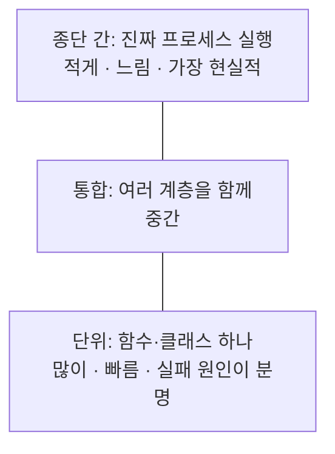
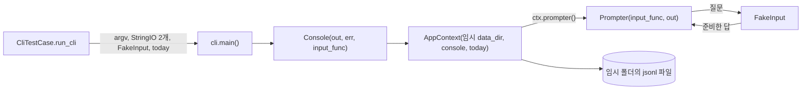

# 09. 테스트 전략: 사람 없이 대화형 프로그램 테스트하기

> `add`처럼 `input()`으로 하나씩 묻는 프로그램도 자동으로 테스트할 수 있습니다. 비결은 "바깥 세상"을 바꿔 끼울 수 있게 만든 설계에 있습니다.
> 계층 구조와 의존성 주입은 [01. 계층 구조](01-architecture.md)를 먼저 보면 이해가 빠릅니다.

## 이 문서에서 배우는 것

- 대화형 프로그램을 사람 없이 테스트할 수 있는 이유(입력·출력·데이터 폴더 주입)를 설명할 수 있습니다.
- `tests/helpers.py`의 `FakeInput`, `TempDirTestCase`, `AppTestCase`, `CliTestCase`가 각각 무엇을 해 주는지 설명할 수 있습니다.
- `unittest.mock`으로 실패를 일부러 일으켜 "데이터가 안전하다"와 "오류 메시지가 친절하다"를 증명하는 방법을 알 수 있습니다.
- `tracemalloc`(메모리), `subprocess`(진짜 진입점), `assertLogs`(경고 로그) 테스트가 무엇을 증명하는지 설명할 수 있습니다.
- 테스트를 계층별로 나누는 이유와 비용을 설명하고, 전체·일부 테스트를 실행하고, 새 테스트를 쓸 수 있습니다.

## 핵심 개념

### 테스트하기 어려운 코드는 "바깥 세상"을 직접 만집니다

| 바깥 세상 | 코드가 직접 쓰면 | 인자로 받으면 테스트에서 넣는 것 |
| --- | --- | --- |
| 키보드 (`input()`) | 사람이 타이핑해야 함 | 준비한 답을 돌려주는 가짜 함수 |
| 화면 (`print()`, `sys.stdout`) | 눈으로 확인해야 함 | `io.StringIO` (문자열로 모이는 가짜 파일) |
| 데이터 폴더 (`./data`) | 실제 데이터가 오염됨 | 테스트마다 새로 만드는 임시 폴더 |
| 시계 (`datetime.now()`) | 실행할 때마다 값이 다름 | 고정된 값을 돌려주는 함수 |

함수가 `input`을 직접 부르지 않고 **인자로 받으면**, 테스트는 가짜를 넣기만 하면 됩니다. 이것이 의존성 주입(dependency injection)입니다.
아래를 `fake_input_demo.py`로 저장하고 `python3 fake_input_demo.py`로 실행해 보세요.

```python
import io
import unittest
from typing import Callable, List, TextIO


def ask_amount(input_func: Callable[[str], str], out: TextIO) -> int:
    """양의 정수를 받을 때까지 다시 묻는다. input과 출력 대상을 인자로 받는다."""
    while True:
        text = input_func("금액: ").strip()
        if text.isascii() and text.isdigit() and int(text) > 0:
            return int(text)
        print(f"! 양의 정수가 아닙니다: {text!r}", file=out)


class FakeInput:
    """준비한 답을 차례로 돌려주는 가짜 input(). 답이 떨어지면 진짜 input()처럼 EOFError."""

    def __init__(self, answers: List[str]) -> None:
        self.answers = list(answers)
        self.prompts: List[str] = []

    def __call__(self, prompt: str) -> str:
        self.prompts.append(prompt)
        if not self.answers:
            raise EOFError
        return self.answers.pop(0)


class AskAmountTest(unittest.TestCase):
    def test_reprompts_until_valid(self) -> None:
        fake, out = FakeInput(["-5", "abc", "1200"]), io.StringIO()
        self.assertEqual(ask_amount(fake, out), 1200)
        self.assertEqual(fake.prompts, ["금액: "] * 3)  # 세 번 물었다
        self.assertIn("'-5'", out.getvalue())

    def test_eof_ends_the_loop(self) -> None:
        with self.assertRaises(EOFError):  # 무한 루프에 빠지지 않는다
            ask_amount(FakeInput(["x"]), io.StringIO())


if __name__ == "__main__":
    unittest.main(verbosity=2)
```

```text
test_eof_ends_the_loop (__main__.AskAmountTest) ... ok
test_reprompts_until_valid (__main__.AskAmountTest) ... ok
...
OK
```

`FakeInput`이 답이 떨어지면 `EOFError`를 던지는 것이 중요합니다. 그러지 않으면 답을 덜 준 테스트가 영원히 멈춥니다.

### 격리와 실패 주입: 임시 폴더, `mock.patch`, `assertLogs`

- **격리(isolation)**: `setUp`에서 `tempfile.TemporaryDirectory()`로 새 폴더를 만들고 `tearDown`에서 지웁니다. 테스트끼리 파일을 공유하지 않으므로 순서가 바뀌어도 결과가 같습니다.
- **실패 주입(fault injection)**: "디스크가 가득 차서 `os.replace`가 실패하면?" 같은 상황은 일부러 만들기 어렵습니다.
  `unittest.mock.patch(..., side_effect=OSError(...))`로 그 함수를 "부르면 예외를 던지는 가짜"로 잠시 바꿉니다.
- **로그 검증**: `self.assertLogs("로거 이름", level="WARNING")` 블록 안에서 경고가 **최소 한 번** 남았는지 확인하고, 메시지를 `logs.output`으로 읽습니다.

아래를 `mock_demo.py`로 저장하고 실행해 보세요. 세 가지가 한 테스트에 모두 들어 있습니다.

```python
import logging
import os
import tempfile
import unittest
from pathlib import Path
from unittest import mock

logger = logging.getLogger("demo")


def save(path: Path, text: str) -> None:
    """임시 파일에 쓴 뒤 os.replace로 교체한다. 교체에 실패하면 임시 파일을 지운다."""
    tmp = path.with_suffix(".tmp")
    tmp.write_text(text, encoding="utf-8")
    try:
        os.replace(tmp, path)
    except OSError:
        tmp.unlink()
        logger.warning("저장 실패, 원본을 유지합니다: %s", path.name)
        raise


class SaveTest(unittest.TestCase):
    def setUp(self) -> None:  # 테스트마다 새 임시 폴더
        self._tmp = tempfile.TemporaryDirectory()
        self.path = Path(self._tmp.name) / "data.txt"
        self.path.write_text("원본", encoding="utf-8")

    def tearDown(self) -> None:
        self._tmp.cleanup()

    def test_success(self) -> None:
        save(self.path, "새 내용")
        self.assertEqual(self.path.read_text(encoding="utf-8"), "새 내용")

    def test_failed_replace_keeps_original(self) -> None:
        with mock.patch("os.replace", side_effect=OSError("디스크 오류")), \
                self.assertLogs("demo", level="WARNING") as logs, \
                self.assertRaises(OSError):
            save(self.path, "새 내용")
        self.assertEqual(self.path.read_text(encoding="utf-8"), "원본")
        self.assertIn("원본을 유지", logs.output[0])
        self.assertEqual([p.name for p in self.path.parent.iterdir()], ["data.txt"])  # 임시 파일 없음


if __name__ == "__main__":
    unittest.main(verbosity=2)
```

```text
test_failed_replace_keeps_original (__main__.SaveTest) ... ok
test_success (__main__.SaveTest) ... ok
...
OK
```

`mock.patch`에는 **이름을 찾는 곳**을 적어야 합니다. `save`는 호출할 때마다 `os` 모듈에서 `replace`를 찾으므로 `"os.replace"`를 바꾸면 됩니다.
`from os import replace`처럼 이름을 복사해 온 모듈이라면 그 모듈 쪽 이름(`"그모듈.replace"`)을 바꿔야 합니다.

### 메모리와 진짜 실행도 테스트할 수 있습니다

- **`tracemalloc`**: 표준 라이브러리로, `start()`부터 `stop()`까지 파이썬이 잡은 메모리를 추적합니다. `get_traced_memory()[1]`이 그동안의 최댓값(peak)입니다.
  "최댓값이 파일 크기보다 훨씬 작다"를 확인하면 파일을 통째로 읽지 않았다는 증거가 됩니다(제너레이터 자체는 [03. 제너레이터와 스트리밍](03-generators-streaming.md)).
- **`subprocess.run`**: 테스트 안에서 진짜 `python -m ...` 프로세스를 띄우고 종료 코드와 출력을 받습니다. 느리지만 진입점까지 포함한 "진짜 실행"을 확인합니다.

### 테스트 피라미드



아래로 갈수록 빠르고, 실패했을 때 어디가 틀렸는지 바로 보입니다. 위로 갈수록 느리지만 "사용자가 겪는 그대로"를 확인합니다.
그래서 아래층을 많이, 위층을 조금 둡니다.

## 이 프로젝트에서는

### tests/ 폴더 지도

표준 라이브러리 `unittest`만 씁니다. 지금 **155개**가 있고 전체 실행에 1초 남짓 걸립니다.

| 파일 | 개수 | 주로 확인하는 것 |
| --- | --- | --- |
| [tests/helpers.py](../tests/helpers.py) | – | 공용 도구: `FakeInput`, 임시 폴더, CLI 실행기 |
| [tests/test_validation.py](../tests/test_validation.py) | 15 | 날짜·월·타입·금액·태그·카테고리 검증 규칙 |
| [tests/test_storage.py](../tests/test_storage.py) | 21 | 원자적 쓰기, 손상된 줄 보존, BOM, id 발급, 모델 레코드 변환 |
| [tests/test_services.py](../tests/test_services.py) | 28 | 거래 CRUD, 최신순, 검색 조건, 카테고리 규칙, 요약·예산 |
| [tests/test_csv_io.py](../tests/test_csv_io.py) | 14 | 전부 아니면 전무 가져오기, 헤더 처리, 내보내기, 왕복 |
| [tests/test_streaming.py](../tests/test_streaming.py) | 4 | 거래 20,000건 파일에서 메모리 상한, 일찍 멈추기 |
| [tests/test_cli.py](../tests/test_cli.py) | 27 | `--help`, 첫 실행, 대화형 `add`, 명령별 출력, 오류·종료 코드, 로그, 진입점 |
| [tests/test_bonus.py](../tests/test_bonus.py) | 11 | 백업/복원, 반복 거래, 한글 표 정렬 |
| [tests/test_regressions.py](../tests/test_regressions.py) | 35 | 점검(audit)과 학습 문서 검토에서 찾아 고친 문제가 다시 생기지 않게 막는 회귀 테스트 |

### `helpers.py`: 네 가지 도구

`FakeInput`은 핵심 개념의 예제와 같은 원리입니다(답 목록을 차례로 돌려주고, 떨어지면 `EOFError`, 물어본 질문은 `prompts`에 기록).
[helpers.py의 TempDirTestCase와 AppTestCase](../tests/helpers.py)는 테스트마다 새 임시 폴더와, 그 폴더를 쓰는 `AppContext`를 준비합니다.

```python
class TempDirTestCase(unittest.TestCase):
    def setUp(self) -> None:
        self._tmp = tempfile.TemporaryDirectory()
        self.root = Path(self._tmp.name)
        self.data_dir = self.root / "data"

    def tearDown(self) -> None:
        shutdown_logging()
        self._tmp.cleanup()


class AppTestCase(TempDirTestCase):
    """초기화된 AppContext(기본 카테고리 포함)를 제공한다."""

    def setUp(self) -> None:
        super().setUp()
        self.out = io.StringIO()
        self.err = io.StringIO()
        self.ctx = AppContext(self.data_dir, Console(self.out, self.err, FakeInput()))
        self.ctx.initialize()
```

- `AppTestCase`는 **서비스 테스트**용입니다. CLI를 거치지 않고 `self.ctx.ledger.add(...)`처럼 서비스를 바로 부릅니다.
  답이 없는 `FakeInput()`을 넣었으므로, 실수로 무언가를 물으면 바로 `EOFError`(→ `InputAbortedError`)로 드러납니다.
- `tearDown`의 `shutdown_logging()`은 `main()`이 (`_run`의 `configure_logging`으로) `budget_app` 로거에 붙인 핸들러(임시 폴더의 `app.log`를 여는 파일 핸들러 포함)를 떼고 닫습니다.
  로거는 프로세스 전체에서 하나라서, 닫지 않으면 지워질 폴더의 파일을 붙잡은 채 다음 테스트로 넘어갑니다.

[helpers.py의 CliTestCase.run_cli](../tests/helpers.py)는 **CLI 통합 테스트**용입니다.

```python
class CliTestCase(TempDirTestCase):
    def run_cli(self, *argv: str, inputs: Iterable[str] = (), data_dir: Optional[Path] = None) -> CliResult:
        out, err = io.StringIO(), io.StringIO()
        fake = FakeInput(inputs)
        target = data_dir if data_dir is not None else self.data_dir
        code = main(
            ["--data-dir", str(target), *argv], stdout=out, stderr=err, input_func=fake, today=lambda: TODAY
        )
        return CliResult(code, out.getvalue(), err.getvalue(), fake.prompts)
```

종료 코드, stdout, stderr, 물어본 질문 목록을 `CliResult` 하나로 돌려줍니다. 테스트는 이 네 가지만 검사하면 됩니다.
`today=lambda: TODAY`는 CLI 테스트의 '오늘'을 `helpers.py`의 `TODAY`(2026-10-19)로 고정합니다. 그래서 `add`의 기본 날짜처럼 오늘에 기대는 동작도 언제 실행하든 같은 결과가 나옵니다.

### `main()`의 주입 지점

이것이 가능한 이유는 [cli.py의 main](../budget_app/cli.py)의 시그니처가
`main(argv=None, *, stdout=None, stderr=None, input_func=None, today=dt.date.today) -> int`처럼 입출력과 오늘 날짜를 인자로 받기 때문입니다.
`main`은 표준 스트림 준비와 끊긴 파이프(`BrokenPipeError`) 처리만 맡고, 실제 일은 `_run`이 합니다. `_run`의 첫 부분이 테스트에 특히 중요합니다.

```python
    parser = build_parser()
    try:
        with redirect_stdout(out), redirect_stderr(err):
            args = parser.parse_args(argv)
    except SystemExit as exc:  # --help, --version, 사용법 오류
        return exc.code if isinstance(exc.code, int) else (OK if exc.code is None else int(ExitCode.ERROR))
```

- argparse는 `--help`와 사용법 오류를 `sys.stdout`/`sys.stderr`에 직접 쓰고 `SystemExit`를 던집니다.
  `redirect_stdout`/`redirect_stderr`로 그 출력도 주입한 스트림에 모으고, `SystemExit`는 종료 코드로 바꿔 **돌려줍니다**. 그래서 테스트 프로세스가 끝나지 않습니다.
- `main()`은 `sys.exit()`를 부르지 않고 정수를 돌려줍니다. 프로세스를 끝내는 일은 `__main__.py`의 `raise SystemExit(main())`이 합니다.
- `_run`은 이어서 `Console(out, err, input_func or input)`를 만들어 `AppContext`에 넘깁니다(`today`도 함께 넘깁니다). 주입한 가짜가 `Prompter`까지 그대로 전달됩니다.



### 대화형 흐름 테스트: 틀린 답을 섞어서 재입력 확인

[test_cli.py의 AddFlowTest.test_interactive_add_with_reprompts](../tests/test_cli.py)는 사람이 실수하는 순서를 그대로 답 목록에 적습니다.

```python
    def test_interactive_add_with_reprompts(self) -> None:
        result = self.run_cli(
            "add",
            inputs=[
                "2026-02-30", "2026-10-02",  # 없는 날짜 → 재입력
                "transfer", "expense",  # 잘못된 타입 → 재입력
                "nope", "n", "food",  # 없는 카테고리 → 등록 거절 → 다시 고름
                "-5", "0", "12,000",  # 음수/0 → 재입력
                "점심", "점심, 회사",
                "",  # 저장 확인 (기본값 Y)
            ],
        )
        self.assertEqual(result.code, 0, result.err)
        self.assertIn("존재하지 않는 날짜", result.out)
        self.assertIn("허용되지 않은 타입", result.out)
        self.assertIn("등록되지 않은 카테고리", result.out)
        self.assertIn("음수", result.out)
        self.assertIn("(id: 1)", result.out)
        record = json.loads((self.data_dir / "transactions.jsonl").read_text(encoding="utf-8"))
        self.assertEqual(record["amount"], 12000)
        self.assertEqual(record["tags"], ["점심", "회사"])
```

- 화면 문구는 `assertEqual`로 통째로 비교하지 않고 `assertIn`으로 **핵심 조각**만 확인합니다. 표 정렬이나 문장부호가 조금 바뀌어도 깨지지 않습니다.
- 마지막에는 화면이 아니라 **파일**을 열어 실제로 저장된 값(`12000`, 정규화된 태그)을 확인합니다.
- 같은 클래스의 다른 테스트는 경계를 확인합니다. 답이 떨어지면 종료 코드 1과 `EOF` 안내(`test_eof_aborts_with_error_code`),
  같은 질문에 5번 틀리면 취소(`test_too_many_wrong_answers`), `n`으로 취소하면 파일이 비어 있음(`test_cancel_saves_nothing`).

### 실패 주입: 데이터가 안전하다는 증명

"`os.replace`가 실패해도 원본이 남는다"는 말은 테스트로 증명합니다. [test_storage.py의 AtomicWriterTest](../tests/test_storage.py)입니다.

```python
    def test_failed_replace_keeps_original(self) -> None:
        with mock.patch("budget_app.storage.os.replace", side_effect=OSError("disk error")):
            with self.assertRaises(OSError):
                with AtomicWriter(self.target) as writer:
                    writer.write_line(b"new")
        self.assertEqual(self.target.read_bytes(), b"original\n")
        self.assertEqual(self.leftovers(), [])
```

원본이 그대로이고(`b"original\n"`), 임시 파일(`*.tmp`)도 남지 않았는지(`leftovers()`) 두 가지를 확인합니다.
`budget_app.storage.os`는 `os` 모듈 그 자체이므로, 이 patch는 결국 `with` 블록 동안 `os.replace`를 프로세스 전체에서 바꿉니다. 경로를 이렇게 적은 것은 "저장소가 쓰는 `os.replace`"라는 의도를 드러내기 위해서입니다.
같은 클래스에는 블록 안에서 `RuntimeError`나 `KeyboardInterrupt`가 나도 원본이 남는지 확인하는 테스트도 있습니다.

오류 **메시지**도 실패를 주입해서 확인합니다. [test_cli.py의 ErrorOutputTest](../tests/test_cli.py)는 서비스 메서드가 예상 못 한 예외를 던지게 만듭니다.

```python
    def test_unexpected_error_is_friendly_and_debug_shows_trace(self) -> None:
        from unittest import mock

        with mock.patch("budget_app.services.LedgerService.recent", side_effect=ZeroDivisionError("boom")):
            result = self.run_cli("list")
            self.assertEqual(result.code, 1)
            self.assertIn("예기치 못한 오류", result.err)
            self.assertNotIn("Traceback", result.err)
            debug = self.run_cli("list", "--debug")
            self.assertIn("Traceback", debug.err)
```

`@handle_errors`의 마지막 안전망이 스택트레이스를 숨기고(종료 코드 1), `--debug`일 때만 보여 주는지 확인합니다.
이 테스트는 클래스의 **속성**(`LedgerService.recent`)을 바꾸므로, 그 클래스를 어디서 import했든 모두 가짜를 보게 됩니다.
같은 클래스의 `test_os_error_maps_to_storage_exit_code`는 `JsonlFile.iter_raw`가 `PermissionError`를 던지게 해서 종료 코드 5와 "권한" 안내(힌트 문구)를 확인합니다.

### 경고 로그 테스트: `assertLogs`

손상된 줄은 "경고만 하고 건너뛰고, 다시 쓸 때도 보존"해야 합니다. [test_storage.py의 JsonlFileTest](../tests/test_storage.py)의 앞부분입니다.

```python
    def test_corrupt_lines_skipped_on_read_and_preserved_on_rewrite(self) -> None:
        self.repo.add(make_tx(1))
        with open(self.repo.path, "ab") as handle:
            handle.write(b"{broken json\n")
            handle.write(b'{"id": 7, "type": "expense", "date": "2026-02-30", "amount": 1, "category": "food"}\n')
            handle.write(b"\xff\xfe invalid utf-8\n")
            handle.write(b'["not", "an", "object"]\n')
        self.repo.add(make_tx(2))

        with self.assertLogs("budget_app.storage", level="WARNING") as logs:
            ids = [tx.id for tx in self.repo.iter_all()]
        self.assertEqual(ids, [1, 2])
        self.assertEqual(len(logs.records), 4)
```

깨진 JSON, 없는 날짜, UTF-8이 아닌 바이트, 객체가 아닌 JSON, 네 종류의 손상 줄을 일부러 넣고 경고가 정확히 4번 나오는지 봅니다.
뒷부분에서는 `delete(1)` 뒤에도 손상된 줄의 **원래 바이트**가 파일에 남아 있는지 `assertIn(b"{broken json\n", raw)`처럼 확인합니다.

### 스트리밍 증명: `tracemalloc`과 "몇 줄 읽었나"

[test_streaming.py의 StreamingTest](../tests/test_streaming.py)는 `setUp`에서 거래 20,000건(약 3.8MB)짜리 파일을 직접 만들고, 이 도우미로 메모리 최댓값을 잽니다.

```python
    def peak_memory(self, func) -> int:  # type: ignore[no-untyped-def]
        tracemalloc.start()
        try:
            func()
            return tracemalloc.get_traced_memory()[1]
        finally:
            tracemalloc.stop()
```

`test_list_memory_is_bounded`는 `self.ctx.ledger.recent(10)`의 최댓값이 `self.file_size / 4`보다 작은지 확인합니다.
같은 파일로 직접 재 보면 `recent(10)`은 약 30KB, 비교용 `list(ctx.transactions.iter_all())`는 약 12MB(파일 크기의 3배쯤)를 썼습니다.
절대 바이트 수가 아니라 "파일 크기의 1/4"이라는 **상대 기준**이라서 파이썬 버전이나 OS가 달라도 흔들리지 않습니다.

`test_get_stops_reading_early`는 `mock.patch.object(JsonlFile, "iter_raw", counting)`으로 한 줄 읽을 때마다 숫자를 올리는 제너레이터를 끼워,
`self.ctx.transactions.get(5)`(`TransactionRepository.get`)가 **딱 5줄만** 읽고 멈추는지 확인합니다. 원래 함수를 그대로 감싸 쓰면서 엿보는 "스파이(spy)" 기법입니다.

### 진짜 진입점: `subprocess`

`main()`을 직접 부르는 테스트는 `__main__.py`, 실제 표준 입력, 프로세스 종료 코드를 확인하지 못합니다. [test_cli.py의 SubprocessTest](../tests/test_cli.py)가 이 틈을 메웁니다.

```python
    def run_module(self, *argv: str, stdin: str = "") -> subprocess.CompletedProcess:
        env = dict(os.environ, PYTHONIOENCODING="utf-8")
        return subprocess.run(
            [sys.executable, "-m", "budget_app", "--data-dir", str(self.data_dir), *argv],
            input=stdin,
            capture_output=True,
            text=True,
            encoding="utf-8",
            cwd=str(PROJECT_ROOT),
            env=env,
            timeout=60,
        )
```

`sys.executable`로 지금 테스트를 돌리는 그 파이썬을 쓰고, `timeout=60`으로 대화형 질문에 걸려 멈추는 일을 막습니다.
`add`에는 `stdin="2026-10-01\ne\nfood\n1000\n\n\ny\n"`처럼 줄바꿈으로 구분한 답을 표준 입력으로 흘려 넣습니다.

### 계층별로 나눠 보기

| 층 | 무엇을 | 개수 | 어디에 |
| --- | --- | --- | --- |
| 단위 | 검증 함수, 모델 변환, `AtomicWriter`·`JsonlFile`, 표 정렬 | 39 | `test_validation`(15), `test_storage`(21), `test_bonus.TableFormattingTest`(3) |
| 서비스 | `AppContext` + 임시 폴더의 실제 파일로 규칙 확인 | 78 | `test_services`(28), `test_csv_io`(14), `test_bonus`의 백업·반복(7), `test_streaming`(4), `test_regressions`의 `AppTestCase` 계열(25) |
| CLI 통합 | `main()` 직접 호출: 인자, 대화, 출력, 종료 코드, 로그 | 37 | `test_cli`(26), `test_bonus.RecurringCliTest`(1), `test_regressions`의 `CliTestCase` 계열(10) |
| 종단 간 | `python -m budget_app`을 별도 프로세스로 | 1 | `test_cli.SubprocessTest` |

`test_regressions.py`는 기반 클래스(`AppTestCase`/`CliTestCase`)를 기준으로 나눴습니다. 아래층이 많고 위층이 적은 피라미드 모양입니다.
요구사항과 짝지어 보면, `HelpTest`는 "모든 명령 `--help`"(4.1)를, `ErrorOutputTest`와 `SubprocessTest`는 "원인 + 힌트, 종료 코드"(4.14)를 지킵니다.
`ImportTest.test_any_bad_row_rejects_everything`은 `import`(4.12)에 대해 **이 프로젝트가 스스로 정한** "전부 아니면 전무" 정책(README 2장 "데이터 안전 장치")을 지킵니다. 요구사항 자체에는 이 규칙이 없습니다.

## 왜 이렇게 설계했나

**`unittest`만 쓴 이유.** 이 프로젝트는 표준 라이브러리만 쓰기로 정했고(README, `pyproject.toml`의 `dependencies = []`), 그래서 설치 없이 `python3 -m unittest`로 바로 돌아갑니다.
과제(requirement.md)가 테스트 도구를 정해 둔 것은 아닙니다.
대가로 pytest의 fixture나 parametrize가 없어 조금 장황합니다. 여러 입력을 한 테스트에서 돌릴 때는 `self.subTest(...)`로 대신합니다(`test_validation.py`).

**mock보다 주입을 먼저.** 정상 흐름은 `stdout=`, `input_func=`, `--data-dir`처럼 설계에 이미 있는 문으로 가짜를 넣습니다. `mock.patch`는 디스크 오류, 권한 오류,
예상 못 한 예외처럼 **일부러 만들기 어려운 실패**에만 씁니다. `"budget_app.storage.os.replace"` 같은 문자열 경로는 구현 세부에 묶여 있어서,
코드를 정리하다 이름이 바뀌면 테스트도 함께 고쳐야 하기 때문입니다.

**가짜 저장소 대신 진짜 파일.** 메모리 속 가짜 저장소가 더 빠르겠지만, 이 프로젝트의 위험은 대부분 **파일 자체**에 있습니다(끊긴 마지막 줄, BOM, 손상된 줄, 원자적 교체).
임시 폴더의 실제 파일로도 전체가 1초 남짓이라 속도 손해가 거의 없습니다.

**종단 간 테스트는 1개만.** `SubprocessTest` 한 개(프로세스 3번 실행)가 0.2초쯤 걸리는 반면, `CommandsTest` 9개는 0.05초쯤입니다.
진입점처럼 프로세스로만 확인할 수 있는 것만 위층에 두고 나머지는 `main()` 직접 호출로 확인합니다.

**테스트가 증명하지 못하는 것도 있습니다.**

- 여러 프로세스의 동시 쓰기는 테스트하지 않습니다. 애초에 파일 잠금이 없습니다(README 10장 "알려진 한계").
- 실패 주입은 "예외가 났을 때"를 흉내 낼 뿐, 실제로 전원이 나갔을 때 `fsync`가 지켜 주는지는 확인할 수 없습니다.
- `main()`이 주입받는 시계는 `today`(오늘 날짜)뿐이고 `now`(저장 시각 `created_at`, 백업 파일 이름)는 받지 않습니다. 그래서 CLI 테스트에서는 `now`가 실제 시계를 따르고,
  CLI 수준에서는 그 값을 정확히 비교하지 않습니다. 고정된 시각이 필요한 확인은 `now=`를 받는 서비스 수준에서 합니다(`BackupTest.test_same_second_backups_get_unique_names`의 `BackupService(..., now=lambda: fixed)`).
  예전에는 `today`도 주입할 수 없어서 `test_default_date_is_today_and_new_category_registration`이 자정을 넘는 순간 드물게 틀릴 수 있었습니다. `main(today=...)`를 추가하고 `run_cli`가 `TODAY`를 넘기면서 이 문제가 사라졌습니다.
- 테스트는 검사한 것만 지킵니다. 이 프로젝트에는 파일 오류가 나면 stderr에 `오류:` 줄이 두 번 찍히던 문제가 있었습니다(로그 기록이 화면에도 나감).
  기존 테스트는 종료 코드, "권한" 같은 핵심 조각, "`Traceback`이 없다"만 확인해서 이 문제를 놓쳤습니다. 점검에서 찾아 고치면서(`logconfig.py`의 `_FileOnly` 필터) `test_regressions.py`의 `test_os_error_prints_single_error_line`이
  `result.err.count("오류:")`가 1인지 확인하도록 추가되었습니다. 버그를 고칠 때 그 버그를 재현하는 테스트를 함께 남기는 것을 **회귀 테스트(regression test)**라고 합니다.

## 직접 해 보기

모든 명령은 프로젝트 루트에서 실행합니다.

**1. 전체 테스트 실행**

```bash
python3 -m unittest discover -s tests -t . -v
```

```text
test_create_list_restore (tests.test_bonus.BackupTest) ... ok
test_restore_rejects_bad_files_and_zip_slip (tests.test_bonus.BackupTest) ... ok
...
----------------------------------------------------------------------
Ran 155 tests in 1.274s

OK
```

`-s tests`는 테스트를 찾을 폴더, `-t .`는 최상위 폴더입니다. 테스트 파일이 `from tests.helpers import ...`로 import하므로 프로젝트 루트가 최상위여야 합니다.

**2. 일부만 실행**: 모듈·클래스·메서드 이름으로 좁히거나, `-k`로 이름 일부를 걸러 냅니다.

```bash
python3 -m unittest tests.test_cli.AddFlowTest.test_eof_aborts_with_error_code -v
```

```bash
python3 -m unittest discover -s tests -t . -k Atomic
```

```text
Ran 6 tests in 0.004s

OK
```

**3. 실제 CLI에 실패 주입하기**: 테스트 프레임워크 없이도 `mock.patch`를 쓸 수 있습니다. 먼저 실습 데이터를 준비합니다.

```bash
rm -rf /tmp/budget-lab
```

```bash
python3 -m budget_app --data-dir /tmp/budget-lab import --from examples/sample_transactions.csv
```

이제 `os.replace`가 실패하도록 바꾼 채로 5번 거래(운동화)를 지워 봅니다.

```bash
python3 -c "
from unittest import mock
from budget_app.cli import main
with mock.patch('os.replace', side_effect=OSError('디스크가 가득 찼습니다')):
    code = main(['--data-dir', '/tmp/budget-lab', 'delete', '--id', '5', '--yes'])
print('종료 코드:', code)
"
```

```text
삭제할 거래
  id       : 5
  ...
오류: 파일을 처리하다가 문제가 생겼습니다: 디스크가 가득 찼습니다
힌트: 경로가 맞는지, 쓰기 권한과 디스크 여유 공간이 있는지 확인하세요.
종료 코드: 5
```

(터미널에서 실행했을 때의 순서입니다. 출력을 파이프로 보내면 stdout이 버퍼링되어 stderr의 `오류:`/`힌트:` 두 줄이 먼저 보일 수 있습니다.)
`LedgerService.delete`는 거래 파일보다 먼저 `meta.jsonl`(지운 id 기록)을 다시 쓰므로, 이 실험에서는 거기서 첫 실패가 납니다.
어느 파일에서 실패하든 `AtomicWriter`가 원본을 지키고 임시 파일을 지웁니다. 데이터가 그대로인지 확인합니다.

```bash
python3 -m budget_app --data-dir /tmp/budget-lab search --q 운동화
```

```text
검색 조건: 메모에 '운동화' 포함
...
 5 | 2026-10-05 | 지출 | shopping | 45,900원 | 운동화 |
...
```

`ls -a /tmp/budget-lab`로 보면 `.tmp` 파일도 남아 있지 않습니다.

**4. 새 테스트 쓰기**: CLI 수준(종료 코드와 화면 문구)에서는 아직 테스트가 없는 경계 상황 네 가지를 검증합니다.
(`update`에 바꿀 항목이 없는 경우는 서비스 수준에서 `test_services.py`의 `test_update_errors`가 `ValidationError`만 확인합니다.) 원본을 건드리지 않게 복사본에서 합니다.

```bash
rm -rf /tmp/budget-test-src && mkdir -p /tmp/budget-test-src && cp -R budget_app tests examples /tmp/budget-test-src/
```

`/tmp/budget-test-src/tests/test_practice.py`를 아래 내용으로 만듭니다.

```python
"""연습: 아직 테스트가 없는 경계 상황을 직접 검증한다."""

from __future__ import annotations

import io
from unittest import mock

from budget_app.cli import main

from tests.helpers import CliTestCase


class PracticeTest(CliTestCase):
    def setUp(self) -> None:
        super().setUp()
        added = self.run_cli("add", inputs=["2026-10-02", "e", "food", "12000", "점심", "", "y"])
        self.assertEqual(added.code, 0, added.err)
        self.path = self.data_dir / "transactions.jsonl"

    def test_delete_answer_no_keeps_data(self) -> None:
        before = self.path.read_bytes()
        result = self.run_cli("delete", "--id", "1", inputs=["n"])
        self.assertEqual(result.code, 0)
        self.assertIn("취소", result.out)
        self.assertEqual(self.path.read_bytes(), before)

    def test_update_without_fields_is_input_error(self) -> None:
        result = self.run_cli("update", "--id", "1")
        self.assertEqual(result.code, 2)
        self.assertIn("수정할 항목", result.err)

    def test_ctrl_c_during_add_exits_130(self) -> None:
        def press_ctrl_c(prompt: str) -> str:
            raise KeyboardInterrupt

        before, err = self.path.read_bytes(), io.StringIO()
        code = main(["--data-dir", str(self.data_dir), "add"],
                    stdout=io.StringIO(), stderr=err, input_func=press_ctrl_c)
        self.assertEqual(code, 130)
        self.assertIn("중단", err.getvalue())
        self.assertEqual(self.path.read_bytes(), before)

    def test_disk_error_during_delete_keeps_data(self) -> None:
        before = self.path.read_bytes()
        with mock.patch("budget_app.storage.os.replace", side_effect=OSError("디스크 오류")):
            result = self.run_cli("delete", "--id", "1", "--yes")
        self.assertEqual(result.code, 5)
        self.assertIn("디스크 오류", result.err)
        self.assertEqual(self.path.read_bytes(), before)
        self.assertEqual([p.name for p in self.data_dir.iterdir() if p.suffix == ".tmp"], [])
```

```bash
(cd /tmp/budget-test-src && python3 -m unittest tests.test_practice -v)
```

```text
test_ctrl_c_during_add_exits_130 (tests.test_practice.PracticeTest) ... ok
test_delete_answer_no_keeps_data (tests.test_practice.PracticeTest) ... ok
test_disk_error_during_delete_keeps_data (tests.test_practice.PracticeTest) ... ok
test_update_without_fields_is_input_error (tests.test_practice.PracticeTest) ... ok
...
OK
```

- Ctrl+C는 테스트에서 누를 수 없으니 `KeyboardInterrupt`를 던지는 입력 함수를 주입했습니다. `run_cli`는 `FakeInput`만 만들므로 이 테스트는 `main()`을 직접 불렀습니다.
- 더 해 보기: README 10장의 알려진 한계("반복 거래로 만든 거래를 지운 뒤 `recurring apply`를 다시 하면 다시 생긴다")를 테스트로 적어 보세요.
  `recurring add`(답: `1`, `expense`, `rent`, `500000`, `월세`, `""`) → `recurring apply --month 2026-11` → `delete --id 1 --yes` → 다시 `apply`의 출력에 `1건 생성`이 있는지 확인합니다.
  이렇게 "지금의 동작"을 고정하는 테스트를 **특성 테스트(characterization test)**라고 합니다. 나중에 한계를 고치면 이 테스트가 깨지면서 문서도 고치라고 알려 줍니다.

**5. 테스트가 정말 지켜 주는지 확인하기**: 4번에서 만든 복사본(`/tmp/budget-test-src`)의 `AtomicWriter`를 일부러 망가뜨려 봅니다.
`AtomicWriter.__exit__`의 조건을 바꿔, 블록에서 예외가 나도 교체(commit)하게 만듭니다.

```bash
python3 -c "import pathlib; p = pathlib.Path('/tmp/budget-test-src/budget_app/storage.py'); s = p.read_text(encoding='utf-8'); p.write_text(s.replace('if exc_type is None and not self._discarded:', 'if not self._discarded:'), encoding='utf-8')"
```

```bash
(cd /tmp/budget-test-src && python3 -m unittest discover -s tests -t .)
```

```text
...
FAIL: test_exception_keeps_original_and_removes_temp (tests.test_storage.AtomicWriterTest)
...
AssertionError: b'half written\n' != b'original\n'
...
FAIL: test_keyboard_interrupt_keeps_original (tests.test_storage.AtomicWriterTest)
...
FAIL: test_staged_append_is_all_or_nothing (tests.test_storage.JsonlFileTest)
...
Ran 159 tests in 1.232s

FAILED (failures=3)
```

테스트 수가 159개인 것은 4번의 `test_practice.py` 4개가 더해졌기 때문입니다.
"반쯤 쓴 내용(`half written`)이 원본을 덮어썼다"는 사고를 테스트 세 개가 바로 잡아냅니다. 확인이 끝나면 프로젝트 루트에서 원본을 복사해 되돌립니다.

```bash
cp budget_app/storage.py /tmp/budget-test-src/budget_app/storage.py
```

`ImportTest.test_any_bad_row_rejects_everything`이 깨지지 않은 이유도 생각해 보세요. (힌트: `CsvService.import_csv`는 오류 행이 있으면 예외를 던지기 **전에** `discard()`를 부릅니다.)

## 자주 하는 실수

- **`tests` 폴더 안에서 실행하기.** `cd tests && python3 -m unittest test_cli`는 `ModuleNotFoundError: No module named 'tests'`로 실패합니다. 프로젝트 루트에서 실행하세요.
- **실제 `./data`로 테스트하기.** 내 가계부가 테스트 데이터로 덮입니다. 항상 `TempDirTestCase`처럼 임시 폴더를 `--data-dir`로 넘기세요.
- **엉뚱한 곳을 patch하기.** `context.py`는 `from .services import LedgerService`로 이름을 복사해 옵니다. 그래서 `mock.patch("budget_app.services.LedgerService")`로 클래스를 통째로 바꿔도
  `context.py`는 여전히 진짜를 씁니다. `"budget_app.context.LedgerService"`를 patch하거나, 이 프로젝트처럼 클래스의 속성(`"budget_app.services.LedgerService.recent"`)을 바꾸세요.
- **답 개수를 잘못 세기.** `FakeInput`의 답이 모자라면 `EOFError` → 종료 코드 1이 됩니다. 테스트가 "EOF"로 실패하면 `result.prompts`를 출력해 몇 번째 질문에서 멈췄는지 보세요.
- **로그 핸들러를 닫지 않기.** `main()`을 부르는 테스트를 직접 만들 때는 `TempDirTestCase`를 상속하거나 `tearDown`에서 `shutdown_logging()`을 부르세요.
- **`assertLogs`로 "경고가 없음"을 확인하려 하기.** 로그가 하나도 없으면 `AssertionError: no logs of level WARNING or higher triggered on ...`로 실패합니다.
  "없음"을 확인하는 `assertNoLogs`는 Python 3.10부터라 3.9에서는 쓸 수 없습니다.
- **출력 전체를 `assertEqual`로 비교하기.** 표의 칸 하나만 바뀌어도 수십 개가 깨집니다. 의미 있는 조각을 `assertIn`으로 확인하고, 값은 파일이나 서비스 결과로 확인하세요.

## 정리

- [ ] `main(argv, stdout=, stderr=, input_func=, today=)` 주입 덕분에 대화형 흐름을 사람 없이 테스트할 수 있는 이유를 설명할 수 있다
- [ ] `FakeInput`, `TempDirTestCase`, `AppTestCase`, `CliTestCase`가 각각 무엇을 준비하는지 설명할 수 있다
- [ ] `mock.patch(side_effect=...)`로 `os.replace` 실패를 주입해 원본 보존과 임시 파일 정리를 증명하는 방법을 설명할 수 있다
- [ ] `tracemalloc` 테스트와 "몇 줄 읽었나" 테스트가 각각 스트리밍의 무엇을 증명하는지 설명할 수 있다
- [ ] 단위·서비스·CLI·종단 간 테스트의 개수가 왜 그렇게 나뉘었는지 trade-off로 설명할 수 있다
- [ ] 전체 테스트, 메서드 하나, 이름 일부(`-k`)로 테스트를 실행하는 명령을 설명할 수 있다

## 스스로 설명해 보기

1. `add` 명령은 `input()`으로 값을 묻습니다. 그런데도 테스트가 키보드 없이 돌아가는 이유를 `main()`부터 `Prompter`까지 따라가며 설명해 보세요.
2. `FakeInput`이 답이 떨어졌을 때 빈 문자열이 아니라 `EOFError`를 던지는 이유는 무엇인가요?
3. "`os.replace`가 실패해도 데이터가 안전하다"를 증명하려면 테스트가 무엇과 무엇을 확인해야 하나요?
4. 종단 간(subprocess) 테스트를 하나만 둔 이유와, 그것만이 잡을 수 있는 문제는 무엇인가요?
5. 이 테스트 묶음이 **증명하지 못하는** 것을 두 가지 들고, 왜 그런지 설명해 보세요.
