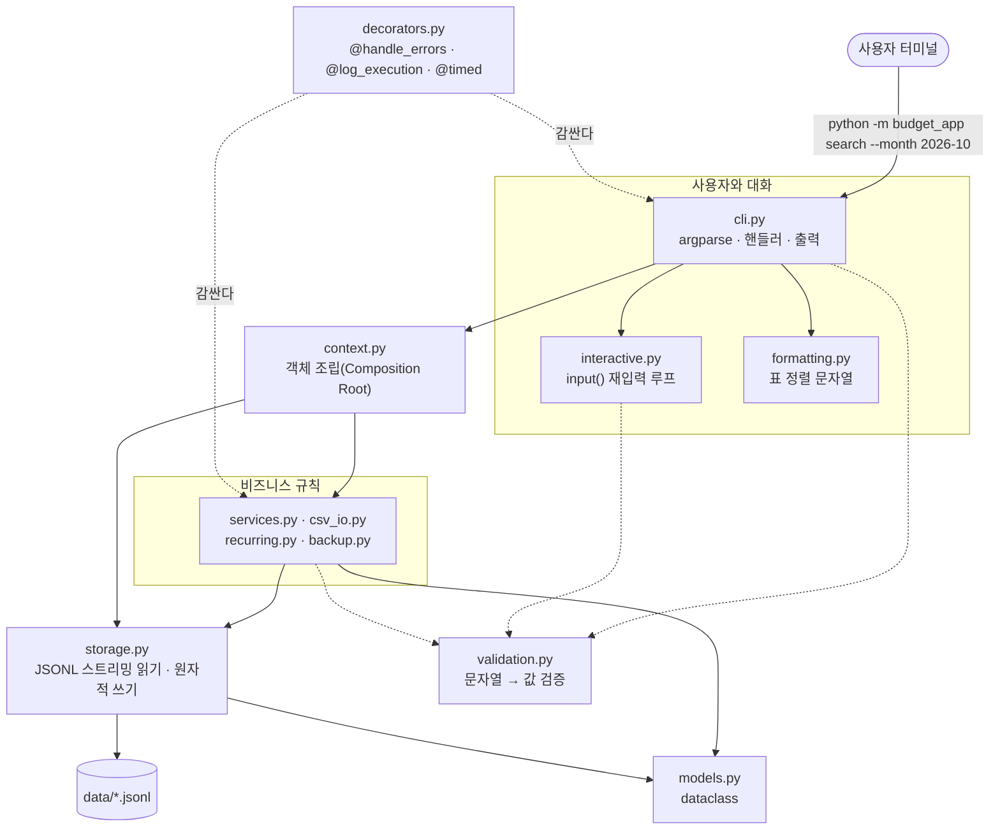

# 학습 가이드: Python 콘솔 가계부로 배우는 "작은 서비스" 설계

이 폴더는 `budget_app`을 교재로 삼아 과제의 학습 목표를 **스스로 설명할 수 있게** 돕는 문서 모음입니다.
각 문서는 짧은 일반 예제로 개념을 설명한 뒤, 이 프로젝트의 실제 코드로 연결하고, 직접 실행해 볼 실습으로 끝납니다.

> 대상 독자: 파이썬 기본 문법(함수, 클래스, 리스트/딕셔너리, `with`, 예외)을 알고,
> "돌아가는 코드"를 넘어 "유지보수할 수 있는 구조"를 배우고 싶은 학습자

## 과제 목표와 문서 대응표

| 과제 목표 (requirement.md 3장) | 먼저 읽을 문서 | 핵심 코드 |
| --- | --- | --- |
| 파일 기반 저장(JSONL/CSV)으로 영구 저장하고, CRUD/검색/요약/입출력을 구현할 수 있다 | [02. 파일 저장소](02-file-storage.md), [07. CSV 가져오기/내보내기](07-csv-import-export.md) | `storage.py`, `csv_io.py` |
| 콘솔 프로그램을 클래스/모듈로 구조화하고, 계층별 책임을 설명할 수 있다 | [01. 계층 구조](01-architecture.md) | `cli.py` → `services.py` → `storage.py` → `models.py` |
| `yield` 기반 제너레이터로 대용량 파일을 스트리밍하는 이유와 동작을 설명할 수 있다 | [03. 제너레이터와 스트리밍](03-generators-streaming.md) | `JsonlFile.iter_raw`, `filter_transactions`, `newest_first` |
| 데코레이터로 공통 관심사(로그/예외/시간 측정)를 분리한 구조와 이유를 설명할 수 있다 | [04. 데코레이터](04-decorators.md) | `decorators.py`, `cli.dispatch` |
| 타입 힌트로 입출력 계약을 명확히 했을 때의 이점을 코드 예로 설명할 수 있다 | [05. 타입 힌트](05-type-hints.md) | `models.py`, `Protocol`, `TypeVar`, `mypy --strict` |

## 추천 학습 순서

1. **[01. 계층 구조와 책임](01-architecture.md)**: 전체 지도를 먼저 봅니다. 명령 하나가 어떤 파일을 거쳐 실행되는지 따라갑니다.
2. **[02. 파일 저장소: JSONL, 원자적 쓰기, 데이터 안전](02-file-storage.md)**: 데이터가 어떻게 저장되고, 왜 깨지지 않는지 봅니다.
3. **[03. 제너레이터와 스트리밍](03-generators-streaming.md)**: `yield`가 메모리를 어떻게 아끼는지 실험으로 확인합니다.
4. **[04. 데코레이터로 공통 관심사 분리](04-decorators.md)**: 예외 처리·로그·시간 측정이 어디로 갔는지 봅니다.
5. **[05. 타입 힌트로 계약 정하기](05-type-hints.md)**: dataclass, Enum, Protocol, Generic, mypy를 다룹니다.
6. **[06. 입력 검증과 오류 처리](06-validation-and-errors.md)**: 원인 + 힌트 메시지, 종료 코드, 재입력 루프를 다룹니다.
7. **[07. CSV 가져오기/내보내기](07-csv-import-export.md)**: csv 모듈, 전부 아니면 전무(all-or-nothing) 가져오기를 다룹니다.
8. **[08. 보너스 기능 해설](08-bonus-features.md)**: 백업/복원, 반복 거래, 표 정렬, 저장 원자성을 다룹니다.
9. **[09. 테스트 전략](09-testing.md)**: 사람 없이 대화형 프로그램을 테스트하는 방법을 다룹니다.
10. **[10. 스스로 점검하기](10-self-check.md)**: 설명 연습 질문, 모범 답안, 확장 과제가 있습니다.

## 실습 준비

모든 실습은 프로젝트 루트에서 실행합니다. 실습용 데이터는 `--data-dir`로 따로 두면 실제 데이터와 섞이지 않습니다.

```bash
python3 -m budget_app --data-dir /tmp/budget-lab import --from examples/sample_transactions.csv
```

```bash
python3 -m budget_app --data-dir /tmp/budget-lab list
```

데이터 파일은 텍스트(JSONL)라서 바로 열어 볼 수 있습니다.

```bash
cat /tmp/budget-lab/transactions.jsonl
```

처음부터 다시 하고 싶으면 폴더를 지우면 됩니다.

```bash
rm -rf /tmp/budget-lab
```

## 한눈에 보는 전체 구조


